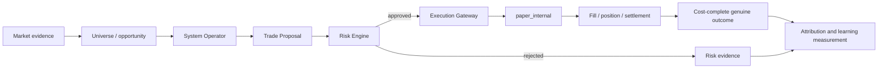

# Aletheia Trading OS

Aletheia is an internal, local-first AI trading system that turns market
evidence into risk-gated decisions, paper execution, cost-complete outcomes,
and measurable learning evidence. The supported core is intentionally narrow:
crypto spot/perpetual with `paper_internal`; live trading and other research
surfaces are outside that core.

The canonical support contracts are [`ACTIVE_RUNTIME_SCOPE.md`](docs/product/ACTIVE_RUNTIME_SCOPE.md)
and [`CAPABILITY_GROUND_TRUTH.md`](docs/product/CAPABILITY_GROUND_TRUTH.md).

## Start here

### Humans

```bash
git clone git@github.com:iridyne/aletheia.git
cd aletheia
uv sync --locked
cd frontend
npm ci
npm run build
cd ..
uv run aletheia install
aletheia gateway start
```

Open `http://127.0.0.1:8787`. Configure providers, credentials, runtime
settings, and any explicit live authority from Dashboard Settings. The install
shim can be rerun after moving the repository or changing shell setup.

Common entry points: `aletheia gateway status`, `aletheia gateway restart`,
`aletheia doctor`, `aletheia observe list`, and `aletheia observe status <observation-id>`.
For shared-runtime operation and recovery, read the [`Runbook`](docs/operations/runbooks/RUNBOOK.md).

### AI agents

Read [`AGENTS.md`](AGENTS.md) before changing anything. It is the mandatory
router for safety boundaries, environment limits, task-specific guides, and PR
lifecycle rules. Determine current behavior from runtime facts, current code,
tests, persisted state, and the two canonical support contracts above; identify
exact commit/runtime provenance when it matters.

## The active trading loop



The System Operator owns entry decisions, Risk approval precedes every
execution, and orders use the Execution Gateway. Learning, research, and
Observation Lab evidence cannot grant trading authority.

## Current support boundary

| Area | Position |
| --- | --- |
| Local runtime, scheduler, market data, dynamic universe | Supported core |
| Opportunity → Operator → Risk → `paper_internal` | Supported core |
| Position lifecycle and cost-complete outcomes | Supported core |
| Observation Lab | Evidence infrastructure; zero trading authority |
| Serenity, equity, prediction-market, exchange-demo paths | Experimental / outside active crypto scope |
| Live execution | Outside Supported core; explicit owner authority required |

The support contracts linked above are authoritative when deeper documents
disagree.

## Development and preview

Use focused tests for narrow changes and the repository CI planning entrypoint
(`scripts/ci_plan.py`) for broader verification. Do not use a local full-suite
`uv run pytest` as the default macOS workflow. For UI-only worktree iteration,
read [`DEVELOPMENT_PREVIEW.md`](docs/operations/development/DEVELOPMENT_PREVIEW.md).
The stable Gateway is `http://127.0.0.1:8787`; worktree frontend HMR is
`http://127.0.0.1:5173`.

## Find the right document

| Need | Read |
| --- | --- |
| Operate, recover, update, or monitor runtime | [`RUNBOOK.md`](docs/operations/runbooks/RUNBOOK.md) |
| Active trading path | [`ACTIVE_RUNTIME_SCOPE.md`](docs/product/ACTIVE_RUNTIME_SCOPE.md) |
| Supported / Implemented / Experimental status | [`CAPABILITY_GROUND_TRUTH.md`](docs/product/CAPABILITY_GROUND_TRUTH.md) |
| AI agent work and routing | [`AGENTS.md`](AGENTS.md) |
| PR review and merge readiness | [`PR_REVIEW_LIFECYCLE.md`](docs/operations/development/agent-guides/PR_REVIEW_LIFECYCLE.md) |
| Human contribution | [`CONTRIBUTING.md`](CONTRIBUTING.md) |
| Subsystem architecture | [`SYSTEM_ARCHITECTURE_GUIDE.md`](docs/design/architecture/SYSTEM_ARCHITECTURE_GUIDE.md) |
| Rolling experiments | [`observation_lab_contract.md`](docs/design/contracts/observation_lab_contract.md) |
| Vulnerability report | [`SECURITY.md`](SECURITY.md) |
