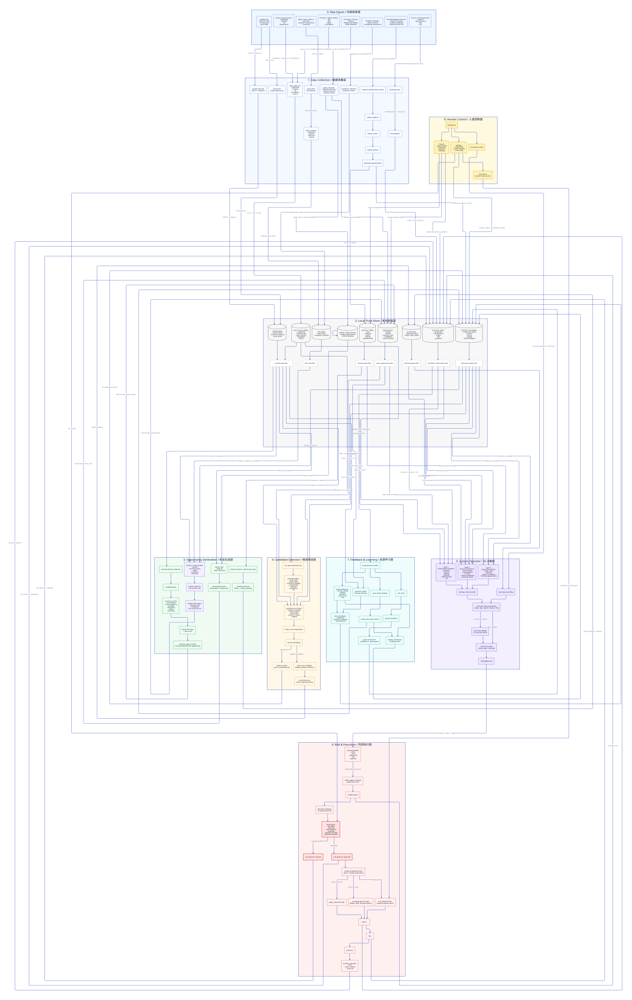
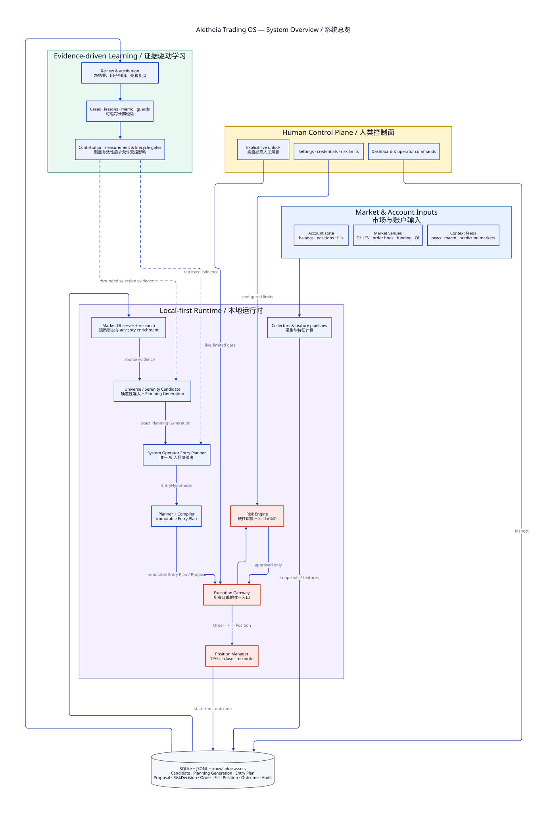
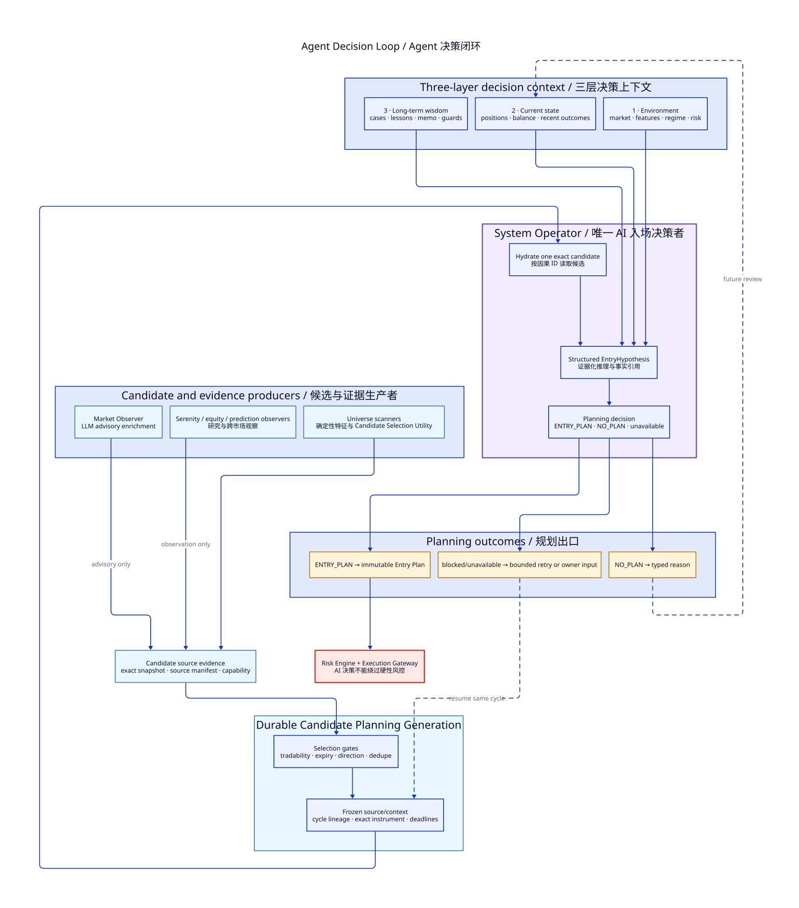
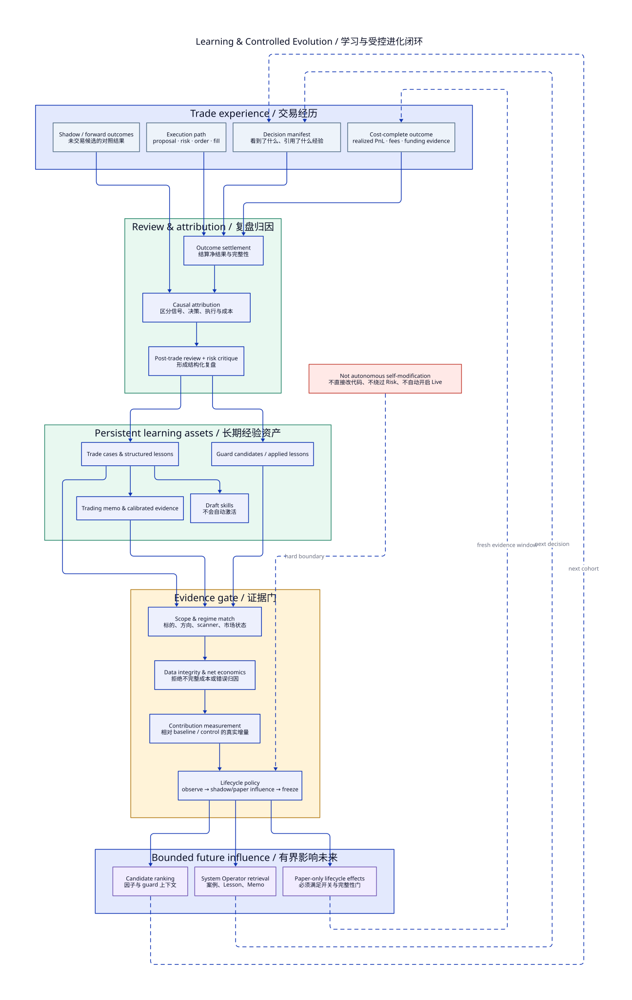
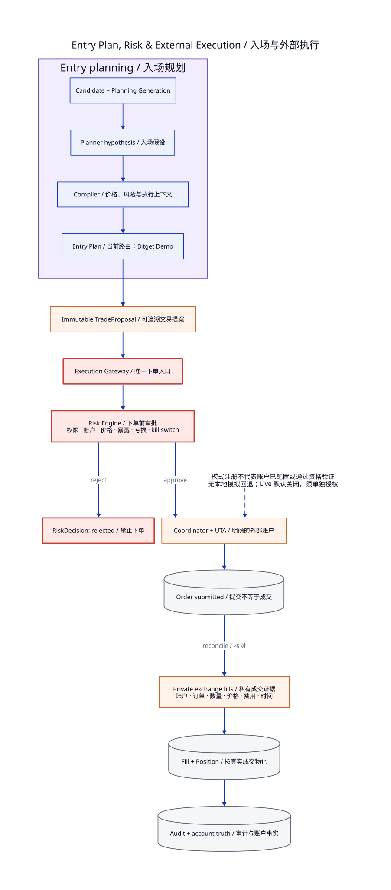
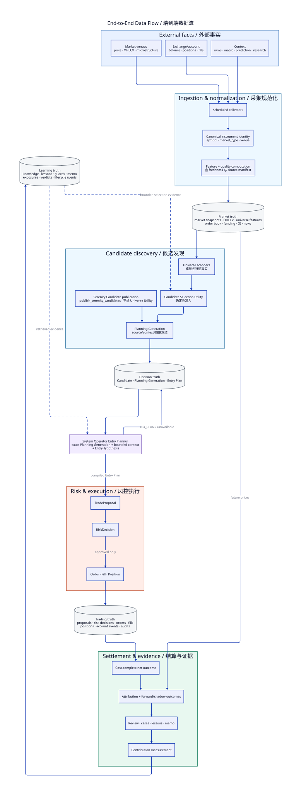

# Aletheia Trading OS

Local-first, file-based, AI-native, self-learning agentic trading system —
paper by default, live only behind an explicit human unlock.

> **Running it unattended?** See **[docs/operations/runbooks/RUNBOOK.md](docs/operations/runbooks/RUNBOOK.md)** —
> going live for paper trading, the brakes, self-upgrade, and health monitoring.
> For the phase-by-phase local runtime hardening plan, see
> **[docs/operations/architecture/STABILITY_TARGET_ARCHITECTURE.md](docs/operations/architecture/STABILITY_TARGET_ARCHITECTURE.md)**.

## For AI agents

If you are an AI agent (Claude, Codex, or any autonomous system) working in
this repo, **read [`AGENTS.md`](AGENTS.md) first** — it is the mandatory root
instruction file, not an optional style guide. When your session is inside
Orca, also run `orca skills get orca-cli` and read
[`docs/operations/development/ORCA_CLI_WORKFLOW.md`](docs/operations/development/ORCA_CLI_WORKFLOW.md)
before any repo-mutating action.

## Quick start (humans)

```bash
uv sync
uv run aletheia-install
aletheia gateway start   # dashboard at http://127.0.0.1:8787
```

`aletheia-install` writes a small reroute command into
[uv's tool bin](https://docs.astral.sh/uv/concepts/tools/) so that `aletheia
...` from any directory delegates back to this checkout's lockfile and virtual
environment. Rerun the installer after moving the clone; if uv reports its
tool bin is not on `PATH`, run `uv tool update-shell` once and open a new shell.

Configure everything (model provider, exchange credentials, agent runtime,
live-trading unlock) **inside the dashboard's Settings page** — full
step-by-step in the runbook. Live trading stays disabled until you explicitly
unlock it.

The CLI is the bootstrap surface only:

```bash
uv run aletheia gateway start | restart | enable-autostart
uv run aletheia doctor    # single source of truth: real local state
```

## Dev preview

For UI-only iteration on a worktree, use Vite HMR on `http://127.0.0.1:5173`
(read-only proxy to the stable `:8787` API by default). Contract, isolated
backend, and Windows commands live in
[Development preview](docs/operations/development/DEVELOPMENT_PREVIEW.md).

## Find your document

| Task | Read |
| --- | --- |
| Run the system, take it live, monitor health | [Runbook](docs/operations/runbooks/RUNBOOK.md) |
| Contribute code or docs (human) | [CONTRIBUTING.md](CONTRIBUTING.md) |
| Contribute code as an AI agent | [AGENTS.md](AGENTS.md) |
| Understand the architecture | [System Architecture Guide](docs/design/architecture/SYSTEM_ARCHITECTURE_GUIDE.md) |
| Report a vulnerability | [SECURITY.md](SECURITY.md) |

AGENTS.md contains the deeper *Read when needed* task-to-document routing.

## Architecture

> **[Open the complete interactive architecture map →](https://iridite.github.io/aletheia/docs/diagrams/interactive/)**
> Drag to pan, use the wheel or pinch to zoom, and double-click to fit. GitHub
> sanitizes executable content inside README Markdown, so the same D2-rendered
> map opens in the repository's GitHub Pages viewer for full interaction.

[](https://iridite.github.io/aletheia/docs/diagrams/interactive/)

Current support truth lives in
[`ACTIVE_RUNTIME_SCOPE.md`](docs/product/ACTIVE_RUNTIME_SCOPE.md) and
[`CAPABILITY_GROUND_TRUTH.md`](docs/product/CAPABILITY_GROUND_TRUTH.md);
the summary below does not widen those contracts.

- Python 3.12 backend (FastAPI + Typer CLI) with an active Bitget crypto
  spot/perpetual evidence path
- Local-first SQLite state plus JSONL/Markdown artifacts; secrets stay in the
  OS keyring or encrypted secret store, never in config or logs
- React/Vite dashboard served from localhost as the primary control surface
- APScheduler and committed-event nudges drive bounded workers; System Operator
  is the sole supported entry-strategy decision maker
- Risk Engine approval always precedes Execution Gateway execution, and every
  causal proposal/risk/order/fill/position link is persisted
- The supported core execution mode is `paper_internal`; external demo/live
  adapters remain outside the Supported core, and live is off by default

### 1. System overview — one durable trading cognition loop



Aletheia is organized around a durable evidence loop, not a sequence of
isolated LLM calls. Market facts, decisions, risk verdicts, fills, outcomes,
reviews, and the learning evidence used by later decisions remain traceable in
local state.

### 2. Agent decision loop — signals advise, the System Operator decides



Universe scanners, observers, and research workers may produce opportunities,
but they cannot place orders. Candidate admission creates a durable
`signal_pending` carrier; the System Operator hydrates that exact candidate,
reads current state and relevant experience, and emits a terminal decision.

### 3. Learning and controlled evolution — experience must earn influence



Closed trades and untraded counterfactuals become reviewable evidence. Cases,
lessons, memos, and guard candidates can affect future ranking or reasoning only
through scope, integrity, contribution-measurement, and lifecycle gates. Draft
skills do not activate themselves, and learning cannot bypass Risk or enable
live trading.

### 4. Execution and risk — every order crosses the same hard boundary



Every `TradeProposal` enters the Execution Gateway and receives a persisted
RiskDecision before routing to paper, exchange-demo, or explicitly unlocked
live execution. Proposal, decision, order, fill, position, settlement, and audit
records retain their causal identity.

### 5. End-to-end data flow — from market facts to net-outcome evidence



The economically important chain is:

```text
market facts → opportunity → decision → risk → execution
             → cost-complete net outcome → attribution → measured learning
```

The [System Architecture Guide](docs/design/architecture/SYSTEM_ARCHITECTURE_GUIDE.md)
contains the deeper subsystem narrative. Editable D2 sources and rendering
instructions live in [docs/diagrams](docs/diagrams/README.md).

## Safety invariants

- Live trading off by default (`live_disabled`); first unlock requires human action
- Agents cannot call restricted tools, modify risk limits, credentials, or the gateway
- Every config, permission, live-state, and trade action writes a JSONL audit event
- API keys are write-only over the API and never returned to the client

## Tests

```bash
uv run pytest    # full local suite; use focused tests during narrow fixes
```
