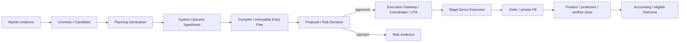

# Aletheia Trading OS

Aletheia is an internal, local-first AI trading system. The accepted Slim
Product is an exchange/provider-agnostic Core, the active Bitget Exchange
Extension, and explicitly configured HTTP Model Endpoints. The currently
declared qualification route is crypto spot/perpetuals on **Bitget Demo**.
This describes the approved boundary, not proof of end-to-end operation,
completed architecture convergence, profitability, or a deployed instance.

For current scope, use the existing authorities:
[`ACTIVE_RUNTIME_SCOPE.md`](docs/product/ACTIVE_RUNTIME_SCOPE.md) is the sole
machine-readable active-admission declaration;
[`CAPABILITY_GROUND_TRUTH.md`](docs/product/CAPABILITY_GROUND_TRUTH.md) owns
capability promises and their evidence limits. This README is a navigation and
setup guide, not a second support registry.

## Start here

### Humans

```bash
git clone git@github.com:iridyne/aletheia.git
cd aletheia
uv sync --locked
cd frontend
npm ci
npm run build
cd ..
uv run aletheia install
aletheia gateway start
```

Open `http://127.0.0.1:8787`. Configure the Bitget Demo account, HTTP Model
Endpoints, and runtime settings from Dashboard Settings. Live is outside the
current supported product; setup does not enable it. The install shim can be
rerun after moving the repository or changing shell setup.

Common entry points: `aletheia gateway status`, `aletheia gateway restart`,
`aletheia doctor`, `aletheia observe list`, and `aletheia observe status <observation-id>`.
For shared-runtime operation and recovery, read the [`Runbook`](docs/operations/runbooks/RUNBOOK.md).

### AI agents

Read [`AGENTS.md`](AGENTS.md) before changing anything. It is the mandatory
router for safety boundaries, environment limits, task-specific guides, and PR
lifecycle rules. Within an owner-authorized task, derive the engineering plan,
relevant failure cases and technical verification without routine approval
handoffs; escalate only at the boundaries defined there. Separate approved
behavior from observed behavior and identify exact commit/runtime provenance
when making implementation or deployment claims.

## The active trading loop



The System Operator remains the entry strategy authority. Risk approval precedes
execution, and exchange mutations pass through the Execution Gateway. This is a
summary of the declared route, not a claim that the entire route has been
qualified. Missing fill or economic evidence remains explicitly unresolved.

## Current declared boundary

OKX/Binance and stock-linked perpetual new-entry support are frozen. Historical
identities and exposure-recovery obligations remain valid. Ordinary equity and
prediction-market execution are outside the active instrument scope; the
separately authorized CN extension remains disabled. The former internal
simulator is [archived](docs/design/history/local_simulated_runtime_scope.md),
not an alternative current execution route.

Research, Observation and Learning are not independent trading authorities.
Their optional/frozen support classification does not remove existing explicitly
owner-gated Learning behavior; the active declaration and relevant Contracts
retain those boundaries. Consult Capability Ground Truth rather than deriving
support from an adapter, a UI control, or a passing test.

## Development and preview

Use focused tests for narrow changes and the repository CI planning entrypoint
(`scripts/ci/ci_plan.py`) for broader verification. Do not use a local full-suite
`uv run pytest` as the default macOS workflow. For UI-only worktree iteration,
read [`DEVELOPMENT_PREVIEW.md`](docs/operations/development/DEVELOPMENT_PREVIEW.md).
The stable Gateway is `http://127.0.0.1:8787`; worktree frontend HMR is
`http://127.0.0.1:5173`.

## Find the right document

| Need | Read |
| --- | --- |
| Operate, recover, update, or monitor runtime | [`RUNBOOK.md`](docs/operations/runbooks/RUNBOOK.md) |
| Active trading path | [`ACTIVE_RUNTIME_SCOPE.md`](docs/product/ACTIVE_RUNTIME_SCOPE.md) |
| Supported / Implemented / Experimental status | [`CAPABILITY_GROUND_TRUTH.md`](docs/product/CAPABILITY_GROUND_TRUTH.md) |
| AI agent work and routing | [`AGENTS.md`](AGENTS.md) |
| PR review and merge readiness | [`PR_REVIEW_LIFECYCLE.md`](docs/operations/development/agent-guides/PR_REVIEW_LIFECYCLE.md) |
| Human contribution | [`CONTRIBUTING.md`](CONTRIBUTING.md) |
| Subsystem architecture | [`SYSTEM_ARCHITECTURE_GUIDE.md`](docs/design/architecture/SYSTEM_ARCHITECTURE_GUIDE.md) |
| Rolling experiments | [`observation_lab_contract.md`](docs/design/contracts/observation_lab_contract.md) |
| Vulnerability report | [`SECURITY.md`](SECURITY.md) |
