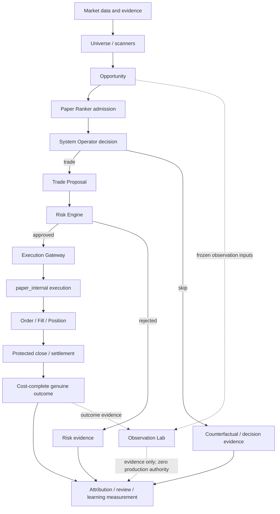
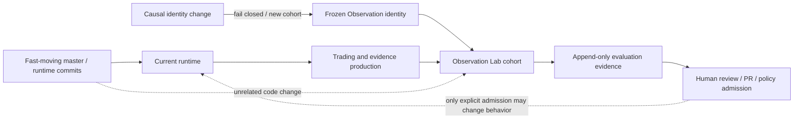

# Aletheia Trading OS

Aletheia is an internal, local-first AI trading system that turns market evidence into **risk-gated trading decisions, paper execution, cost-complete outcomes, and measurable learning evidence**.

The currently supported core is intentionally narrow: **crypto spot/perpetual + `paper_internal`**. Aletheia is not claiming a general live-trading platform, autonomous profit engine, or production support for every research surface that exists in the repository.

| Current truth | Status |
| --- | --- |
| Active market | Crypto spot + perpetual |
| Supported execution | `paper_internal` |
| Entry decision authority | System Operator |
| Risk authority | Risk Engine, mandatory before execution |
| Outcome standard | Causally linked, cost-complete `genuine_outcome` |
| Learning | Measurement is active; behavioral influence is experiment/owner-gated |
| Live trading | Outside the Supported core; off by default |
| Release model | **Rolling update** — current commit and runtime evidence matter more than a product version number |

The canonical support contracts are [`ACTIVE_RUNTIME_SCOPE.md`](docs/product/ACTIVE_RUNTIME_SCOPE.md) and [`CAPABILITY_GROUND_TRUTH.md`](docs/product/CAPABILITY_GROUND_TRUTH.md). This README is orientation, not a broader capability promise.

## Start here

### Humans

```bash
git clone git@github.com:iridyne/aletheia.git
cd aletheia
uv run aletheia-install
aletheia gateway start
```

Open `http://127.0.0.1:8787`. Configure model providers, exchange credentials, runtime settings, and any explicit live authority from the dashboard Settings page.

`aletheia-install` registers a small shim in uv's tool bin so `aletheia ...` can be used from any directory while still executing against this checkout's lockfile and environment. It is safe to rerun after moving the repository or changing shell setup.

Useful commands:

```bash
aletheia gateway status
aletheia gateway restart
aletheia doctor
aletheia observe list
aletheia observe status <observation-id>
```

For the shared operational runtime, unattended operation, recovery, update behavior, and safety procedures, use the [`Runbook`](docs/operations/runbooks/RUNBOOK.md). Do not infer shared-runtime state from a developer checkout.

### AI agents

**Read [`AGENTS.md`](AGENTS.md) before changing anything.** It is the repository-wide instruction router and trust-boundary contract.

When determining what Aletheia *currently* does, use this evidence order:

1. Current runtime facts, latest code, executable tests, and persisted state.
2. [`ACTIVE_RUNTIME_SCOPE.md`](docs/product/ACTIVE_RUNTIME_SCOPE.md) — what is allowed to count as the active trading mainline.
3. [`CAPABILITY_GROUND_TRUTH.md`](docs/product/CAPABILITY_GROUND_TRUTH.md) — Supported / Implemented / Experimental capability status.
4. Design contracts and research documents — intent and architecture, not automatic proof of active behavior.

Do not promote an Experimental capability to Supported because code exists, a page renders, or a test passes. Do not reason about the system from a human-facing version label; identify the exact commit/runtime provenance when behavior matters.

If working through Orca, also run `orca skills get orca-cli` and follow [`ORCA_CLI_WORKFLOW.md`](docs/operations/development/ORCA_CLI_WORKFLOW.md) before repo-mutating actions.

## The active trading loop

Aletheia is built around one durable causal chain. Scanners and research components may create evidence or opportunities, but they do not own execution authority.



Important boundaries:

- The **System Operator** is the only supported native entry-strategy decision maker.
- Every proposal must receive a persisted **Risk Engine** decision before execution.
- Orders reach brokers/exchanges only through the **Execution Gateway**.
- A position counts as a native genuine outcome only when its opportunity → proposal → risk → order → fill → position ancestry and economic settlement are valid.
- Learning, guards, research, and Observation Lab evidence cannot bypass Risk, credentials, or live authority.

For subsystem detail, use the [`System Architecture Guide`](docs/design/architecture/SYSTEM_ARCHITECTURE_GUIDE.md). The larger interactive architecture map remains available at the repository's architecture viewer, but the contracts above take precedence over diagrams.

## Rolling update, not product-version thinking

Aletheia follows a **rolling-update development model**. The project does not use a long-lived human-facing version line to describe what the system can do. `master` evolves continuously, and the meaningful identity of a running system is:

**exact commit + runtime provenance + active runtime scope + capability ground truth**.

Immutable tags or release artifacts may still be used as deployment checkpoints, rollback anchors, or transport identities. They are operational artifacts, not a promise that Aletheia should be understood as a sequence of feature-frozen product versions.

This model is made practical by the **Observation Lab**. Prospective observations freeze the causal identity that matters to an experiment — treatment/control semantics, first-exposure inputs, outcome contract, and evaluation rule — instead of treating every unrelated `master` commit as a new experiment.



The rule is simple: **unrelated runtime churn should not destroy valid evidence; causal changes must create a new evidence identity.** Observation Lab itself has zero production mutation authority.

See [`observation_lab_contract.md`](docs/design/contracts/observation_lab_contract.md) for the executable contract and [`EXPERIMENT_PROTOCOL.md`](docs/product/experiments/EXPERIMENT_PROTOCOL.md) for experiment/admission rules.

## What is Supported vs outside the core

The repository contains more than the supported product surface. That is intentional.

| Area | Current position |
| --- | --- |
| Local runtime, scheduler, market data, dynamic universe | Supported core |
| Opportunity → System Operator → Risk → `paper_internal` | Supported core |
| Position lifecycle, protective close, cost-complete outcome | Supported core |
| PnL, trade attribution, funnel visibility | Supported core |
| Observation Lab | Evidence/experiment infrastructure; zero trading authority |
| Serenity research | Experimental, research-only |
| Equity and prediction-market paths | Experimental / outside active crypto scope |
| Exchange demo execution | Experimental / outside active support proof |
| Live execution | Outside Supported core; explicit owner authority required |
| Learning contribution / persona rollout | Measured and gated; qualification-dependent, not assumed effective |

When this table and a deeper document disagree, the two canonical product contracts named at the top of this README win.

## Safety invariants

- Live trading is off by default and cannot be enabled by an agent learning loop.
- Agents cannot expand their own tool, credential, Risk, Gateway, or live-unlock authority.
- Risk approval always precedes execution.
- Secrets are write-only through supported interfaces and must never be returned, logged, prompted, or committed.
- Trading/config/permission actions are auditable; causal trade identity is persisted across the mainline.
- Experimental evidence may inform review, but it does not silently mutate production behavior.

## Find the right document

| Need | Read |
| --- | --- |
| Operate, recover, update, or monitor the runtime | [`RUNBOOK.md`](docs/operations/runbooks/RUNBOOK.md) |
| Know exactly what the active trading path is | [`ACTIVE_RUNTIME_SCOPE.md`](docs/product/ACTIVE_RUNTIME_SCOPE.md) |
| Know whether a capability is Supported / Implemented / Experimental | [`CAPABILITY_GROUND_TRUTH.md`](docs/product/CAPABILITY_GROUND_TRUTH.md) |
| Work as an AI coding/research agent | [`AGENTS.md`](AGENTS.md) |
| Contribute as a human | [`CONTRIBUTING.md`](CONTRIBUTING.md) |
| Understand subsystem architecture | [`SYSTEM_ARCHITECTURE_GUIDE.md`](docs/design/architecture/SYSTEM_ARCHITECTURE_GUIDE.md) |
| Understand rolling experiments | [`observation_lab_contract.md`](docs/design/contracts/observation_lab_contract.md) |
| Report a vulnerability | [`SECURITY.md`](SECURITY.md) |

`AGENTS.md` contains the deeper task-to-document routing. Load only the guides relevant to the task instead of bulk-reading the repository.

## Development

The backend is Python 3.12 with FastAPI/Typer, local SQLite state and append-only artifacts; the dashboard is React/Vite. The primary control surface is local-first.

```bash
uv run pytest
```

Use focused tests while fixing narrow defects and the repository's CI/spec contracts for trust-boundary changes. For UI-only worktree iteration, see [`DEVELOPMENT_PREVIEW.md`](docs/operations/development/DEVELOPMENT_PREVIEW.md).
