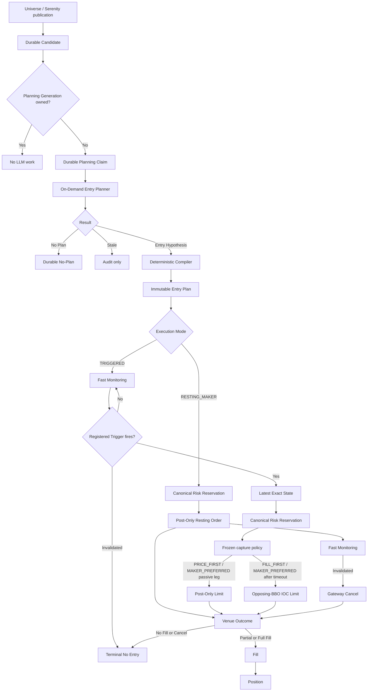

# Decision Lifecycle — superseded contract text

> **History (moved 2026-10-10).** Verbatim text of `docs/design/contracts/decision_lifecycle_contract.md` before
> the golden-standard rewrite (Chinese narrative, Plan field-freeze rules duplicated from the Entry Plan
> contract, unordered `DL-INV-*` list). Provenance only; the current contract is
> [decision_lifecycle_contract.md](../contracts/decision_lifecycle_contract.md). The earlier retired
> entry appendix is in [decision_lifecycle_retired_entry.md](decision_lifecycle_retired_entry.md).

## Former contract (verbatim)

> **角色**:本契约**横切**所有交易子系统,定义一笔交易从机会到复盘的完整脊柱,
> 以及每个**接缝(seam)**的前置/后置条件、守卫位置、与中间载体的字段约定。
> 其他契约**竖切**单个子系统(风控/执行/agent/知识);本契约负责它们之间的交接。
> **不重复**子系统细节 —— 指向已有契约。
> **基线**:本契约描述当前行为;代码与本契约不一致时记为 conformance gap(GitHub Issue),不改写契约迁就缺陷。

---

### 1. 脊柱全景(开仓方向)

Universe 与 Serenity 共同使用以下唯一开仓主路径。`Trigger` 只存在于 `TRIGGERED` 分支，不能为了线性展示而给
`RESTING_MAKER` 合成 Trigger。

Universe 与 Serenity 发布相同 durable Candidate/current PlanningGeneration，不再存在独立
Opportunity producer 的第二条可执行入场线。`universe_members` 是物理表名，不限定来源。
Candidate context 在出生时冻结真实 `source.kind/id/trade_school`、cutoff 与 evidence hash；
source-scoped refresh 不可终结另一来源的 attention，同一 exact venue/symbol/market_type
仍只有一个 current owner。跨来源 active attention/Plan/未决执行冲突为 `instrument_owned`。
Serenity 的研究证据只授权来源，真实 PA/compatible Profile 仍须通过；不冒充 Universe Utility。

当前 Snapshot/Candidate 创建只经 Core repository 的 `publish_candidate_snapshot`：
一次接收来源 snapshot 与对应 members，验证 snapshot identity，并在共享事务/嵌套
savepoint 中原子持久化。分离的 snapshot/member 插入 API 与 `insert_candidate` alias
已删除。Universe refresh 与 Serenity 来源编排保留各自准入和外层原子范围；前者可保留
不可规划的分析 members，后者仍要求整批 theme 回滚。PlanningGeneration 仍只有原有
exact-instrument owner，不因持久化入口收敛而新增执行权限。边界见
[Candidate publication Proposal](../proposals/slim_core_candidate_publication.md)。

具体来源准入、不可变 source 与 timing/holding 分离见
[Entry Plan contract](../contracts/entry-plan-contract.md) 与 [Serenity contract](../contracts/serenity_contract.md)。
Universe 当前 selection 见 [Candidate selection contract](../contracts/candidate_selection_utility_contract.md)；
历史 legacy total score、Ranker、Setup 与 conditional authorization 不是 fallback authority。

当前 analytics 的 `candidate_attention`、`entry_plans`、`planning_history` 和 summary 来自
canonical workbench。旧 ranker/funnel/filter cohort 保留历史含义，只读，不能冒充当前队列。
PiDecision 入场/pending 与 `pi_reflection.json` 是历史，不再认领、恢复或推进新入场；
共享持仓 review/close/reduce/adjust 的原审计继续保留。旧孤儿 claim 不重建 Proposal；
已有订单、未知提交和真实成交由 Gateway reconciliation/cancel/settlement 收口。

> 固定持有期反事实结果遵循 `docs/design/contracts/opportunity_outcome_contract.md`。历史 gross-only 行、
> 永续缺 funding、方向未知或过晚 ticker 只能用于解释，不得进入自动学习。

> 入场事实不再经 `pi_decisions` 交汇；监管与持仓审计不授予入场权限。
> 平仓/退出脊柱见 [`execution_contract.md §10`](../contracts/execution_contract.md)。

---

### 2. 中间载体契约

跨子系统传递的数据结构,其字段语义在此固定(此前只活在代码里):

#### 2.1 历史 Opportunity 载体

旧 Ranker / `paper_trader` / PiDecision 入场路径写下的 Opportunity、`signal_pending` 与 admission slot 字段只读，其原定义见 [退役入场生命周期](decision_lifecycle_retired_entry.md)。

#### 2.1a Candidate Planning Generation 与 Entry Plan

携带有效 typed Candidate opportunity context 的新 Candidate 只进入一个 canonical
Context → Hypothesis → Compiler → Entry Plan 实现。当前 writer 不写 Candidate、Planner、
Hypothesis、Profile、TriggerSpec 或 Plan 的 numeric format label；历史 numeric label
只读保留且不能选择当前行为。当前兼容与复用由 schema/behavior fingerprint 决定。
其 ownership identity 由 exact instrument、Opportunity mechanism/direction、
Candidate-selection policy/epoch 与 mechanism identity 组成；family、rank、score、
Utility、price 与普通 snapshot churn 不进入身份。机制或 policy epoch 变化会保留并
supersede 旧 generation，同时 fail-closed 终结旧的 pre-order Entry Plan。

`candidate_planning_generations` 以 planning thread 与递增 `cycle_number` 建立耐久生命周期。
每周期最多一个 planning owner；经济性 No-Plan 在相同 frozen material input 下耐久。Runtime/config/
capability block 在同一周期恢复且不算 No-Plan；validation/compiler failure 也不进入经济学习分母。
Plan expiry 仅在后续完成的来源 requalification、更新 source cutoff 且无未决 Order/Fill/Position
时创建下一周期。模型返回必须 CAS 当前周期；stale result 可审计但不可激活。
相同发现身份不代表相同 PA 材料：终态且无 Plan 的周期，可凭更新的已确认 15m 结构证明建立一次 successor。
未调用模型的缺失盘口/必需上下文终态，须有新闭合窗口及终态后的真实新鲜盘口恢复证明；不能清零旧尝试或刷新旧冻结输入。
证明在 publication 写事务前准备，事务内重验 source/snapshot、current owner、behavior/schema 与未决执行；
普通新 bar、时间、价格、排名变化不重开。材料边界及持久归属见 [Entry Plan contract](../contracts/entry-plan-contract.md#contract-identity-and-planning-cycles)。

缺少 registry/frozen-context Profile 是 runtime_preflight 非经济 block。依赖缺失
或 backpressure 仅退还当前未 dispatch 尝试并记录 planning_unavailable。dispatch
后取消保留尝试，以 PLANNER_CANCELLED_DISPATCH_UNKNOWN 进入既有有界 defer，
不伪造物理调用或 model_skipped。dispatch 前取消用 shield/CAS 只释放本 owner
claim；调用事实单调保留，经济 NO_PLAN 不因数据恢复重开。

**Candidate business progress (accepted 2026-09-05)**

`get_candidate_path_progress()` is a read-only SQLite snapshot over scanner
metrics, exact active/current supported planning, watchable Plan readiness, and
current frozen-epoch selection plus exact `entry-fill:<id>` 4h outcome debt. It
does not evaluate qualification or load provider/model data. Historical process
IDs never remove current debt. Other epochs and unrelated outcome keys do not
enter the count. A pending scanner capture with its committed batch is projected
as captured without repairing scanner JSON. Missing identities/clocks remain
unavailable, not an empty or successful queue. Per-outcome provider defer reasons
are not durably stored by the existing settler: report settlement reason unavailable,
not an invented provider diagnosis.

The background health job replaces one cache before `compute_health`; Workbench
reads that same cache. It includes generated time/age, attempt/success/snapshot
watermarks, policy/epoch, selection/support/observe-only and reason counts, ready
planning count/oldest time, expired claims, due outcome count/oldest due, and bounded
issues. Cache TTL is twice the actual health job interval (default 1200 seconds).
Unconfigured/paused health job, failed or missing/expired cache means unavailable;
Universe disabled or deliberate runtime pause is explicitly non-applicable.

With Universe enabled and scheduler running, latest failed refresh degrades at
the next sample. Last success older than twice refresh interval plus 600 seconds
is stalled; a new process without success initializes only until that bound.
Supported ready work uses pending created_at, unavailable retry_not_before, or
expired claim_expires_at, never updated_at. Ready work older than 480 seconds,
or an expired lease older than 180 seconds, is stalled. Due pending 4h outcomes
older than 900 seconds are a backlog, not proof of deadlock or economic failure.
Normal empty/observe-only selection, future retries, capability blocks, economic
NO_PLAN and natural Trigger/Fill waits are not stalls.

Only `candidate_refresh_failed`, `candidate_refresh_stalled`,
`candidate_planning_stalled`, and `candidate_outcome_backlog` degrade business
health; unavailable probes initialize. All are alert-only: no self-heal restart,
Live/Risk/Gateway change, rescheduling, admission or rewritten due_at.

`entry_plans` 是唯一 active plan ledger。不可变 JSON 固定 instrument、generation、方向、thesis、
source_kind/source_id/trade_school/holding_horizon_hours、execution mode、注册 TriggerSpec、
entry/invalidation/stop/target/timing horizon、风险上限、order tactic、
maker/taker 权限、timeout/fallback、expiry 和 behavior identity；状态只可单调前进。Momentum 的
breakout/pullback/reclaim 只在 versioned `TriggerSpec.params` 中，不能成为通用 Entry Plan 字段。

Candidate 精确详情与 Planning History 必须按同一 soft/hard attention deadline 投影即时有效状态：
hard deadline 已过时为 `max_attention_age`，否则 soft deadline 已过时为 `ttl_expired`。该读投影不得
写 planning generation，也不得改变 Entry Plan、Order 或其有效性；耐久终态仍只由 canonical expiry
reconciliation 写入。

逻辑机会仅是现有账本的只读关联，不增加 Opportunity ID/表/调度器/总状态。
共享批量 snapshot reader 以 exact Plan→Proposal/Order→Fill→Position 及
Position→close Order→close Fill 读取执行事实；冲突、缺失或多义为 unavailable，
不按 symbol/time 猜测。cycles 保留原 Candidate/input/hash/Plan，列表不得逐 cycle
重复查询。attention、planning、execution、economics 并列显示；attention 终态
不覆盖已激活执行。零成交确认终态为 NO_FILL，Fill 缺 Position 为 UNAVAILABLE，
open Position 优先于 entry 余单；closed 仍须区别成本待结算、terminal exclusion
和已完成。归档模拟关闭仍按既有只读经济一致性规则读取，GET 不补写；
其历史规则见[归档账户定义](local_paper_account_controls.md)。Position realized economics 与
entry-fill:<fill_id> 的固定四小时 Entry outcome 分离，不以选择 T0 forward return
冒充开仓结果。所有开平仓仍由既有 Risk/Gateway/Position/accounting owner 执行。
当前外部执行保留不可变 Proposal 的请求数量；Risk 批准数量必须与 Order
执行数量一致且不得超过请求。只有 filled 或 cancelled 终态 Entry Order
可计入关闭账本；filled 的成交量必须等于执行数量，cancelled 只计真实已成交量，
余单不构成敞口。全部精确 Fills 的数量及成本仍须与 Position 对齐。

#### 2.2 当前入场/持仓边界

EntryPlan 的 timing `expected_horizon_hours`（INTRADAY 4h、SWING 24h）与
60/240 分钟 entry expiry 不决定 Serenity 持仓期限。Compiler 冻结正有限
`holding_horizon_hours`：short_term 等于 timing，Serenity 等于当次 max_hold_days×24。
Proposal.expected_horizon_hours 接收 holding，source/school 通过 attribution 与 Serenity
opportunity_id 穿透到 Position 和关仓反馈。90 天研究可用 24h 择时、4h entry expiry，
成交后仍为 2160h holding；PA invalidation 不能冒充持仓到期。Risk 验证冻结 Plan，
止损使用最终真实结构并重新约束仓位，不借 Serenity 配置覆盖有效 stop。

#### 2.4 Filter Evidence（评估旁路）

- `filter_decision_batches` 保存 ticker/tradability 等高频无方向门；必须保存本次扫描的全部候选，不得抽样。
- `filter_decisions` 保存已有方向的 Observer、Ranker、System Operator 和 Risk 逐关事实，到首个拒绝停止。
- `filter_candidate_outcomes` 按候选共享一份目标市场净结果，不按筛选关重复结算。
- Risk 证据必须在 authoritative `RiskDecision` 的同一事务内写入；任一 evidence 失败整体回滚，preflight 不写最终候选 evidence。
- 旧 Observer/Ranker/System Operator evidence 是只读历史；新 Planner/Compiler 与 Risk
  事实按其真实 owner 写入，不从最终状态倒推旧漏斗，也不创建入场 PiDecision。

完整定义见 `docs/design/contracts/filter_evidence_contract.md`。

---

### 3. 接缝守卫表

| 接缝 | writer | consumer | 关键不变量 | 守卫/spec |
|------|--------|----------|-----------|-----------|
| Candidate publication | Core `publish_candidate_snapshot`；Universe / Serenity 来源编排 | current PlanningGeneration | source/hash 出生冻结、exact instrument 单一 owner、原子 publication | entry-plan-contract / Serenity §7 |
| Planning→Plan | Entry Planner / Compiler | Plan execution / watcher | immutable input、CAS、typed unavailable/no-plan、真实 Profile | entry-plan-contract |
| Plan→Proposal | canonical entry_plan_execution | Risk / Gateway | source/school/holding 一致、唯一 Plan lineage、不可复活旧 pending | entry-plan-contract |
| 提案→风控 | `gateway.py` | `risk/engine.py` 的 `evaluate_proposal` | `_eval_lock` 串行;每提案恰评估一次;`approved=False` 不执行 | risk_engine_contract / spec_pipeline_risk_gate |
| 平仓脊柱 | — | — | 见 `execution_contract §10`(退出触发器优先级 / paused 不挡平仓) | PL-PM-01~07 |
| 筛选证据 | 各关原 writer | filter controller / doctor | 事前输入+参数版本；无方向不生成可学习净结果；authoritative Risk evidence 与 RiskDecision 原子提交 | filter_evidence_contract / spec_filter_evidence |

---

### 4. 当前不变量

- **DL-INV-1 单一开仓决策权**:所有 Universe/Serenity 新入场只经 current PlanningGeneration → Planner → Hypothesis → Compiler → EntryPlan execution/watcher → Risk → Gateway；无独立 producer/evaluator/compatibility adapter。
- **DL-INV-4 归因不可改写**:Candidate source context 出生冻结；Plan 冻结 source_kind/source_id/trade_school/holding_horizon_hours；Proposal 与 Position 保留真实研究 ID、school 和 holding，不能按 symbol 猜来源。
- **DL-INV-11 耐久所有权后唤醒**:两来源只唤醒 canonical planning 工作；idle/unavailable 不调用旧 evaluator。重复唤醒由同一 claim/retry/CAS 收口，不重建 pending 或 PiDecision。
- **DL-INV-19 中断可恢复**:旧无 Proposal claim 只读退休，不补造 Proposal。未提交旧 authority 的退休必须保留 entry_path_retired 审计；已有执行 owner/Order 或未知提交不得被迁移伪造终态。
- **DL-INV-20 入场与持仓动作分面**:共享 portfolio review/close/reduce/adjust 与持仓审计保留；明确 Position identity 不可借来创建新入场。horizon 到期只能有效延长或关闭，不以无效 hold 完成复核。
- **DL-INV-27 来源所有权**:source-scoped snapshot/attention 与全局 exact instrument current owner 同时成立；Universe 不驱逐 Serenity，Serenity 不抢占 Universe。新来源证据必须重新准入，旧 pending 不是批准。
- **DL-INV-7 筛选事实不反推**:放行/拒绝必须在当次评估时记录，不得从最终 opportunity/proposal 状态倒推中间关卡。
- **DL-INV-8 无方向不学收益**:无事前 `long/short` 时只衡量能力和覆盖，禁止事后选最赚方向。
- **DL-INV-30 TriggerSpec 权限**:EntryHypothesis 只能选择 registry Profile；Compiler 固定 TriggerSpec id/version 与 bounded params；Fast Monitoring 不解释模型 prose。新增 Trigger economics/threshold 必须走经济研究权限，不能借 lifecycle refactor 上线。
- **DL-INV-31 Fast Monitoring 精确场地与新鲜度**:Trigger 与 Order Intent 必须使用 Entry Plan 同一 `venue + symbol + market_type` 的已确认订阅和 latest exact state；stale quote/depth/trade、sequence 异常、越出 envelope 或 adapter 不可用均 fail closed，禁止跨 venue 或 REST 热替代。
- **DL-INV-32 单次执行与真实 tactic**:Entry Plan 与 Proposal/Order 唯一约束禁止 duplicate execute。Maker 必须为 true Post-Only；Urgent 默认 opposing-BBO IOC Limit 且不得越过 plan envelope；plain GTC Limit 不得标 Maker。成交只接受匹配账户的私有 Fill 证据；已退役模拟撮合不构成当前 tactic。
- **DL-INV-33 Entry Plan 不可变与单调**:plan JSON/hash 与 planning generation 不可改写；status 只可前进。rank/score/snapshot refresh 不终结 plan；只有 structural invalidation、incompatible new generation、expiry、permission/pause/kill-switch、Risk revocation、execution completion 或 manual cancel 可终结，终态不得 revive。
- **DL-INV-34 Gateway 撤单与 Fill 优先**:Fast Monitoring 只决定 invalidation 并向 Gateway 请求 cancel；Gateway 才可调用 broker/adapter。网络调用后必须重查 private Fill/Order facts。完整 Fill 赢得 cancel race；partial fill 保留真实 Position 并只取消 remainder，不得因 cancel acknowledgement 覆盖经济事实或升级为 Taker。
- **DL-INV-38 Planner admission 与抢占**:普通 Candidate batch 只能占用 broker 可用的 normal-priority capacity，local backpressure 或 portfolio wake 抢占不得消费物理 model attempt。父 batch 返回前必须 cancel-and-await 全部 child task；urgent portfolio wake 立即跳过普通 cooldown，同时仍只有一个 Operator authority。
- **DL-INV-39 Entry market evidence 双时钟**:RESTING_MAKER 与 TRIGGERED 执行均须验证并持久化同一 exact quote 的 exchange/source time 与 local receive time。任一时间旧、未来、无时区或不可解析均不得进入 Risk/Gateway；subscription 尚未确认或 generation 已重置时，旧 rolling evidence 不可复用。
- **DL-INV-40 IOC 与 maker remainder 收敛**:Opposing-BBO IOC 的 cumulative Fill 与 remainder terminal state 是独立事实；零 Fill terminal 为 cancelled，partial Fill 先物化 Position 后仅 terminalize remainder，完整 Fill 为 filled，重启必须幂等。任何实际 `POST_ONLY_LIMIT`（包括 TRIGGERED 后释放者）都从真实 Order lifetime 执行 `max_wait_sec`，且 invalidation 必须严格位于所有允许 entry reference 的保护侧。
- **DL-INV-41 post-submit Plan integrity**:Entry Plan 在 `ordered/partially_filled` 后即使 JSON/hash 损坏，也不得丢失外部 Order ownership；只能使用耐久 Plan↔Order identity 进入 canonical Gateway cancel/reconcile，保留 partial Fill 与原始 integrity reason。证据不完整保持 retry-suppressing unresolved state。
- **DL-INV-42 Mechanism-aware planning authority**:current PlanningGeneration 的 mechanism、direction、selection policy/epoch 与 mechanism version 必须与当前 typed Candidate context/hash 一致。Fast Monitoring 与 Order Intent creation 在任何 pre-order side effect 前复核该身份；不一致则终结旧 Plan，且撤单仍只能经 Gateway。
- **DL-INV-35 Price Action 权限隔离**:`market-structure/v2` 只可将同一 [Market Structure Derived Data Contract](../contracts/market_structure_contract.md) 的连续、已收盘、同 venue 1m 因果事实投影成 append-only Shadow assessment；历史 v1 行保持不可变。BOS/CHoCH 不得改变 Opportunity、Risk 或 Execution。hard-gate consumer seam 必须对未批准版本及 unavailable 结果 fail closed，生产 allowlist 为空。
- **DL-INV-36 Universe instrument background**:每个进入 feature/scanner 的 registry 标的必须携带完整的 `instrument-background/v1`，并解析到一个明确支持的 analysis context。当前产品只有 crypto context：venue 标为真实世界资产的永续（`isRwa`）被 registry 拉黑，代码中残留的 `stock_linked_perp` context 因此在主线不可达，不构成支持声明。Candidate publication 将同一 background 与 applicability 冻结进 typed context；缺失、冲突、未解析或无受支持 context 均 fail closed，完整 equity 身份本身不是拒绝理由。
- **DL-INV-37 Candidate planning priority**:稀缺 Entry Planner capacity 必须先 claim 当前 `last_candidate_id` 所指向的最低 Candidate rank；每轮可用 3–15 个并发 worker 依次完成 CAS claim 后并行规划，且每个 generation 仍只有一个 owner。rank 只决定调度顺序，不进入 planning identity 或经济权限。exact rank 不可用时稳定回退 generation `created_at`、再 `id`，不得随机排序或因 rank/score churn 创建重复 LLM work。
- **DL-INV-29 Funding 符号固定**:正 funding 是 longs pay shorts / long crowding，支持 contrarian short；负 funding 是 shorts pay longs / short crowding，支持 contrarian long 并反对 short。语义改变必须轮换 policy epoch。

---

### 5. 验证边界

当前行为聚焦于 `tests/test_entry_planner.py`、`tests/test_entry_plan_execution.py`、
`tests/test_entry_lifecycle_cutover.py`、`tests/test_candidate_opportunity_persistence.py`、
`tests/test_serenity_routes.py` 和 `tests/test_pi_daemon.py`。文档同步不表示这些测试已在此执行，
也不表示 Fedora 已部署或账户已获资格。
