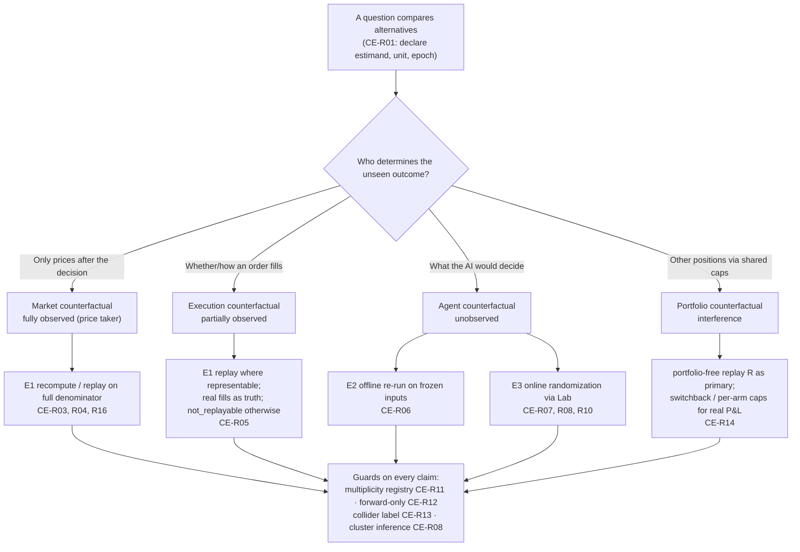

# 0002 — Causal inference and counterfactual evidence: design

Answers [spec.md](spec.md). Every section cites the requirement ids it serves.

## Overview

The first question for any comparison is **who decides the outcome we did not see** (CE-R02):

Consequences:

- Selection rules, admission gates and exit rules are market counterfactuals: their value is
  computed exactly from the full-denominator ledger or replay. Their real risk is
  **overfitting and drift**, not confounding — hence the registry (CE-R11) and forward-only
  confirmation (CE-R12), not propensity models.
- Randomization is needed only where the AI is the policy (Playbook, prompts, models) or where
  realised P&L across arms is claimed.
- OPE (IPS/DR/RDD) has no current valid use: logged decisions are deterministic gates or LLM
  calls without logged propensities.

## Data model

| Table | Content | Requirements |
|---|---|---|
| `filter_candidate_outcomes` (existing) | full-denominator fixed-horizon outcomes, both directions | CE-R03 |
| `causal_claims` (new, append-only) | claim id, estimand, class, rung, unit, epoch scope, registry id, method version, producer, created_at, verdict | CE-R01 |
| `hypothesis_registry` (new, append-only) | registry id, family (gate/exit/selection/playbook/prompt), definition hash, registered_at; count per family drives the adjusted threshold | CE-R11, R12 |
| Observation Lab tables (existing) | manifests, assignments, receipts; add SRM result to evaluations | CE-R07 |
| `decision_labels` (spec 0001) | judgment/system R per decision, reused for CE-R15/R16 | CE-R15, R16 |

`shadow_trades`, Twin and relative-rank tables stay as history; their readers are deleted (CE-R17).

## Components and flow

### Market and execution evidence (CE-R02–R05, R16)

- `signal_replay.py` is the only bar-level replay; `momentum_geometry_replay`,
  `profit_loop_counterfactual` and sizing replays call it for any fill/exit computation.
- Gate value: compiled plans rejected by a gate are replayed (spec 0001 judgment labels) and
  compared with zero; exit value: positions' paths replayed with and without the exit rule.
- Fidelity: replay vs real fill per `order_tactic`, reported with each E1 execution claim.

### Agent evidence (CE-R06, R07, R10, R15)

- Offline: frozen `EntryAnalysisContext` after the model's knowledge cutoff, pinned model, K
  samples per input; variance reported; costs charged (spec 0001 LL-R22).
- Online: Observation Lab hash assignment only (one function, `manifest.resolve_treatment`);
  unit = planning thread or time block; SRM check per evaluation; strata by model identity.
- AI value report: per stratum, judgment R of AI plans vs a random-direction baseline
  (`random_entry_baseline`) and a deterministic mechanism rule on the same candidates.

### One inference module (CE-R08, R09)

`core/aletheia/analytics/inference.py` holds the single implementations of: cluster/block
bootstrap interval, conditional randomization test (moved from `learning/verdicts.py`),
mixture-martingale e-process / confidence sequence, shrunk mean, percentile, and pre-assignment
regression adjustment. All callers migrate; the duplicates are deleted.

### Claims and registry (CE-R01, R11–R13, R18)

- Producers write a `causal_claims` row with their output; display surfaces read class/rung
  from it and label E0 as association and conditioned estimates as conditional.
- Before any rule/variant is evaluated it is registered; promotion uses e-BH (or a deflated
  threshold) over the family count; confirmation data must postdate registration.
- Naming review applies CE-R18 to new tables/modules.

## Failure semantics

| Failure | Result |
|---|---|
| Missing declaration | claim not shown as evidence |
| Bars unavailable / tactic unrepresentable | `unavailable` / `not_replayable`, counted |
| SRM breach | evaluation invalid until explained |
| Unregistered variant | cannot be promoted |
| Confirmation overlaps discovery | confirmation invalid |
| Epoch change mid-experiment | new stratum; old arms frozen |

## Trust and complexity review

- No authority is added; claims stay evidence. Candidate Selection Utility keeps its authority,
  now labelled E1 with forward-only confirmation.
- Deletions (CE-R17): shadow_trades calibration/propensity/estimators/advisories (1,306 LOC),
  Twin/relative-rank prospective builders and assignment functions (evaluators kept while the
  alpha-attribution report reads them; the Twin table stays because Candidate Selection Utility
  writes it), exit breakeven reader, contribution aggregator, duplicate helpers.
- Two small new tables replace scattered, inconsistent status prose.
- Why not smaller: fixing only the documents leaves five interval implementations and the IID
  bootstrap on overlapping outcomes, which mis-states every filter verdict.

## Alternatives considered

| Alternative | Why not |
|---|---|
| Keep upgrading OPE (propensity → DR → causal forest, roadmap #527–#532) | answers a zero-by-construction question for a price taker; positivity fails at deterministic gates ([Sachdeva et al.](https://arxiv.org/abs/2006.09438)) |
| Randomized holdout for Universe selection | unnecessary for a market counterfactual with a full-denominator ledger; costs opportunities |
| IID bootstrap everywhere | invalid under overlapping/clustered outcomes ([Abadie et al.](https://arxiv.org/abs/1710.02926)) |
| Fixed-n tests with repeated peeking | inflates false positives; use always-valid inference ([Johari et al.](https://arxiv.org/abs/1512.04922), [Ramdas et al.](https://arxiv.org/abs/2210.01948)) |
| Per-trade A/B on realised P&L | SUTVA violation via shared caps; use switchback ([Bojinov et al.](https://arxiv.org/abs/2009.00148)) or per-arm budgets ([Liu et al.](https://arxiv.org/abs/2012.08724)) |
| Association-only factor research | "likely false" without causal structure and falsification ([López de Prado, *Causal Factor Investing*](https://doi.org/10.1017/9781009397315)); multiple-testing hurdle ([Harvey, Liu & Zhu](https://www.nber.org/papers/w20592)) |
| Replaying LLM decisions once | nondeterministic even at temperature 0 ([Thinking Machines](https://thinkingmachines.ai/blog/defeating-nondeterminism-in-llm-inference/)); look-ahead via training data ([Glasserman & Lin](https://arxiv.org/abs/2309.17322)) |

## Traceability

| Requirement | Design section | Verification | Evidence type |
|---|---|---|---|
| CE-R01 | Claims and registry | `tests/specs/spec_causal_evidence.py::CE-R01` | deterministic test |
| CE-R02 | Overview; Market and execution | `::CE-R02` IPS/DR on deterministic gate rejected | deterministic test |
| CE-R03 | Data model | `::CE-R03` unselected candidate settled; missing bars unavailable | deterministic test |
| CE-R04 | Market and execution | `::CE-R04` no second bar-level fill loop | structural test |
| CE-R05 | Market and execution | `::CE-R05` Post-Only through market → no fill | deterministic test |
| CE-R06 | Agent evidence | `::CE-R06` pre-cutoff inputs excluded | deterministic test |
| CE-R07 | Agent evidence | `::CE-R07` SRM breach invalidates | deterministic test |
| CE-R08 | One inference module | `::CE-R08` cluster unit used; no IID on overlap | deterministic test |
| CE-R09 | One inference module | `::CE-R09` post-assignment covariate rejected | deterministic test |
| CE-R10 | Agent evidence | `::CE-R10` epoch change starts stratum | deterministic test |
| CE-R11 | Claims and registry | `::CE-R11` threshold uses family count | deterministic test |
| CE-R12 | Claims and registry | `::CE-R12` overlapping confirmation invalid | deterministic test |
| CE-R13 | Claims and registry | `::CE-R13` conditional label | deterministic test |
| CE-R14 | Overview | `::CE-R14` arm comparison uses replay R | deterministic test |
| CE-R15 | Agent evidence | `::CE-R15` report requires both baselines | deterministic test + runtime report |
| CE-R16 | Market and execution | `::CE-R16` gate value from replay | deterministic test |
| CE-R17 | Trust and complexity review | `::CE-R17` no producer without writer/consumer | structural test |
| CE-R18 | Claims and registry | review rule + `check_docs` term list | documentation check |

## Rollout and rollback

- Dependencies: verify runtime authority fact (open question) → delete dead/frozen stack and
  duplicate helpers (no behavior change) → single inference module with callers migrated →
  claims/registry tables → AI value baselines and gate/exit replay reports (need spec 0001
  judgment labels).
- Deletions are code-only; history tables remain. Rollback of a deletion is a revert; no data
  migration is reversed.
- Spec 0001 measurement (LL-R16–R18) follows this spec's inference and interference rules.
