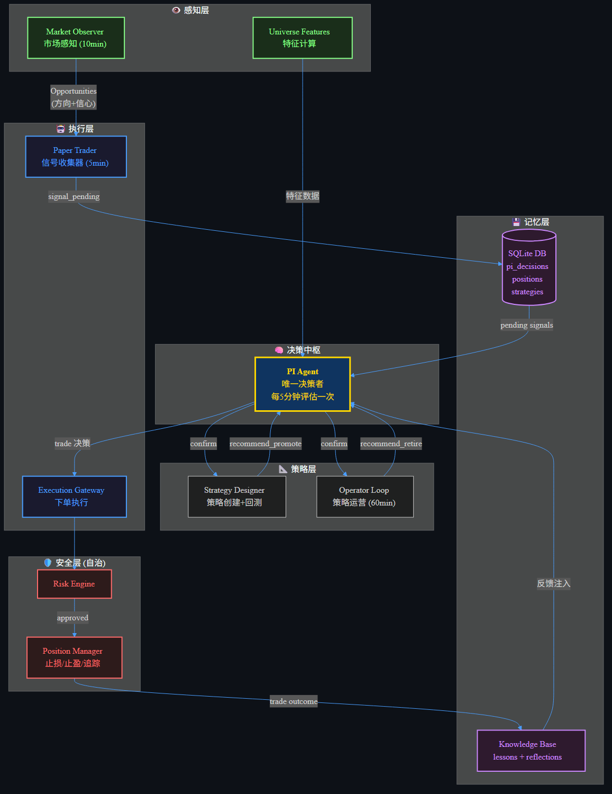
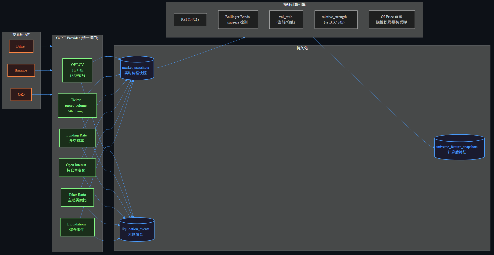
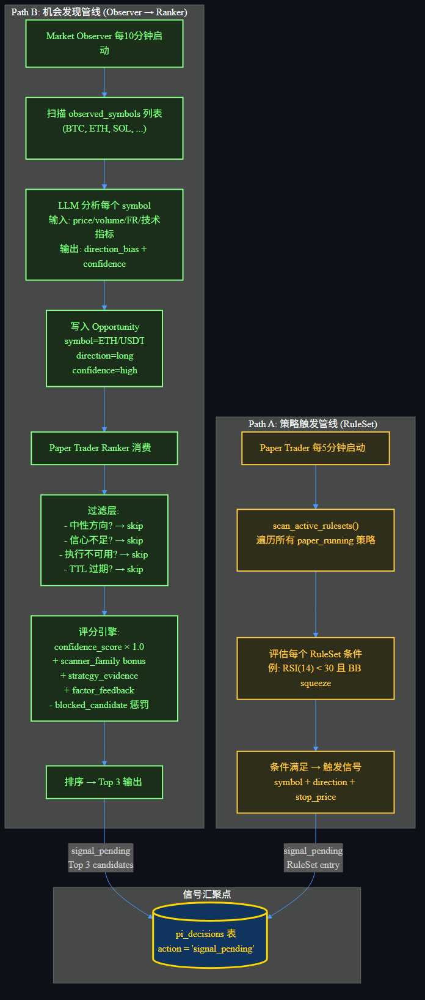
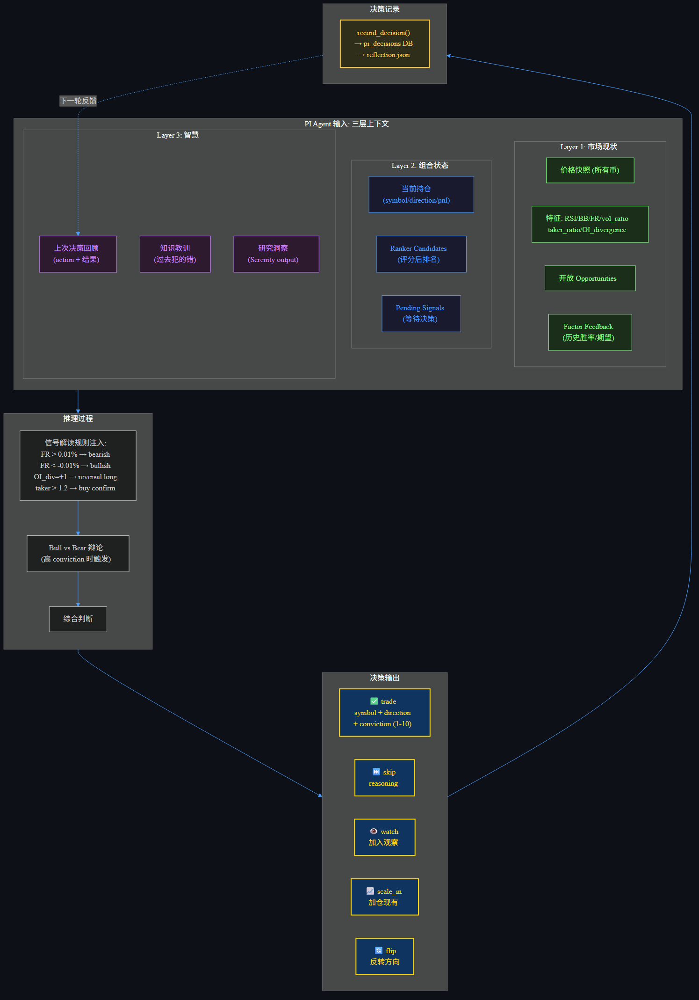
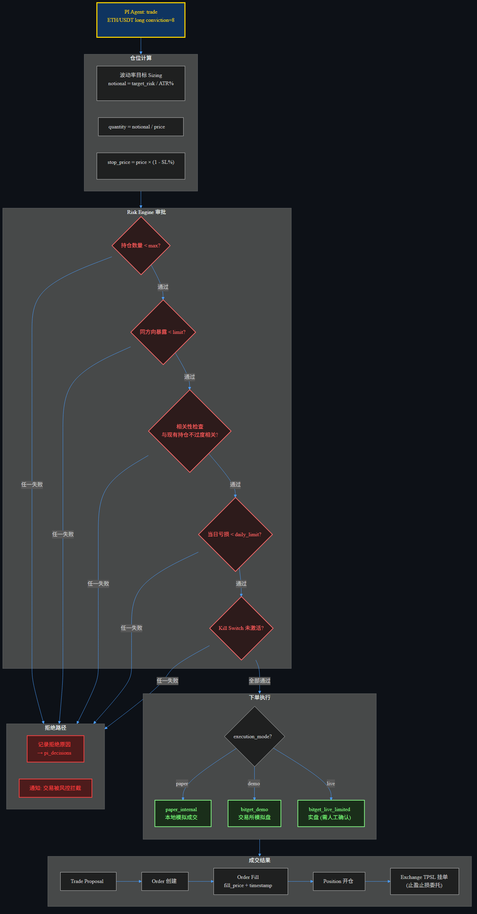
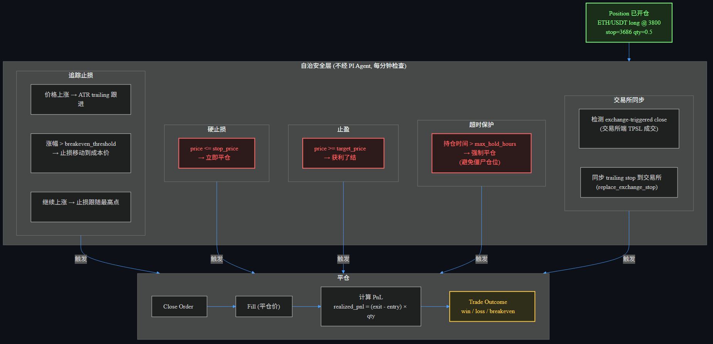
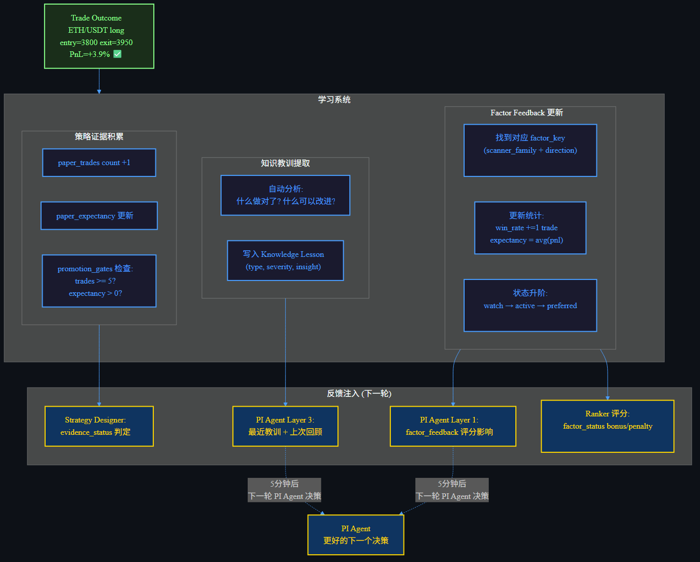
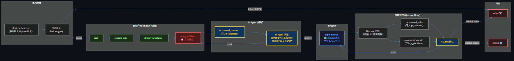
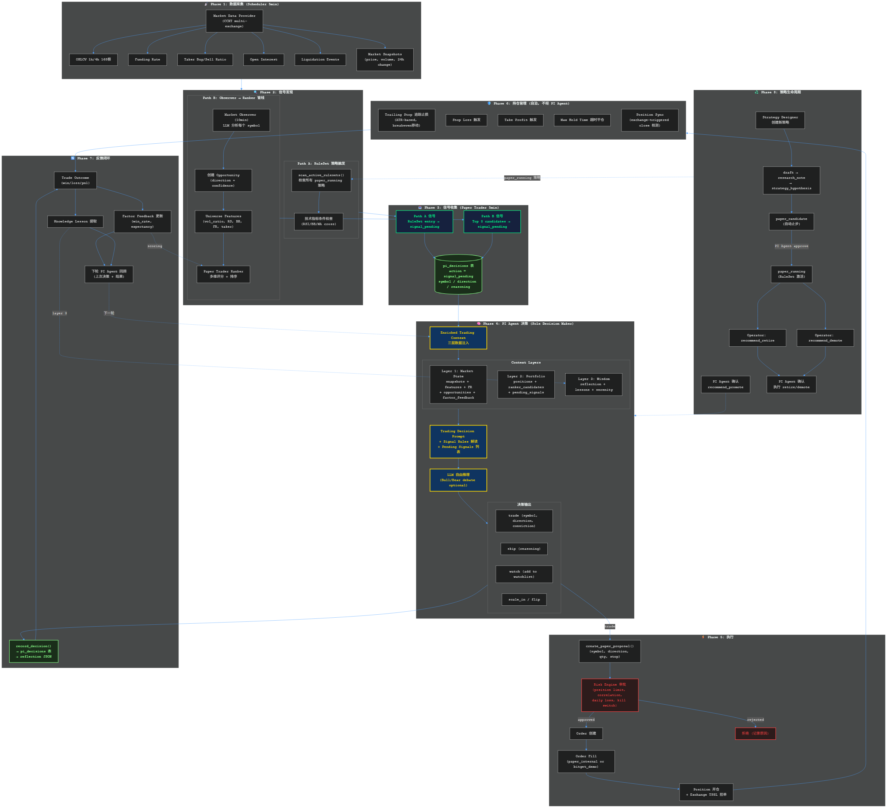

# Aletheia Trading OS — 系统架构全景图

> 本文档用图示 + 故事的方式完整说明系统的每个环节。
> 所有流程图源文件位于 `docs/diagrams/*.mmd`，可用 `mmdc` 重新渲染。

---

## 第一章：全景 — 系统里有谁



想象 Aletheia 是一家小型对冲基金，有明确分工：

| 角色 | 组件 | 职责 | 自治权 |
|------|------|------|--------|
| 基金经理 | **PI Agent** | 所有买卖决策最终由他拍板 | 唯一决策者 |
| 研究员 | Market Observer | 每10分钟扫一遍市场，发现机会 | 只写 Opportunity，不下单 |
| 交易员助理 | Paper Trader | 收集信号交给老板 | 只写 signal_pending，不下单 |
| 量化工程师 | Strategy Designer | 设计新策略+回测 | 升阶止于 paper_candidate |
| 风控主管 | Operator Loop | 建议淘汰/降级策略 | 只写 recommend_*，不直接执行 |
| 安全保镖 | Position Manager | 止损/止盈/追踪止损 | **唯一自治执行权**（钱不等人） |

**核心原则**：所有"动脑子"的决定由 PI Agent 一人做；其他组件只产出信号和建议。

---

## 第二章：数据采集 — 系统的"眼睛"



系统每 5 分钟从三家交易所（Bitget / Binance / OKX）通过 CCXT 统一接口拉取 6 种数据：

| 数据 | 内容 | 用途 |
|------|------|------|
| OHLCV | 1h+4h 各 168 根 K线 | 计算 RSI、布林带、成交量比 |
| Funding Rate | 多空费率 | 反映杠杆偏向（拥挤度） |
| Taker Ratio | 主动买/卖比 | 市场情绪确认 |
| Open Interest | 持仓量变化 | 结合价格计算 OI-Price 背离 |
| Liquidation | 大额爆仓事件 | 极端情绪检测 |
| Price Snapshot | 实时价格、24h 变化 | 基础快照 |

原始数据经特征计算引擎加工后存入 `universe_feature_snapshots` 表：
- `vol_ratio`：当前成交量 / 均值（放量检测）
- `relative_strength_24h`：相对 BTC 的 24h 强弱
- `oi_price_divergence`：+1 隐性积累 / -1 弱势反弹 / 0 正常
- `taker_buy_ratio`：主动买入占比

---

## 第三章：信号发现 — "我觉得 ETH 可以做多"



系统有两条并行信号管线，殊途同归汇入 `pi_decisions` 表：

### Path B：机会发现管线（适合新标的/新机会）

```
Market Observer (10min)
  → LLM 分析每个 symbol → 输出方向+信心
  → 写入 Opportunity
  → Ranker 消费 → 5层过滤 + 多维评分
  → Top 3 → signal_pending
```

**Ranker 评分维度**：
- confidence_score（LLM 给出的信心分）
- scanner_family bonus（来源加成）
- strategy_evidence（策略历史表现）
- factor_feedback（因子历史胜率）
- blocked_candidate 惩罚（-50 分）

### Path A：策略触发管线（已有策略的自动触发）

```
Paper Trader (5min)
  → 扫描所有 paper_running 策略的 RuleSet
  → 检查技术指标条件（如 RSI<30 且 BB squeeze）
  → 条件满足 → signal_pending
```

**关键：两条路径都只写信号到 `pi_decisions` 表，绝不下单。**

---

## 第四章：PI Agent 决策 — 唯一的"按钮"在这里



每 5 分钟，PI Agent 醒来。面前摆着三层信息：

### Layer 1: 市场现在长什么样
- 所有币的价格快照
- 特征指标（RSI/BB/FR/vol_ratio/taker/OI_divergence）
- 开放 Opportunities
- Factor Feedback（历史胜率/期望）

### Layer 2: 我现在手里有什么
- 当前持仓（symbol/direction/pnl）
- Ranker 评分后的候选列表
- **等待我决策的 pending_signals**

### Layer 3: 我过去学到了什么
- 上次决策回顾（我做了什么？结果如何？）
- Knowledge Lessons（犯过的错）
- Serenity Research（研究洞察）

### 决策过程

1. 信号解读规则注入 prompt（硬编码逻辑）：
   - FR > +0.01% → 多头拥挤，bearish 偏向
   - FR < -0.01% → 空头拥挤，bullish 偏向
   - OI_div=+1 → 隐性积累（OI↑ price↓），可能反转做多
   - taker > 1.2 → 主动买入确认
   - vol_ratio > 2x → 放量突破确认

2. Bull vs Bear 辩论（高 conviction 时触发）

3. 输出决策：

| 决策 | 含义 | 后续 |
|------|------|------|
| `trade` | 确认交易 | → 执行层下单 |
| `skip` | 放弃信号 | 记录原因，下轮可回顾 |
| `watch` | 先观察 | 加入观察列表 |
| `scale_in` | 加仓 | 现有持仓追加 |
| `flip` | 反转 | 平掉反向再开 |

---

## 第五章：执行与风控 — 从决策到下单



PI Agent 说 `trade ETH/USDT long conviction=8` 之后：

### Step 1: 仓位计算
```
波动率目标 Sizing:
notional = target_risk_per_trade / ATR%
quantity = notional / current_price
stop_price = price × (1 - stop_loss_pct%)
```

### Step 2: Risk Engine 五关审批

| 关卡 | 检查 | 失败后果 |
|------|------|----------|
| 1 | 持仓数量 < max_positions? | 拒绝 |
| 2 | 同方向暴露 < directional_limit? | 拒绝 |
| 3 | 与现有持仓相关性 < threshold? | 拒绝 |
| 4 | 当日已亏 < daily_loss_limit? | 拒绝 |
| 5 | Kill Switch 未激活? | 拒绝 |

### Step 3: 下单执行

根据 `execution_mode`：
- `paper_internal`：本地模拟成交（零延迟）
- `bitget_demo`：交易所模拟盘（真实撮合但虚拟资金）
- `bitget_live_limited`：实盘（**需要人工确认**）

### Step 4: 成交链路
```
Proposal → Order → Fill → Position → Exchange TPSL 挂单
```

---

## 第六章：持仓管理 — 自治安全层



这是系统中**唯一不经 PI Agent 的环节**。原因：止损必须秒级执行，不能等 LLM。

每分钟自动检查：

| 机制 | 触发条件 | 动作 |
|------|----------|------|
| **追踪止损** | 价格上涨 | 止损跟随最高点（ATR-based） |
| **保本移动** | 涨幅 > breakeven_threshold | 止损移到成本价 |
| **硬止损** | price ≤ stop_price | 立即平仓 |
| **止盈** | price ≥ target_price | 获利了结 |
| **超时保护** | 持仓 > max_hold_hours | 强制平仓 |
| **交易所同步** | exchange TPSL 成交 | 本地状态同步 |

平仓后 → 计算 PnL → 输出 Trade Outcome → 进入反馈闭环。

---

## 第七章：反馈闭环 — 每笔交易让系统变聪明



交易结束后触发三条学习通路：

### 1. Factor Feedback（因子反馈）
- 找到对应 factor_key（scanner_family + direction + symbol 类型）
- 更新统计：胜率、期望收益、交易次数
- 状态升阶：`watch` → `active` → `preferred`
- **下轮效果**：Ranker 给 `preferred` 因子 +20 分，`blocked_candidate` -50 分

### 2. Knowledge Lesson（知识教训）
- 自动分析本次交易的成功/失败原因
- 写入知识库
- **下轮效果**：PI Agent Layer 3 看到最近教训

### 3. Strategy Evidence（策略证据）
- paper_trades 计数 +1
- paper_expectancy 更新
- 检查 promotion_gates：≥5 笔 + 期望为正？
- **下轮效果**：满足条件 → Operator 可以推荐升级

这三条路径在 5 分钟后的下一轮 PI Agent 决策中生效——正反馈循环。

---

## 第八章：策略生命周期 — 从创意到退役



### 策略升阶路径

```
draft → research_note → strategy_hypothesis → paper_candidate ⛔ STOP
                                                      ↓
                                             [PI Agent 批准]
                                                      ↓
                                              paper_running ✅
                                              (RuleSet 激活)
```

**自动阶段**（Strategy Designer 自行推进）：
- `draft`：刚创建
- `research_note`：有研究支撑
- `strategy_hypothesis`：可被回测验证
- `paper_candidate`：**强制止步！** 等 PI Agent

**PI Agent 决策门**：
- Designer 写 `recommend_promote` 到 `pi_decisions`
- PI Agent 评估后决定同意/拒绝

### 策略退出路径

- Operator Loop（每60min）评估策略表现
- 表现差 → 写 `recommend_retire` 或 `recommend_demote`
- PI Agent 确认后执行
- PI Agent 也可以拒绝（"再观察"）

### 策略变体（Param Sweep）

- Optuna 优化参数后产生变体策略
- 同样止步于 `paper_candidate`
- 同样需要 PI Agent 确认才能激活

---

## 完整交易流程图



---

## 设计哲学总结

| 原则 | 实现 |
|------|------|
| **PI Agent 是唯一决策者** | 所有 trade/promote/retire 动作必须经过 PI Agent |
| **其他组件只产出信号** | Observer 写 Opportunity, Paper Trader 写 signal_pending, Operator 写 recommend_* |
| **安全层自治** | 止损/止盈/追踪不等审批，秒级执行保护资金 |
| **正反馈循环** | 每笔交易的结果在 5 分钟内影响下一个决策 |
| **策略升阶有门禁** | 自动推进止于 paper_candidate，激活需 PI Agent 确认 |
| **Risk Engine 是硬墙** | 无论 PI Agent 多有信心，5 关审批不通过就不下单 |

---

## 附录：定时任务一览

| 组件 | 周期 | 做什么 |
|------|------|--------|
| Market Data Collector | 5 min | 拉取价格/FR/OI/Taker/Liquidation |
| Market Observer | 10 min | LLM 分析 → 写 Opportunity |
| Paper Trader | 5 min | 信号收集 → 写 signal_pending |
| PI Agent | 5 min | 读 pending signals → 决策 → 执行 |
| Position Manager | 1 min | 追踪止损 / 检查平仓条件 |
| Operator Loop | 60 min | 策略评估 → recommend_retire/demote |
| Strategy Designer | 事件触发 | 创建/回测新策略 |
