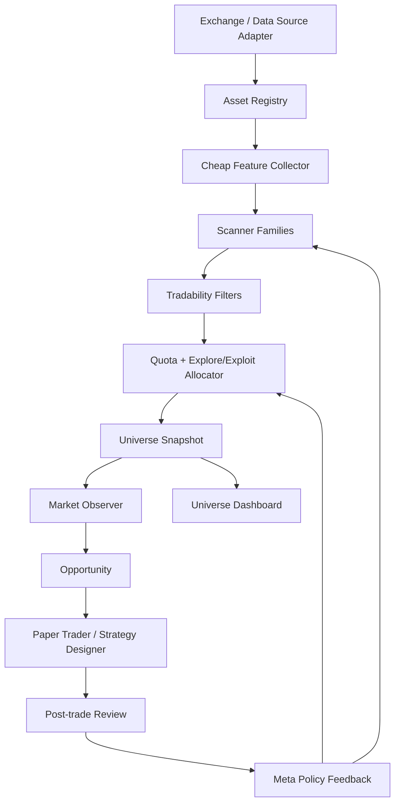

# Aletheia Dynamic Universe Generator 设计报告

版本：v0.1  
定位：Market Observer 的动态选币池 / 动态资产池子系统  
范围：Crypto MVP；保留未来 equity / prediction market 扩展接口  

---

## 1. 结论

当前 `market_observer` 只覆盖 BTC、ETH、SOL，核心问题不是少了几个配置项，而是缺少一个稳定的 **Universe Generator**：它应当把全市场资产压缩成可解释、可审计、带 TTL、带 family quota、带 tradability filter 的候选池，再交给 Market Observer 和后续 LLM 分析。

建议把 Universe Generator 设为 P0 后端能力，并按以下原则实现：

1. **全市场先低成本扫描，LLM 只看候选池**。不得让 LLM 直接遍历全市场。
2. **动态池不是一个 whitelist，而是一个带版本的 Universe Snapshot**。
3. **候选池必须可解释**：每个入池资产都要有得分、入池原因、所属策略 family、TTL、数据新鲜度、交易可行性。
4. **执行边界不变**：Universe Generator 只能影响 Market Observer 的观察范围；不能改 risk engine、live 权限、kill switch、账户限额。
5. **参考 VergeX AI 500 的产品形态，而不是复制其实现**：可做一个“AI 500-style 市场候选榜 / 热度池 / 机会指数”，但底层应以确定性特征、审计日志和风险门控为主。

---

## 2. 当前问题

### 2.1 功能缺口

目前 Market Observer 的 symbol universe 基本是静态配置：

```text
BTC, ETH, SOL
```

这导致：

- 只能发现大盘主流币机会；
- 无法捕捉小盘 / 中盘的量价异动、资金费率异常、OI 激增、listing/news catalyst；
- LLM 机会生成被输入边界限制，后续 Strategy Designer 和 Paper Trader 都只能围绕极少数资产运转；
- 缺少候选资产的 TTL、得分衰减、数据新鲜度、入池/出池原因。

### 2.2 设计目标

Universe Generator 的目标不是“多选一些币”，而是建立以下能力：

```text
全市场资产源
    ↓
低成本特征扫描
    ↓
策略 family 分桶评分
    ↓
tradability / safety 过滤
    ↓
explore-exploit 配额
    ↓
Universe Snapshot
    ↓
Market Observer 分析
    ↓
Opportunity
```

---

## 3. 设计边界

### 3.1 In scope

- Crypto 市场动态选币池；
- 资产注册表和动态 universe snapshots；
- 量价、波动、流动性、衍生品、事件类 scanner；
- family quota、TTL、explore/exploit、late entry penalty；
- Market Observer 集成；
- Universe 管理 / 观测 API；
- 基础前端展示，可先集成到 Agent Activity 或新增 Universe 页面。

### 3.2 Out of scope

- 不改变 risk engine 的 13 项检查矩阵；
- 不允许 Universe Generator 直接发单；
- 不做 live 自动放权；
- 不在 MVP 中做复杂 on-chain/social/news 融合，除非已有稳定数据源；
- 不把 prediction market 直接纳入可执行 crypto paper trader，prediction/equity 仍 observation-only。

---

## 4. 参考设计原则

### 4.1 Aletheia 既有架构原则

Aletheia 现有端到端方案已经明确：市场扫描应以低成本全市场扫描开始，LLM 只看候选池；策略表达要落到 DSL/spec；验证路径应走回测、walk-forward、paper/sandbox、proposal、live unlock；反馈闭环只调整 scanner、权重、TTL、模板和准入规则；硬风控、密钥、额度、live 开关不交给自进化 Agent。

### 4.2 OpenAlice 借鉴点

OpenAlice 值得借鉴的不是“让 AI 更自由交易”，而是：

- proposal / guard / approval / audit；
- Trading-as-Git 风格版本历史；
- 每次交易动作都经过安全检查和显式审批；
- AI 只面对统一账户抽象，不直接绕过安全边界。

在 Aletheia 中，对应做法是：Universe Generator 的输出也应版本化，并将 `universe_snapshot_id` 写入 Opportunity、Proposal 和 Review，便于复盘“当时为什么选了这个资产”。

### 4.3 Freqtrade 借鉴点

Freqtrade 的 Dynamic Pairlist 证明了动态交易对选择可以工程化：VolumePairList、PercentChangePairList、MarketCapPairlist、SpreadFilter、VolatilityFilter、RangeStabilityFilter 等机制可以组合成候选池。Aletheia 不应直接照搬 pairlist，而应抽象为更通用的 `scanner_family + filter_chain + universe_snapshot`。

### 4.4 VergeX AI 500 产品启发

VergeX AI 500 公开可验证工程资料较少，因此建议只把它作为产品形态启发：

- 一个动态市场候选榜；
- 类似“AI 维护的 Top-N 可关注资产池”；
- 有排名、趋势、热度、风险提示、入池/出池原因；
- 更适合展示给用户和 Agent，而不是直接作为交易指令。

Aletheia 可做自己的 `Aletheia AI-500 / Dynamic Universe Board`，但底层必须由透明 feature scoring 和 audit log 支撑。

---

## 5. 总体架构



### 5.1 核心模块

| 模块 | 职责 | MVP 建议 |
|---|---|---|
| `AssetRegistry` | 维护可扫描资产基础信息 | symbol、base/quote、market_type、venue、status、precision、min_notional |
| `FeatureCollector` | 拉取低成本特征 | ticker、OHLCV、volume、spread、orderbook depth、ATR、RSI、SMA、funding、OI |
| `ScannerFamily` | 根据不同机会类型打分 | momentum、mean-reversion、volatility、derivatives、event、arb |
| `TradabilityFilter` | 判断是否具备交易可行性 | volume、spread、depth、slippage、data freshness、blacklist |
| `UniverseAllocator` | 处理 family quota、TTL、explore/exploit | 避免池子被单一热门方向占满 |
| `UniverseSnapshotStore` | 版本化保存动态池 | 所有观察和交易复盘可回溯 |
| `UniverseService` | 给 Market Observer 提供当前池 | 带 fallback 和数据新鲜度检查 |
| `UniverseDashboard` | 解释入池、出池、风险 | 面向开发者和 human reviewer |

---

## 6. 四层漏斗机制

### 6.1 Layer 1：全市场粗扫

输入：交易所可交易资产全集。  
是否使用 LLM：否。  
目标：快速排除不可交易、低质量、数据不稳定资产。

MVP 资产源：

- Bitget / CCXT markets；
- 仅启用 active 状态；
- 仅启用 USDT quote；
- 先覆盖 spot 或 perpetual 中一个市场，不要一开始混用；
- 排除 leveraged tokens、test symbols、delisting、低精度或极低 minNotional 异常资产。

基础过滤条件建议：

| 过滤项 | MVP 建议 |
|---|---|
| 24h quote volume | `>= 5M USDT`，可按账户规模调低 |
| bid/ask spread | `<= 25 bps` |
| 10 bps depth | `>= 25,000 USDT` |
| OHLCV 新鲜度 | 最新 1m/5m candle 不超过 2 个周期 |
| API 数据完整性 | ticker + OHLCV + orderbook 至少两个源可用 |
| 黑名单 | 手动 blacklist、近期异常、停牌、极端滑点资产 |

输出：`FeatureSnapshot`。

### 6.2 Layer 2：Scanner Family 打分

每个 asset 进入多个 scanner，产生 family-specific score。

| Family | 目标 | 核心特征 |
|---|---|---|
| Momentum / Breakout | 捕捉趋势突破 | 1h/4h return、volume spike、BB %B、SMA slope、ATR expansion |
| Mean Reversion | 捕捉过度偏离回归 | RSI extreme、z-score、distance from SMA、volume exhaustion |
| Volatility Expansion | 捕捉波动扩张 | ATR percentile、range breakout、compression-to-expansion |
| Derivatives / Funding | 捕捉 perp 结构异常 | funding rate、OI delta、basis、long/short crowding |
| Event / Catalyst | 捕捉新叙事和事件 | listing/news/social/on-chain 异常；MVP 可先空置或仅手工注入 |
| Cross-venue / Arb | 捕捉跨市场价差 | CEX-CEX spread、spot-perp basis、latency-adjusted spread |

输出：`ScannerScore(asset, family, score, reasons[])`。

### 6.3 Layer 3：配额、TTL、探索/利用

避免动态池被单一类型资产占满。MVP 起点：

| 参数 | 建议起点 |
|---|---:|
| 总候选池 | 20–30 assets |
| Core pool | 8–10 assets，偏稳定高流动性 |
| Rotating pool | 10–20 assets，偏机会型 |
| family quota | momentum 30%、mean-reversion 20%、arb/derivatives 30%、event 20% |
| explore/exploit | 20/80 |
| TTL | 15 min – 24 h，按 family 分层 |
| 单次权重变更 | 不超过 10%–15% |

TTL 建议：

| 机会类型 | TTL |
|---|---:|
| fast momentum | 15–60 min |
| volatility breakout | 1–4 h |
| derivatives/funding | 1–8 h |
| event/catalyst | 1–24 h，取决于事件半衰期 |
| core liquidity candidate | 12–24 h |

### 6.4 Layer 4：Market Observer 深度分析

只有 Universe Snapshot 中的候选资产进入 `market_observer` LLM 分析。

LLM 输入不应是全市场原始数据，而是：

```json
{
  "universe_snapshot_id": "...",
  "asset": "XYZ/USDT",
  "family": "momentum",
  "score": 83.4,
  "ttl_sec": 3600,
  "cheap_features": {...},
  "scanner_reasons": [...],
  "risk_flags": [...]
}
```

LLM 输出继续保持现有 `MarketRead` / `Opportunity` 结构，但应补充：

- `asset_class = "crypto"`
- `universe_snapshot_id`
- `scanner_family`
- `universe_score`
- `tradability_score`
- `entry_lateness_score`
- `ttl_expires_at`

---

## 7. 统一评分模型

建议使用可解释线性组合，先不要上复杂 ML：

```text
total_score =
  w1 * opportunity_score
+ w2 * tradability_score
+ w3 * regime_fit
+ w4 * liquidity_score
+ w5 * novelty_or_catalyst
+ w6 * cross_venue_arb_density
- w7 * estimated_cost
- w8 * crowding_risk
- w9 * late_entry_penalty
- w10 * data_staleness_penalty
```

### 7.1 各项含义

| 字段 | 含义 |
|---|---|
| `opportunity_score` | family scanner 对机会强度的判断 |
| `tradability_score` | 成交量、深度、点差、滑点综合得分 |
| `regime_fit` | 当前市场 regime 是否适合该 family |
| `liquidity_score` | 独立流动性质量，防止小盘币虚假信号 |
| `novelty_or_catalyst` | 是否存在新事件、新叙事、新流入 |
| `cross_venue_arb_density` | 跨市场价差和结构性机会密度 |
| `estimated_cost` | 手续费、滑点、资金费率、冲击成本 |
| `crowding_risk` | 过热、资金费率极端、OI 过度集中 |
| `late_entry_penalty` | 信号已经过度兑现后的追高惩罚 |
| `data_staleness_penalty` | 数据过期或源不一致惩罚 |

### 7.2 Late Entry Penalty

这是动态选币池必须有的字段。很多 altcoin 机会不是没有被发现，而是发现时已经太晚。

建议规则：

```text
late_entry_penalty = f(
  post_trigger_return / expected_edge,
  volume_percentile_after_trigger,
  funding_extreme_percentile,
  social_or_news_diffusion_percentile,
  distance_from_breakout_level
)
```

触发剔除条件示例：

- 触发后已实现涨幅超过策略预期收益的 70%；
- 过去 1h volume 已进入 99% percentile 且 price extension 过大；
- funding/OI 进入极端拥挤区；
- spread 扩大到基础阈值 2 倍以上。

---

## 8. 数据模型

### 8.1 `asset_universe_registry`

```sql
CREATE TABLE asset_universe_registry (
  id UUID PRIMARY KEY,
  venue TEXT NOT NULL,
  market_type TEXT NOT NULL, -- crypto_spot, crypto_perp, equity, prediction
  symbol TEXT NOT NULL,
  base_asset TEXT,
  quote_asset TEXT,
  exchange_symbol TEXT,
  status TEXT NOT NULL,
  precision JSONB,
  limits JSONB,
  first_seen_at TIMESTAMPTZ NOT NULL,
  last_seen_at TIMESTAMPTZ NOT NULL,
  is_blacklisted BOOLEAN DEFAULT FALSE,
  blacklist_reason TEXT,
  metadata JSONB DEFAULT '{}'
);
```

### 8.2 `universe_feature_snapshots`

```sql
CREATE TABLE universe_feature_snapshots (
  id UUID PRIMARY KEY,
  asset_id UUID REFERENCES asset_universe_registry(id),
  ts TIMESTAMPTZ NOT NULL,
  quote_volume_24h NUMERIC,
  volume_1h NUMERIC,
  spread_bps NUMERIC,
  depth_10bps_usd NUMERIC,
  atr_pct NUMERIC,
  rsi_14 NUMERIC,
  return_1h NUMERIC,
  return_4h NUMERIC,
  return_24h NUMERIC,
  funding_rate NUMERIC,
  open_interest NUMERIC,
  open_interest_delta_1h NUMERIC,
  data_freshness_sec INTEGER,
  raw JSONB DEFAULT '{}'
);
```

### 8.3 `universe_scanner_runs`

```sql
CREATE TABLE universe_scanner_runs (
  id UUID PRIMARY KEY,
  started_at TIMESTAMPTZ NOT NULL,
  completed_at TIMESTAMPTZ,
  status TEXT NOT NULL,
  policy_id UUID,
  assets_scanned INTEGER DEFAULT 0,
  assets_passed_filters INTEGER DEFAULT 0,
  snapshot_id UUID,
  errors JSONB DEFAULT '[]',
  metrics JSONB DEFAULT '{}'
);
```

### 8.4 `universe_snapshots`

```sql
CREATE TABLE universe_snapshots (
  id UUID PRIMARY KEY,
  created_at TIMESTAMPTZ NOT NULL,
  market_type TEXT NOT NULL,
  policy_id UUID,
  status TEXT NOT NULL, -- active, expired, superseded, failed
  expires_at TIMESTAMPTZ,
  summary JSONB DEFAULT '{}'
);
```

### 8.5 `universe_members`

```sql
CREATE TABLE universe_members (
  id UUID PRIMARY KEY,
  snapshot_id UUID REFERENCES universe_snapshots(id),
  asset_id UUID REFERENCES asset_universe_registry(id),
  symbol TEXT NOT NULL,
  rank INTEGER NOT NULL,
  total_score NUMERIC NOT NULL,
  opportunity_score NUMERIC,
  tradability_score NUMERIC,
  regime_fit NUMERIC,
  liquidity_score NUMERIC,
  estimated_cost NUMERIC,
  crowding_risk NUMERIC,
  late_entry_penalty NUMERIC,
  scanner_family TEXT,
  ttl_sec INTEGER NOT NULL,
  expires_at TIMESTAMPTZ NOT NULL,
  inclusion_reason JSONB DEFAULT '[]',
  risk_flags JSONB DEFAULT '[]',
  execution_eligible BOOLEAN DEFAULT TRUE
);
```

### 8.6 `universe_policies`

```sql
CREATE TABLE universe_policies (
  id UUID PRIMARY KEY,
  created_at TIMESTAMPTZ NOT NULL,
  created_by TEXT NOT NULL, -- system, human, meta_agent
  active BOOLEAN DEFAULT FALSE,
  market_type TEXT NOT NULL,
  family_quota JSONB NOT NULL,
  scoring_weights JSONB NOT NULL,
  filters JSONB NOT NULL,
  ttl_policy JSONB NOT NULL,
  explore_ratio NUMERIC NOT NULL,
  max_weight_step NUMERIC DEFAULT 0.15,
  change_reason TEXT,
  previous_policy_id UUID
);
```

---

## 9. Service / API 设计

### 9.1 Python Service

```python
class UniverseService:
    async def refresh(self, market_type: str = "crypto") -> UniverseSnapshot:
        ...

    async def get_current_universe(
        self,
        market_type: str = "crypto",
        execution_eligible_only: bool = True,
        limit: int | None = None,
    ) -> list[UniverseMember]:
        ...

    async def explain_member(self, member_id: str) -> UniverseMemberExplanation:
        ...

    async def fallback_static_universe(self) -> list[str]:
        return ["BTC/USDT", "ETH/USDT", "SOL/USDT"]
```

### 9.2 REST API

| Endpoint | 用途 |
|---|---|
| `GET /api/universe/current?market_type=crypto` | 当前动态池 |
| `GET /api/universe/snapshots?market_type=crypto` | 历史快照 |
| `GET /api/universe/snapshots/{id}` | 快照详情 |
| `GET /api/universe/members/{id}` | 单个成员解释 |
| `POST /api/universe/refresh` | 手动刷新，需权限 |
| `GET /api/universe/policy/current` | 当前 policy |
| `POST /api/universe/policy/propose` | meta-agent 提交 policy diff |
| `PATCH /api/universe/policy/{id}/activate` | 人工或安全门控启用 |

---

## 10. 与现有 Agent 的集成

### 10.1 Market Observer

改造前：

```python
symbols = settings.MARKET_SYMBOLS  # BTC, ETH, SOL
```

改造后：

```python
symbols = await universe_service.get_current_universe(
    market_type="crypto",
    execution_eligible_only=True,
    limit=settings.MARKET_OBSERVER_MAX_SYMBOLS,
)

if not symbols:
    symbols = await universe_service.fallback_static_universe()
```

Market Observer 对每个候选资产生成 `MarketRead` 时，附带：

```json
{
  "asset_class": "crypto",
  "universe_snapshot_id": "...",
  "universe_member_id": "...",
  "scanner_family": "momentum",
  "universe_score": 82.1,
  "ttl_expires_at": "...",
  "inclusion_reason": [...]
}
```

### 10.2 Opportunity 表

建议补字段：

```sql
ALTER TABLE opportunities ADD COLUMN asset_class TEXT DEFAULT 'crypto';
ALTER TABLE opportunities ADD COLUMN market_type TEXT;
ALTER TABLE opportunities ADD COLUMN universe_snapshot_id UUID;
ALTER TABLE opportunities ADD COLUMN universe_member_id UUID;
ALTER TABLE opportunities ADD COLUMN scanner_family TEXT;
ALTER TABLE opportunities ADD COLUMN execution_eligible BOOLEAN DEFAULT TRUE;
ALTER TABLE opportunities ADD COLUMN metadata JSONB DEFAULT '{}';
```

### 10.3 Paper Trader

保留现有原则：

```python
if opportunity.asset_class != "crypto":
    skip_observation_only()
```

新增检查：

```python
if not opportunity.execution_eligible:
    skip_not_execution_eligible()

if opportunity.ttl_expires_at < now:
    skip_expired_universe_signal()
```

### 10.4 Research / Dreaming / Review

复盘时增加：

- 该机会来自哪个 Universe Snapshot；
- 入池分数和实际后续表现；
- scanner family 是否有效；
- late_entry_penalty 是否低估；
- tradability_score 与实际滑点偏差。

这些结果进入 meta-policy，但只允许调整软参数。

---

## 11. 前端 Universe Board

MVP 可先做轻量页面 `/universe` 或嵌入 Agent Activity。

### 11.1 页面结构

```text
Universe Board
├── Header
│   ├── Current Snapshot ID
│   ├── Last refresh
│   ├── Next refresh
│   ├── Assets scanned / candidates selected
│   └── Policy version
├── Summary Cards
│   ├── Top Momentum
│   ├── Top Mean Reversion
│   ├── Top Derivatives
│   ├── Top Event / Catalyst
│   └── Filtered / Rejected Count
├── Candidate Table
│   ├── Rank
│   ├── Symbol
│   ├── Family
│   ├── Total score
│   ├── Tradability
│   ├── Spread / Depth / Volume
│   ├── TTL
│   ├── Risk flags
│   └── Linked Opportunities
└── Member Detail Drawer
    ├── Inclusion reason
    ├── Feature snapshot
    ├── Score breakdown
    ├── Recent candles
    ├── Rejection / risk flags
    └── Observer output
```

### 11.2 UI 原则

- 排名必须解释；
- TTL 和 data freshness 必须显眼；
- “selected by scanner” 不等于 “approved to trade”；
- Universe 页面不得提供绕过 risk engine 的交易按钮。

---

## 12. 测试与验收标准

### 12.1 单元测试

- Asset registry 去重；
- blacklist 生效；
- volume/spread/depth 过滤；
- scanner score 正常归一化；
- family quota 不越界；
- TTL 过期剔除；
- fallback 到 BTC/ETH/SOL；
- late_entry_penalty 在极端涨幅时变大；
- policy 单次变更不超过 max step。

### 12.2 集成测试

- `UniverseService.refresh()` 能产出 snapshot；
- Market Observer 能消费 snapshot；
- Opportunity 写入时保留 universe metadata；
- Paper Trader 跳过 expired / non-eligible；
- 前端能展示 current universe；
- scanner run 失败不影响静态 fallback。

### 12.3 验收标准

P0 完成标准：

- 能从交易所扫描不少于 100 个 crypto symbols；
- 产出 20–30 个候选资产；
- 候选资产具备 score breakdown、TTL、family、tradability；
- Market Observer 不再只限 BTC/ETH/SOL；
- 失败时安全 fallback 到静态池；
- 不改变 risk engine 和 live 权限；
- 至少 30 个新增测试覆盖核心逻辑。

---

## 13. 迭代计划

### Phase 0：Schema + fallback 接入（1–2 天）

- 新增表和 migration；
- 新增 `asset_class` / `market_type` / `metadata` 字段；
- `UniverseService.get_current_universe()` 返回静态 fallback；
- Market Observer 改为通过 UniverseService 获取 symbols。

### Phase 1：基础动态池（3–5 天）

- 接 CCXT markets / tickers / OHLCV；
- 实现 volume、spread、depth、volatility 基础过滤；
- 实现 top-N candidate ranking；
- 写入 universe snapshot；
- Agent Activity 或 `/universe` 页面展示结果。

### Phase 2：Family scanner + TTL + quota（1 周）

- Momentum / mean-reversion / derivatives scanner；
- family quota；
- TTL；
- late_entry_penalty；
- Policy 配置化。

### Phase 3：Meta-policy feedback（1 周）

- 从 post-trade review 聚合 scanner family 表现；
- 只生成 policy proposal，不自动改 live 风控；
- shadow A/B 后人工启用。

### Phase 4：扩展数据源（后续）

- on-chain inflow；
- social/news catalyst；
- cross-venue basis；
- prediction market correlation signals。

---

## 14. 任务拆分建议

| 任务 | Owner | 优先级 |
|---|---|---|
| Universe DB schema + migration | Backend Agent | P0 |
| UniverseService + fallback | Backend Agent | P0 |
| CCXT dynamic asset scan | Data Agent | P0 |
| Basic score/filter implementation | Quant/Data Agent | P0 |
| Market Observer integration | Agent Orchestration Agent | P0 |
| Universe Board UI | Frontend Agent | P1 |
| Meta-policy feedback | Learning Agent | P1 |
| Event/on-chain/social scanners | Research Agent | P2 |

---

## 15. 最小实现清单

```text
[ ] Add asset_class / market_type / metadata to Opportunity model
[ ] Add universe tables
[ ] Implement UniverseService with static fallback
[ ] Implement asset registry sync from exchange
[ ] Implement feature collector: volume, spread, depth, ATR, returns
[ ] Implement scoring formula
[ ] Implement family quota and TTL
[ ] Update market_observer to consume dynamic universe
[ ] Preserve BTC/ETH/SOL fallback
[ ] Add tests for filters, scoring, TTL, fallback
[ ] Add Universe Board or Agent Activity subsection
```

---

## 16. 最终建议

Universe Generator 应作为 Aletheia 的下一阶段 P0。它是后续自演化、策略发现、proposal 质量提升的入口。如果它不做，Market Observer、Strategy Designer、Dreaming Agent 的上限都会被 BTC/ETH/SOL 静态池锁死。

但它必须保持克制：

```text
Universe Generator 负责“看什么”
Market Observer 负责“怎么看”
Strategy Designer 负责“提出什么假设”
Validator / Risk Engine 负责“能不能交易”
Execution Gateway 负责“如何执行”
```

不要让 Universe Generator 直接变成交易决策器。
