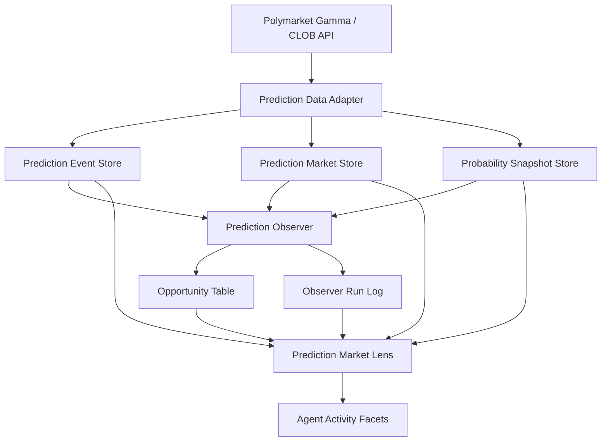

# Aletheia Prediction Market Lens 设计报告

版本：v0.1  
定位：Prediction Market 前后端轻量级重构与专属前端页面  
范围：Polymarket / prediction_observer / Opportunities / Frontend Lens  

---

## 1. 结论

当前 `prediction_observer` 后端已经能生成 Opportunities，但前端把 prediction market 扁平化成普通 `symbol + direction_bias + confidence` 展示，导致事件标题、YES 概率、概率变化、成交量、resolution 风险、order book 状态等核心语义丢失。

建议新增一个专门的 **Prediction Market Lens**，并对后端做轻量级 schema/API 适配：

1. **前端必须区分 asset_class**：crypto / equity / prediction 不再混在同一张通用卡片里。
2. **Prediction Market 是 event-first，不是 symbol-first**：页面围绕 Event、Market、Outcome、Probability、Resolution 展开。
3. **MVP 只做 observation-first**：不提供交易按钮，不接 paper_trader，不暗示 prediction opportunity 可执行。
4. **保留统一 Opportunity 表**，但新增 prediction-specific metadata 和 normalized tables。
5. **借鉴 Serenity Lens**：做成研究工作台 / Lens，而不是交易终端。

---

## 2. 当前问题

### 2.1 后端已有能力

当前数据流大致为：

```text
prediction_observer
    ↓
Polymarket active events / market data
    ↓
YES probability, 24h probability change, volume
    ↓
Opportunity table
```

这说明后端主链已打通。

### 2.2 前端缺口

当前前端问题：

| 问题 | 影响 |
|---|---|
| `Opportunity` 类型缺少 `asset_class` | UI 无法区分 crypto / equity / prediction |
| 无 prediction market 专属页面 | 事件、概率、resolution、order book 语义丢失 |
| YES/NO 概率被扁平化 | 用户只能看到 direction/confidence，看不到真实预测市场信号 |
| 没有概率趋势图 | 无法判断是短期 spike、持续 trend 还是均值回归 |
| 没有 observer run 页面 | 不知道 prediction_observer 何时运行、扫描了多少市场、是否失败 |
| 没有 observation-only 提示 | 用户可能误以为 prediction opportunity 会被 paper_trader 执行 |
| Agent Activity 混合展示 | Crypto trading opportunities 和 prediction observations 混淆 |

---

## 3. 产品定位

### 3.1 页面名称

建议命名：

```text
Prediction Market Lens
```

中文可称：

```text
预测市场观察镜 / Prediction Lens
```

### 3.2 产品原则

| 原则 | 说明 |
|---|---|
| Observation-first | MVP 不交易，只观察、解释、记录 |
| Event-first | 以事件为中心，而非 ticker 为中心 |
| Probability-native | 概率、概率变化、implied odds 是一等公民 |
| Resolution-aware | 必须展示 resolution date、规则、风险 |
| Evidence-linked | 概率异动应尽量关联 evidence / claim / observer note |
| Agent-readable | 页面数据也应服务给 Agent，不只是人看 |
| No execution ambiguity | 明确标注 prediction/equity 当前不进入 paper_trader |

---

## 4. 参考来源与设计启发

### 4.1 Polymarket 数据模型

Polymarket 的官方数据结构是 event / market / outcome：

- Event 是顶层问题或主题；
- Market 是可交易的二元结果；
- outcomes 和 outcomePrices 一一对应；
- outcomePrices 表示 implied probabilities；
- 如果 `enableOrderBook` 为 true，该 market 可通过 CLOB 交易。

因此 Aletheia 的前端不应只显示 `symbol`，而应显示：

```text
Event Title
  └── Market Question
        ├── YES probability
        ├── NO probability
        ├── 24h probability change
        ├── liquidity / volume
        ├── resolution date
        └── order book status
```

### 4.2 Polymarket 历史价格

Polymarket 提供 `prices-history` endpoint，支持按 market 查询历史价格。因此 Prediction Lens 应至少支持 YES probability sparkline / chart。

### 4.3 Goldsky / v2 contracts 注意点

Polymarket v2 之后，旧公共 subgraph 可能不完整或不准确。MVP 数据源应优先采用 Polymarket 官方 Gamma / CLOB API；若后续需要更强实时链上分析，再接 Goldsky Turbo Pipelines 或自建索引。

### 4.4 Serenity Lens 借鉴

Prediction Market Lens 可以沿用 Serenity Lens 的页面范式：

| Serenity Lens | Prediction Lens 对应 |
|---|---|
| Workbench | Prediction Market Radar / Workbench |
| Run Detail | Prediction Observer Run Detail |
| Theme Detail | Event Detail |
| Evidence / Claim Explorer | Market Move Explanation Drawer |
| Preference Profile | Watchlist / Topic Preferences |
| 无交易按钮 | Observation-only，不提供 trade button |

---

## 5. 目标架构



---

## 6. 后端轻量级重构

### 6.1 Opportunity 模型补字段

第一优先级：让前端能区分不同 asset class。

```sql
ALTER TABLE opportunities ADD COLUMN asset_class TEXT DEFAULT 'crypto';
ALTER TABLE opportunities ADD COLUMN market_type TEXT;
ALTER TABLE opportunities ADD COLUMN external_source TEXT;
ALTER TABLE opportunities ADD COLUMN external_id TEXT;
ALTER TABLE opportunities ADD COLUMN execution_eligible BOOLEAN DEFAULT TRUE;
ALTER TABLE opportunities ADD COLUMN metadata JSONB DEFAULT '{}';
```

Prediction opportunity 写入建议：

```json
{
  "asset_class": "prediction",
  "market_type": "polymarket",
  "symbol": "POLY:<event_slug>:YES",
  "direction_bias": "long_yes",
  "confidence": "medium",
  "confidence_score": 72,
  "execution_eligible": false,
  "external_source": "polymarket",
  "external_id": "<market_id>",
  "metadata": {
    "event_id": "...",
    "event_title": "Will ...?",
    "market_question": "Will ... by ...?",
    "yes_probability": 0.63,
    "no_probability": 0.37,
    "probability_change_24h": 0.08,
    "volume_24h": 123456,
    "liquidity": 98765,
    "resolution_at": "2026-...",
    "enable_orderbook": true,
    "source_url": "...",
    "risk_flags": ["resolution_risk", "low_liquidity"]
  }
}
```

### 6.2 Normalized prediction tables

MVP 可以先只增强 Opportunity metadata，但建议在 Phase 2 加 normalized tables，避免把所有业务语义塞进 JSON。

#### `prediction_events`

```sql
CREATE TABLE prediction_events (
  id UUID PRIMARY KEY,
  source TEXT NOT NULL, -- polymarket
  external_event_id TEXT NOT NULL,
  slug TEXT,
  title TEXT NOT NULL,
  description TEXT,
  category TEXT,
  tags JSONB DEFAULT '[]',
  status TEXT NOT NULL, -- active, closed, resolved, archived
  starts_at TIMESTAMPTZ,
  ends_at TIMESTAMPTZ,
  resolution_at TIMESTAMPTZ,
  resolution_source TEXT,
  rules_url TEXT,
  liquidity NUMERIC,
  volume_24h NUMERIC,
  open_interest NUMERIC,
  raw JSONB DEFAULT '{}',
  created_at TIMESTAMPTZ NOT NULL,
  updated_at TIMESTAMPTZ NOT NULL
);
```

#### `prediction_markets`

```sql
CREATE TABLE prediction_markets (
  id UUID PRIMARY KEY,
  event_id UUID REFERENCES prediction_events(id),
  source TEXT NOT NULL,
  external_market_id TEXT NOT NULL,
  question TEXT NOT NULL,
  condition_id TEXT,
  token_yes_id TEXT,
  token_no_id TEXT,
  outcomes JSONB DEFAULT '[]',
  outcome_prices JSONB DEFAULT '[]',
  yes_probability NUMERIC,
  no_probability NUMERIC,
  probability_change_24h NUMERIC,
  enable_orderbook BOOLEAN,
  best_bid NUMERIC,
  best_ask NUMERIC,
  spread_bps NUMERIC,
  liquidity NUMERIC,
  volume_24h NUMERIC,
  status TEXT NOT NULL,
  raw JSONB DEFAULT '{}',
  updated_at TIMESTAMPTZ NOT NULL
);
```

#### `prediction_probability_snapshots`

```sql
CREATE TABLE prediction_probability_snapshots (
  id UUID PRIMARY KEY,
  market_id UUID REFERENCES prediction_markets(id),
  ts TIMESTAMPTZ NOT NULL,
  yes_probability NUMERIC,
  no_probability NUMERIC,
  yes_price NUMERIC,
  no_price NUMERIC,
  best_bid NUMERIC,
  best_ask NUMERIC,
  spread_bps NUMERIC,
  liquidity NUMERIC,
  volume_24h NUMERIC,
  source_latency_ms INTEGER,
  raw JSONB DEFAULT '{}'
);
```

#### `prediction_observer_runs`

```sql
CREATE TABLE prediction_observer_runs (
  id UUID PRIMARY KEY,
  started_at TIMESTAMPTZ NOT NULL,
  completed_at TIMESTAMPTZ,
  status TEXT NOT NULL,
  events_scanned INTEGER DEFAULT 0,
  markets_scanned INTEGER DEFAULT 0,
  opportunities_created INTEGER DEFAULT 0,
  stale_markets INTEGER DEFAULT 0,
  errors JSONB DEFAULT '[]',
  summary JSONB DEFAULT '{}'
);
```

---

## 7. API 设计

### 7.1 Prediction-specific API

| Endpoint | 用途 |
|---|---|
| `GET /api/prediction/events` | 事件列表，支持 category/status/search/sort |
| `GET /api/prediction/events/{event_id}` | 事件详情 |
| `GET /api/prediction/markets/{market_id}` | 单个 market 详情 |
| `GET /api/prediction/markets/{market_id}/history?interval=1h` | 概率历史 |
| `GET /api/prediction/opportunities?status=open` | prediction opportunities |
| `GET /api/prediction/observer-runs` | observer run 列表 |
| `GET /api/prediction/observer-runs/{run_id}` | 单次 run 详情 |
| `POST /api/prediction/observer-runs` | 手动触发 observer run，需权限 |
| `GET /api/prediction/watchlist` | 用户关注主题/事件 |
| `PATCH /api/prediction/watchlist` | 更新 watchlist |

### 7.2 Unified Opportunity API

现有 Opportunity API 应支持：

```text
GET /api/opportunities?asset_class=prediction
GET /api/opportunities?asset_class=crypto
GET /api/opportunities?asset_class=equity
```

Agent Activity 页面可以默认按 asset class 分组。

---

## 8. 前端页面设计

### 8.1 信息架构

```text
Prediction Market Lens
├── Header
│   ├── Observation-only badge
│   ├── Last observer run
│   ├── Next scheduled run
│   ├── Markets scanned
│   └── Open prediction opportunities
├── Summary Cards
│   ├── Active events
│   ├── 24h probability movers
│   ├── High liquidity markets
│   ├── New opportunities
│   └── Stale / risky markets
├── Tabs
│   ├── Market Radar
│   ├── Probability Movers
│   ├── Event Detail
│   ├── Observer Runs
│   └── Watchlist / Preferences
└── Drawers
    ├── Market Move Explanation
    ├── Evidence / Claim Explorer
    └── Raw Data / Audit
```

### 8.2 Header

必须明确展示：

```text
Prediction markets are observation-only in current Aletheia mode.
They are not eligible for Paper Trader or Live Execution.
```

字段：

- `last_run_at`
- `next_run_at`
- `markets_scanned`
- `opportunities_created`
- `data_freshness_status`
- `execution_eligible = false`

### 8.3 Market Radar Tab

类似“市场雷达”页面。

卡片字段：

| 字段 | 示例 |
|---|---|
| Event title | `Will X happen by Dec 31?` |
| Category | Politics / Crypto / Macro / Sports |
| YES probability | `63%` |
| 24h change | `+8.2%` |
| Volume 24h | `$123k` |
| Liquidity | `$98k` |
| Resolution date | `2026-12-31` |
| Observer signal | `bullish YES / medium confidence` |
| Risk flags | low liquidity, stale, resolution ambiguity |
| Status | active / closing soon / resolved |

排序方式：

- biggest probability movers；
- highest liquidity；
- newest opportunities；
- closing soon；
- highest observer confidence；
- watchlist first。

### 8.4 Probability Movers Tab

表格 + sparkline：

| Event | Market | YES Now | 1h | 24h | Volume | Liquidity | Reason |
|---|---|---:|---:|---:|---:|---:|---|
| ... | ... | 63% | +2% | +8% | 123k | 98k | volume spike / news / observer note |

需要显示：

- mini probability chart；
- movement reason chips；
- link to event detail；
- stale data warning。

### 8.5 Event Detail Page

```text
Event Detail
├── Event Summary
│   ├── title / description / category / tags
│   ├── source / rules / resolution source
│   └── status / end date / resolution date
├── Probability Chart
│   ├── YES / NO history
│   └── event markers
├── Markets Table
│   ├── market question
│   ├── yes/no probability
│   ├── spread / liquidity / volume
│   └── opportunity status
├── Observer Analysis
│   ├── direction bias
│   ├── confidence
│   ├── key observations
│   └── risk notes
├── Evidence / Claims
│   ├── source
│   ├── claim
│   ├── timestamp
│   └── confidence
└── Audit / Raw Data
```

### 8.6 Observer Runs Tab

借鉴 Serenity Lens 的 Run Detail：

```text
Run Timeline
├── started
├── fetched events
├── fetched markets
├── computed probability deltas
├── generated opportunities
├── wrote DB
└── completed / failed
```

展示字段：

- run_id；
- status；
- duration；
- events scanned；
- markets scanned；
- opportunities created；
- errors；
- stale markets；
- API latency。

### 8.7 Watchlist / Preferences

用户可配置：

| 偏好 | 示例 |
|---|---|
| Categories | crypto, macro, AI, politics |
| Excluded categories | sports, entertainment |
| Min liquidity | `$10k` |
| Min 24h volume | `$5k` |
| Max spread | `5%` |
| Resolution horizon | 7d / 30d / 90d |
| Probability move threshold | `>= 5% / 24h` |
| Ignored events | event blacklist |

这些偏好只影响 Lens 展示和 observer prioritization，不应影响 crypto Paper Trader。

---

## 9. 前端组件设计

### 9.1 TypeScript 类型

```ts
export type AssetClass = 'crypto' | 'equity' | 'prediction';

export interface Opportunity {
  id: string;
  symbol: string;
  asset_class: AssetClass;
  market_type?: string;
  direction_bias: string;
  confidence: 'high' | 'medium' | 'speculative' | 'neutral';
  confidence_score?: number;
  status: string;
  execution_eligible: boolean;
  created_at: string;
  metadata?: Record<string, unknown>;
}

export interface PredictionOpportunity extends Opportunity {
  asset_class: 'prediction';
  metadata: {
    event_id: string;
    market_id: string;
    event_title: string;
    market_question: string;
    yes_probability: number;
    no_probability?: number;
    probability_change_24h?: number;
    volume_24h?: number;
    liquidity?: number;
    resolution_at?: string;
    enable_orderbook?: boolean;
    risk_flags?: string[];
  };
}
```

### 9.2 Components

| Component | 用途 |
|---|---|
| `PredictionLensPage` | 页面容器 |
| `PredictionSummaryCards` | 顶部统计 |
| `PredictionMarketRadar` | 市场雷达 |
| `PredictionOpportunityCard` | 单个 prediction opportunity 卡片 |
| `ProbabilitySparkline` | 概率迷你图 |
| `ProbabilityHistoryChart` | 详情页概率图 |
| `ResolutionRiskBadge` | resolution 风险 |
| `LiquidityDepthBadge` | 流动性状态 |
| `ObserverRunTimeline` | observer run 时间线 |
| `EvidenceClaimDrawer` | 证据和 claim 抽屉 |
| `ObservationOnlyBanner` | observation-only 明示 |

### 9.3 Agent Activity 改造

Agent Activity 页面应增加 asset class 分组：

```text
Agent Activity
├── Crypto Opportunities
├── Equity Observations
└── Prediction Market Observations
```

Prediction card 点击后跳转：

```text
/prediction-markets/events/{event_id}?market={market_id}
```

---

## 10. 风险与合规显示

Prediction Lens 必须显示风险，不应把 prediction market 当普通 crypto signal。

### 10.1 风险类型

| 风险 | 展示方式 |
|---|---|
| Resolution risk | `ResolutionRiskBadge` + rules/source link |
| Low liquidity | Liquidity badge + spread warning |
| Stale data | Header + card-level warning |
| Jurisdiction / access limitation | Footer / info banner |
| Order book disabled | `Not orderbook-enabled` badge |
| Ambiguous wording | Observer risk note |
| Closing soon | Time-to-resolution warning |

### 10.2 默认提示

```text
Prediction Market data is used for research and observation only.
Aletheia does not currently route prediction market opportunities to Paper Trader or Live Execution.
```

---

## 11. 与现有后端 Agent 的关系

### 11.1 prediction_observer

继续负责：

- 拉取 active events / markets；
- 计算 YES probability、24h delta、volume/liquidity；
- 生成 prediction opportunities；
- 写入 observer run log；
- 写入 probability snapshots。

### 11.2 market_observer

不直接消费 prediction market 作为 tradable universe。

可选后续功能：prediction market signal 可作为 crypto market regime/catalyst 的旁路 evidence，例如：

```text
BTC event probability spike → feed Research Agent / Market Observer as catalyst evidence
```

但这不等于 prediction market trade。

### 11.3 paper_trader

继续跳过：

```python
if opportunity.asset_class != "crypto":
    skip()
```

并记录 skip reason：

```text
observation_only_asset_class
```

前端应展示同样状态，避免误解。

---

## 12. 数据新鲜度策略

| 数据类型 | Freshness 建议 |
|---|---:|
| Event / market metadata | 15–60 min |
| Probability snapshot | 5–15 min |
| 24h probability delta | 每次 observer run 重算 |
| Orderbook status | 1–5 min，如 API 预算允许 |
| Observer opportunity | 15–60 min TTL |
| Closed/resolved market | 每日归档检查 |

UI 状态：

```text
fresh       < 15 min
stale       15–60 min
outdated    > 60 min
unknown     no snapshot
```

---

## 13. 测试与验收标准

### 13.1 后端测试

- `prediction_observer` 写入 `asset_class = prediction`；
- `execution_eligible = false`；
- market metadata 映射正确；
- outcomePrices 映射 YES/NO 概率正确；
- probability_change_24h 计算正确；
- stale data 标记正确；
- Observer run log 成功/失败都写入；
- `GET /api/opportunities?asset_class=prediction` 正确过滤。

### 13.2 前端测试

- Agent Activity 按 asset_class 分组；
- Prediction Lens 能展示 event title，不只展示 symbol；
- Probability sparkline 正常；
- Observation-only banner 始终可见；
- Prediction opportunity 不显示 trade / paper trade button；
- stale / low liquidity / resolution risk badge 显示正确；
- event detail 链接正确。

### 13.3 验收标准

P0 完成标准：

- 前端 `Opportunity` 类型包含 `asset_class`；
- prediction opportunities 不再混入 crypto trading card；
- `/prediction-markets` 页面可用；
- 每条 prediction opportunity 至少显示 event title、YES probability、24h probability change、volume、resolution date；
- 页面明确显示 observation-only；
- 后端能记录 observer run；
- 无任何 prediction market 执行入口。

---

## 14. 迭代计划

### Phase 0：类型与显示修复（1–2 天）

- Opportunity backend/frontend 增加 `asset_class`；
- Agent Activity 按 asset_class 分组；
- prediction opportunities 加 observation-only badge；
- 修复 paper_trader skip reason 可见性。

### Phase 1：Prediction Lens MVP（3–5 天）

- 新增 `/prediction-markets` 页面；
- 基于现有 Opportunity metadata 展示 event cards；
- 支持搜索、分类、按 24h probability move 排序；
- 显示 last observer run 和 data freshness；
- 无交易按钮。

### Phase 2：Normalized tables + history（1 周）

- 新增 `prediction_events`、`prediction_markets`、`prediction_probability_snapshots`、`prediction_observer_runs`；
- 接 Polymarket history endpoint；
- Event Detail 页面展示 probability history；
- Observer Runs 页面展示 run timeline。

### Phase 3：Evidence / Claim Explorer（1 周）

- 将 prediction market moves 与 evidence/claim 关联；
- 支持 market move explanation；
- 支持 watchlist/preferences。

### Phase 4：Research integration（后续）

- Prediction signal 作为 Research Agent / Market Observer 的旁路 evidence；
- 对 crypto/event-driven strategies 提供 catalyst signal；
- 仍不直接进入执行层。

---

## 15. 任务拆分建议

| 任务 | Owner | 优先级 |
|---|---|---|
| Opportunity asset_class 字段 | Backend Agent | P0 |
| Frontend Opportunity type 更新 | Frontend Agent | P0 |
| Agent Activity 分组 | Frontend Agent | P0 |
| Prediction Lens MVP 页面 | Frontend Agent | P0 |
| Observer run log | Backend Agent | P0 |
| Polymarket normalized tables | Backend/Data Agent | P1 |
| Probability history chart | Frontend Agent | P1 |
| Evidence / Claim integration | Research Agent | P1 |
| Watchlist / Preferences | Frontend + Backend | P2 |

---

## 16. 最小实现清单

```text
[ ] Add asset_class / execution_eligible / metadata to Opportunity model
[ ] Ensure prediction_observer writes asset_class='prediction'
[ ] Ensure paper_trader skip reason is explicit for non-crypto
[ ] Update frontend Opportunity type
[ ] Add Agent Activity asset-class grouping
[ ] Create /prediction-markets page
[ ] Display event title, market question, YES probability, 24h change, volume, liquidity, resolution date
[ ] Add observation-only banner
[ ] Add observer run status panel
[ ] Add tests
```

---

## 17. 最终建议

Prediction Market 不应继续塞进通用 Opportunity UI。它的信息结构完全不同：

```text
Crypto = symbol / price / direction / trade eligibility
Prediction = event / probability / outcome / resolution / observation
```

因此建议把 Prediction Market Lens 作为一个独立页面，并把 Agent Activity 改为跨资产观察入口。

当前最小正确方向是：

```text
后端：Opportunity 增加 asset_class + prediction metadata
前端：新增 Prediction Lens + Agent Activity 分类
执行：继续 observation-only，不进入 Paper Trader
```

这能用较小改动把已有 prediction_observer 的价值显性化，同时不破坏当前严格门控的执行体系。
