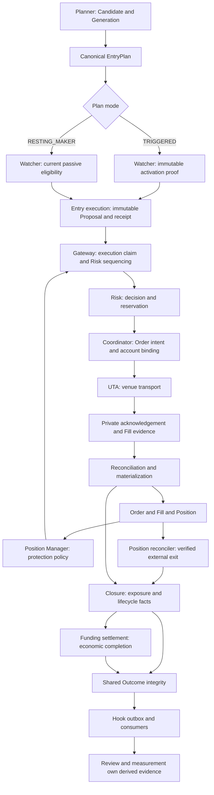

# #3031 A baseline: execution, ownership and Outcome

**Verdict: A audit complete; implementation awaits an owner D1 decision.** G0 is evidenced below. G1–G5 are not accepted, Bitget Demo qualification remains pending, and #3031 stays open. The only recommended first batch is canonical Universe ancestry at the shared Outcome eligibility boundary. This record documents observations; it changes no Contract, product capability, runtime configuration or trading authority.

## 1. Baseline and natural first breakpoint

Audit source: `a41d16460b5e7d6dbec14fd23bbf2143b8ac197e` (GitHub master rechecked before publication). Fedora running/boot/disk: `1543c7c1e705de816a13e63f3a4aa3f9f8bd8038`. The intervening master commit only changes the #2851 evidence document. Thus production source is equivalent for this audit, but the SHAs are not reported as equal. Original local master was divergent with unrelated uncommitted tests; all audit work used a separate worktree.

Live reads were taken **2026-09-10 05:06:20–05:15:46 UTC**. Retrospective session denominator covers **04:01:28.681451–05:15:46 UTC**. These are bounded observations, not a continuing monitor. See [selected runtime reads](evidence-3031/runtime.json).

| Fact | Observed value / limit |
| --- | --- |
| Runtime identity | session `d96c5d259218`, runtime-local-current; process-tree verified live Gateway; PID 232221; behavior `66e1e0bed9fff5e4` |
| Schema | `aletheia-sqlite-v79` |
| Execution account | `bitget_demo`, venue Bitget, environment Demo, `classic_v2`, CCXTUTAAdapter v1 / ccxt 4.5.56; credential generation 29 |
| Exact account fingerprint | `sha256:6dc3d2fc5b4ab7bd90248de369abfd00e3571cb87a1d439173ff1c44041b2577` |
| Account evidence | cache fetched 05:11:39.650349 UTC; sync ok/complete, account and position completeness complete; zero external positions |
| Configuration | Full; Live disabled; spot and USDT futures enabled; `require_llm_at_startup=false` (#3023 not applicable here) |
| Health | healthy, issues/pause owners/blockers empty, paused false; scheduler resume allowed |
| Qualification | `qualifications/uta-bitget_demo.json` absent: `qualification_artifact_unavailable`. Connected account/readiness is not permission or proof for mutation qualification |
| Stale metadata | `exchange.name=paper_internal` remains in config; selected execution mode and actual account identity are Bitget Demo. This field is not evidence of an active simulator |

The control read model's unknown process-local scheduler/exchange values were not interpreted as failures; live HTTP status/health and durable session/account facts were checked separately. The older `auto_recorded` SHA in the selected output is also not the verified Gateway boot identity. No credentials were read or published. Fedora DB queries used SQLite read-only mode against `/home/admin/.aletheia/app.db`; no deployment, restart, exchange mutation or qualification artifact creation was performed.

### Natural chain

`d0bf4311fcb5` Candidate → `b0a26e335f2f` Generation → `ee9ae4665093` Plan → `2afd512012bf` Proposal → `74ef7bfc8837` preflight Risk refusal.

The DOGE/USDT **spot short RESTING_MAKER** Plan was created at 04:04:04 UTC. At 04:17:02.511 UTC, current Bitget quote/trade monitoring was ready and passive eligibility was true. Its null trigger activation is correct for RESTING_MAKER. Proposal creation followed at 04:17:02.521 UTC; Risk rejected it with `stop_distance_below_vol_target:0.2532<1.5000` and `spot_short_not_allowed`. The Plan is terminal `failed/canonical_risk_rejected`, with no Order. **The observed first breakpoint is a normal Risk refusal**, not a missing trigger, submission defect or failed fill. Altering Alpha, tactic or Risk limits to manufacture a trade would not repair it.

The full session denominator is 12 Candidate snapshot rows (not 12 independent theses), 3 planning generations, 1 Plan, 1 Proposal, 1 Risk decision, **0 Orders / 0 Fills / 0 Positions**. Latest snapshot has 3 candidates / 3 execution-eligible candidates; no active Plan remained at the endpoint. The other generations were NEAR `179966302246` (`ENTRY_PLAN_COMPILE_INVALID:EXECUTION_CONTEXT_UNAVAILABLE`) and BGB `4495761ed195` (`PLANNER_SCHEMA_INVALID: constraint_violation`): operational planning failures, not economic NO_PLAN outcomes. All 847 lifetime Orders were historical Paper Internal rows (838 filled, 9 cancelled); these are not external qualification evidence and were preserved. Local open positions were also zero.

Consequently **every natural boundary after Risk remains unobserved in this window**. The downstream map below is source/test evidence, not an invented natural round-trip.

## 2. State ownership and recovery

Source references in this section refer to the audit SHA above. Transactions are local SQLite transactions; no database transaction includes a venue network operation.

| State / canonical owner | Writer and transaction boundary | Recovery / idempotency | Consumers and authority limits |
| --- | --- | --- | --- |
| Candidate claim, planning Generation, Plan — Entry planner | `agent_shell/entry_planner.py`; `storage/repositories.py::complete_candidate_planning_with_plan`: current-input/claim CAS and completed generation + immutable Plan binding in one transaction | Generation ownership/current-input checks; frozen hypothesis/payload/hash | Universe/API and watcher project facts; cannot replace historical inputs |
| Monitoring and activation — watcher / activation protocol | `agent_runtime/fast_trigger_watch.py`; `repo.bind_entry_trigger_activation`: immediate transaction checks Plan hash/runtime, stream/subscription and previous activation, inserts proof and transitions Plan atomically | CAS rejects stale ownership; RESTING checks current BBO without manufacturing activation | UI readiness is a projection, not execution authority |
| Proposal — canonical Entry execution | `execution/entry_plan_execution.py::execute_entry_plan`: immutable intent, unique EntryPlan linkage; current authority and receipt rechecked | Existing Proposal reused; terminal state routed through Gateway; only scoped unique conflict handled | Risk/Gateway consume intent; Proposal is not acknowledgement |
| Execution claim — Gateway | `gateway.py::execute_existing_proposal`: immediate claim + executing transition, token/lease fencing | Expired external submission becomes unknown; token-CAS release; no blind resend | Status API reads; cannot infer external acceptance from executing |
| Risk decision / reservation — Risk Engine | `risk/engine.py::evaluate_proposal`: evaluation lock + immediate working-set transaction; authoritative decision, trace, outcome seed and reservation | Receipt/hash bindings and current exposure rechecked; quantity-only venue normalization before authoritative Risk | Coordinator receives approved authority; preflight refusal is not approval |
| Order intent / acknowledgement — Coordinator | `coordinator.py::execute_order`: qualification check; pending Order and Plan transition atomic; exact account persisted before network; `repo.finalize_exchange_acknowledgement` CAS after response | Pending/unknown only; late private Fill wins; typed not-sent/rejected/ambiguous states | UTA performs transport only, writes no Aletheia DB; ACK is not Fill |
| Fill and entry Position — exchange materializer | `exchange_materialization.py::materialize_bitget_entry`; `_atomic_materialization` immediate transaction/savepoint; actual private fills create Position | Account-scoped Fill IDs, quantity completeness and replay dedup; reconciliation scans unresolved Orders and acknowledged/filled materialization gaps | PnL/API read actual position; no synthetic fill on ACK |
| Position fields — field-specific repository owners | `repositories.py::_update_owned_position_fields` and materialization/exit-plan/observation/settlement helpers enforce field whitelist and expected lifecycle | CAS final close; callers cannot arbitrarily rewrite every Position field | PM owns policy/observations, not private venue facts; multiple callers are not automatically dual owners |
| Close claim / close Order — Gateway and Coordinator | `position_manager.py::close_position_routed` → Gateway → `coordinator.py::_claim_close`: immediate close Order + claim | Same unresolved close returns existing Order; pending claims preserve mark/exit observations; stale claims escalate | UI status cannot clear claim or create another close |
| External disappearance / verified exit — Position reconciler and closure protocol | `position_reconciler.py` exact-account complete observations; `outcome_closure.py::close_position_verified` validates independent evidence and exact instrument/quantity/cost | Durable observations; missing identity remains unresolved; administrative closure has different premises; never error-text-derived fills | Reconciliation is evidence gathering, not a second strategy executor |
| Lifecycle close / economics — materializer, closure, funding settlement | Native private close → `pnl.close_position`: Order/Fill/Position/close event/hook intent in closure transaction. `broker_funding_settlement.py` binds ledger + snapshot CAS and closed Position/event/outbox updates atomically | Funding unknown stays NULL; closed settlement recovery does not fabricate history; audit mirror after commit | Exposure absence, local lifecycle, cost completeness and Outcome eligibility remain separate |
| Outcome eligibility / hooks — shared integrity predicate and durable hook outbox | `analytics/outcome_integrity.py`; `portfolio/outcome_hooks.py` intent recorded with close, lease claim + eligibility recheck | Replay retries hooks without re-executing trades; scheduler hook replay 1 min, execution reconciliation 2 min, PM/position reconciliation 5 min, funding 30 min (initial 4 min) | `learning/outcomes.py`, `analytics/trade_attribution.py`, `agents/post_trade_reviewer.py` consume eligible facts; hooks/review own derived writes, not original trades |
| Entry measurement — existing Learning projection | `learning/entry_context.py`: generation-based ITT/cutoff; filled T0 fixed 4 h; eligible Position evidence required | Immutable input/inference identity and cutoff validation | Read-only trading-fact projection; measurement/Observation own their evidence state, no new execution authority |

No second generic Order or Position ledger was established by this audit. Existing CAS/field-owner convergence already addresses part of the historical ownership concern. Source names containing `bitget` do not alone establish competing implementations; the normalized materializer and evidence-specific close entrances answer distinct questions.

## 3. Requirement → implementation → evidence → gap matrix

Contracts consulted include [Entry](../../design/contracts/entry-plan-contract.md), [Execution](../../design/contracts/execution_contract.md), [Risk](../../design/contracts/risk_engine_contract.md), [Persistence](../../design/contracts/persistence_recovery_contract.md), [Learning](../../design/contracts/learning_contract.md), [Opportunity Outcome](../../design/contracts/opportunity_outcome_contract.md), and [trust policy](../../governance/policies/trust_and_change_control.md). Opportunity counterfactual outcomes are not automatically realized-trade outcomes. Current product-scope documents outrank stale explanatory architecture prose.

| Requirement / focused owner | Current implementation and executable evidence | Runtime evidence / current disposition |
| --- | --- | --- |
| External Gate B — #2899 | Account identity/qualification guards, Coordinator/private materialization exist. Existing external entry/close/funding tests exercise parts of the mechanical path | Demo account connected, but artifact absent and zero external Orders. **Not qualified**. Old “qualify before Paper retirement” sequence superseded by #3022; no simulator restoration |
| Current external E2E coverage — #2993 | Two external pipeline suites exist after #3007. Current Entry suite has 13 failures at `entry_trigger_activation_required`, before its claimed downstream assertions; fixture no longer satisfies #3026 activation authority | “No external E2E exists” superseded. Coverage is real but Entry baseline needs current activation fixtures; do not weaken production gate or add another test platform |
| Incomplete close costs — #3008 | Strict third-currency-fee xfail persists. Native materialization records lifecycle closed with exit fee / realized economics NULL and Outcome ineligible; verified closure independently rejects unavailable/unconvertible costs | No natural close to adjudicate. Old economic-complete pollution claim not supported. Execution §11.3 vs lifecycle/economic separation requires explicit semantic resolution, not automatic test-driven choice of close meaning |
| Exact account/position uPnL — #571 | `portfolio/pnl.py` checks broker-position/account fingerprint, scoped multiplicity, freshness/source; PL-PM16–19 and neighboring PnL suite pass | Generic historical missing-scoping hypothesis largely superseded; empty runtime account does not qualify nonzero uPnL attribution |
| Close/retry convergence — #572 | Atomic close claims, pending protection, escalation, typed no-position and verified absence paths; close confirmation / outcome closure tests pass | Core historical gap substantially implemented. Actual Demo close/restart evidence pending; no basis for new generic state machine |
| Proposal ancestry / old alternate entry — #1859 | Old `create_paper_proposal` / PiDecision entry path removed. Current production calls to submit/execute-existing resolve through EntryPlan. Direct exported submit and Risk helper still permit absent Plan | No current production caller proving autonomous bypass. Track latent residual separately; do not restore old PiDecision semantics or equate this with downstream Outcome gap |
| Liquidation proof matches execution margin — #1451 | `_check_liquidation_buffer` uses isolated formula; Bitget classic profile defaults command margin to cross. Probe proves helper accepts sample while actual serialization is cross | Futures enabled, so relevant conditional risk concern. Probe is **not full Risk approval or unsafe order reproduction**; current natural Plan is spot. Existing Contract names an estimate; exact cross admission target is not uniquely D0 |
| Required startup LLM gate — #3023 | Async pending gate concern remains in code | `require_llm_at_startup=false`: **not applicable to this deployment**, not fixed/closed |
| Model identity joins — #2866 | Actual Entry prompt raw hash differs from inference canonical-JSON hash. Persisted cohort probe changing only ledger hash changes `observational` to `unavailable/entry_learning_mixed_model_identity` | Confirmed integration defect; no runtime eligible filled Outcome yet. Existing focused owner retained; not a new Learning initiative |
| Canonical Universe lineage reaches Outcome — **#3031, new gap, no separate focused owner yet** | `entry_plan_execution.py` assigns opportunity only for Serenity. Real fixture Plan→Proposal→Coordinator→private Fill→Position preserves Candidate/Generation/Plan/Order ancestry with NULL opportunity. `outcome_integrity.py::attribution_chain_complete` requires opportunity and only resolves Opportunity/Serenity tables; additional closure/cohort gates repeat requirement | Deterministic current-source downstream exclusion. No natural close occurred. Existing PL-OF fixtures with legacy opportunity do not cover Universe ancestry. **Recommended first batch, D1 decision below** |
| Product truth residue — #3031 baseline / prior #3028 target | `server/routes/universe.py` still declares FundingReadiness / EntryPlanProjection.funding_readiness; SYSTEM_MAP has obsolete Paper entries | Current config also retains legacy exchange name. Protocol/docs residue, not active Paper trading proof; lower priority than shared Outcome exclusion |

Issue bodies/comments were retrieved in current state and all-state duplicate searches were performed for the new attribution gap; no exact existing focused owner was established. An open label did not establish a defect. None of these focused Issues is closed by this audit.

## 4. Validation and limitations

All checks were focused, local, isolated SQLite / venue-double checks on audit source. No remote GitHub workflow, local Gateway, full suite, qualification trade or production migration was run. [Recorded node IDs and results](evidence-3031/validation.txt):

| Selected check | Result | What it proves |
| --- | --- | --- |
| `tests/e2e/test_pipeline_exchange_entry_to_position.py`, `test_pipeline_exchange_position_to_close.py`, `test_exchange_funding_golden_path.py`, `tests/uta/test_execution_coordinator.py` | **13 failed, 39 passed, 1 xfailed** | Existing baseline is not green; 13 Entry tests fail on missing activation; #3008 strict xfail remains |
| `tests/test_pnl_pipeline.py`, `test_exchange_close_confirmation.py`, `test_outcome_closure.py`, `test_entry_learning_context.py`, `tests/specs/spec_pipeline_risk_execution_integrity.py` | **146 passed** | Scoped existing ownership/evidence behavior, not a real venue qualification |
| `tests/specs/spec_pipeline_outcome_feedback.py`, `spec_broker_funding_settlement.py` | **21 passed** | Existing Outcome/funding fixtures; does not cover the newly exposed canonical Universe omission |
| Four archived diagnostic probes | **4 passed** | Confirm observed discrepancies, not post-fix regression success |

Reproduce each selected group with `uv run --no-sync pytest -q` and the listed full paths. Diagnostic source is [baseline_probes.py](evidence-3031/baseline_probes.py), archived outside test collection because it records **pre-fix behavior**, not desired permanent assertions. At the audit SHA, copy it temporarily to `tests/e2e/test_audit_3031_probe.py`, run `uv run --no-sync pytest -q -s tests/e2e/test_audit_3031_probe.py`, then remove that one scratch file.

The ancestry probe uses the existing approving Risk and UTA doubles and bypasses fixture runtime fingerprint validation; it does **not** prove real Risk approval, live account transport, closure or full economic eligibility. It does use real RESTING receipt handling, Proposal/Order persistence, private entry materialization and the shared attribution predicate. The margin probe tests check 18 and actual profile serialization, not the whole Risk decision. The hash probe uses the real inference call builder and isolated persisted cohort fixtures; no historical runtime payload was rewritten. These limits are part of the evidence, not reasons to report simulated facts as actual execution.

## 5. Single recommended first batch and owner decision

**Recommendation: make the existing shared realized-Outcome ancestry gate resolve the current canonical EntryPlan source identity, including Universe Candidate/Generation lineage.** Reuse the shared integrity owner; retain exact Proposal/Order/Position linkage and existing economic-completeness checks. Do not create synthetic Opportunities, backfill immutable history, add a second ledger or weaken eligibility.

Facts: current Entry construction intentionally leaves Universe `opportunity_id` NULL; the real persistence/materialization probe retains the canonical chain; the shared predicate deterministically rejects it. `assess_position_closure` and cohort SQL also encode the old opportunity requirement, so repairing only one caller would leave sibling consumers broken. The old trust policy §1.1 / PL-OF01/04 require Opportunity while the current Entry Contract defines Universe Candidate lineage. **This is a Contract conflict, not a uniquely specified D0.** Confidence is high for source/fixture exclusion; actual closed-runtime impact remains unobserved.

Why first: no deterministic wrong-funds or incorrect full Risk approval was reproduced; #1451 is a material but conditional estimate/serialization concern. Existing recovery/close ownership is substantially implemented and its selected checks pass. Canonical ancestry is a proven shared rule that blocks multiple current Outcome consumers regardless of cost correctness. API tails are lower priority. The observed natural Risk refusal itself needs no repair.

**Requested D1 decision:** accept canonical EntryPlan source ancestry as valid realized-trade causal identity for Universe entries, while preserving the existing source-specific Serenity/Opportunity path and all account/fill/economic eligibility requirements. This changes the accepted identity rule at the Outcome boundary; it does not change Alpha, economic selection, Risk limits, tactic, execution permissions or Live. No implementation of this decision is included in this record.

If accepted, the bounded implementation would converge the shared predicate, closure check and cohort read condition on that accepted source rule, update the conflicting Contract/SpecClaims, and reuse existing fixtures. Acceptance must include canonical Universe success; missing/wrong Candidate or Generation, mismatched Plan/Proposal/Order, external-account mismatch, incomplete fee/funding and administrative close negatives; existing Serenity lineage; hook replay and declared measurement consumer handoff. Replace diagnostic bug assertions with meaningful pre-fix failing/post-fix passing regressions. Restore activation fixtures only where required to exercise those existing paths; do not mock away the gate being claimed.

Historical payloads/hashes and economics remain immutable. Any changed eligibility of historical canonical records must be explicitly bounded in the accepted decision and verified, not silently promoted into old measurement windows. Rollback is code/eligibility-policy rollback compatible with v79; no DB history rollback, simulator fallback or blind close resend. Real route qualification remains a separate authorized Gate B action after code acceptance.

**Current gates:** G0 baseline/ownership evidenced; G1 source/test partial and live downstream absent; G2 ancestry/close semantic gaps; G3 ownership mapped with product residue; G4 known 13-failure baseline; G5 `runtime qualification pending`; O1 `natural_runtime_evidence_pending`. Next action is owner decision on the single ancestry boundary above. A completion does not close #3031 or claim profitability.
