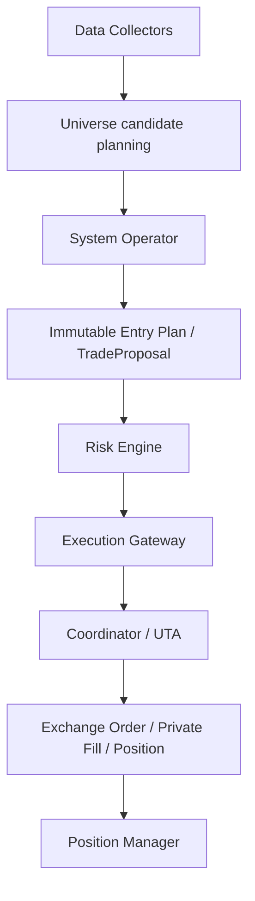

# Architecture Reference

> 快速导航层。深度内容见各链接文档；本文不重复细节。

> 当前支持边界只认
> [`ACTIVE_RUNTIME_SCOPE.md`](../../product/ACTIVE_RUNTIME_SCOPE.md) 和
> [`CAPABILITY_GROUND_TRUTH.md`](../../product/CAPABILITY_GROUND_TRUTH.md)；
> 本页仅作导航，不把已实现模块或历史图表升级为受支持能力。

---

## Tech Stack

| Layer | Technology |
|-------|-----------|
| 语言 | Python 3.12（后端）/ TypeScript + React 18（前端）|
| Web 框架 | FastAPI + uvicorn（`--loop none` 强制，防 IOCP 冻结）|
| 数据库 | SQLite（WAL 模式，进程级 `_WRITE_LOCK` 写序列化，`busy_timeout=30s`，线程本地连接；运行实例使用 owner 选定的数据根目录）|
| 包管理 | `uv`（禁用 pip/poetry）|
| 前端构建 | Vite + React（产物 `aletheia/dashboard_static/`，gitignored）|
| 交易所接入 | Core 通过 UTA/Coordinator 与 Exchange Port 访问已注册的 `bitget_demo`、`okx_demo`、`binance_testnet`；注册不等于凭据、能力或资格证明 |
| LLM 路由 | 兼容 OpenAI / Anthropic 格式；实际 provider 以运行实例 provenance 为准 |
| 进程管理 | supervisor → frontdoor(:8787) + backend(:8788)，`lifecycle.py` 统管 |
| 任务调度 | APScheduler（max_workers=3，不得上调）|

---

## Where modules live

模块与调用链导航只有一个入口：[System Map](SYSTEM_MAP.md)（任务 → owner → 源码 → focused tests），
stage → location 另见 [`AGENTS.md`](../../../AGENTS.md#where-the-stages-live)。本页不再维护第二份目录树副本：
旧树把 core 写成仓库根下的 `aletheia/`、把 venue adapter 挂在 core 下，都与
`core/` + `extensions/` 的现状相反。信任边界清单见文末「禁止修改区域」。

Symbol 显示唯一合法入口：`frontend/src/lib/format.ts` 的 `fmtSymbol()`；其他位置不得自行拼接 symbol 文本。

---

## Module Seams

大文件按领域拆成 seam 模块（facade + `<facade>_<domain>.py`）。facade 保留 shared writers、事务 helper 和公开签名；seam 只承担该域的读/纯计算。所有 seam 通过 facade `from ... import *` 再导出，`from aletheia.<pkg> import <name>` 的旧用法不变。

| Facade | Seams | Facade 只留 |
|---|---|---|
| `storage/repositories.py` | `repositories_positions` `repositories_universe` `repositories_research` `repositories_market_data` `repositories_execution` | `_stamp_provenance` / `_insert` / `_update` / `_select_*` / `transaction`；所有 writers（domain seam 因 ownership guard 拒绝导入 generic writers）|
| `diagnostics/doctor.py` | `probes/content` `probes/storage_trust` `probes/environment` `probes/data_quality` `probes/trading` | `Check` / `Report` 类；`_build_report` 编排；shared helpers（`_age_minutes`, `_fmt_age`, `_parse_iso_datetime`）|
| `observation_lab/canonical.py` | `canonical_adapters`（Domain A：value helpers + adapter Protocol/registry singleton）`canonical_lifecycle`（Domain B：Lab 证据 + lifecycle writes）| Domain C/D/E（authority/treatment 决策 · Main/Lab transport · retention/archive）— 跨事务边界，暂未拆 |
| `agent_runtime/scheduler.py` | `scheduler_retention`（`_prune_*` × 7 + `_cleanup_catchup_due`）| `_run_cleanup` 因 `spec_agent_contracts` AST-scan 阻拦保留；所有 `add_job()`、`_ESSENTIAL_JOBS`、timeout workers |
| `analytics/profit_gradient_evidence.py` | `profit_gradient_evidence_utils`（8 SAFE：`_json` `_hash` `_utc_text` `_text` `_safe_json_object` `_parse_utc` `_iso` `_finite`）| builder / verifier / registration / pairing / coverage — 跨事务 + `source_hash` binding，未拆 |

### 单函数解构

不新增文件，直接把巨型函数拆成同模块 `_` prefix helpers：

| 函数 | 起始 → 当前 | Helpers |
|---|---|---|
| `execution/reconciliation.py::reconcile()` | 767 → 123 (-84%) | `_validate_reconcile_identities` `_recover_filled_gap_orders` `_reconcile_multibroker_orders` `_prepare_bitget_private_views` `_recover_exchange_order_id` `_fetch_order_history_and_ioc_state` `_converge_legacy_order_status` `_materialize_native_order` |
| `agent_shell/operator_recommendations.py::build_recommendations()` | 946 单函数 → 完全解构 | 11 helpers：`_make_task_recommendation` factory + `_build_*_recommendation(s)` × 8 + `_missing_review_strategy_ids` + `_group_agent_runs` |
| `storage/repositories.py::ensure_candidate_planning_generation()` | 383 → 187 (-51%) | `_candidate_planning_existing_state` `_candidate_planning_requalification` `_candidate_planning_generation_data` |
| `agent_shell/entry_planner.py::plan_next_candidate()` | 430 → 226 (-47%) | `_parse_candidate_opportunity` `_ensure_entry_orderbook` `_build_fresh_entry_context` `_validate_and_bind_hypothesis` `_compile_current_entry_plan` `_load_or_invoke_hypothesis` |
| `agent_shell/commands.py::review_portfolio_state()` | 638 → 部分拆 | `_collect_fresh_review_marks` `_collect_review_scope` `_record_unavailable_review` `_normalize_review_and_select_target` `_build_review_request`（`_apply_review_effect` + `_finalize_review` 契约敏感未拆）|

### 未拆的巨型函数（audit 完成，拆分成本 > 收益）

| 函数 | 行数 | 阻拦 |
|---|---|---|
| `universe/service.py::refresh()` | 564 | 4 spec 用 `inspect.getsource(refresh)` 或按文件路径截取函数体做 AST 断言；改行为断言的工作在 #3561 |
| `agent_runtime/scheduler.py::init_scheduler` | 467 | INV-SCH-5 spec 用 AST 扫 scheduler.py 检查每个 `add_job` wrapper；改行为断言的工作也在 #3561 |
| `risk/engine.py::_evaluate_proposal_locked` | 595 | 未 audit；D2 敏感，风控决策核心 |
| `execution/gateway.py::_execute_proposal` | 516 | 未 audit；段 3 主入口 |
| `universe/features.py::_fetch_single_feature` | 487 | 未 audit |
| `universe/filter_outcome_recorder.py::settle_due_filter_outcomes` | 455 | 未 audit |
| `extensions/observation_lab/canonical.py::resolve_observation_treatment` | 480 | Domain C（authority/treatment 决策），跨 Main/Lab 事务边界，RISKY |

---

## Data Flow（简版）

本地模拟执行已退役，旧定义见[历史归档](../history/local_simulated_risk_execution.md)。

## Unified Trading Account boundary

[`unified_trading_account.md`](../proposals/unified_trading_account.md) 已接受
完整 UTA 设计，取代“UTA 仅只读”这一旧决策。UTA 是六个现有外部执行模式的唯一
私有账户读路径；Gateway 的授权变更通过通用 Coordinator 和 `CCXTUTAAdapter`，
本地 storage 保留事实与 CAS。Binance、OKX、Bitget Classic-v2 与 UTA-v3 的差异
限制在 `extensions/exchanges/{venue}/profile.py` 与 venue-native exception，返回 Core 可消费的规范化 DTO；
不存在 legacy/shadow selector 或私有 broker fallback。

Coordinator 负责 pending/claim、外部调用后的短 CAS、审计以及未知结果的重对账，
UTA 只负责外部账户 I/O。已注册的 Demo/Testnet 模式仍不证明凭据、仪器能力、账号
可达或端到端资格；Live 仍在当前支持面之外，读取账户也不会授予变更权限。该边界
记录的是静态代码事实，不声称外部往返或 Fedora 部署已经完成。

---

## 禁止修改区域（无 owner 明确授权不得碰）

| 路径 | 理由 |
|------|------|
| `core/aletheia/risk/` | 风控核心，行为变更必须有回归测试 |
| `core/aletheia/execution/` | 执行网关，直接影响资金安全 |
| `extensions/exchanges/bitget/auth.py` | 凭证签名逻辑 |
| `core/aletheia/config/secrets.py` | 密钥处理 |
| `core/aletheia/agent_runtime/permissions.py` | Agent 权限边界 |
| `core/aletheia/server/routes/live.py` | 实盘开关 |

---

## 深度阅读

- 架构全景（8章）→ [`docs/design/architecture/SYSTEM_ARCHITECTURE_GUIDE.md`](SYSTEM_ARCHITECTURE_GUIDE.md)
- 数据模型 → [`docs/design/data/data_model.md`](../data/data_model.md)
- Agent 契约 → [`docs/design/contracts/agent_contracts.md`](../contracts/agent_contracts.md)
- 信任边界规则 → [`docs/governance/policies/trust_and_change_control.md`](../../governance/policies/trust_and_change_control.md)
- 完整 AI 规则 → [`AGENTS.md`](../../../AGENTS.md)
