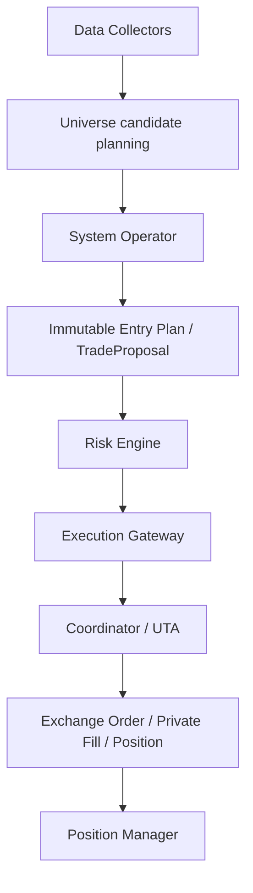

# Architecture Reference

> 快速导航层。深度内容见各链接文档；本文不重复细节。

> 当前支持边界只认
> [`ACTIVE_RUNTIME_SCOPE.md`](../../product/ACTIVE_RUNTIME_SCOPE.md) 和
> [`CAPABILITY_GROUND_TRUTH.md`](../../product/CAPABILITY_GROUND_TRUTH.md)；
> 本页仅作导航，不把已实现模块或历史图表升级为受支持能力。

---

## Tech Stack

| Layer | Technology |
|-------|-----------|
| 语言 | Python 3.12（后端）/ TypeScript + React 18（前端）|
| Web 框架 | FastAPI + uvicorn（`--loop none` 强制，防 IOCP 冻结）|
| 数据库 | SQLite（WAL 模式，进程级 `_WRITE_LOCK` 写序列化，`busy_timeout=30s`，线程本地连接；运行实例使用 owner 选定的数据根目录）|
| 包管理 | `uv`（禁用 pip/poetry）|
| 前端构建 | Vite + React（产物 core/aletheia/dashboard_static/，gitignored）|
| 交易所接入 | 当前产品路线是 Core → UTA/Coordinator → Exchange Port → Bitget Extension (`bitget_demo`)；OKX/Binance 注册身份冻结，仅保留历史/恢复义务 |
| LLM 路由 | 配置的 HTTP Endpoint；协议限 `openai_chat_completions`、`openai_responses`、`anthropic_messages`，实际 endpoint/model 以运行实例 provenance 为准 |
| 进程管理 | supervisor → frontdoor(:8787) + backend(:8788)，`lifecycle.py` 统管 |
| 任务调度 | APScheduler（max_workers=3，不得上调）|

---

## Directory Structure

```
aletheia-trading-os/
├── core/                   # Slim Core（稳定交易语义、运行时与最小操作面）
│   └── aletheia/
│       ├── agents/         # 观察、候选整理、Operator 决策和复盘 worker
│       ├── risk/           # ⚠️ 信任边界：风控引擎（勿随意改）
│       ├── execution/      # ⚠️ 信任边界：执行网关（勿随意改）
│       ├── uta/            # 交换端口、规范化 DTO 与账户边界
│       ├── data/           # 规范化市场事实与数据端口
│       ├── config/         # 配置 schema（改此处必须同步前端 Settings 页）
│       ├── storage/        # SQLite 连接、repositories 与 migrations
│       ├── learning/       # Outcome/安全边界所需的 Core 语义
│       ├── server/         # FastAPI 路由（routes/）
│       ├── agent_runtime/  # Scheduler、任务 guard、pause/resume 与 runtime 生命周期
│       └── dashboard_static/ # 前端构建产物（gitignored，需手动 build）
├── extensions/             # 可选/具体外部实现；不得成为 Core 权威
│   └── exchanges/
│       └── bitget/auth.py  # ⚠️ 信任边界：凭证签名（勿随意改）
├── frontend/               # React/Vite 前端源码
│   └── src/
│       └── lib/format.ts   # fmtSymbol()：唯一合法 symbol 显示入口
├── tests/                  # 回归测试与可执行规格
│   └── specs/spec_*.py     # SDD executable claims
├── scripts/                # 运维、验证与文档治理脚本
├── data/                   # checkout 本地数据（gitignored；不得代表 Fedora 运行状态）
├── docs/                   # 文档（见 docs/README.md 四层金字塔）
├── AGENTS.md               # ← AI agent 仓库规则路由
└── core/aletheia/config/secrets.py # ⚠️ 信任边界（勿随意改）
```

---

## Data Flow（简版）



本地模拟执行已退役，旧定义见[历史归档](../history/local_simulated_risk_execution.md)。

## Unified Trading Account boundary

[`unified_trading_account.md`](../proposals/unified_trading_account.md) 已接受
完整 UTA 设计，取代“UTA 仅只读”这一旧决策。UTA 是已注册外部执行模式的唯一
私有账户读路径；Gateway 的授权变更通过通用 Coordinator 和 `CCXTUTAAdapter`，
本地 storage 保留事实与 CAS。Binance、OKX、Bitget Classic-v2 与 UTA-v3 的差异
限制在 extensions/exchanges/ccxt/profiles/ 与 venue-native exception，返回 Core 可消费的规范化 DTO；
不存在 legacy/shadow selector 或私有 broker fallback。

Coordinator 负责 pending/claim、外部调用后的短 CAS、审计以及未知结果的重对账，
UTA 只负责外部账户 I/O。当前新入场/资格路线仅为 Bitget Demo；OKX/Binance
注册身份冻结，只承担历史读取与既有暴露恢复。注册仍不证明凭据、仪器能力、账号
可达或端到端资格；Live 仍在当前支持面之外，读取账户也不会授予变更权限。该边界
记录的是静态代码事实，不声称外部往返或 Fedora 部署已经完成。

---

## 禁止修改区域（无 owner 明确授权不得碰）

| 路径 | 理由 |
|------|------|
| core/aletheia/risk/ | 风控核心，行为变更必须有回归测试 |
| core/aletheia/execution/ | 执行网关，直接影响资金安全 |
| extensions/exchanges/bitget/auth.py | 凭证签名逻辑 |
| core/aletheia/config/secrets.py | 密钥处理 |
| core/aletheia/agent_runtime/permissions.py | Agent 权限边界 |
| core/aletheia/server/routes/live.py | 实盘开关 |

---

## 深度阅读

- 架构全景（8章）→ [`docs/design/architecture/SYSTEM_ARCHITECTURE_GUIDE.md`](SYSTEM_ARCHITECTURE_GUIDE.md)
- 数据模型 → [`docs/design/data/data_model.md`](../data/data_model.md)
- Agent 契约 → [`docs/design/contracts/agent_contracts.md`](../contracts/agent_contracts.md)
- 信任边界规则 → [`docs/governance/policies/trust_and_change_control.md`](../../governance/policies/trust_and_change_control.md)
- 完整 AI 规则 → [`AGENTS.md`](../../../AGENTS.md)
