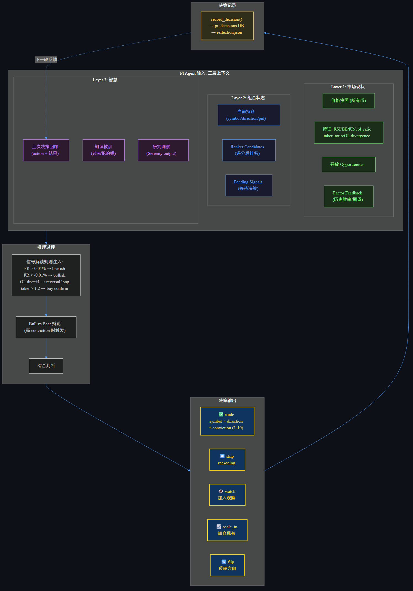
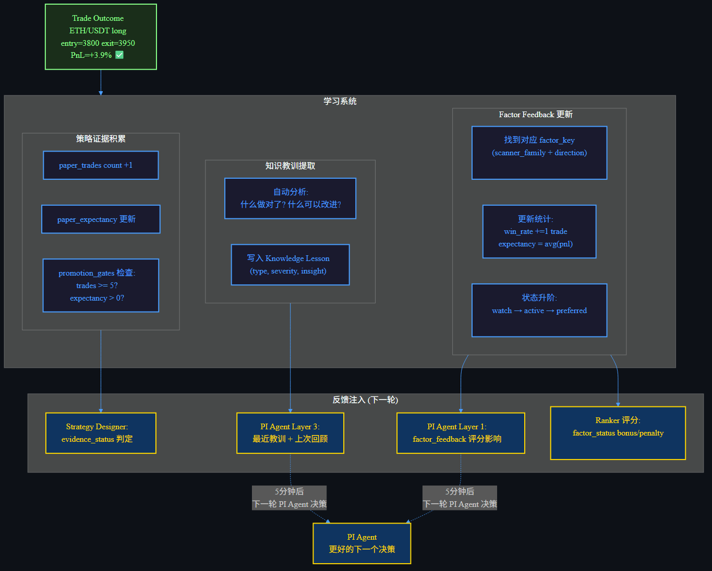
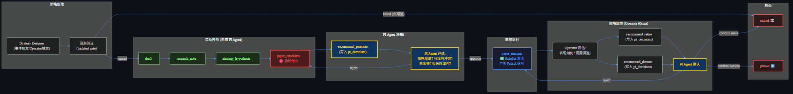
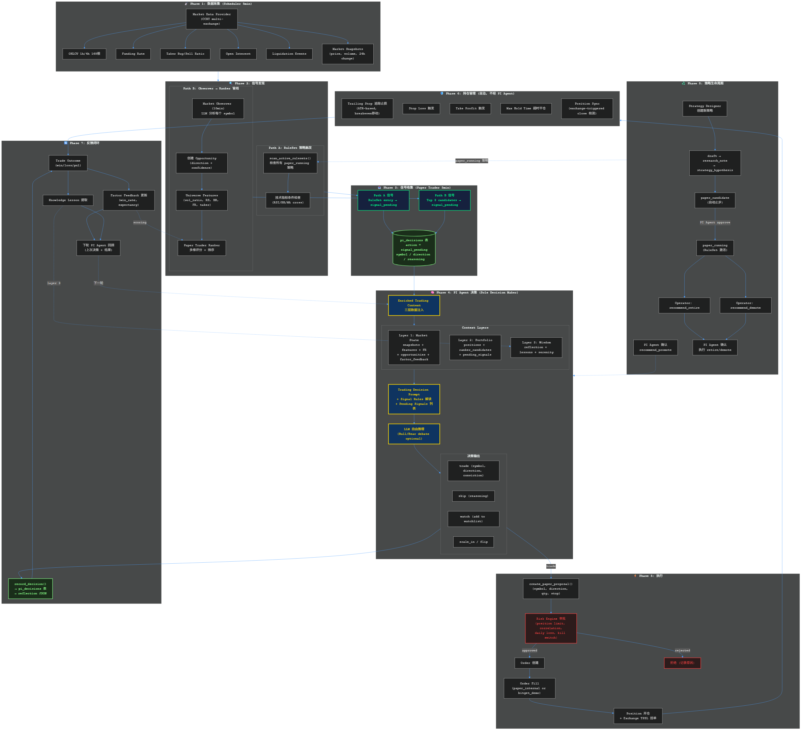

# Aletheia Trading OS — 系统架构全景图

> 本文档是解释性导览，不是能力或运行状态权威。
> 当前支持边界只认 [`ACTIVE_RUNTIME_SCOPE.md`](../../product/ACTIVE_RUNTIME_SCOPE.md)
> 与 [`CAPABILITY_GROUND_TRUTH.md`](../../product/CAPABILITY_GROUND_TRUTH.md)；
> 图示若与这两份文件或可执行证据冲突，以后者为准。

---

## 第一章：全景 — 系统里有谁


想象 Aletheia 是一家小型对冲基金，有明确分工：

| 角色 | 组件 | 职责 | 自治权 |
|------|------|------|--------|
| 入场决策者 | **System Operator** | 对确切候选输出 `trade` / `skip` | 唯一受支持的入场策略决策主体 |
| 市场观察 | Market Observer | 对 emitter-admitted Opportunity 做可选 LLM advisory enrichment | 只写 namespaced assessment，不下单 |
| 候选整理 | Paper Ranker / Paper Trader | 确定性筛选并写 `signal_pending` | 不调用 LLM，不提交 Proposal |
| 运行评估 | Python Operator assessment | 有界配置建议、通知和仍存在的委派 | 不是交易策略主体 |
| 保护性持仓管理 | Position Manager | 止损、止盈、追踪和受控平仓 | 只缩减既有授权持仓 |

**核心原则**：System Operator 是唯一受支持的入场策略决策主体；Risk Engine
和 Execution Gateway 仍是独立硬边界，任何组件都不能绕过它们。

---

## 第二章：数据采集 — 系统的"眼睛"


活动主线从运行时配置并记录的 market-data venue 获取 crypto spot/perpetual 市场事实，
并把 venue、market type 和 symbol 身份保留到持久化记录。其他 adapter 或历史采集代码
的存在不等于当前 Supported 能力。核心数据包括：

| 数据 | 内容 | 用途 |
|------|------|------|
| OHLCV | 多周期 K 线 | 结构化技术上下文 |
| Funding Rate | 永续资金费率 | 杠杆拥挤度证据 |
| Taker Ratio | 主动买/卖比 | 市场结构上下文 |
| Open Interest | 持仓量变化 | OI 与价格关系 |
| Liquidation | 爆仓事件 | 极端市场上下文 |
| Price Snapshot | 带 venue/market type 的价格事实 | 估值与新鲜度检查 |

原始数据经特征计算引擎加工后存入 `universe_feature_snapshots` 表：
- `vol_ratio`：当前成交量 / 均值（放量检测）
- `relative_strength_24h`：相对 BTC 的 24h 强弱
- `oi_price_divergence`：+1 隐性积累 / -1 弱势反弹 / 0 正常
- `taker_buy_ratio`：主动买入占比

---

## 第三章：信号发现 — "我觉得 ETH 可以做多"


当前受支持的入场候选只有一条因果链：

```
Market Observer (10min)
  → LLM 读取确切 instrument 的有来源市场事实
  → 写入 Opportunity
  → Paper Ranker 确定性筛选
  → Paper Trader（3min fallback + committed-event nudge）
  → 写入 signal_pending PiDecision
  → System Operator（事件驱动 + ~15min fallback）
  → 输出 trade / skip
  → trade 才形成不可变 Proposal，随后进入 Risk 与 Execution
```

Paper Trader 不调用 LLM、不提交 Proposal，也不直接平仓。旧的
`paper_running RuleSet → 自动触发` 路径已经删除；表名、旧记录或历史图中仍出现
这些状态，不构成当前产品能力。

---

## 第四章：System Operator 决策 — 唯一的"按钮"在这里



System Operator 由 committed event 唤醒，并保留约 15 分钟的 fallback。每次只处理
一个确切 pending candidate，面前是三层信息：

### Layer 1: 市场现在长什么样
- 所有币的价格快照
- 特征指标（RSI/BB/FR/vol_ratio/taker/OI_divergence）
- 开放 Opportunities
- Factor Feedback（历史胜率/期望）

### Layer 2: 我现在手里有什么
- 当前持仓（symbol/direction/pnl）
- Ranker 评分后的候选列表
- **等待我决策的 pending_signals**

### Layer 3: 我过去学到了什么
- 上次决策回顾（我做了什么？结果如何？）
- Knowledge Lessons（犯过的错）
- Serenity Research（研究洞察）

### 决策过程

1. 信号解读规则注入 prompt（硬编码逻辑）：
   - FR > +0.01% → 多头拥挤，bearish 偏向
   - FR < -0.01% → 空头拥挤，bullish 偏向
   - OI_div=+1 → 隐性积累（OI↑ price↓），可能反转做多
   - taker > 1.2 → 主动买入确认
   - vol_ratio > 2x → 放量突破确认

2. Bull vs Bear 辩论（高 conviction 时触发）

3. 输出决策：

| 决策 | 含义 | 后续 |
|------|------|------|
| `trade` | 确认交易 | → 执行层下单 |
| `skip` | 放弃信号 | 记录原因，下轮可回顾 |

---

## 第五章：执行与风控 — 从决策到下单


System Operator 说 `trade ETH/USDT long conviction=8` 之后：

### Step 1: 仓位计算
```
波动率目标 Sizing:
notional = target_risk_per_trade / ATR%
quantity = notional / current_price
stop_price = price × (1 - stop_loss_pct%)
```

### Step 2: Risk Engine 五关审批

| 关卡 | 检查 | 失败后果 |
|------|------|----------|
| 1 | 持仓数量 < max_positions? | 拒绝 |
| 2 | 同方向暴露 < directional_limit? | 拒绝 |
| 3 | 与现有持仓相关性 < threshold? | 拒绝 |
| 4 | 当日已亏 < daily_loss_limit? | 拒绝 |
| 5 | Kill Switch 未激活? | 拒绝 |

### Step 3: 下单执行

当前 Supported execution mode 只有 `paper_internal`，由本地 Paper broker 模拟成交。
Exchange demo/live adapter 代码的存在不构成 Supported 能力；Live 默认关闭，且任何未来
启用仍必须保留显式人工授权和完整 Risk/Execution 信任边界。

### Step 4: 成交链路
```
Proposal → Order → Fill → Position → Exchange TPSL 挂单
```

---

## 第六章：持仓管理 — 自治安全层


这是系统中**唯一不经 System Operator 的环节**。原因：止损必须秒级执行，不能等 LLM。

每分钟自动检查：

| 机制 | 触发条件 | 动作 |
|------|----------|------|
| **追踪止损** | 价格上涨 | 止损跟随最高点（ATR-based） |
| **保本移动** | 涨幅 > breakeven_threshold | 止损移到成本价 |
| **硬止损** | price ≤ stop_price | 立即平仓 |
| **止盈** | price ≥ target_price | 获利了结 |
| **超时保护** | 持仓 > max_hold_hours | 强制平仓 |
| **交易所同步** | exchange TPSL 成交 | 本地状态同步 |

平仓后 → 计算 PnL → 输出 Trade Outcome → 进入反馈闭环。

---

## 第七章：反馈闭环 — 结果先成为证据，再允许影响决策



交易结束后，系统先持久化真实 close、净结果和因果归因，再运行后续消费者：

### 1. Outcome 与 Attribution
- 只接纳能回溯到 Opportunity、Proposal、RiskDecision、Order、Fill 和 Position 的结果
- 区分未验证、部分结算和已验证 genuine outcome，不用缺失数据补造胜负

### 2. Review 与 Knowledge
- Post-trade review 和 lesson review 可以产生持久化知识
- 知识只有在明确声明的 consumer 路径中才参与后续上下文；存在一条记录不等于已生效

### 3. Measured Learning
- 受支持的 exposure / treatment / control 路径写入固定身份与 outcome contract
- measurement-unsupported 的 ranker、persona 等 hook 保持静态 fallback，不创建正式 exposure
- 旧 Strategy promotion / demotion 链已经删除，不会因交易计数或期望值自动恢复

因此，反馈是可审计、可归因的后续输入，不承诺“下一轮必然生效”，也不把相关性冒充因果改进。

---

## 第八章：策略生命周期 — 当前支持边界



本图和旧的 `draft → paper_candidate → paper_running` 流程属于历史规则引擎设计。
RuleSet、Strategy Designer、backtest orchestrator 和 Optuna 策略变体路径已经删除，
不属于当前产品能力。

当前 System Operator 的受支持交易职责是：读取一个确切候选的三层上下文，产生
`trade` 或 `skip`，并让完整 `trade` 进入不可变 Proposal、Risk 和 Execution Gateway。
Python Operator assessment 只保留有界配置调整、通知和仍存在的一次性委派。
历史 `recommend_promote` / `recommend_retire` / `recommend_demote` 没有可达的策略
生命周期消费者，不得从表中存在旧记录推断功能仍可用。

未来若重新引入策略生命周期，必须作为新的产品能力重新建立入口、审批、执行消费者、
持久状态、回退和端到端证据，而不是复用历史图中的状态名。

---

## 完整交易流程图



---

## 设计哲学总结

| 原则 | 实现 |
|------|------|
| **System Operator 是入场决策者** | 当前候选只产生 `trade` / `skip`；Risk 与 Execution 仍是独立硬边界 |
| **其他组件只产出候选事实** | Observer 写 Opportunity，Paper Trader 写 `signal_pending`；二者都不提交 Proposal |
| **保护层自治但不扩权** | Position Manager 只能缩减既有授权持仓，仍保留因果链和审计 |
| **反馈先测量后影响** | verified outcome、归因与正式 exposure 先落账；unsupported hook 保持静态 fallback |
| **策略生命周期不冒充能力** | 旧 RuleSet 升阶/退役链已删除；未来恢复必须重新证明完整链路 |
| **Risk Engine 是硬墙** | System Operator 的 `trade` 仍须通过独立 Risk 审批才能执行 |

---

## 附录：定时任务一览

| 组件 | 周期 | 做什么 |
|------|------|--------|
| Market Data Collector | 5 min | 拉取价格/FR/OI/Taker/Liquidation |
| Market Observer | 10 min | 对 emitter-admitted Opportunity 做可选 LLM enrichment |
| Paper Trader | 3 min fallback + committed-event nudge | 确定性候选整理 → 写 signal_pending |
| System Operator trading decision | event-driven + ~15 min fallback | 读确切 pending candidate → `trade` / `skip` |
| Position Manager | 30 sec protective cycle（另有 exchange TP/SL fill check） | 追踪保护 / 检查平仓条件 |
| Python Operator assessment | 4 h | 有界 config 调整、通知和当前委派 |
| TS operator-shell | continuous supervision | 状态监督、Command Registry 编排和受控自愈 |
