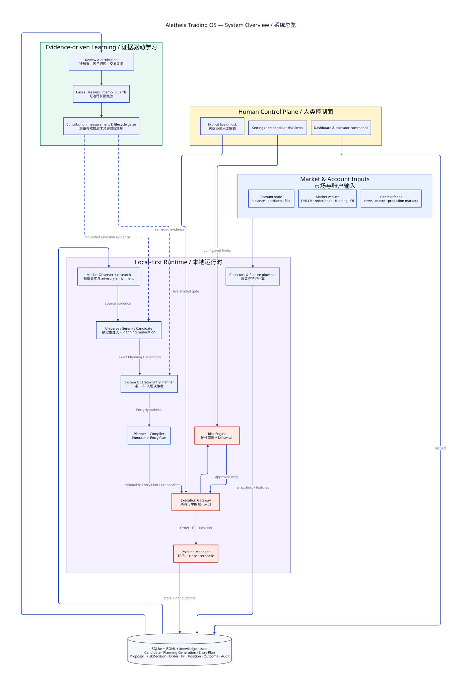
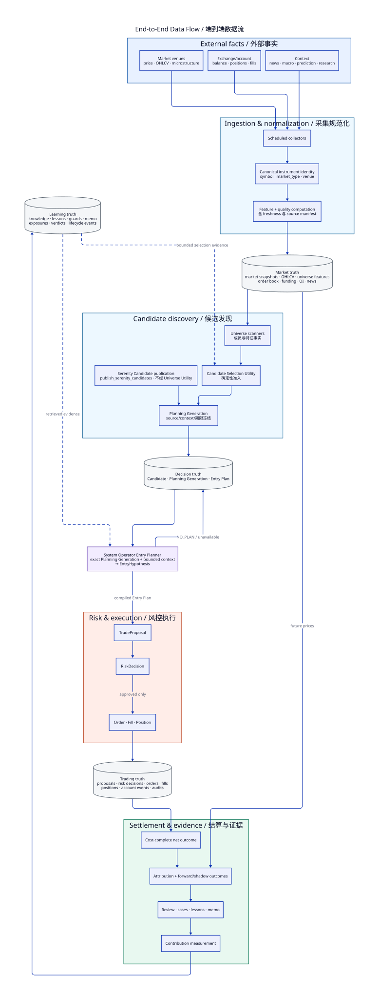
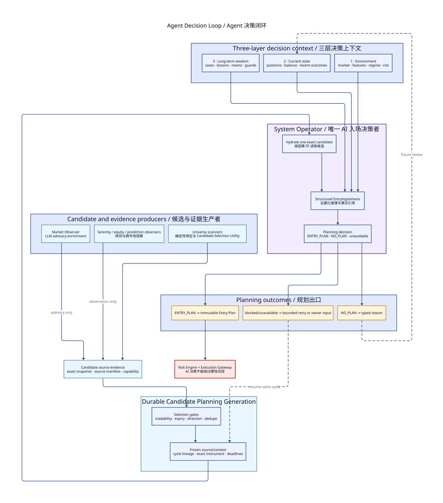
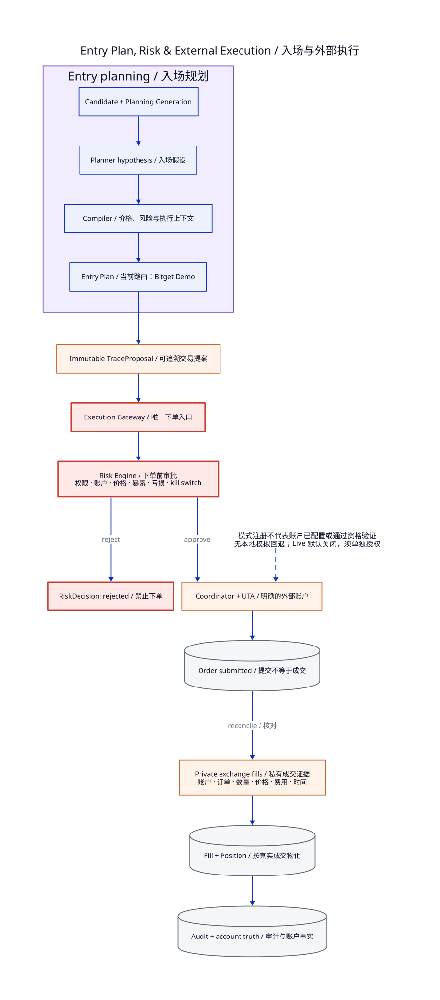
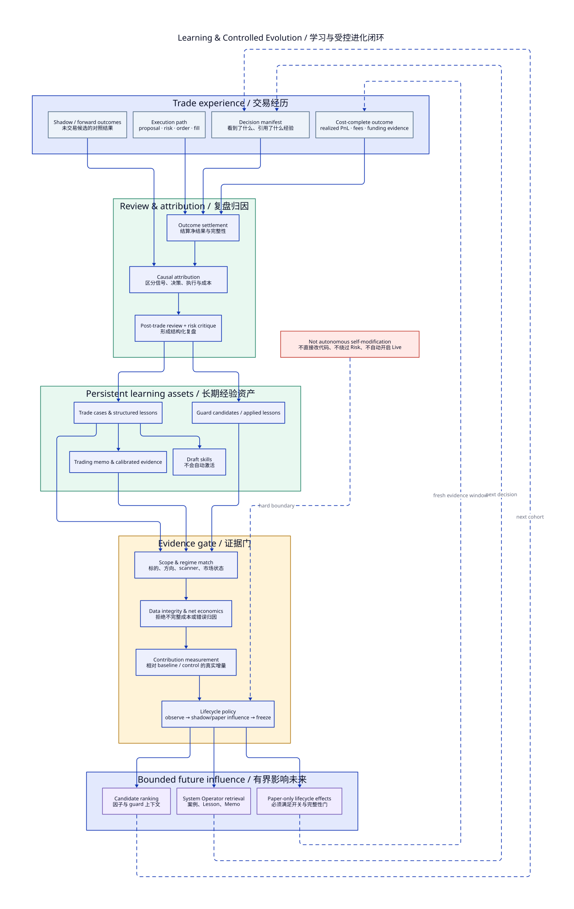

# Aletheia Trading OS — 系统架构全景图

> 本文档是解释性导览，不是能力或运行状态权威。
> 当前支持边界只认 [`ACTIVE_RUNTIME_SCOPE.md`](../../product/ACTIVE_RUNTIME_SCOPE.md)
> 与 [`CAPABILITY_GROUND_TRUTH.md`](../../product/CAPABILITY_GROUND_TRUTH.md)；
> 图示若与这两份文件或可执行证据冲突，以后者为准。

---

## 第一章：全景 — 系统里有谁



想象 Aletheia 是一家小型对冲基金，有明确分工：

| 角色 | 组件 | 职责 | 自治权 |
|------|------|------|--------|
| 入场决策者 | **System Operator** | 对确切 Planning Generation 输出 `ENTRY_PLAN` / `NO_PLAN` | 唯一受支持的入场策略决策主体 |
| 候选准入 | Candidate Selection Utility / Universe service | 确定性选择 execution-eligible Candidate，并发布 Planning Generation | 不调用 LLM，不提交 Proposal |
| 保护性持仓管理 | Position Manager | 止损、止盈、追踪和受控平仓 | 只缩减既有授权持仓 |

Market Observer 与 Python Operator assessment 已退役（#3463 / #3134）：不再注册调度任务、
不再有 fallback writer，只保留历史 assessment 的只读检视。旧记录或旧表名不构成恢复生产的许可；
活动调度身份以 [System Map](SYSTEM_MAP.md) 为准。

**核心原则**：System Operator 是唯一受支持的入场策略决策主体；Risk Engine
和 Execution Gateway 仍是独立硬边界，任何组件都不能绕过它们。

---

## 第二章：数据采集 — 系统的"眼睛"



活动主线从运行时配置并记录的 market-data venue 获取 crypto spot/perpetual 市场事实，
并把 venue、market type 和 symbol 身份保留到持久化记录。其他 adapter 或历史采集代码
的存在不等于当前 Supported 能力。核心数据包括：

| 数据 | 内容 | 用途 |
|------|------|------|
| OHLCV | 多周期 K 线 | 结构化技术上下文 |
| Funding Rate | 永续资金费率 | 杠杆拥挤度证据 |
| Taker Ratio | 主动买/卖比 | 市场结构上下文 |
| Open Interest | 持仓量变化 | OI 与价格关系 |
| Liquidation | 爆仓事件 | 极端市场上下文 |
| Price Snapshot | 带 venue/market type 的价格事实 | 估值与新鲜度检查 |

原始数据经特征计算引擎加工后存入 `universe_feature_snapshots` 表：
- `vol_ratio`：当前成交量 / 均值（放量检测）
- `relative_strength_24h`：相对 BTC 的 24h 强弱
- `oi_price_divergence`：+1 隐性积累 / -1 弱势反弹 / 0 正常
- `taker_buy_ratio`：主动买入占比

---

## 第三章：信号发现 — "我觉得 ETH 可以做多"



当前受支持的入场候选只有一条因果链：

```
Universe / accepted Serenity Candidate publication
  → Candidate Selection Utility 确定性准入
  → durable Candidate Planning Generation（source/context/期限冻结）
  → System Operator Entry Planner（事件驱动 + ~15min heartbeat）
  → Planner hypothesis
  → deterministic Compiler
  → immutable Entry Plan
  → Proposal → Risk → Execution Gateway → Coordinator / UTA
```

equity/prediction observer 与 Serenity research 只提供有来源的观察或 Candidate source
evidence；它们不创建 Proposal。Market Observer 已退役（#3463），`Opportunity`、
`signal_pending` 与旧 Ranker/Funnel 记录仍可供历史分析读取，但不再是当前入场队列或
System Operator claim。
旧的 `paper_running RuleSet → 自动触发` 路径已经删除；表名、旧记录或历史图中仍出现
这些状态，不构成当前产品能力。

---

## 第四章：System Operator 决策 — 唯一的"按钮"在这里


System Operator 由 Candidate planning committed event 唤醒，并保留约 15 分钟的 heartbeat
fallback。每次只处理一个确切 Planning Generation，面前是冻结的 Candidate source/context、
精确 market evidence、Portfolio state 和有界 Learning bundle：

### 市场与执行事实
- 所有币的价格快照
- 特征指标（RSI/BB/FR/vol_ratio/taker/OI_divergence）
- 当前 Candidate 的 Planning Generation 与 cycle 状态
- Entry profiles、执行模式与 UTA capability facts

### 当前组合状态
- 当前持仓（symbol/direction/pnl）
- 现有 Proposal、Order、Fill 和 Position 的可追溯状态

### 学习与历史证据
- 上次决策回顾（我做了什么？结果如何？）
- Knowledge Lessons（犯过的错）
- Serenity Research（研究洞察）

### 决策过程

1. System Operator 只返回结构化 `EntryHypothesis`；模型不得决定执行价格、数量、杠杆、止损、
   止盈或触发参数。
2. Compiler 根据冻结的 anchors、市场质量与 Entry Profile 计算计划几何。
3. 输出规划结果：

| 决策 | 含义 | 后续 |
|------|------|------|
| `ENTRY_PLAN` | 证据充分且通过 Compiler | → immutable Entry Plan → Risk/Gateway |
| `NO_PLAN` | 证据不足或冲突 | 记录 typed reason，不创建执行状态 |

---

## 第五章：执行与风控 — 从 Entry Plan 到外部账户



当前入场主线是 Candidate、Planning Generation、Planner、Compiler 和 Entry Plan。
Compiler 依据明确的价格、风险与执行上下文形成计划；Entry Plan 执行仍须产生可追溯的
Proposal 和 RiskDecision，并通过 Execution Gateway、Coordinator 和 UTA 下单。
完整审批项以 [Risk Engine 契约](../contracts/risk_engine_contract.md) 为准。

Entry Plan 当前只获准使用 Bitget Demo。UTA 的外部账户模式还包括 OKX Demo、Binance
Testnet 及对应的 Live Limited；注册模式不代表该账户已经配置，也不扩大 Entry Plan 的
路由权限。Live 默认关闭，启用仍需显式人工授权和完整 Risk/Execution 边界。

Order 提交与真实成交是不同事实。只有匹配的交易所私有成交证据才能驱动 Fill 和 Position
物化；缺失成交或费用证据时必须保留未决或不可用状态。历史本地模拟执行定义和原流程图
已[归档](../history/diagrams/README.md)，不能作为当前账户或成交资格。

---

## 第六章：持仓管理 — 自治安全层

这是系统中**唯一不经 System Operator 的环节**。原因：止损必须快速执行，不能等 LLM。

Position Manager 每 30 秒检查一次精确 instrument 的 fresh mark：

| 机制 | 触发条件 | 动作 |
|------|----------|------|
| **追踪止损** | 价格上涨 | 止损跟随最高点（ATR-based） |
| **保本移动** | 涨幅 > breakeven_threshold | 止损移到成本价 |
| **硬止损** | price ≤ stop_price | 立即平仓 |
| **止盈** | price ≥ target_price | 获利了结 |
| **超时保护** | 持仓 > max_hold_hours | 强制平仓 |
| **交易所同步** | exchange TPSL 成交 | 本地状态同步 |

平仓后由外部私有成交证据驱动 Fill、Position 和 verified Outcome；证据不足时保持未决或
不可用，不把本地模拟成交当作当前资格。

---

## 第七章：反馈闭环 — 结果先成为证据，再允许影响决策



交易结束后，系统先持久化真实 close、净结果和因果归因，再运行后续消费者：

### 1. Outcome 与 Attribution
- 只接纳能回溯到 Opportunity、Proposal、RiskDecision、Order、Fill 和 Position 的结果
- 区分未验证、部分结算和已验证 genuine outcome，不用缺失数据补造胜负

### 2. Review 与 Knowledge
- Post-trade review 和 lesson review 可以产生持久化知识
- 知识只有在明确声明的 consumer 路径中才参与后续上下文；存在一条记录不等于已生效

### 3. Measured Learning
- 受支持的 exposure / treatment / control 路径写入固定身份与 outcome contract
- measurement-unsupported 的 ranker、persona 等 hook 保持静态 fallback，不创建正式 exposure
- 旧 Strategy promotion / demotion 链已经删除，不会因交易计数或期望值自动恢复

因此，反馈是可审计、可归因的后续输入，不承诺“下一轮必然生效”，也不把相关性冒充因果改进。

---

## 第八章：策略生命周期 — 当前支持边界

本图和旧的 `draft → paper_candidate → paper_running` 流程属于历史规则引擎设计。
RuleSet、Strategy Designer、backtest orchestrator 和 Optuna 策略变体路径已经删除，
不属于当前产品能力。

当前 System Operator 的受支持交易职责是：读取一个确切 Planning Generation 的有界上下文，产生
`ENTRY_PLAN` 或 `NO_PLAN`；只有完整 Entry Plan 才能进入不可变 Proposal、Risk 和 Execution Gateway。
TS operator-shell 是唯一运行时 Operator；独立 Entry Planner 交易职责不变。Python
Operator assessment 及其配置写入、调度、手动触发已退役，仅保留历史评估读取。
历史 `recommend_promote` / `recommend_retire` / `recommend_demote` 没有可达的策略
生命周期消费者，不得从表中存在旧记录推断功能仍可用。

未来若重新引入策略生命周期，必须作为新的产品能力重新建立入口、审批、执行消费者、
持久状态、回退和端到端证据，而不是复用历史图中的状态名。

---

## 历史交易流程图

旧 Operator 入场与本地模拟执行全流程图保存在[历史图集](../history/diagrams/README.md)。
当前执行链路见第五章。

---

## 设计哲学总结

| 原则 | 实现 |
|------|------|
| **System Operator 是入场决策者** | 当前 Candidate 只产生 `ENTRY_PLAN` / `NO_PLAN`；Risk 与 Execution 仍是独立硬边界 |
| **其他组件只产出候选事实** | equity/prediction observer、Universe、Serenity 写带来源事实；Candidate Selection 发布 Planning Generation；都不提交 Proposal |
| **保护层自治但不扩权** | Position Manager 只能缩减既有授权持仓，仍保留因果链和审计 |
| **反馈先测量后影响** | verified outcome、归因与正式 exposure 先落账；unsupported hook 保持静态 fallback |
| **策略生命周期不冒充能力** | 旧 RuleSet 升阶/退役链已删除；未来恢复必须重新证明完整链路 |
| **Risk Engine 是硬墙** | Entry Plan 仍须通过独立 Risk 审批才能执行 |

---

## 附录：定时任务一览

活动调度身份、频率与运行状态以 [System Map](SYSTEM_MAP.md) 的任务表为准；本表只作阅读顺序上的简化叙述。

| 组件 | 周期 | 做什么 |
|------|------|--------|
| Market Data Collector | 5 min | 拉取价格/FR/OI/Taker/Liquidation |
| Candidate Selection / Universe refresh | 10 min + source publication | 确定性准入 → 发布 Candidate Planning Generation |
| System Operator Entry Planner | event-driven + ~15 min heartbeat | 读取确切 Planning Generation → `ENTRY_PLAN` / `NO_PLAN` |
| Position Manager | 30 sec protective cycle（另有 exchange TP/SL fill check） | 追踪保护 / 检查平仓条件 |
| TS operator-shell | continuous supervision | 状态监督、Command Registry 编排和受控自愈 |
