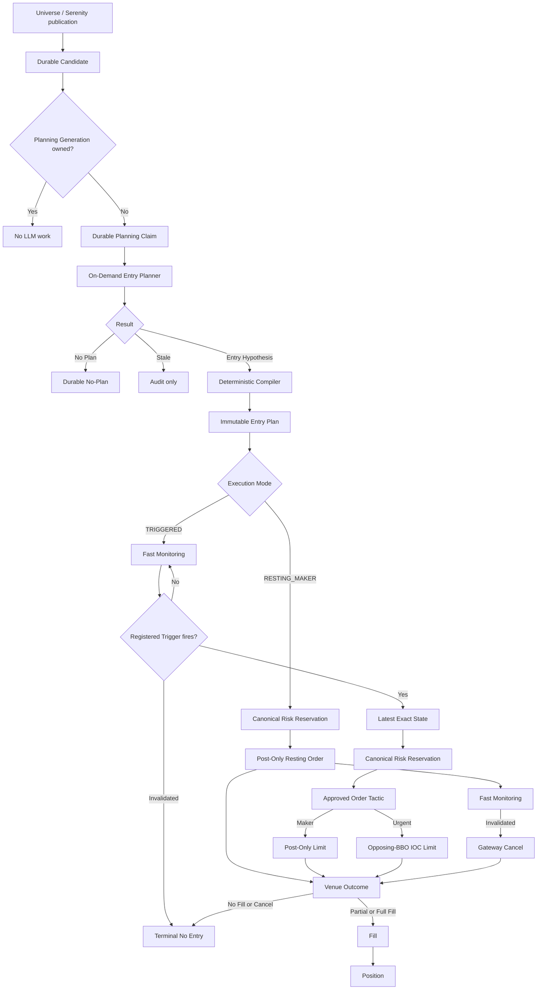

# 决策生命周期契约 (Decision Lifecycle Contract, L2 金标准)

> **角色**:本契约**横切**所有交易子系统,定义一笔交易从机会到复盘的完整脊柱,
> 以及每个**接缝(seam)**的前置/后置条件、守卫位置、与中间载体的字段约定。
> 其他契约**竖切**单个子系统(风控/执行/agent/知识);本契约负责它们之间的交接。
> **不重复**子系统细节 —— 指向已有契约。
> **基线**:代码为底(file:line);冲突时文档为准。
> Last updated: 2026-09-07 (D2:唯一 Candidate→Entry Plan 入场主线) · 维护者:Aletheia Dev · 研究证据:`docs/research/audits/OPPORTUNITY_END_TO_END_LIFECYCLE_AUDIT_2026-07-18.md`

---

## 1. 脊柱全景(开仓方向)

Universe 与 Serenity 共同使用以下唯一开仓主路径。`Trigger` 只存在于 `TRIGGERED` 分支，不能为了线性展示而给
`RESTING_MAKER` 合成 Trigger。

Universe 与 Serenity 发布相同 durable Candidate/current PlanningGeneration，不再存在独立
Opportunity producer 的第二条可执行入场线。`universe_members` 是物理表名，不限定来源。
Candidate context 在出生时冻结真实 `source.kind/id/trade_school`、cutoff 与 evidence hash；
source-scoped refresh 不可终结另一来源的 attention，同一 exact venue/symbol/market_type
仍只有一个 current owner。跨来源 active attention/Plan/未决执行冲突为 `instrument_owned`。
Serenity 的研究证据只授权来源，真实 PA/compatible Profile 仍须通过；不冒充 Universe Utility。

具体来源准入、不可变 source 与 timing/holding 分离见
[Entry Plan contract](entry-plan-contract.md) 与 [Serenity contract](serenity_contract.md)。
Universe 当前 selection 见 [Candidate selection contract](candidate_selection_utility_contract.md)；
历史 legacy total score、Ranker、Setup 与 conditional authorization 不是 fallback authority。

当前 analytics 的 `candidate_attention`、`entry_plans`、`planning_history` 和 summary 来自
canonical workbench。旧 ranker/funnel/filter cohort 保留历史含义，只读，不能冒充当前队列。
PiDecision 入场/pending 与 `pi_reflection.json` 是历史，不再认领、恢复或推进新入场；
共享持仓 review/close/reduce/adjust 的原审计继续保留。旧孤儿 claim 不重建 Proposal；
已有订单、未知提交和真实成交由 Gateway reconciliation/cancel/settlement 收口。

> 固定持有期反事实结果遵循 `docs/design/contracts/opportunity_outcome_contract.md`。历史 gross-only 行、
> 永续缺 funding、方向未知或过晚 ticker 只能用于解释，不得进入自动学习。

> 入场事实不再经 `pi_decisions` 交汇；监管与持仓审计不授予入场权限。
> 平仓/退出脊柱见 [`execution_contract.md §10`](execution_contract.md)。

---

## 2. 中间载体契约

跨子系统传递的数据结构,其字段语义在此固定(此前只活在代码里):

### 2.1 历史 Opportunity 载体（非当前执行契约）

以下字段/旧状态机仅解释历史记录；其中 Ranker、pending、TTL fallback 与 adapter 均无新入场权限。

| 字段 | 类型 | 语义 / 值域 |
|------|------|------------|
| `market` | `str`(必填) | 机会的市场/场地描述符。跳5 当 PI 未显式选 `market_type` 时由 `_attach_opportunity_context` 作为继承来源(`trading_decision.py:909`)。⚠️ **已知歧义**:`market` 与下游期望的 `market_type` 枚举(`spot`/`usdt_futures`)值域是否一致**需核实并锁定**(报告 A1 design gap)。 |
| `direction_bias` | `str \| None` | `long` / `short` / `neutral`。跳2 `paper_trader_ranker` 直接读它定方向。 |
| `confidence` | `str` | **分类**置信度,默认 `speculative`(同 `VALID_CONFIDENCES`)。**不是**数值。字段由 Opportunity 的原始 producer 持有，后续 Observer assessment 不得覆盖。 |
| `confidence_score` | `int \| None` | Producer-owned 数值信号,跳2 打分用。Universe-linked 新路径不创建 executable Opportunity；历史 `universe_scanner` 行只作 legacy/observation carrier。Observer 的 LLM confidence 只进入 namespaced assessment，禁止与 scanner composite score 混合或把它解释成概率。 |
| `status` | `str` | 状态机:`open`(每个 snapshot 的可排序分析代次)→ `queued`(已认领为耐久 Operator 载体)→ `reviewed`(Operator 最终决定已落库);Filter 的永久拒绝也可从 `open` 直接进入 `reviewed`。父 snapshot supersede 只终结仍为 `open` 的代次；`queued` 由自身 `valid_until`、Operator 终局或 Proposal claim 终结。跳2 以 oldest-first 有界批次查询 `open` 工作集；top-N 只限制执行候选，不能截掉本批已扫描到的永久拒绝。永久拒绝或 TTL 终态与其原因事实同事务提交，证据失败则保持原状态可重试。 |
| `scanner_family` | `str \| None` | 来源扫描器族,跳5 透传进归因链(风控 #16 部门集中度解析用)。 |
| `valid_until` | `str \| None` | 触发后 Opportunity 自身的权威市场失效时间。它不是 Candidate TTL；Candidate TTL 由 Universe refresh/selection 与 `universe_members.expires_at` 管理。`open` 在此后进入 Ranker 的 family soft-TTL 衰减，直到硬顶才终结；`queued` 到此时间立即失去 Proposal 权限。只有缺失/不可解析该字段的历史 queued 载体才使用 pending `created_at + 30min` 兜底。 |
| `setup_id` / `signal_mark` / `trigger_behavior_version` | `str \| None` | 历史 Universe Setup adapter 的不可变审计字段。新 Candidate → Entry Plan 路径不得写入或依赖这些字段。 |
| `generation_version` / `generation_json` / `generation_hash` | `str \| None` | 历史 Opportunity Generation V2 审计载荷；新 Candidate → Entry Plan 路径不得以它取得开仓权限。 |

### 2.1a Candidate Planning Generation 与 Entry Plan

携带有效 typed Candidate opportunity context 的新 Candidate 只进入一个 canonical
Context → Hypothesis → Compiler → Entry Plan 实现。当前 writer 不写 Candidate、Planner、
Hypothesis、Profile、TriggerSpec 或 Plan 的 numeric format label；历史 numeric label
只读保留且不能选择当前行为。当前兼容与复用由 schema/behavior fingerprint 决定。
其 ownership identity 由 exact instrument、Opportunity mechanism/direction、
Candidate-selection policy/epoch 与 mechanism identity 组成；family、rank、score、
Utility、price 与普通 snapshot churn 不进入身份。机制或 policy epoch 变化会保留并
supersede 旧 generation，同时 fail-closed 终结旧的 pre-order Entry Plan。

`candidate_planning_generations` 以 planning thread 与递增 `cycle_number` 建立耐久生命周期。
每周期最多一个 planning owner；经济性 No-Plan 在相同 frozen material input 下耐久。Runtime/config/
capability block 在同一周期恢复且不算 No-Plan；validation/compiler failure 也不进入经济学习分母。
Plan expiry 仅在后续完成的来源 requalification、更新 source cutoff 且无未决 Order/Fill/Position
时创建下一周期。模型返回必须 CAS 当前周期；stale result 可审计但不可激活。
相同发现身份不代表相同 PA 材料：终态且无 Plan 的周期，可凭更新的已确认 15m 结构证明建立一次 successor。
未调用模型的缺失盘口/必需上下文终态，须有新闭合窗口及终态后的真实新鲜盘口恢复证明；不能清零旧尝试或刷新旧冻结输入。
证明在 publication 写事务前准备，事务内重验 source/snapshot、current owner、behavior/schema 与未决执行；
普通新 bar、时间、价格、排名变化不重开。材料边界及持久归属见 [Entry Plan contract](entry-plan-contract.md#contract-identity-and-planning-cycles)。

缺少 registry/frozen-context Profile 是 runtime_preflight 非经济 block。依赖缺失
或 backpressure 仅退还当前未 dispatch 尝试并记录 planning_unavailable。dispatch
后取消保留尝试，以 PLANNER_CANCELLED_DISPATCH_UNKNOWN 进入既有有界 defer，
不伪造物理调用或 model_skipped。dispatch 前取消用 shield/CAS 只释放本 owner
claim；调用事实单调保留，经济 NO_PLAN 不因数据恢复重开。

**Candidate business progress (accepted 2026-09-05)**

`get_candidate_path_progress()` is a read-only SQLite snapshot over scanner
metrics, exact active/current supported planning, watchable Plan readiness, and
current frozen-epoch selection plus exact `entry-fill:<id>` 4h outcome debt. It
does not evaluate qualification or load provider/model data. Historical process
IDs never remove current debt. Other epochs and unrelated outcome keys do not
enter the count. A pending scanner capture with its committed batch is projected
as captured without repairing scanner JSON. Missing identities/clocks remain
unavailable, not an empty or successful queue. Per-outcome provider defer reasons
are not durably stored by the existing settler: report settlement reason unavailable,
not an invented provider diagnosis.

The background health job replaces one cache before `compute_health`; Workbench
reads that same cache. It includes generated time/age, attempt/success/snapshot
watermarks, policy/epoch, selection/support/observe-only and reason counts, ready
planning count/oldest time, expired claims, due outcome count/oldest due, and bounded
issues. Cache TTL is twice the actual health job interval (default 1200 seconds).
Unconfigured/paused health job, failed or missing/expired cache means unavailable;
Universe disabled or deliberate runtime pause is explicitly non-applicable.

With Universe enabled and scheduler running, latest failed refresh degrades at
the next sample. Last success older than twice refresh interval plus 600 seconds
is stalled; a new process without success initializes only until that bound.
Supported ready work uses pending created_at, unavailable retry_not_before, or
expired claim_expires_at, never updated_at. Ready work older than 480 seconds,
or an expired lease older than 180 seconds, is stalled. Due pending 4h outcomes
older than 900 seconds are a backlog, not proof of deadlock or economic failure.
Normal empty/observe-only selection, future retries, capability blocks, economic
NO_PLAN and natural Trigger/Fill waits are not stalls.

Only `candidate_refresh_failed`, `candidate_refresh_stalled`,
`candidate_planning_stalled`, and `candidate_outcome_backlog` degrade business
health; unavailable probes initialize. All are alert-only: no self-heal restart,
Live/Risk/Gateway change, rescheduling, admission or rewritten due_at.

`entry_plans` 是唯一 active plan ledger。不可变 JSON 固定 instrument、generation、方向、thesis、
source_kind/source_id/trade_school/holding_horizon_hours、execution mode、注册 TriggerSpec、
entry/invalidation/stop/target/timing horizon、风险上限、order tactic、
maker/taker 权限、timeout/fallback、expiry 和 behavior identity；状态只可单调前进。Momentum 的
breakout/pullback/reclaim 只在 versioned `TriggerSpec.params` 中，不能成为通用 Entry Plan 字段。

Candidate 精确详情与 Planning History 必须按同一 soft/hard attention deadline 投影即时有效状态：
hard deadline 已过时为 `max_attention_age`，否则 soft deadline 已过时为 `ttl_expired`。该读投影不得
写 planning generation，也不得改变 Entry Plan、Order 或其有效性；耐久终态仍只由 canonical expiry
reconciliation 写入。

逻辑机会仅是现有账本的只读关联，不增加 Opportunity ID/表/调度器/总状态。
共享批量 snapshot reader 以 exact Plan→Proposal/Order→Fill→Position 及
Position→close Order→close Fill 读取执行事实；冲突、缺失或多义为 unavailable，
不按 symbol/time 猜测。cycles 保留原 Candidate/input/hash/Plan，列表不得逐 cycle
重复查询。attention、planning、execution、economics 并列显示；attention 终态
不覆盖已激活执行。零成交确认终态为 NO_FILL，Fill 缺 Position 为 UNAVAILABLE，
open Position 优先于 entry 余单；closed 仍须区别成本待结算、terminal exclusion
和已完成。paper_internal CLOSED 必须以既有只读经济一致性规则核对最终关闭
事件、净现金及可复算 PnL（1e-8），GET 不补写。Position realized economics 与
entry-fill:<fill_id> 的固定四小时 Entry outcome 分离，不以选择 T0 forward return
冒充开仓结果。所有开平仓仍由既有 Risk/Gateway/Position/accounting owner 执行。
本地资金结算保留不可变 Proposal 的请求数量；Risk 批准数量必须与 Order
执行数量一致且不得超过请求。只有 filled 或 cancelled 终态 Entry Order
可计入关闭账本；filled 的成交量必须等于执行数量，cancelled 只计真实已成交量，
余单不构成敞口。全部精确 Fills 的数量及成本仍须与 Position 对齐。

### 2.2 当前入场/持仓边界

EntryPlan 的 timing `expected_horizon_hours`（INTRADAY 4h、SWING 24h）与
60/240 分钟 entry expiry 不决定 Serenity 持仓期限。Compiler 冻结正有限
`holding_horizon_hours`：short_term 等于 timing，Serenity 等于当次 max_hold_days×24。
Proposal.expected_horizon_hours 接收 holding，source/school 通过 attribution 与 Serenity
opportunity_id 穿透到 Position 和关仓反馈。90 天研究可用 24h 择时、4h entry expiry，
成交后仍为 2160h holding；PA invalidation 不能冒充持仓到期。Risk 验证冻结 Plan，
止损使用最终真实结构并重新约束仓位，不借 Serenity 配置覆盖有效 stop。

### 2.4 Filter Evidence（评估旁路）

- `filter_decision_batches` 保存 ticker/tradability 等高频无方向门；必须保存本次扫描的全部候选，不得抽样。
- `filter_decisions` 保存已有方向的 Observer、Ranker、System Operator 和 Risk 逐关事实，到首个拒绝停止。
- `filter_candidate_outcomes` 按候选共享一份目标市场净结果，不按筛选关重复结算。
- Risk 证据必须在 authoritative `RiskDecision` 的同一事务内写入；任一 evidence 失败整体回滚，preflight 不写最终候选 evidence。
- 旧 Observer/Ranker/System Operator evidence 是只读历史；新 Planner/Compiler 与 Risk
  事实按其真实 owner 写入，不从最终状态倒推旧漏斗，也不创建入场 PiDecision。

完整定义见 `docs/design/contracts/filter_evidence_contract.md`。

---

## 3. 接缝守卫表

| 接缝 | writer | consumer | 关键不变量 | 守卫/spec |
|------|--------|----------|-----------|-----------|
| Candidate publication | Universe / Serenity repository publication | current PlanningGeneration | source/hash 出生冻结、exact instrument 单一 owner、原子 publication | entry-plan-contract / Serenity §7 |
| Planning→Plan | Entry Planner / Compiler | Plan execution / watcher | immutable input、CAS、typed unavailable/no-plan、真实 Profile | entry-plan-contract |
| Plan→Proposal | canonical entry_plan_execution | Risk / Gateway | source/school/holding 一致、唯一 Plan lineage、不可复活旧 pending | entry-plan-contract |
| 提案→风控 | `gateway.py` | `risk/engine.py:67` | `_eval_lock` 串行;每提案恰评估一次;`approved=False` 不执行 | risk_engine_contract / spec_pipeline_risk_gate |
| 平仓脊柱 | — | — | 见 `execution_contract §10`(退出触发器优先级 / paused 不挡平仓) | PL-PM-01~07 |
| 筛选证据 | 各关原 writer | filter controller / doctor | 事前输入+参数版本；无方向不生成可学习净结果；authoritative Risk evidence 与 RiskDecision 原子提交 | filter_evidence_contract / spec_filter_evidence |

---

## 4. 当前不变量

- **DL-INV-1 单一开仓决策权**:所有 Universe/Serenity 新入场只经 current PlanningGeneration → Planner → Hypothesis → Compiler → EntryPlan execution/watcher → Risk → Gateway；无独立 producer/evaluator/compatibility adapter。
- **DL-INV-4 归因不可改写**:Candidate source context 出生冻结；Plan 冻结 source_kind/source_id/trade_school/holding_horizon_hours；Proposal 与 Position 保留真实研究 ID、school 和 holding，不能按 symbol 猜来源。
- **DL-INV-11 耐久所有权后唤醒**:两来源只唤醒 canonical planning 工作；idle/unavailable 不调用旧 evaluator。重复唤醒由同一 claim/retry/CAS 收口，不重建 pending 或 PiDecision。
- **DL-INV-19 中断可恢复**:旧无 Proposal claim 只读退休，不补造 Proposal。未提交旧 authority 的退休必须保留 entry_path_retired 审计；已有执行 owner/Order 或未知提交不得被迁移伪造终态。
- **DL-INV-20 入场与持仓动作分面**:共享 portfolio review/close/reduce/adjust 与持仓审计保留；明确 Position identity 不可借来创建新入场。horizon 到期只能有效延长或关闭，不以无效 hold 完成复核。
- **DL-INV-27 来源所有权**:source-scoped snapshot/attention 与全局 exact instrument current owner 同时成立；Universe 不驱逐 Serenity，Serenity 不抢占 Universe。新来源证据必须重新准入，旧 pending 不是批准。
- **DL-INV-7 筛选事实不反推**:放行/拒绝必须在当次评估时记录，不得从最终 opportunity/proposal 状态倒推中间关卡。
- **DL-INV-8 无方向不学收益**:无事前 `long/short` 时只衡量能力和覆盖，禁止事后选最赚方向。
- **DL-INV-30 TriggerSpec 权限**:EntryHypothesis 只能选择 registry Profile；Compiler 固定 TriggerSpec id/version 与 bounded params；Fast Monitoring 不解释模型 prose。新增 Trigger economics/threshold 必须走经济研究权限，不能借 lifecycle refactor 上线。
- **DL-INV-31 Fast Monitoring 精确场地与新鲜度**:Trigger 与 Order Intent 必须使用 Entry Plan 同一 `venue + symbol + market_type` 的已确认订阅和 latest exact state；stale quote/depth/trade、sequence 异常、越出 envelope 或 adapter 不可用均 fail closed，禁止跨 venue 或 REST 热替代。
- **DL-INV-32 单次执行与真实 tactic**:Entry Plan 与 Proposal/Order 唯一约束禁止 duplicate execute。Maker 必须为 true Post-Only；Urgent 默认 opposing-BBO IOC Limit 且不得越过 plan envelope；plain GTC Limit 不得标 Maker。`paper_internal` 只以 `paper-order-fill/v1` 模拟：IOC 仅消费 receipt 中已知 opposing depth，Maker 先落 durable open Order，之后仅由同 instrument 的 later strict opposite-aggressor trade-through 按真实事件 size 有界成交；不宣称外部 queue position。
- **DL-INV-33 Entry Plan 不可变与单调**:plan JSON/hash 与 planning generation 不可改写；status 只可前进。rank/score/snapshot refresh 不终结 plan；只有 structural invalidation、incompatible new generation、expiry、permission/pause/kill-switch、Risk revocation、execution completion 或 manual cancel 可终结，终态不得 revive。
- **DL-INV-34 Gateway 撤单与 Fill 优先**:Fast Monitoring 只决定 invalidation 并向 Gateway 请求 cancel；Gateway 才可调用 broker/adapter。网络调用后必须重查 private Fill/Order facts。完整 Fill 赢得 cancel race；partial fill 保留真实 Position 并只取消 remainder，不得因 cancel acknowledgement 覆盖经济事实或升级为 Taker。
- **DL-INV-38 Planner admission 与抢占**:普通 Candidate batch 只能占用 broker 可用的 normal-priority capacity，local backpressure 或 portfolio wake 抢占不得消费物理 model attempt。父 batch 返回前必须 cancel-and-await 全部 child task；urgent portfolio wake 立即跳过普通 cooldown，同时仍只有一个 Operator authority。
- **DL-INV-39 Entry market evidence 双时钟**:RESTING_MAKER 与 TRIGGERED 执行均须验证并持久化同一 exact quote 的 exchange/source time 与 local receive time。任一时间旧、未来、无时区或不可解析均不得进入 Risk/Gateway；subscription 尚未确认或 generation 已重置时，旧 rolling evidence 不可复用。
- **DL-INV-40 IOC 与 maker remainder 收敛**:Opposing-BBO IOC 的 cumulative Fill 与 remainder terminal state 是独立事实；零 Fill terminal 为 cancelled，partial Fill 先物化 Position 后仅 terminalize remainder，完整 Fill 为 filled，重启必须幂等。任何实际 `POST_ONLY_LIMIT`（包括 TRIGGERED 后释放者）都从真实 Order lifetime 执行 `max_wait_sec`，且 invalidation 必须严格位于所有允许 entry reference 的保护侧。
- **DL-INV-41 post-submit Plan integrity**:Entry Plan 在 `ordered/partially_filled` 后即使 JSON/hash 损坏，也不得丢失外部 Order ownership；只能使用耐久 Plan↔Order identity 进入 canonical Gateway cancel/reconcile，保留 partial Fill 与原始 integrity reason。证据不完整保持 retry-suppressing unresolved state。
- **DL-INV-42 Mechanism-aware planning authority**:current PlanningGeneration 的 mechanism、direction、selection policy/epoch 与 mechanism version 必须与当前 typed Candidate context/hash 一致。Fast Monitoring 与 Order Intent creation 在任何 pre-order side effect 前复核该身份；不一致则终结旧 Plan，且撤单仍只能经 Gateway。
- **DL-INV-35 Price Action 权限隔离**:`market-structure/v2` 只可将同一 [Market Structure Derived Data Contract](market_structure_contract.md) 的连续、已收盘、同 venue 1m 因果事实投影成 append-only Shadow assessment；历史 v1 行保持不可变。BOS/CHoCH 不得改变 Opportunity、Risk 或 Execution。hard-gate consumer seam 必须对未批准版本及 unavailable 结果 fail closed，生产 allowlist 为空。
- **DL-INV-36 Universe instrument background**:每个进入 feature/scanner 的 registry 标的必须携带完整的 `instrument-background/v1`，并解析到一个明确支持的 analysis context。当前只支持既有 crypto context 与经核验的 `stock_linked_perp` context；后者只消费 instrument-local 行情、成本与衍生品证据，BTC 相对强弱、全局 crypto regime 和旧 crypto-family prior 明确不适用。Candidate publication 将同一 background 与 applicability 冻结进 typed context；缺失、冲突、未解析或无受支持 context 均 fail closed，完整 equity 身份本身不是拒绝理由。
- **DL-INV-37 Candidate planning priority**:稀缺 Entry Planner capacity 必须先 claim 当前 `last_candidate_id` 所指向的最低 Candidate rank；每轮可用 3–15 个并发 worker 依次完成 CAS claim 后并行规划，且每个 generation 仍只有一个 owner。rank 只决定调度顺序，不进入 planning identity 或经济权限。exact rank 不可用时稳定回退 generation `created_at`、再 `id`，不得随机排序或因 rank/score churn 创建重复 LLM work。
- **DL-INV-29 Outcome 与 funding 符号固定**:B2 `qualified_negative` 表示同身份、同方向成熟 cohort 的净收益为负，不表示 bearish 方向，也不单独授权 trade/skip/veto。正 funding 是 longs pay shorts / long crowding，支持 contrarian short；负 funding 是 shorts pay longs / short crowding，支持 contrarian long 并反对 short。语义改变必须轮换 policy epoch。

---

## 5. 验证边界

当前行为聚焦于 `tests/test_entry_planner.py`、`tests/test_entry_plan_execution.py`、
`tests/test_entry_lifecycle_cutover.py`、`tests/test_candidate_opportunity_persistence.py`、
`tests/test_serenity_routes.py` 和 `tests/test_pi_daemon.py`。文档同步不表示这些测试已在此执行，
也不表示 Fedora 已部署或账户已获资格。

本次说明入场 D2 收口。UTA 唯一私有账户路径、Learning 单向 Lab 迁移和生产部署
唯一 auto.run 是已批准的后续部分，不在这里宣称已经交付或上线。

## 附录：退役入场历史（非执行契约）

下面的原术语、数值和恢复叙述仅用于理解旧记录及旧审计；不再是当前不变量、
测试验收或任何可执行 fallback。当前契约以 §1–§5 与 Entry Plan contract 为准。

### 历史 TradingDecision、PiDecision、pending 与 admission slot

本节完整保留旧设计叙述以解释历史证据；所有评估、claim、defer/wake、恢复与队列授权均已退役，不能执行。

| 字段 | 类型 | 语义 |
|------|------|------|
| `action` | `str`(必填) | 活跃入场面只允许 `trade` / `skip`。缺失或返回 `close` / `reduce` / `scale_in` / `flip` / `watch` 是 `DecisionUnavailable(operator_output_validation)`，不得归一成终态 `skip`、绑定身份或消费 pending。 |
| `conviction` | `int`(必填) | 0–100。缺失、非整数或越界是评估不可用；合法值低于 55(初始或 debate 后)是**非终态 defer** (DL-INV-2 v1.5)——`DecisionUnavailable('operator_low_conviction' 或 'debate_not_confirmed')`，pending 载体保留待 material fingerprint 变化重新开放；不合成 final `skip`。 |
| `reasoning` | `str`(必填) | 决策理由(人类可读)。权威 PiDecision 保存全文；短 reflection/UI 可独立截断。 |
| `skip_kind` | `str \| None` | 结构化输出只接受 `adverse_candidate_evidence` / `insufficient_evidence` / JSON `null`；`trade` 可显式返回 `null`。仅 direct skip 使用非空值，`insufficient_evidence` 或 `null` 均为中性未知，不得终结候选。 |
| `adverse_reason_codes` / `adverse_evidence` | `list[str]` | terminal direct skip 必须至少各有一项允许的 typed reason 与候选特定事实；rank priority 或证据不足不能冒充 adverse reason。 |
| `validated_adverse_claims` | `list[dict]` | 仅由确定性 validator 生成；逐项保存 `reason_code + fact_refs`。模型文本不能写入或替代该权限。 |
| `model_reasoning` | `str \| None` | direct skip 的原始模型文本，仅作审计；权威 `reasoning/adverse_evidence` 由 validated fact refs 重建，避免错误判词进入最终状态。 |
| `market_type` | `str \| None` | 新 LLM `trade` 必须显式选择与 exact carrier 一致的 `spot` / `usdt_futures`；缺失或无效值走同一有界输出修复，不再从 carrier 猜测。新 Operator `spot+short` 不得在下游静默重标为 futures，只能 repair/defer；旧 programmatic/历史恢复对象保留兼容 coercion。`skip` 保留可空语义。 |
| `opportunity_id` / `strategy_id` / `scanner_family` | `str \| None` | R0 归因,由 `_attach_opportunity_context` 回填(`trading_decision.py:909`)。 |
| `signal_source` | `str` | 机会来源,默认 `market_observer`;`serenity` 表示解析 `serenity_opportunities.id`(`:85`)。值域 = {`market_observer`,`serenity`}。 |
| `bear_case` | `str` | S4 强制反方论证。新 LLM 决策 schema 必填；空值仅允许历史记录。 |
| `stop_price` / `take_profit` | `float \| None` | `trade` 的 LLM schema 与解析边界要求两者都是显式有限正数；缺失/0/NaN/Infinity 触发有界修复，不能由配置替模型补值。跳6 用新鲜精确 mark 校验多空几何及 `1.00 <= round(abs(tp-entry)/abs(entry-stop), 2) <= 10.00`；初稿越界走一次有界修复，二次仍错或提交时 mark 刷新导致越界则 `DecisionUnavailable(operator_entry_plan)`，不改写模型计划。`skip` 不要求这些字段。 |
| `parameter_rationale` | `dict[str,str]` | 新开仓的五项 AI 理由：`entry_price` / `stop_loss` / `take_profit` / `notional_usdt` / `leverage`。仅 `trade` 的 LLM schema/解析路径要求全部为非空字符串；缺项触发同一有界输出修复，最终仍不完整则不创建 final PiDecision/Proposal。最终入场价同时保存实际 `market_snapshot_id / market_type / snapshot_at`，不是只写“来自快照”；详见 `trade_decision_rationale_contract.md`。 |

跳6 在精确报价通过后，还必须用相同 `symbol + exchange + physical market_type`
读取新鲜订单簿和 24h volume，形成 `market_tradability_gate`。`usdt_futures/swap`
在采集存储层映射为 `perp`；订单簿和 volume 不得跨 venue 或 spot/perp 混用。
缺失、过期、身份不完整的上下文返回
`DecisionUnavailable(reason='market_tradability_unavailable', stage='operator_entry_plan')`；
只有明确 `is_tradable=false` 才返回 `market_not_tradable`。两者均为非终态 defer，
不创建 Proposal、不消费 pending。阈值仍由既有 `compute_tradability` 负责，本关卡
只消费其明确结论，不改变评分公式。通过时，完整 instrument identity 与 tradability
输入写入 hash-covered `TradeProposal.attribution_snapshot`，供事后复盘和 Learning 使用。

#### 历史 2.2a PiDecision（耐久 Operator 事实）

`PiDecision` 对 pending 和最终 action 都保存 `symbol / direction / market_type /
opportunity_id / signal_source`。最终行另存 `proposal_id / proposal_status /
proposal_reason`：已形成的业务决定必须有耐久状态；但评估、必需辩论或 Proposal 前置条件
不可用不是业务决定，必须抛出带稳定 `reason/stage` 的 `DecisionUnavailable`，不写最终行、
不消费队列。`evidence_manifest_json.operator_rationale` 保存 skip kind、adverse codes/evidence、
supporting/opposing signals 与 risk factors；不得用 200/300 字截断替代权威理由。不得把 provider
异常文本写入数据库。历史 NULL 默认保持未知；唯一例外是旧
Serenity pending 的 `market_type`，且只能从相同 `opportunity_id` 的耐久
`SerenityOpportunity` 恢复，并要求两边 `symbol / direction` 精确一致、来源
`market_type` 非空。任何缺行或不一致仍保持未知并拒绝授权。

#### 历史 2.2b Layer 1 technical feature identity

`universe_feature_snapshots` 的物理身份只有 `asset_id`；System Operator 的 Layer 1 技术特征读取
必须经 `asset_id → universe_registry` 取得 `symbol + market_type`，再按完整 instrument identity 去重。
不得把未 join 的 snapshot 当作含 `symbol` 或价格的行：那会把所有资产压缩为一个空标的，令模型把
完整的特征供给误解为数据不足。价格仍只能来自新鲜的 market-data cache；cache 未命中必须诚实为
`None`，不得用 snapshot 身份修复伪造报价。

全局 `feature_index` 的数量上限只用于有界展示，不是候选事实门。每个精确 pending carrier 必须按其
`universe_member_id → asset_id` 单独读取最新技术快照，即使该快照排在全局展示上限之外；同一候选的
queued/reviewed 来源 Opportunity 也必须携带 thesis、observations 与技术身份进入上下文。精确快照缺失、
核心数值不完整或过期时，在模型调用前写候选级 typed defer 并保留 carrier。新的精确 snapshot id/时间/
数值进入 material fingerprint，必须重新开放评估；Universe 特征刷新（含 change-suppressed TTL slide）
必须唤醒 Operator，不能只等待固定 heartbeat。

#### 历史 2.3 signal_pending 载体 (跳2→4 接缝)

`paper_trader` 写 `PiDecision(action='signal_pending')`(`paper_trader.py:143/235`);
`trading_context._build_pending_signal_queue` 读回尚无同 `signal_source + opportunity_id`
最终决定的行,先按 `signal_source + symbol + direction + market_type` 去重,再按最早到达顺序向 PI 暴露 5 条。
`pending_queue` 同时返回真实未完成总数、可见数、overflow、最老时间和已超时未消费数。
**不变量**:市场扫描信号进入 queued 后由来源 Opportunity 的 `valid_until` 单一控制；pending
`created_at + 30min` 只用于没有可解析 `valid_until` 的历史兼容行。不得同时套用两套时钟，否则
30min 会截断 1–4h 家族载体，也令 120min Operator defer 永远无法完成。Serenity 是长周期来源，
不得套用 market compatibility fallback。
Operator 的 Proposal preflight 与最终原子 claim 都必须重查 Opportunity 自身 `valid_until`；两处中先观察到
过期的一处通过同一个仓储 CAS，把 `queued→expired` 与唯一一条
`opportunity_ttl / ttl_expired` 事实放在同一保存点中。证据失败时保持 `queued`，且不得写最终 PiDecision
或 TradeProposal；不能让模型评估期间发生的过期成为“有终态、无原因”的审计断点。
`paper_trader` 只能以条件更新认领 `open→queued`;旧计划不得把 `reviewed/expired` 倒退为 queued。成功写入后先把来源 Opportunity 标记为
`queued`;只有 `reflection.claim_decision` 在最终 PiDecision 与状态更新的同一事务中把它改成
`reviewed`。任何绑定 Opportunity 的活跃最终决定（`trade` / `skip`）都必须命中同一
`signal_source + opportunity_id` 的耐久 `signal_pending` 载体；Layer1 open 视图和 ranker 候选只能
提供分析上下文。heartbeat 零 pending 不是 entry 决定：不得调用交易 LLM、写 final `PiDecision`、
退休 Opportunity 或创建 Proposal；只能写 `operator_evaluation_events(event_kind=no_evaluable_candidate)`，
附队列摘要、触发源和当前 policy epoch。该观察事实不进入 candidate skip/outcome cohort；历史无 target
skip 仅作 legacy audit，不能由新逻辑继续产生。持仓动作不属于这个入口，只能由独立 portfolio review
以 `hold` / `adjust_position` / `close_one` 表达；horizon 到期时 `hold` 不构成终态，
只能明确延长到未来的绝对持仓 age 或平仓；
`reduce_exposure` 等未实现标签不得映射为整仓关闭。命令路径先在内存中准备完整 immutable Proposal，
再以短事务同时写入 `proposal_status=submitting` 的最终 PiDecision 和 TradeProposal,并把 Opportunity
改为 `reviewed`;完成提交后才进入 Risk/Execution。这样崩溃只能留下“两者都没有”或“两者都存在”,
不得留下 reviewed + submitting 但零 Proposal。升级前遗留的该类孤儿 claim 只能在 pending 载体和
symbol/direction/market_type/action/opportunity/source 身份全部匹配时补写一次 Proposal；原 claim 的
conviction 仍是耐久审计事实，但重启后同一身份被重新打成 89/90 不得阻塞恢复或改写原评分。
Direct skip 在 `system_operator_skip_remediation/b1.5` 下必须经过一次有界、blind 反事实确认；确认后仍只有
`adverse_candidate_evidence + typed reason + concrete evidence`，且每个 reason 都由确定性 validator 解析到
同一候选的 typed fact refs，才可终结。B2 `insufficient_evidence`、中性 50/50 regime、可选 OI 缺失、
rank ordering、账户权益或单笔近期亏损都没有 adverse authority。两次输出仍是信息不足或无效时，
写 `operator_evaluation_events(event_kind=operator_decision_deferred_unchanged_context)` 并保持 pending；
同一 policy epoch、同一候选的物质上下文 fingerprint 在 120 分钟窗口内未变化时不再调用模型；
每条 defer 的 `defer_until` 是独立的 Operator attention deadline，但不得晚于来源
Opportunity 的 `valid_until`。defer 事件绝不修改 `valid_until`；PI daemon 必须把仍未兑现的
耐久 `defer_until` 作为独立 wake deadline，持续的新 signal、heartbeat 相位和进程重启都不得
推迟或遗忘该 deadline，且新 Operator 观察、终局 PiDecision 或 Opportunity 过期后不得重挂。
过期载体只能按其市场有效期失去 admission/recovery 资格，不能由 scheduler/API resurrect。
defer 不阻塞同批下一候选。每次模型调用只能暴露一个 pending carrier 及其技术/Opportunity/B2 证据，
不得暴露 analysis-only preview 或另一 pending 候选作为判词依据。fingerprint 排除
Opportunity id/时间戳等载体 churn，但包含 instrument、方向、scanner thesis、rank priority、B2 状态、
实际 B2 `n_total/n_net/coverage/avg/shrunk/verdict`、候选技术特征与 market regime；这些字段变化会重新开放评估。
缺失技术数值显示为 unknown，不得转写为 0。已存在 `proposal_status=submitting` 的 claim 始终优先恢复，
不得被新确认门阻断或覆盖。
`PiDecision` 自身保存 `symbol / direction / market_type / opportunity_id / signal_source`;
`_attach_opportunity_context` 必须把 `pending_signals` 中 `market_observer` 与 `serenity` 两类载体
都视为有效归因来源,并按 `opportunity_id` 回填来源字段,不得只消费 Serenity 载体。对
`market_observer` 载体,队列中的精确编号优先于仅靠相同 symbol/direction/market 匹配到的另一条开放机会;
Opportunity 最终动作只认 pending 权限，因此精确 Serenity pending 与仅用于分析的 Layer1 同时匹配时，
由前者提供身份。portfolio review 只按明确 `position_id` 使用独立持仓权限。

#### 历史 2.3b Admission slot 语义

`paper_trader._plan_signal_batch` 用 `_PENDING_SIGNAL_QUEUE_CAPACITY=5` 限制同时暴露给
Operator 的 signal_pending 载体数量。一个 admission slot 代表 **Operator 尚未做出判断** 的
signal_pending 载体；`count_unresolved_signal_pending` 是此语义的唯一权威计数器。

**已判等**的载体（`operator_evaluation_events` 中最新事件是
`operator_decision_deferred_*` 且 `defer_until > now()`）不占 admission slot——Operator 已经
判断了它，只是在等重评窗口到达。该规则同时被 `pi_daemon._has_pending_signal_work`（决定
是否要 startup 评估）与 `paper_trader.admission`（决定是否接纳更高分新候选）复用；两个消费者
必须共享同一份"活跃 defer opportunity_id 集合"（`active_defer_opportunity_ids()`）。

`_build_pending_signal_queue` 的显示排序层继续把活跃 defer 载体 demote 到队尾，与本 slot
语义相互独立：admission slot 决定"是否允许新候选入场"，display order 决定"入场后先看谁"。
