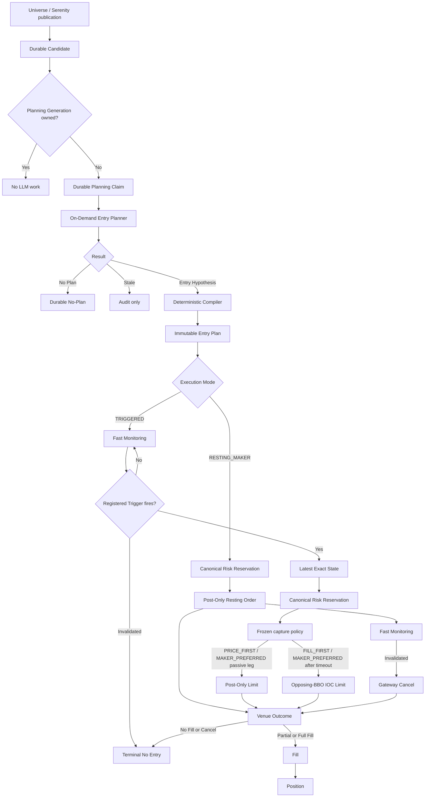

# Decision Lifecycle Contract

> **Role:** Contract — current approved behavior only. Target designs live in
> [`../specs/`](../specs/README.md); known mismatches live in GitHub Issues.
> **Prefix:** `DL` · **Owner code:** the seams between `core/aletheia/universe/`, `agent_shell/entry_planner.py`,
> `execution/entry_plan_execution.py`, `agent_runtime/fast_trigger_watch.py`, `risk/engine.py` and `execution/gateway.py`

## Scope

This contract is the cross-cutting spine of one entry, from Candidate publication through
Planning, Entry Plan, Risk and Gateway to Fill and Position, and the guard at each seam
between subsystems. It owns the seam invariants and the Candidate business-progress
health read; it does not repeat subsystem rules. Plan field-freeze, timing/holding,
planning-cycle and execution-leg rules belong to the [Entry Plan contract](entry-plan-contract.md);
Candidate admission to the [Candidate Selection contract](candidate_selection_utility_contract.md);
the exit spine to [execution_contract.md §10](execution_contract.md); filter evidence to the
[Filter Evidence contract](filter_evidence_contract.md). Retired TradingDecision / PiDecision /
`signal_pending` text is in [history](../history/decision_lifecycle_retired_entry.md) and the
pre-rewrite text in [history](../history/decision_lifecycle_superseded_passages.md).

## Entry points

| Entry point | Kind | Caller |
|---|---|---|
| `core/aletheia/storage/repositories.py::publish_candidate_snapshot` | call (only Core Candidate snapshot/member writer) | `universe/service.py::UniverseService.refresh`; `trading/serenity_publication.py::publish_serenity_candidates` |
| `core/aletheia/storage/repositories.py::claim_next_candidate_planning` | call | `agent_shell/entry_planner.py::run_entry_planner_batch` (via `agent_runtime/pi_daemon.py::_run_interruptible_planner_batch`) |
| `core/aletheia/execution/entry_plan_execution.py::execute_entry_plan` / `::build_entry_plan_order_intent` | call | Plan execution and `agent_runtime/fast_trigger_watch.py` |
| `core/aletheia/risk/engine.py::evaluate_proposal` | call | Gateway, before any submission |
| `core/aletheia/execution/gateway.py::cancel_entry_plan_order` | call (only entry cancel path) | `fast_trigger_watch.py` |
| `core/aletheia/storage/repositories.py::get_candidate_path_progress` | call (read-only) | `agent_runtime/health.py::_refresh_candidate_path_progress` |

## Durable state

| Table / file | Writer | Readers | Mutability |
|---|---|---|---|
| `universe_snapshots`, `universe_members` | `publish_candidate_snapshot` | Planner, Workbench | member context immutable; attention/TTL monotonic |
| `candidate_planning_generations` | `repositories.py` planning functions | Planner, Workbench | one row per cycle; see [Entry Plan contract](entry-plan-contract.md) |
| `entry_plans` | `complete_candidate_planning_with_plan`, `transition_entry_plan` | Fast Monitoring, execution, Risk, Workbench | Plan facts immutable (DB trigger); status monotonic |
| `trade_proposals`, `risk_decisions`, `orders`, `fills`, `positions` | execution / Risk / Gateway owners | lineage readers | owned by their contracts |
| `filter_decisions`, `filter_candidate_outcomes` | evidence writers | analytics | see [Filter Evidence](filter_evidence_contract.md) / [Opportunity Outcome](opportunity_outcome_contract.md) |

## 1. Spine (entry direction)

Universe and Serenity share this single entry path. A `Trigger` exists only on the
`TRIGGERED` branch; no Trigger is synthesized for `RESTING_MAKER`.

The capture policies are `trading/entry_capture.py::CapturePriority`. The Triggered hot
path (Fast Monitoring → Order Intent) consumes only local/stream facts and routes
cancellation through Gateway (DL-C23, DL-C25).

## 2. Carriers

### 2.1a Candidate Planning Generation and Entry Plan

Birth-context freezing, timing vs holding, planning cycles, requalification and Plan
authority states are owned by the Entry Plan contract: EP-C01..C04 and EP-C17..C19. Legacy
Opportunity / `signal_pending` / admission-slot fields are read-only
([history](../history/decision_lifecycle_retired_entry.md)).

#### DL-C04 One Core publication writer

`The system shall create Candidate snapshots and members only through publish_candidate_snapshot, which validates snapshot identity and persists the snapshot with its members atomically in a shared transaction or savepoint.`

- Universe refresh and Serenity keep their own admission and outer atomic scope; a Serenity theme rolls back as a whole.
- No separate snapshot/member insert API or `insert_candidate` alias exists.

#### DL-C05 Attention read projection

`When Candidate detail or Planning History is read, the reader shall project max_attention_age once the hard attention deadline has passed and otherwise ttl_expired once the soft deadline has passed, without writing any planning generation, Entry Plan or Order.`

- Durable attention terminal states are written only by canonical expiry reconciliation (`repositories.py::expire_candidate_attention`).

#### DL-C06 Exact execution lineage

`When the Workbench reads a Candidate's execution facts, the reader shall join exact Plan → Proposal/Order → Fill → Position and Position → close Order → close Fill identities, and shall report a conflicting, missing or ambiguous link as unavailable instead of matching by symbol or time.`

- A zero-fill confirmed terminal is `NO_FILL`; a Fill without a Position is `UNAVAILABLE`; an open Position takes precedence over an entry remainder.
- Cycles keep their original Candidate, input, hash and Plan and are read in one batch, not per cycle.
- Position realized economics stay separate from the fixed 4h `entry-fill:<fill_id>` outcome.

### 2.1b Candidate business progress

#### DL-C07 Read-only progress snapshot

`The progress reader get_candidate_path_progress shall be a read-only SQLite snapshot over scanner metrics, current supported planning, watchable Plan readiness and current-epoch selection plus exact entry-fill:<id> 4h outcome debt, without evaluating qualification or loading provider or model data.`

- Historical process IDs never remove current debt; other epochs and unrelated outcome keys are not counted.
- A pending scanner capture with its committed batch is projected as captured without repairing scanner JSON.
- Missing identities or clocks are unavailable, never an empty or successful queue; per-outcome provider defer reasons are reported as unavailable because the settler does not store them.

#### DL-C08 Cached health read

`The background health job shall replace one progress cache before compute_health with a TTL of twice the health job interval (default 1200 seconds), and the Workbench shall read that same cache.`

- The cache carries generated time/age, attempt/success/snapshot watermarks, policy/epoch, selection/support/observe-only and reason counts, ready planning count and oldest time, expired claims, due outcome count and oldest due, and bounded issues.
- An unconfigured or paused health job, or a failed, missing or expired cache, is unavailable; Universe disabled or a deliberate runtime pause is non-applicable.

#### DL-C09 Stall thresholds

`While Universe is enabled and the scheduler runs, the health check shall report a stall when the last successful refresh is older than twice the refresh interval plus 600 seconds, when supported ready planning work is older than 480 seconds, or when an expired lease is older than 180 seconds, and a backlog when due pending 4h outcomes are older than 900 seconds.`

- A latest failed refresh degrades at the next sample; a new process without success initializes only until the 600-second bound.
- Ready work age uses pending `created_at`, unavailable `retry_not_before` or expired `claim_expires_at`, never `updated_at`.
- Normal empty or observe-only selection, future retries, capability blocks, economic `NO_PLAN` and natural Trigger/Fill waits are not stalls.

#### DL-C10 Alert-only business health

`Only candidate_refresh_failed, candidate_refresh_stalled, candidate_planning_stalled and candidate_outcome_backlog shall degrade business health, and they shall only alert.`

- No self-heal restart, Live/Risk/Gateway change, rescheduling, admission or rewritten `due_at` follows; unavailable probes initialize.

### 2.2 Entry / holding boundary

Timing horizon, entry expiry and the frozen `holding_horizon_hours` passed to
`Proposal.expected_horizon_hours` are EP-C04.

### 2.4 Filter evidence (evaluation side path)

High-volume directionless gates write complete batches; directional gates and Risk write
per-candidate facts; one outcome per candidate is shared; Risk evidence commits with the
authoritative RiskDecision ([FE-C15, FE-C17, FE-C20](filter_evidence_contract.md)). Historical
Observer / Ranker / System Operator evidence is read-only.

## 3. Seam guard table

| Seam | Writer | Consumer | Key invariant | Guard / owner |
|---|---|---|---|---|
| Candidate publication | `publish_candidate_snapshot`; Universe / Serenity orchestration | current PlanningGeneration | birth context frozen, one exact-instrument owner, atomic publication | DL-C04, DL-C15, EP-C02/C03 |
| Planning → Plan | Entry Planner / Compiler | Plan execution / watcher | immutable input, owner CAS, typed unavailable / no-plan, real Profile | EP-C07..C17, DL-C18 |
| Plan → Proposal | `entry_plan_execution.py` | Risk / Gateway | source/school/holding consistent, single Plan lineage, no legacy pending revival | EP-C04, DL-C27 |
| Proposal → Risk | Gateway | `risk/engine.py::evaluate_proposal` | serialized by `_eval_lock`; each Proposal evaluated once; `approved=False` never executes | risk_engine_contract |
| Exit spine | — | — | exit trigger priority; pause never blocks a close | [execution_contract.md §10](execution_contract.md) |
| Filter evidence | each gate's writer | filter controller / doctor | ex-ante input + version; no direction no net; Risk evidence atomic | FE contract |

## 4. Invariants

Each invariant keeps its former `DL-INV-*` id in parentheses for traceability.
Requirement ids start at `DL-C04` because `DL-C01..C03` are already executable claim ids of
the data-layer contract.

### DL-C11 Single entry decision authority (DL-INV-1)

`The system shall admit every new Universe or Serenity entry only through current PlanningGeneration → Planner → Hypothesis → Compiler → EntryPlan execution/watcher → Risk → Gateway, with no independent producer, evaluator or compatibility adapter.`

- See EP-C01.

### DL-C12 Attribution cannot be rewritten (DL-INV-4)

`The system shall carry the Candidate's frozen source kind, source id, trade_school and holding_horizon_hours unchanged into the Plan, Proposal and Position, and shall never infer source from symbol.`

### DL-C13 Wakes reach only durable ownership (DL-INV-11)

`When either source wakes planning, the system shall wake only canonical planning work, and duplicate wakes shall resolve through the same claim/retry/CAS without rebuilding pending signals or PiDecisions.`

### DL-C14 Interrupted legacy claims retire read-only (DL-INV-19)

`If a legacy claim has no Proposal, then the system shall retire it read-only with an entry_path_retired audit and shall not create a Proposal, and an existing execution owner, Order or unknown submission shall not be given an invented terminal state.`

### DL-C15 Entry and position actions are separate (DL-INV-20)

`The system shall keep portfolio review, close, reduce and adjust actions separate from entry, and a Position identity shall never be used to create a new entry.`

- At horizon expiry a Position can only be validly extended or closed; an invalid hold does not complete the review.

### DL-C16 Source ownership (DL-INV-27)

`The system shall keep source-scoped snapshots and attention together with one global current owner per exact instrument, so that Universe and Serenity never evict each other and a cross-source conflict returns instrument_owned.`

- New source evidence requires new admission; an old pending signal is not an approval.

### DL-C17 Filter facts are recorded at evaluation time (DL-INV-7)

`The system shall record each gate's pass or reject when it is evaluated and shall never reconstruct intermediate gates from a final Proposal or opportunity state.`

### DL-C18 No direction, no return learning (DL-INV-8)

`If a candidate has no ex-ante long or short, then the system shall measure only capability and coverage and shall never pick the more profitable direction afterwards.`

- See OO-C05.

### DL-C19 TriggerSpec authority (DL-INV-30)

`The EntryHypothesis shall select only a registry Profile, the Compiler shall fix TriggerSpec id, version and bounded params, and Fast Monitoring shall not interpret model prose.`

- New Trigger economics or thresholds require economic-research authority, not a lifecycle refactor.

### DL-C20 Fast Monitoring exact venue and freshness (DL-INV-31)

`If the Trigger or Order Intent cannot use a confirmed subscription and the latest exact state for the Plan's own venue, symbol and market_type, then the system shall fail closed without cross-venue or REST substitution.`

- Stale quote/depth/trade, sequence anomalies, envelope breaches and unavailable adapters all fail closed (`entry_plan_execution.py::require_current_submission_market`).

### DL-C21 Single execution and real tactic (DL-INV-32)

`The system shall allow at most one execution per Entry Plan and Proposal/Order, shall submit Maker only as true Post-Only and Urgent only as an opposing-BBO IOC limit inside the Plan envelope, and shall accept a fill only from matching-account private Fill evidence.`

- A plain GTC limit is never labelled Maker; retired simulated matching is not a current tactic.

### DL-C22 Entry Plan immutable and monotonic (DL-INV-33)

`The system shall never rewrite a Plan's JSON, hash or planning generation, shall move status only forward, and shall terminate a Plan only for structural invalidation, incompatible new generation, expiry, permission/pause/kill-switch, Risk revocation, execution completion or manual cancel.`

- Rank, score and snapshot refresh never terminate a Plan; a terminal Plan never revives.

### DL-C23 Gateway cancel and fill priority (DL-INV-34)

`When Fast Monitoring invalidates a Plan with an Order, it shall request cancellation through the Gateway, and the Gateway shall recheck private Fill/Order facts after the network call so that a complete fill wins the race and a partial fill keeps its real Position and cancels only the remainder.`

- A cancel acknowledgement never overrides economic facts or escalates to Taker.

### DL-C24 Planner admission and preemption (DL-INV-38)

`The Planner batch shall use only broker-available normal-priority capacity, and before the parent batch returns it shall cancel and await every child task, so an urgent portfolio wake can preempt it without consuming a physical model attempt.`

- An urgent portfolio wake skips the normal cooldown; there is still only one Operator authority.

### DL-C25 Entry market evidence has two clocks (DL-INV-39)

`The system shall verify and persist both the exchange/source time and the local receive time of the exact quote used for RESTING_MAKER and TRIGGERED execution, and shall refuse Risk/Gateway entry if either is stale, in the future, naive or unparsable.`

- Old rolling evidence is not reused before a subscription is confirmed or after its generation resets.

### DL-C26 IOC and maker remainder convergence (DL-INV-40)

`The system shall treat an opposing-BBO IOC's cumulative Fill and its remainder terminal state as separate facts: zero fill is cancelled, a partial fill first materializes the Position and then terminalizes only the remainder, and a full fill is filled, idempotently across restart.`

- The passive timeout runs from the real Order lifetime (EP-C21); invalidation sits strictly on the protective side of every allowed entry reference.

### DL-C27 Post-submit Plan integrity (DL-INV-41)

`If an ordered or partially filled Plan's JSON or hash is corrupt, then the system shall keep external Order ownership through the durable Plan ↔ Order identity and route it to canonical Gateway cancel/reconcile, preserving partial fills and the original integrity reason.`

- Incomplete evidence stays in a retry-suppressing unresolved state.

### DL-C28 Mechanism-aware planning authority (DL-INV-42)

`Before any pre-order side effect, Fast Monitoring and Order Intent creation shall recheck that the generation's mechanism, direction, selection policy/epoch and mechanism version still match the current typed Candidate context, and shall terminate the old Plan otherwise.`

- Cancellation still goes only through the Gateway.

### DL-C29 Price-action shadow isolation (DL-INV-35)

`The market-structure/v2 projection shall produce only append-only Shadow assessments that cannot change Opportunity, Risk or Execution, and its hard-gate consumer seam shall fail closed for unapproved versions and unavailable results.`

- The production allowlist (`universe/market_structure.py::HARD_GATE_ALLOWLIST`) is empty; rules are owned by the [Market Structure contract](market_structure_contract.md).

### DL-C30 Instrument background (DL-INV-36)

`If a registry instrument entering features/scanners lacks a complete instrument-background/v1 that resolves to a supported analysis context, then the system shall fail closed, and Candidate publication shall freeze the same background and applicability into the typed context.`

- The product supports only the crypto context. The residual `stock_linked_perp` context is resolved as supported only on the frozen `binance` venue for specific embedded products (`data/symbols.py::instrument_analysis_context`) and is unreachable on the `bitget_demo` mainline; it is not a support claim.

### DL-C31 Candidate planning priority (DL-INV-37)

`When Planner capacity is available, the system shall claim first the generation whose last_candidate_id points at the lowest current Candidate rank, falling back to generation created_at and then id, with one owner per generation.`

- Rank only orders scheduling; it never enters planning identity or economic authority, and rank/score churn never creates duplicate LLM work.
- Concurrency is bounded by `ENTRY_PLANNER_MIN_CONCURRENCY` / `ENTRY_PLANNER_MAX_CONCURRENCY` and by broker capacity.

### DL-C32 Funding sign (DL-INV-29)

`The system shall treat positive funding as longs paying shorts (long crowding, supporting contrarian short) and negative funding as shorts paying longs (short crowding, supporting contrarian long and opposing short).`

## Failure semantics

| Condition | Response | Visible as | Unavailable vs zero |
|---|---|---|---|
| execution lineage link missing / conflicting | report unavailable | Workbench `UNAVAILABLE` | never matched by symbol/time |
| progress cache failed / expired | health unavailable | business health probe | unavailable, not healthy |
| stall threshold exceeded | degrade, alert only | `candidate_*_stalled` / `candidate_outcome_backlog` | no self-heal |
| stale / foreign market state at Trigger or Order Intent | fail closed | Plan stays waiting or is invalidated | no venue substitution |
| corrupt post-submit Plan | Gateway cancel/reconcile via Plan ↔ Order | integrity reason kept | unresolved, not terminal |
| mechanism / epoch mismatch | terminate old Plan pre-order | typed reason | no side effect |

## Authority

The spine grants no authority of its own: entry is decided only by the Planner/Compiler,
approved only by Risk and submitted or cancelled only by the Gateway; no seam may expand
Risk, credential, Gateway or Live-unlock authority.

## Verification

| Requirement | Executable claim / focused test |
|---|---|
| DL-C04 | `tests/specs/spec_entry_plan_contract.py::EP-S01`, `tests/test_architecture_fitness.py::test_candidate_snapshot_creation_has_one_core_owner` |
| DL-C05 | `tests/specs/spec_decision_lifecycle.py::DL-S75` |
| DL-C06 | `tests/test_entry_plan_execution.py`, `tests/test_repositories_execution.py` (`get_entry_plan_execution_lineage`) |
| DL-C07 | `tests/test_health.py::test_candidate_progress_exact_epoch_and_entry_outcome_debt`, `::test_candidate_progress_does_not_hold_writer_permit` |
| DL-C08 | `tests/test_health.py::test_candidate_progress_health_cadence_and_disabled` |
| DL-C09 | `tests/test_health.py::test_candidate_progress_planning_uses_original_clocks_and_exact_identity`, `::test_candidate_progress_observe_only_and_missing_profiles_are_not_stalls` |
| DL-C10 | `tests/test_health.py`, `tests/test_universe_routes.py` |
| DL-C11 | `tests/test_entry_lifecycle_cutover.py` |
| DL-C12 | `tests/test_candidate_opportunity_persistence.py::test_generation_source_is_frozen_and_refresh_assets_allow_all_venues` |
| DL-C13, DL-C14 | `tests/test_entry_lifecycle_cutover.py` |
| DL-C15 | `tests/test_pi_daemon.py` |
| DL-C16 | `tests/test_candidate_opportunity_persistence.py::test_cross_source_cannot_replace_active_instrument_owner` |
| DL-C17, DL-C18 | `tests/specs/spec_filter_evidence.py::FE-B02` |
| DL-C19 | `tests/test_entry_planner.py` |
| DL-C20 | `tests/test_entry_plan_execution.py::test_stale_market_cannot_advance_active_plan` |
| DL-C21 | `tests/test_entry_plan_execution.py::test_plain_limit_is_not_maker_and_post_only_crossing_fails_closed` |
| DL-C22 | `tests/test_entry_planner.py::test_rank_snapshot_churn_does_not_invalidate_active_plan` |
| DL-C23 | `tests/specs/spec_entry_plan_contract.py::EP-S02`, `tests/test_entry_plan_execution.py::test_gateway_cancel_rechecks_fill_and_fill_wins`, `::test_gateway_cancel_keeps_partial_fill_and_closes_remainder` |
| DL-C24 | `tests/test_pi_daemon.py::test_candidate_planner_batch_yields_and_awaits_cancellation_for_portfolio_wake`, `tests/test_entry_planner.py::test_entry_planner_batch_cancels_and_awaits_siblings_on_fatal_failure` |
| DL-C25 | `tests/test_entry_plan_execution.py::test_stale_market_cannot_advance_active_plan` |
| DL-C26 | `tests/test_entry_plan_execution.py::test_reconciliation_terminalizes_ioc_remainder_from_exact_order_evidence` |
| DL-C27 | `tests/test_universe_fast_trigger.py::test_integrity_failure_preserves_order_lifecycle` |
| DL-C28 | `tests/test_universe_fast_trigger.py` |
| DL-C29 | `tests/test_universe_fast_trigger.py::test_market_structure_is_closed_bar_causal_and_shadow_unqualified` |
| DL-C30 | `tests/test_universe_service.py::test_pre_v3_snapshot_cannot_suppress_background_aware_publication` |
| DL-C31 | `tests/specs/spec_entry_plan_contract.py::EP-S04`, `tests/test_entry_planner.py::test_candidate_planning_claim_prefers_current_rank_over_fifo_age` |
| DL-C32 | no dedicated claim |

Claim `DL-S65` anchors §4 for the retired conviction-gate defer rule (former `DL-INV-21`,
see [history](../history/decision_lifecycle_retired_entry.md)); claim `DL-S64` (Serenity theme
expiry, `repositories_research.py::expire_stale_serenity_themes`) is on the claim-anchor
baseline.

### Known conformance gaps

- DL-C32: the former DL-INV-29 also required "a semantic change must rotate the policy
  epoch". The sign convention is encoded in several scorers
  (`universe/scanners.py::score_derivatives`, `::_funding_conflicts`,
  `extensions/regime/detector.py`) with no single constant and no mechanical link to an epoch.
- DL-C29: `universe/market_structure.py::hard_gate_decision` has no production consumer (only
  `tests/test_universe_fast_trigger.py`); it is an empty extension seam.
- DL-C30: the former text said the `isRwa` blacklist makes `stock_linked_perp` unreachable;
  the actual guard is `instrument_analysis_context`, which still returns supported for the
  frozen `binance` venue. Removal belongs to [spec 0003](../specs/0003-futures-only-convergence/spec.md).

## Decision references

- 2026-09-05: Candidate business-progress health accepted (DL-C07..C10).
- 2026-09-07 canonical entry cutover: TradingDecision / PiDecision / `signal_pending` entry
  retired ([history](../history/decision_lifecycle_retired_entry.md)).
- Candidate publication convergence: [slim_core_candidate_publication proposal](../proposals/slim_core_candidate_publication.md).
- 2026-10-10 rewrite: invariants renumbered `DL-C11..C32` (old ids kept in parentheses);
  Plan field-freeze and timing/holding rules replaced by pointers to the Entry Plan
  contract; the "3–15 concurrent workers" parameter left the invariant (code computes
  `min(max(pending, 3), 15, broker capacity)` in `entry_planner.py::run_entry_planner_batch`);
  Candidate business progress kept here as §2.1b.
- The former §2.1a entry-order closure paragraph (Risk-approved quantity equals Order quantity and
  never exceeds the request; only filled or cancelled Entry Orders enter the closure ledger) is
  preserved in [history](../history/decision_lifecycle_superseded_passages.md); leg sizing and
  accounting are EP-C24.
