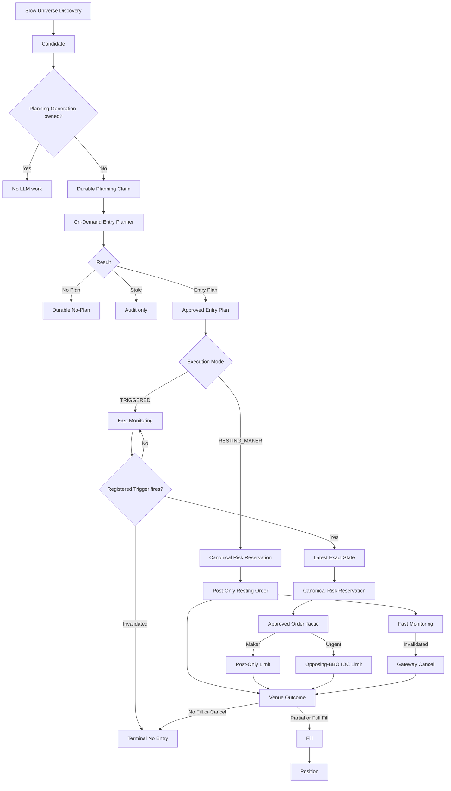

# 决策生命周期契约 (Decision Lifecycle Contract, L2 金标准)

> **角色**:本契约**横切**所有交易子系统,定义一笔交易从机会到复盘的完整脊柱,
> 以及每个**接缝(seam)**的前置/后置条件、守卫位置、与中间载体的字段约定。
> 其他契约**竖切**单个子系统(风控/执行/agent/知识);本契约负责它们之间的交接。
> **不重复**子系统细节 —— 指向已有契约。
> **基线**:代码为底(file:line);冲突时文档为准。
> Last updated: 2026-08-27 (v2.3:Candidate→Entry Plan convergence) · 维护者:Aletheia Dev · 研究证据:`docs/research/audits/OPPORTUNITY_END_TO_END_LIFECYCLE_AUDIT_2026-07-18.md`

---

## 1. 脊柱全景(开仓方向)

Universe-linked 开仓主路径如下。`Trigger` 只存在于 `TRIGGERED` 分支，不能为了线性展示而给
`RESTING_MAKER` 合成 Trigger。

以下 Opportunity 说明仅覆盖独立 producer 与历史兼容路径，不属于 Universe-linked 开仓主路径。
独立 producer 每个 snapshot 可产生一个 `open` analysis
generation；只有 Ranker 原子写入 `signal_pending` 后，它才成为 `queued` durable carrier。
前者服务分析换代和反事实，后者服务 Operator 工作连续性。两者不得共享 snapshot supersede
终止权或固定 30 分钟队列时钟。

Universe 选出的行是 Candidate；物理表 `universe_members` 仅是兼容实现名。新 Candidate 不再同时
生成一条可执行 Opportunity。独立 producer 的 Opportunity/Ranker/System Operator 路径仍保留，
但历史 `universe_scanner` Opportunity、Setup 和 conditional authorization 只能用于审计、恢复或
在没有 current Entry Plan owner 时的显式 compatibility adapter，不能与 Entry Plan 并行取得权限。

> 固定持有期反事实结果遵循 `docs/design/contracts/opportunity_outcome_contract.md`。历史 gross-only 行、
> 永续缺 funding、方向未知或过晚 ticker 只能用于解释，不得进入自动学习。

> **两个控制环**(理解模型,见上游报告 §2):跳1–8 是**交易决策环**(OODA,分钟级);
> 系统监管环(MAPE-K,小时级,见 `operator_layer.md` + `PI_OPERATOR_DESIGN_DECISIONS.md`)与本脊柱
> **正交**,两者只在 `pi_decisions` 表交汇,靠 `action` 命名空间区分(见 `PI_OPERATOR_DESIGN_DECISIONS.md §问题2`)。
> 平仓/退出脊柱见 [`execution_contract.md §10`](execution_contract.md)。

---

## 2. 中间载体契约

跨子系统传递的数据结构,其字段语义在此固定(此前只活在代码里):

### 2.1 Legacy/independent Opportunity compatibility contract (`storage/models.py:45`)

| 字段 | 类型 | 语义 / 值域 |
|------|------|------------|
| `market` | `str`(必填) | 机会的市场/场地描述符。跳5 当 PI 未显式选 `market_type` 时由 `_attach_opportunity_context` 作为继承来源(`trading_decision.py:909`)。⚠️ **已知歧义**:`market` 与下游期望的 `market_type` 枚举(`spot`/`usdt_futures`)值域是否一致**需核实并锁定**(报告 A1 design gap)。 |
| `direction_bias` | `str \| None` | `long` / `short` / `neutral`。跳2 `paper_trader_ranker` 直接读它定方向。 |
| `confidence` | `str` | **分类**置信度,默认 `speculative`(同 `VALID_CONFIDENCES`)。**不是**数值。字段由 Opportunity 的原始 producer 持有，后续 Observer assessment 不得覆盖。 |
| `confidence_score` | `int \| None` | Producer-owned 数值信号,跳2 打分用。Universe-linked 新路径不创建 executable Opportunity；历史 `universe_scanner` 行只作 legacy/observation carrier。Observer 的 LLM confidence 只进入 namespaced assessment，禁止与 scanner composite score 混合或把它解释成概率。 |
| `status` | `str` | 状态机:`open`(每个 snapshot 的可排序分析代次)→ `queued`(已认领为耐久 Operator 载体)→ `reviewed`(Operator 最终决定已落库);Filter 的永久拒绝也可从 `open` 直接进入 `reviewed`。父 snapshot supersede 只终结仍为 `open` 的代次；`queued` 由自身 `valid_until`、Operator 终局或 Proposal claim 终结。跳2 以 oldest-first 有界批次查询 `open` 工作集；top-N 只限制执行候选，不能截掉本批已扫描到的永久拒绝。永久拒绝或 TTL 终态与其原因事实同事务提交，证据失败则保持原状态可重试。 |
| `scanner_family` | `str \| None` | 来源扫描器族,跳5 透传进归因链(风控 #16 部门集中度解析用)。 |
| `valid_until` | `str \| None` | 触发后 Opportunity 自身的权威市场失效时间。它不是 Candidate TTL；Candidate TTL 由 Universe refresh/selection 与 `universe_members.expires_at` 管理。`open` 在此后进入 Ranker 的 family soft-TTL 衰减，直到硬顶才终结；`queued` 到此时间立即失去 Proposal 权限。只有缺失/不可解析该字段的历史 queued 载体才使用 pending `created_at + 30min` 兜底。 |
| `setup_id` / `signal_mark` / `trigger_behavior_version` | `str \| None` | 历史 Universe Setup adapter 的不可变审计字段。新 Candidate → Entry Plan 路径不得写入或依赖这些字段。 |
| `generation_version` / `generation_json` / `generation_hash` | `str \| None` | 历史 Opportunity Generation V2 审计载荷；新 Candidate → Entry Plan 路径不得以它取得开仓权限。 |

### 2.1a Candidate Planning Generation 与 Entry Plan

`candidate_planning_generations` 以 exact instrument、family、direction 和 thesis-level material facts
建立耐久 planning identity；snapshot/member/rank/score/price churn 不在 ownership identity 中。每代
最多一个 planning owner；No-Plan 耐久；unavailable 仅有界重试；旧 plan expiry/invalidation 不自动
重问模型。新 generation 或显式 manual replan 才能重新开放。模型返回必须 CAS 当前 generation；
stale result 可审计但不可激活。

`entry_plans` 是唯一 active plan ledger。不可变 JSON 固定 instrument、generation、方向、thesis、
execution mode、注册 TriggerSpec、entry/invalidation/stop/target/horizon、风险上限、order tactic、
maker/taker 权限、timeout/fallback、expiry 和 behavior identity；状态只可单调前进。Momentum 的
breakout/pullback/reclaim 只在 versioned `TriggerSpec.params` 中，不能成为通用 Entry Plan 字段。

Candidate 精确详情与 Planning History 必须按同一 soft/hard attention deadline 投影即时有效状态：
hard deadline 已过时为 `max_attention_age`，否则 soft deadline 已过时为 `ttl_expired`。该读投影不得
写 planning generation，也不得改变 Entry Plan、Order 或其有效性；耐久终态仍只由 canonical expiry
reconciliation 写入。

### 2.2 Legacy/independent TradingDecision compatibility contract (`agent_shell/trading_decision.py:56`,dataclass)

仅独立 producer 与历史恢复路径使用；Universe-linked 开仓由 Entry Planner 直接产生 Entry Plan。

| 字段 | 类型 | 语义 |
|------|------|------|
| `action` | `str`(必填) | 活跃入场面只允许 `trade` / `skip`。缺失或返回 `close` / `reduce` / `scale_in` / `flip` / `watch` 是 `DecisionUnavailable(operator_output_validation)`，不得归一成终态 `skip`、绑定身份或消费 pending。 |
| `conviction` | `int`(必填) | 0–100。缺失、非整数或越界是评估不可用；合法值低于 55(初始或 debate 后)是**非终态 defer** (DL-INV-2 v1.5)——`DecisionUnavailable('operator_low_conviction' 或 'debate_not_confirmed')`，pending 载体保留待 material fingerprint 变化重新开放；不合成 final `skip`。 |
| `reasoning` | `str`(必填) | 决策理由(人类可读)。权威 PiDecision 保存全文；短 reflection/UI 可独立截断。 |
| `skip_kind` | `str \| None` | 结构化输出只接受 `adverse_candidate_evidence` / `insufficient_evidence` / JSON `null`；`trade` 可显式返回 `null`。仅 direct skip 使用非空值，`insufficient_evidence` 或 `null` 均为中性未知，不得终结候选。 |
| `adverse_reason_codes` / `adverse_evidence` | `list[str]` | terminal direct skip 必须至少各有一项允许的 typed reason 与候选特定事实；rank priority 或证据不足不能冒充 adverse reason。 |
| `validated_adverse_claims` | `list[dict]` | 仅由确定性 validator 生成；逐项保存 `reason_code + fact_refs`。模型文本不能写入或替代该权限。 |
| `model_reasoning` | `str \| None` | direct skip 的原始模型文本，仅作审计；权威 `reasoning/adverse_evidence` 由 validated fact refs 重建，避免错误判词进入最终状态。 |
| `market_type` | `str \| None` | 新 LLM `trade` 必须显式选择与 exact carrier 一致的 `spot` / `usdt_futures`；缺失或无效值走同一有界输出修复，不再从 carrier 猜测。新 Operator `spot+short` 不得在下游静默重标为 futures，只能 repair/defer；旧 programmatic/历史恢复对象保留兼容 coercion。`skip` 保留可空语义。 |
| `opportunity_id` / `strategy_id` / `scanner_family` | `str \| None` | R0 归因,由 `_attach_opportunity_context` 回填(`trading_decision.py:909`)。 |
| `signal_source` | `str` | 机会来源,默认 `market_observer`;`serenity` 表示解析 `serenity_opportunities.id`(`:85`)。值域 = {`market_observer`,`serenity`}。 |
| `bear_case` | `str` | S4 强制反方论证。新 LLM 决策 schema 必填；空值仅允许历史记录。 |
| `stop_price` / `take_profit` | `float \| None` | `trade` 的 LLM schema 与解析边界要求两者都是显式有限正数；缺失/0/NaN/Infinity 触发有界修复，不能由配置替模型补值。跳6 用新鲜精确 mark 校验多空几何及 `1.00 <= round(abs(tp-entry)/abs(entry-stop), 2) <= 10.00`；初稿越界走一次有界修复，二次仍错或提交时 mark 刷新导致越界则 `DecisionUnavailable(operator_entry_plan)`，不改写模型计划。`skip` 不要求这些字段。 |
| `parameter_rationale` | `dict[str,str]` | 新开仓的五项 AI 理由：`entry_price` / `stop_loss` / `take_profit` / `notional_usdt` / `leverage`。仅 `trade` 的 LLM schema/解析路径要求全部为非空字符串；缺项触发同一有界输出修复，最终仍不完整则不创建 final PiDecision/Proposal。最终入场价同时保存实际 `market_snapshot_id / market_type / snapshot_at`，不是只写“来自快照”；详见 `trade_decision_rationale_contract.md`。 |

跳6 在精确报价通过后，还必须用相同 `symbol + exchange + physical market_type`
读取新鲜订单簿和 24h volume，形成 `market_tradability_gate`。`usdt_futures/swap`
在采集存储层映射为 `perp`；订单簿和 volume 不得跨 venue 或 spot/perp 混用。
缺失、过期、身份不完整的上下文返回
`DecisionUnavailable(reason='market_tradability_unavailable', stage='operator_entry_plan')`；
只有明确 `is_tradable=false` 才返回 `market_not_tradable`。两者均为非终态 defer，
不创建 Proposal、不消费 pending。阈值仍由既有 `compute_tradability` 负责，本关卡
只消费其明确结论，不改变评分公式。通过时，完整 instrument identity 与 tradability
输入写入 hash-covered `TradeProposal.attribution_snapshot`，供事后复盘和 Learning 使用。

### 2.2a PiDecision（耐久 Operator 事实）

`PiDecision` 对 pending 和最终 action 都保存 `symbol / direction / market_type /
opportunity_id / signal_source`。最终行另存 `proposal_id / proposal_status /
proposal_reason`：已形成的业务决定必须有耐久状态；但评估、必需辩论或 Proposal 前置条件
不可用不是业务决定，必须抛出带稳定 `reason/stage` 的 `DecisionUnavailable`，不写最终行、
不消费队列。`evidence_manifest_json.operator_rationale` 保存 skip kind、adverse codes/evidence、
supporting/opposing signals 与 risk factors；不得用 200/300 字截断替代权威理由。不得把 provider
异常文本写入数据库。历史 NULL 默认保持未知；唯一例外是旧
Serenity pending 的 `market_type`，且只能从相同 `opportunity_id` 的耐久
`SerenityOpportunity` 恢复，并要求两边 `symbol / direction` 精确一致、来源
`market_type` 非空。任何缺行或不一致仍保持未知并拒绝授权。

### 2.2b Layer 1 technical feature identity

`universe_feature_snapshots` 的物理身份只有 `asset_id`；System Operator 的 Layer 1 技术特征读取
必须经 `asset_id → universe_registry` 取得 `symbol + market_type`，再按完整 instrument identity 去重。
不得把未 join 的 snapshot 当作含 `symbol` 或价格的行：那会把所有资产压缩为一个空标的，令模型把
完整的特征供给误解为数据不足。价格仍只能来自新鲜的 market-data cache；cache 未命中必须诚实为
`None`，不得用 snapshot 身份修复伪造报价。

全局 `feature_index` 的数量上限只用于有界展示，不是候选事实门。每个精确 pending carrier 必须按其
`universe_member_id → asset_id` 单独读取最新技术快照，即使该快照排在全局展示上限之外；同一候选的
queued/reviewed 来源 Opportunity 也必须携带 thesis、observations 与技术身份进入上下文。精确快照缺失、
核心数值不完整或过期时，在模型调用前写候选级 typed defer 并保留 carrier。新的精确 snapshot id/时间/
数值进入 material fingerprint，必须重新开放评估；Universe 特征刷新（含 change-suppressed TTL slide）
必须唤醒 Operator，不能只等待固定 heartbeat。

### 2.3 signal_pending 载体 (跳2→4 接缝)

`paper_trader` 写 `PiDecision(action='signal_pending')`(`paper_trader.py:143/235`);
`trading_context._build_pending_signal_queue` 读回尚无同 `signal_source + opportunity_id`
最终决定的行,先按 `signal_source + symbol + direction + market_type` 去重,再按最早到达顺序向 PI 暴露 5 条。
`pending_queue` 同时返回真实未完成总数、可见数、overflow、最老时间和已超时未消费数。
**不变量**:市场扫描信号进入 queued 后由来源 Opportunity 的 `valid_until` 单一控制；pending
`created_at + 30min` 只用于没有可解析 `valid_until` 的历史兼容行。不得同时套用两套时钟，否则
30min 会截断 1–4h 家族载体，也令 120min Operator defer 永远无法完成。Serenity 是长周期来源，
不得套用 market compatibility fallback。
Operator 的 Proposal preflight 与最终原子 claim 都必须重查 Opportunity 自身 `valid_until`；两处中先观察到
过期的一处通过同一个仓储 CAS，把 `queued→expired` 与唯一一条
`opportunity_ttl / ttl_expired` 事实放在同一保存点中。证据失败时保持 `queued`，且不得写最终 PiDecision
或 TradeProposal；不能让模型评估期间发生的过期成为“有终态、无原因”的审计断点。
`paper_trader` 只能以条件更新认领 `open→queued`;旧计划不得把 `reviewed/expired` 倒退为 queued。成功写入后先把来源 Opportunity 标记为
`queued`;只有 `reflection.claim_decision` 在最终 PiDecision 与状态更新的同一事务中把它改成
`reviewed`。任何绑定 Opportunity 的活跃最终决定（`trade` / `skip`）都必须命中同一
`signal_source + opportunity_id` 的耐久 `signal_pending` 载体；Layer1 open 视图和 ranker 候选只能
提供分析上下文。heartbeat 零 pending 不是 entry 决定：不得调用交易 LLM、写 final `PiDecision`、
退休 Opportunity 或创建 Proposal；只能写 `operator_evaluation_events(event_kind=no_evaluable_candidate)`，
附队列摘要、触发源和当前 policy epoch。该观察事实不进入 candidate skip/outcome cohort；历史无 target
skip 仅作 legacy audit，不能由新逻辑继续产生。持仓动作不属于这个入口，只能由独立 portfolio review
以 `hold` / `adjust_position` / `close_one` 表达；horizon 到期时 `hold` 不构成终态，
只能明确延长到未来的绝对持仓 age 或平仓；
`reduce_exposure` 等未实现标签不得映射为整仓关闭。命令路径先在内存中准备完整 immutable Proposal，
再以短事务同时写入 `proposal_status=submitting` 的最终 PiDecision 和 TradeProposal,并把 Opportunity
改为 `reviewed`;完成提交后才进入 Risk/Execution。这样崩溃只能留下“两者都没有”或“两者都存在”,
不得留下 reviewed + submitting 但零 Proposal。升级前遗留的该类孤儿 claim 只能在 pending 载体和
symbol/direction/market_type/action/opportunity/source 身份全部匹配时补写一次 Proposal；原 claim 的
conviction 仍是耐久审计事实，但重启后同一身份被重新打成 89/90 不得阻塞恢复或改写原评分。
Direct skip 在 `system_operator_skip_remediation/b1.5` 下必须经过一次有界、blind 反事实确认；确认后仍只有
`adverse_candidate_evidence + typed reason + concrete evidence`，且每个 reason 都由确定性 validator 解析到
同一候选的 typed fact refs，才可终结。B2 `insufficient_evidence`、中性 50/50 regime、可选 OI 缺失、
rank ordering、账户权益或单笔近期亏损都没有 adverse authority。两次输出仍是信息不足或无效时，
写 `operator_evaluation_events(event_kind=operator_decision_deferred_unchanged_context)` 并保持 pending；
同一 policy epoch、同一候选的物质上下文 fingerprint 在 120 分钟窗口内未变化时不再调用模型；
每条 defer 的 `defer_until` 是独立的 Operator attention deadline，但不得晚于来源
Opportunity 的 `valid_until`。defer 事件绝不修改 `valid_until`；PI daemon 必须把仍未兑现的
耐久 `defer_until` 作为独立 wake deadline，持续的新 signal、heartbeat 相位和进程重启都不得
推迟或遗忘该 deadline，且新 Operator 观察、终局 PiDecision 或 Opportunity 过期后不得重挂。
过期载体只能按其市场有效期失去 admission/recovery 资格，不能由 scheduler/API resurrect。
defer 不阻塞同批下一候选。每次模型调用只能暴露一个 pending carrier 及其技术/Opportunity/B2 证据，
不得暴露 analysis-only preview 或另一 pending 候选作为判词依据。fingerprint 排除
Opportunity id/时间戳等载体 churn，但包含 instrument、方向、scanner thesis、rank priority、B2 状态、
实际 B2 `n_total/n_net/coverage/avg/shrunk/verdict`、候选技术特征与 market regime；这些字段变化会重新开放评估。
缺失技术数值显示为 unknown，不得转写为 0。已存在 `proposal_status=submitting` 的 claim 始终优先恢复，
不得被新确认门阻断或覆盖。
`PiDecision` 自身保存 `symbol / direction / market_type / opportunity_id / signal_source`;
`_attach_opportunity_context` 必须把 `pending_signals` 中 `market_observer` 与 `serenity` 两类载体
都视为有效归因来源,并按 `opportunity_id` 回填来源字段,不得只消费 Serenity 载体。对
`market_observer` 载体,队列中的精确编号优先于仅靠相同 symbol/direction/market 匹配到的另一条开放机会;
Opportunity 最终动作只认 pending 权限，因此精确 Serenity pending 与仅用于分析的 Layer1 同时匹配时，
由前者提供身份。portfolio review 只按明确 `position_id` 使用独立持仓权限。

### 2.3b Admission slot 语义

`paper_trader._plan_signal_batch` 用 `_PENDING_SIGNAL_QUEUE_CAPACITY=5` 限制同时暴露给
Operator 的 signal_pending 载体数量。一个 admission slot 代表 **Operator 尚未做出判断** 的
signal_pending 载体；`count_unresolved_signal_pending` 是此语义的唯一权威计数器。

**已判等**的载体（`operator_evaluation_events` 中最新事件是
`operator_decision_deferred_*` 且 `defer_until > now()`）不占 admission slot——Operator 已经
判断了它，只是在等重评窗口到达。该规则同时被 `pi_daemon._has_pending_signal_work`（决定
是否要 startup 评估）与 `paper_trader.admission`（决定是否接纳更高分新候选）复用；两个消费者
必须共享同一份"活跃 defer opportunity_id 集合"（`active_defer_opportunity_ids()`）。

`_build_pending_signal_queue` 的显示排序层继续把活跃 defer 载体 demote 到队尾，与本 slot
语义相互独立：admission slot 决定"是否允许新候选入场"，display order 决定"入场后先看谁"。

### 2.4 Filter Evidence（评估旁路）

- `filter_decision_batches` 保存 ticker/tradability 等高频无方向门；必须保存本次扫描的全部候选，不得抽样。
- `filter_decisions` 保存已有方向的 Observer、Ranker、System Operator 和 Risk 逐关事实，到首个拒绝停止。
- `filter_candidate_outcomes` 按候选共享一份目标市场净结果，不按筛选关重复结算。
- Risk 证据必须在权威 `RiskDecision` 落库后追加；证据失败不改变原始批准/拒绝。
- `TradingDecision.action='trade'` 表示 System Operator 的交易意图，不等于提案已经创建。
  方向过热是确定性业务拒绝，转成可耐久的 `skip`；模型 `trade` 缺显式 stop/TP/五项参数理由、
  或这些保护价相对提交时精确 mark 几何错误时，返回可重试的稳定不可用原因，在形成最终决定前
  停止，不能消费 pending；配置默认值不得把一个不完整模型计划改写成另一笔交易。
- 只有首次创建最终 PiDecision 的 owner 可以把本轮 `filter_trace` 绑定到该 decision id；终态重放或
  历史中断恢复不得把新一轮 LLM 的 trace 冒充成原决策事实。对精确 pending 候选的 terminal `skip`，
  PiDecision、trace、可识别的固定 horizon outcome seed 与 `queued→reviewed` 必须同一提交；trace
  写入失败则整轮回滚、pending 保持。原 trace 未耐久时宁可不追加。

完整定义见 `docs/design/contracts/filter_evidence_contract.md`。

---

## 3. 接缝守卫表

| 接缝 | writer | consumer | 关键不变量 | 守卫/spec |
|------|--------|----------|-----------|-----------|
| 机会落库 | `market_observer.py:361` | ranker / Layer1 | 仅 `status='open'` 进排序;reviewed 不重复 | (本契约 DL-S01) |
| signal_pending | `paper_trader.py` | `trading_context._build_pending_signal_queue` | 仅未完成；先去重再限量；oldest-first；显式 backlog/expiry；queued→reviewed 原子终结 | DL-S03 + DL-S10~12 |
| 决策→提案 | `trading_decision.py` | `gateway.py` | `conviction≥55 且 action='trade'` 且有精确 pending 载体才尝试；LLM 开仓还必须显式给出有限正数 stop/TP 与五项参数理由；`paper_internal` 还需配置行情 venue 的同 symbol/spot-perp 新鲜精确 mark，并据此校验几何、计算唯一 reward:risk；PiDecision+Proposal 原子提交；不可用时零最终行并保留队列 | DL-S18~19 + DL-S40~41 + DL-C01 + DL-C02 + TDR-C01 + execution_contract §3 |
| 提案→风控 | `gateway.py` | `risk/engine.py:67` | `_eval_lock` 串行;每提案恰评估一次;`approved=False` 不执行 | risk_engine_contract / spec_pipeline_risk_gate |
| 平仓脊柱 | — | — | 见 `execution_contract §10`(退出触发器优先级 / paused 不挡平仓) | PL-PM-01~07 |
| 筛选证据 | 各关原 writer | filter controller / doctor | 事前输入+参数版本；无方向不生成可学习净结果；Risk 只报告 | filter_evidence_contract / spec_filter_evidence |

---

## 4. 不变量

- **DL-INV-1 单一开仓决策权**:Universe-linked Candidate 只由 current Candidate Planning Generation 与 Entry Plan 取得开仓权限；新快照不得同时生成可执行 Opportunity。独立 producer 的 Opportunity 仍只允许 `trading_decision.evaluate` 形成意图。两条路径都必须经过同一个 canonical Risk/Gateway，任何 compatibility adapter 都不得与 current Entry Plan 并行成为 owner。
- **DL-INV-2 conviction 门**:`conviction < 55`(`_MIN_CONVICTION_TO_TRADE`)不得成为最终 `skip`。它是评估不可用:抛稳定 typed `DecisionUnavailable`,保留 pending 载体,写 `operator_evaluation_events(event_kind=operator_decision_deferred_low_conviction)`,由 material fingerprint 变化(新技术快照/regime tag/catalyst)重新开放评估。改此阈值须同步本契约 + DL-C01;`_DEBATE_RANGE` 与 debate 权重公式同理不得静默变更。
- **DL-INV-3 guard advisory**:跳6 的 guard chain 只写 `decision_meta['guards']`,**不硬拦**;唯一硬门是风控引擎(见 `execution_contract` guard 澄清段 + spec PI-S02)。
- **DL-INV-4 归因继承**:`_attach_opportunity_context` 必须按 `signal_source` 把 opportunity_id/strategy_id/scanner_family 回填到 decision,否则学习闭环断链(LEARNING_LOOP_AUDIT §R0)。
- **DL-INV-5 instrument 取价**:跳6 必须先确定最终 `market_type` 和 price venue。`paper_internal` 只接受配置行情 venue 的同 symbol、同物理 `spot/perp` mark：内存不超过 90 秒，SQLite 精确回退不超过 120 秒；不得跨 venue/market 或用旧 snapshot 建 Proposal。
- **DL-INV-6 强制反方论证**:新 TradingDecision 的 LLM schema 必须要求非空 `bear_case`,`_parse_decision` 必须透传到提案审计元数据；仅 dataclass 有字段不算实现。
- **DL-INV-7 筛选事实不反推**:放行/拒绝必须在当次评估时记录，不得从最终 opportunity/proposal 状态倒推中间关卡。
- **DL-INV-8 无方向不学收益**:无事前 `long/short` 时只衡量能力和覆盖，禁止事后选最赚方向。
- **DL-INV-9 提案结果不丢失**:`trade` 是唯一可执行入场意图。确定性方向门拒绝必须成为带稳定原因的 `skip`；报价、必需理由或依赖不可用必须抛稳定 typed reason 并保持队列可重试，禁止写一条 `proposal_id=NULL` 的伪最终 trade。
- **DL-INV-10 入场计划与参数理由不伪造**:System Operator 的 `trade` 须显式带有限正数 stop/TP 与五项参数理由；schema/语义不完整只能有界修复或 defer。提交时的新鲜精确 mark 是 entry 权威，reward:risk 只按该 mark 与模型原始 stop/TP 确定性计算；不得用 `default_config` 改写模型缺失或几何错误的保护价，再冒充完整 AI 计划，也不得把新 Operator `spot+short` 静默重标为 futures。修复成功的初稿错误以 `error` 审计、不得成为 rejected 学习 cohort；最终正式 exposure 必须首先为 passed，二次仍错才是 rejected。Programmatic/历史对象的兼容 fallback/coercion 不构成新 LLM 交易权限。详见 `trade_decision_rationale_contract.md`。
- **DL-INV-11 耐久所有权后唤醒**:Universe refresh 只在创建新 Candidate Planning Generation 后唤醒 PI daemon；重复 refresh/heartbeat 不重问。独立 Opportunity producer 仍须由 `paper_trader` 排序并写入 `signal_pending` 后唤醒。两类耐久工作不得相互冒充。
- **DL-INV-12 公平待处理队列**:只向 Operator 暴露尚无最终决定的信号；必须先去重再限量、最早信号优先，并报告 overflow/过期，禁止用“最新 5 条”静默覆盖旧工作。
- **DL-INV-13 最终决定幂等**:同 `signal_source + opportunity_id` 的首条非 pending PiDecision 是权威结果；重复唤醒只能恢复该行已绑定的 pending Proposal 或返回终态,不得生成第二份提案或最终决定，也不得把 replay-only 筛选痕迹绑定到原 decision id。
- **DL-INV-14 可用结果才耐久**:只有完整评估和前置条件得到的 `trade` / `skip` 可以成为最终 PiDecision。评估、必需辩论、精确报价或 Proposal 准备异常一律作为可重试不可用结果返回，零最终 PiDecision/TradeProposal，pending 保持 queued。
- **DL-INV-15 原子提案认领**:最终 PiDecision 与已完整准备的 immutable Proposal 必须在同一短事务耐久落库;同一来源机会的并发唤醒只能有一个认领者。任一写入失败必须整体回滚且零 Risk/Order 副作用。
- **DL-INV-16 不可用不冒充 skip**:LLM assessment 或必需 debate 不可用时不得合成 `skip`，不得绑定/消费最早 pending；后续依赖恢复后必须能对同一载体重新评估并只终结一次。
- **DL-INV-17 状态只前进**:`paper_trader` 只允许 `open→queued`;任何旧批次不得把 `reviewed/expired` 倒退。Serenity 待处理信号在没有对称过期迁移时不得被市场信号 TTL 静默隐藏。
- **DL-INV-18 pending 是 Opportunity 最终身份权限**:open Opportunity、ranker 候选和 heartbeat 不是终结或开仓授权；`skip/trade` 只可绑定精确且未过期的 pending 身份。零 pending heartbeat 不得把 open 改为 reviewed；缺失/不支持的模型动作是评估不可用，不能借 Opportunity 或 Position 身份制造终态。
- **DL-INV-19 中断可恢复**:新提交不得产生“最终 claim 存在但 Proposal 不存在”的崩溃窗口;历史孤儿 submitting 行只能在完整交易身份匹配时补写一次 Proposal并继续；conviction 等非身份审计值沿用原 claim，不以新模型评分相等为恢复条件。
- **DL-INV-20 入场与持仓动作分面**:入场 Operator 只暴露 `trade/skip`；portfolio review 只暴露 `hold/adjust_position/close_one` 并以明确 Position 为对象。`HORIZON_DUE` 时 hold、空调整或未延长到当前 age 之后的调整均不完成复核。`reduce_exposure`、`scale_in`、`flip` 等标签没有执行实现时不得出现在 schema/prompt，也不得映射为其他真实副作用。
- **DL-INV-21 direct skip 非对称否决禁止**:direct skip 必须经一次有界 blind 反事实确认，且每个 adverse reason 必须绑定同一候选的机器事实；`insufficient_evidence`、rank ordering、账户权益、单笔近期结果、可选数据缺失或无效输出不得成为终态。二次仍无效时只写候选级去重 observation 并保留 pending、轮转下一候选，绝不自动改成 trade。
- **DL-INV-22 候选技术事实不被展示窗口截断**:全局特征展示上限不得决定精确 pending 候选是否有技术事实；必须按 `asset_id` 定向补齐，缺失/不完整/过期则在推理前 defer。
- **DL-INV-23 新事实立即重开**:新精确 feature snapshot 必须改变候选 material fingerprint 并唤醒 Operator；不得让已有 neutral defer 吞掉新事实直到固定 heartbeat。
- **DL-INV-24 判词旁路禁止**(2026-07-18 · policy_epoch `system_operator_skip_remediation` v1.5):SIDEWAYS/中性 50/50 regime、neutral funding、单笔近期结果、账户 equity、可选遥测缺失(如 OI delta)、Ranker rank_priority 数值等既不得作为 direct skip 授权(DL-INV-21 已锁),也不得通过 debate/conviction gate 通道降低 candidate conviction。conviction 只能来自候选特定证据(技术结构、funding/OI 信号、catalyst context);上述维度只能出现在 `bear_case` / `risk_factors` 作为顾虑,不能进入决定开仓与否的数值。违反本项在诊断里表现为 `direct_skip_not_confirmed` 或 `operator_low_conviction / debate_not_confirmed` 的诡异重复,均按 defer 处理。
- **DL-INV-25 分析代次与工作载体分离**:Universe snapshot supersede 只能终结 `open` 分析代次；已写 `signal_pending` 的 `queued` 载体保留不可变的来源 snapshot/member id，并以自身 `valid_until` 继续到 Operator 终局。同一物理 `symbol + market + direction + scanner_family` 已有活跃载体时，新代次记录 `active_operator_carrier`，不得重复入队；spot 与 perp（以及其规范化别名）是不同的 ownership domain。
- **DL-INV-26 Producer 身份不可被 enrichment 改写**:若读取到历史 `universe_scanner` Opportunity，其 `direction_bias`、`confidence`、`confidence_score`、`thesis`、`valid_until` 与 identity 只保留 legacy producer 语义，不得获得新交易权限。Market Observer 的方向、置信、理由与 observations 只能写入 namespaced `metadata.observer_assessment`；方向相反时必须显式标 `direction_conflict`，不能把同一 carrier 静默翻成反向交易，也不能混合 LLM confidence 与 scanner composite score。
- **DL-INV-27 Universe producer authority**:Universe refresh 发布 Candidate 并确保一个 current Planning Generation；`universe_members` 是 legacy 物理表名，不是 Opportunity population。历史 `universe_scanner` Opportunity/Setup 只能审计、恢复或由显式 adapter 消费，不能获得新的并行交易权限。Observer 不得把 Candidate 或 legacy 行提升为 owner；独立 producer 不受此 Universe 合约扩张。
- **DL-INV-30 TriggerSpec 权限**:Entry Planner 只能选择 registry 中的 spec id/version 并填写 bounded params；Fast Monitoring 不解释模型 prose。新增 Trigger economics/threshold 必须走经济研究权限，不能借 lifecycle refactor 上线。
- **DL-INV-31 Fast Monitoring 精确场地与新鲜度**:Trigger 与 Order Intent 必须使用 Entry Plan 同一 `venue + symbol + market_type` 的已确认订阅和 latest exact state；stale quote/depth/trade、sequence 异常、越出 envelope 或 adapter 不可用均 fail closed，禁止跨 venue 或 REST 热替代。
- **DL-INV-32 单次执行与真实 tactic**:Entry Plan 与 Proposal/Order 唯一约束禁止 duplicate execute。Maker 必须为 true Post-Only；Urgent 默认 opposing-BBO IOC Limit 且不得越过 plan envelope；plain GTC Limit 不得标 Maker。V1 exchange tactic 仅 `bitget_demo`，`paper_internal` 不宣称 maker queue fidelity。
- **DL-INV-33 Entry Plan 不可变与单调**:plan JSON/hash 与 planning generation 不可改写；status 只可前进。rank/score/snapshot refresh 不终结 plan；只有 structural invalidation、incompatible new generation、expiry、permission/pause/kill-switch、Risk revocation、execution completion 或 manual cancel 可终结，终态不得 revive。
- **DL-INV-34 Gateway 撤单与 Fill 优先**:Fast Monitoring 只决定 invalidation 并向 Gateway 请求 cancel；Gateway 才可调用 broker/adapter。网络调用后必须重查 private Fill/Order facts。完整 Fill 赢得 cancel race；partial fill 保留真实 Position 并只取消 remainder，不得因 cancel acknowledgement 覆盖经济事实或升级为 Taker。
- **DL-INV-38 Planner admission 与抢占**:普通 Candidate batch 只能占用 broker 可用的 normal-priority capacity，local backpressure 或 portfolio wake 抢占不得消费物理 model attempt。父 batch 返回前必须 cancel-and-await 全部 child task；urgent portfolio wake 立即跳过普通 cooldown，同时仍只有一个 Operator authority。
- **DL-INV-39 Entry market evidence 双时钟**:RESTING_MAKER 与 TRIGGERED 执行均须验证并持久化同一 exact quote 的 exchange/source time 与 local receive time。任一时间旧、未来、无时区或不可解析均不得进入 Risk/Gateway；subscription 尚未确认或 generation 已重置时，旧 rolling evidence 不可复用。
- **DL-INV-40 IOC 与 maker remainder 收敛**:Opposing-BBO IOC 的 cumulative Fill 与 remainder terminal state 是独立事实；零 Fill terminal 为 cancelled，partial Fill 先物化 Position 后仅 terminalize remainder，完整 Fill 为 filled，重启必须幂等。任何实际 `POST_ONLY_LIMIT`（包括 TRIGGERED 后释放者）都从真实 Order lifetime 执行 `max_wait_sec`，且 invalidation 必须严格位于所有允许 entry reference 的保护侧。
- **DL-INV-41 post-submit Plan integrity**:Entry Plan 在 `ordered/partially_filled` 后即使 JSON/hash 损坏，也不得丢失外部 Order ownership；只能使用耐久 Plan↔Order identity 进入 canonical Gateway cancel/reconcile，保留 partial Fill 与原始 integrity reason。证据不完整保持 retry-suppressing unresolved state。
- **DL-INV-35 Price Action 权限隔离**:`market-structure/v2` 只可将同一 [Market Structure Derived Data Contract](market_structure_contract.md) 的连续、已收盘、同 venue 1m 因果事实投影成 append-only Shadow assessment；历史 v1 行保持不可变。BOS/CHoCH 不得改变 Opportunity、Risk 或 Execution。hard-gate consumer seam 必须对未批准版本及 unavailable 结果 fail closed，生产 allowlist 为空。
- **DL-INV-36 Universe instrument background**:每个进入 feature/scanner 的 registry 标的必须携带完整的 `instrument-background/v1`，并解析到一个明确支持的 analysis context。当前只支持既有 crypto context 与经核验的 `stock_linked_perp` context；后者只消费 instrument-local 行情、成本与衍生品证据，BTC 相对强弱、全局 crypto regime 和旧 crypto-family prior 明确不适用。`signal_emitter` 将同一 background 与 applicability 冻结进统一 Opportunity；缺失、冲突、未解析或无受支持 context 均 fail closed，完整 equity 身份本身不是拒绝理由。
- **DL-INV-37 Candidate planning priority**:稀缺 Entry Planner capacity 必须先 claim 当前 `last_candidate_id` 所指向的最低 Candidate rank；每轮可用 3–15 个并发 worker 依次完成 CAS claim 后并行规划，且每个 generation 仍只有一个 owner。rank 只决定调度顺序，不进入 planning identity 或经济权限。exact rank 不可用时稳定回退 generation `created_at`、再 `id`，不得随机排序或因 rank/score churn 创建重复 LLM work。
- **DL-INV-28 Producer rejection 不是 Operator outcome**:queued carrier 的 immutable producer admission 已确定拒绝时，只写 producer eligibility rejection 并转为 `signal_queue_evicted`；不得生成 `operator_action_assessment`、outcome seed 或 B2 cohort 成员。producer attestation 暂时不可用时保持 typed unavailable 和可重试载体。
- **DL-INV-29 Outcome 与 funding 符号固定**:B2 `qualified_negative` 表示同身份、同方向成熟 cohort 的净收益为负，不表示 bearish 方向，也不单独授权 trade/skip/veto。正 funding 是 longs pay shorts / long crowding，支持 contrarian short；负 funding 是 shorts pay longs / short crowding，支持 contrarian long 并反对 short。语义改变必须轮换 policy epoch。

---

## 5. Spec-as-Code

| claim | 级别 | 锁定 |
|-------|------|------|
| `DL-S01` | L2a | Opportunity 模型含 market/direction_bias/confidence/confidence_score/status/scanner_family |
| `DL-S02` | L2a | TradingDecision dataclass 含 action/conviction/reasoning/bear_case/market_type/opportunity_id/signal_source |
| `DL-S03` | L2b | trading_context.py 含 signal_pending 查询并填 pending_signals(跳2→4 接缝存在) |
| `DL-S04` | L2a | TradingDecision.signal_source 默认 `market_observer`(值域含 `serenity`) |
| `DL-S06` | L2a | 提案先解析最终 market_type 与 local price venue，再调用 exact fresh-mark accessor |
| `DL-S07` | L2b | reviewed Opportunity 仍可经 market_observer signal_pending 把 opportunity_id 交给最终决策 |
| `DL-S08` | L2a | 市场 Opportunity 生产者不绕过 ranker 唤醒 Operator；paper_trader 写 pending 后唤醒 |
| `DL-S09` | L2b | 经确认的 adverse skip 保存完整 pending 身份并终结 queued；遗留 watch 保持可重试且不消费 |
| `DL-S10` | L2a | PiDecision 载体包含 market_type，pending/final 不依赖事后猜市场 |
| `DL-S11` | L2b | pending 队列只读未完成项，先去重再限量，oldest-first 并报告 backlog |
| `DL-S12` | L2b | 同来源机会已有最终决定时，重复唤醒不再创建 proposal/最终行 |
| `DL-S13` | L2b | Proposal 准备异常返回稳定 typed unavailable，零最终决定且 pending 可重试 |
| `DL-S14` | L2b | 同一待处理机会并发评估时先耐久认领,仅一次 proposal 副作用 |
| `DL-S15` | L2b | 最终认领写失败时零 proposal 副作用且调用失败可见 |
| `DL-S16` | L2b | LLM assessment 不可用不合成 skip、不消费 pending；恢复后同一载体只终结一次 |
| `DL-S17` | L2b | Serenity 长周期待处理信号不被 market 30 分钟 TTL 静默隐藏 |
| `DL-S18` | L2b | heartbeat 在零 pending 时不能从 open/ranker 视图创建 Proposal |
| `DL-S19` | L2b | 历史 submitting+零 Proposal 中断按完整交易身份恢复；重评分不阻塞、原 conviction 不改写、只创建一份 Proposal |
| `DL-S20` | L2b | 旧 Serenity pending 仅在来源 id/symbol/direction 精确一致且来源 market_type 非空时恢复 NULL market_type；其余继续拒绝 |
| `DL-S22` | L2b | Layer1 保留完整持仓权限上下文，但入场 prompt 不暴露假 close/reduce 动作 |
| `DL-S33` | L2b | 活跃入场 schema/prompt 仅 trade/skip；遗留假动作成为可重试无效输出且零 Proposal |
| `DL-S34` | L2c | portfolio review 仅 hold/adjust_position/close_one；horizon 到期须未来 extension 或 close，reduce_exposure 不能静默整仓关闭 |
| `DL-S35` | L2b | 零 pending heartbeat 的终态结果不绑定或退休 Layer1/ranker Opportunity；claim 事务内再次核验载体 |
| `DL-S36` | L2b | 遗留 close/reduce 在上下文绑定前成为评估不可用，不借用 Opportunity/Position 身份 |
| `DL-S43` | L2b | 缺失/不支持 action 或 malformed conviction 不合成终态 skip |
| `DL-S44` | L2b | direct skip 一次有界 blind 确认及逐 reason 事实验证；中性事实 defer；候选级去重与队列轮转 |
| `DL-S45` | L2b | 精确 pending 候选即使落在全局特征展示上限之外，仍按 asset_id 补齐技术快照与来源 Opportunity 上下文 |
| `DL-S46` | L2b | 精确技术上下文缺失/不完整/过期时模型调用前 typed defer；新快照改变指纹并重新开放评估 |
| `DL-S47` | L2b | 初始 conviction<55 未触发 debate → 抛 `DecisionUnavailable(reason='operator_low_conviction', stage='operator_conviction_gate')`；零 final PiDecision，opportunity 仍 queued |
| `DL-S48` | L2b | debate 后 conviction<55 → 抛 `DecisionUnavailable(reason='debate_not_confirmed', stage='operator_debate_gate')`；零 final PiDecision，opportunity 仍 queued |
| `DL-S49` | L2b | 低置信度 defer 事件用 `event_kind='operator_decision_deferred_low_conviction'`；dedup_key 按 event_kind 分裂，`operator_decision_deferred_unchanged_context` 不与之冲突 |
| `DL-S50` | L2b | 判词旁路禁止(DL-INV-24)：即便模型 reasoning 里出现 SIDEWAYS/one loss/equity 词条，低于阈值的结果仍是 defer 而非伪装成 direct adverse skip |
| `DL-S51` | L2b | Layer 1 技术快照经 asset identity 解析，不把不同 instrument 压成空 symbol |
| `DL-S52` | L2b | snapshot supersede 只原子终结 open generations 并写唯一 evidence；queued carrier 保持可见，证据失败回滚 |
| `DL-S53` | L2b | queued market carrier 以 Opportunity `valid_until` 为权威；30min 仅是无可解析 deadline 的 legacy fallback，preflight/claim 使用同一语义 |
| `DL-S54` | L2b | 同一物理 symbol+market+direction+scanner_family 的 active queued carrier 在 30min 后仍阻止重复 enqueue，并记录 `active_operator_carrier` 而非 cooldown |
| `DL-S55` | L2b | Operator defer 的写入和历史 read projection 均以 carrier `valid_until` 为上限，不承诺 expiry 后 retry |
| `DL-S56` | L2b | global retention 不在刚过 `valid_until` 时终结 open generation；Ranker family soft/hard TTL 保持唯一决策权 |
| `DL-S37` | L2b | 模型评估期间 `valid_until` 过期时，Proposal preflight 原子写 expired 与唯一 TTL 拒绝事实，零 Proposal |
| `DL-S38` | L2b | preflight 后、最终 claim 前 `valid_until` 过期时，claim 原子写 expired 与唯一 TTL 拒绝事实，零最终决定/Proposal |
| `DL-S39` | L2b | claim 内 TTL 证据写失败通过保存点回滚，Opportunity 保持 queued 且零最终决定/Proposal |
| `DL-S40` | L2b | 必需 bull/bear debate 任一不可用时整轮可重试，零最终决定 |
| `DL-S41` | L2b | 提交前精确报价缺失/过期时形成可审计 `operator_entry_plan` defer，零最终决定/Proposal，pending 保持 queued |
| `DL-S67` | L2b | `trade` 结构化输出缺失/无效 market_type、stop/TP 或五项理由时先有界修复、最终仍不完整则 typed defer；`skip` 不被迫伪造入场字段；配置不能改写模型保护计划 |
| `DL-S68` | L2b | 推理前 mark 下反向保护价或价格推导 RR 超出 `[1.00, 10.00]` 先走同一次有界修复；修复成功时初稿只记非 cohort error、正式 first exposure=passed，二次仍错才 rejected；提交前刷新 mark 穿越保护位或使 RR 越界，则记录 pass→reject trace、typed defer 且 carrier 不消费 |
| `DL-S69` | L2b | 新 Operator `spot+short` 先走一次有界修复、仍不合法则 typed defer；不得创建 futures Proposal、不得消费原 spot carrier；历史 coercion 仅作恢复兼容 |
| `DL-S70` | L2b | `_DECISION_SCHEMA.skip_kind` 仅接受既有两个字符串或 JSON `null`；`trade+null` schema-valid，未登记的非空值仍是 `outside_enum`，`skip+null` 仍由 direct-skip validation typed defer 且不消费 carrier |
| `DL-S71` | L2b | Operator 入场 RR 越界初稿只允许一次有界修复；二次仍越界时稳定返回 `operator_output_not_repaired:invalid_operator_entry_plan_risk_reward:outside_envelope`，零 final PiDecision/Proposal 且 Opportunity 保持 queued；当前边界只在 trace parameters 与契约中表达 |
| `DL-S72` | L2b | 新 Operator trade 的精确品种 tradability 缺失/身份不完整时以 `market_tradability_unavailable` defer，明确 `is_tradable=false` 时以 `market_not_tradable` defer；两者均发生在 Proposal 创建前 |
| `DL-S73` | L2b | 精确品种 tradability 明确通过时创建 Proposal，并把相同 venue + physical market identity 和连续评分输入写入不可变 attribution snapshot |
| `DL-C01` | L2c | `_MIN_CONVICTION_TO_TRADE == 55`(改阈值即爆红,强制同步本契约) |
| `DL-C02` | L2c | Proposal 前置不可用返回稳定 typed reason；确定性方向拒绝仍是明确 skip |

跨契约的 owner-facing/typed-exit 锁：

| claim | 契约 | 锁定 |
|---|---|---|
| `FE-S21` | `filter_evidence_contract` | Trace 只从 typed terminal fact 区分 snapshot supersede、true TTL 与 unknown lifecycle expiry；终态压过历史 pending |
| `API-S09` | `api_reference` | Funnel 同时返回 generations、unique setups、active setups 与 evidence-backed terminal breakdown；Overview/CLI 共用 current projection |

可执行入口：`tests/specs/spec_decision_lifecycle.py`、
`tests/specs/spec_opportunity_lifecycle_continuity.py`、
`tests/specs/spec_operator_low_conviction_defer.py`、
`tests/specs/spec_filter_evidence.py`、`tests/specs/spec_api_reference.py`。
验证：`uv run pytest tests/test_spec_conformance.py tests/specs/spec_opportunity_lifecycle_continuity.py -q`。
