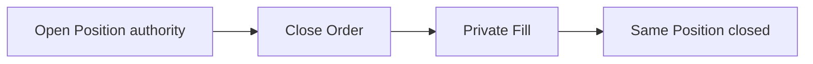

# Execution 执行通路契约 (L2 金标准)

> **角色**:定义订单从 proposal 到交易所的完整通路,及其原子性/幂等/对账保证。
> **基线**:代码为底(file:line),意图差距标 ⚠️;冲突时文档为准。
> **不变式来源**:[trust_and_change_control §1, §6.3](../../governance/policies/trust_and_change_control.md)。
> Last updated: 2026-08-27 · 维护者:Aletheia Dev

---

## 1. 入口与因果链

| 项 | 值 | 位置 |
|----|----|----|
| 入口 | `submit_proposal(...) -> dict` | `aletheia/execution/gateway.py:16` |
| 重执行 | `execute_existing_proposal(proposal_id, mode)` | `gateway.py:52` |

**开仓因果链(不可断,[trust §1.1](../../governance/policies/trust_and_change_control.md)):**


**平仓因果链**不伪造第二个 RiskDecision：



开仓 Order 消费 approved authoritative RiskDecision；平仓 Order 消费它所减少的
open Position，并必须匹配 Position 的 proposal/instrument/execution mode/quantity 与
durable close client identity。入场 RiskDecision 不能被复制到平仓单上冒充退出授权。

**契约**:一个 proposed trade 只创建一次 `trade_proposals` 行。批准/拒绝/风控/执行**绝不**创建第二行。所有订单**必须**经 Execution Gateway——agent/dashboard/telegram 不得直接调交易所下单([trust §6.3](../../governance/policies/trust_and_change_control.md))。

Gateway 的新执行入口只接受 `source='native'`。调用方传入 `adopted` 或未知 source 时，
`submit_proposal()` 必须在 Proposal 落库前拒绝，`execute_existing_proposal()` 必须在 claim、Risk 或
broker 副作用前拒绝。`source='adopted'` 只属于 Position Reconciler 直接持久化的 synthetic
Proposal/Order/Fill/Position 事实，不得进入新订单执行。可执行检查：`EX-B20`。

Entry Plan 是 Universe-linked Proposal 的唯一 active 上游，不是执行旁路。它以 plan id 绑定
immutable Proposal、authoritative RiskDecision 和 stable client order identity；duplicate execute
只能恢复同一链，`submission_unknown` 必须先对账且禁止重发。V1 exchange tactic 只允许
`bitget_demo`，任何 Live 或未注册 venue capability 都在 Gateway fail closed。

---

## 2. 链路各环数据结构

| 环 | 结构 | 状态流 | 位置 |
|----|------|--------|------|
| Order Intent | Physical compatibility model: `TradeProposal(symbol, direction, quantity, price, execution_mode...)`; this is an internal immutable Risk/Gateway carrier, never an owner-facing planning stage | `pending/approved→executing→executed` / `→rejected` / `→error`; uncertain exchange submission uses `submission_unknown`, incomplete local Order/Fill/Position materialization uses `materialization_missing` | `models.py:102` |
| RiskDecision | 见 [risk_engine_contract §3](risk_engine_contract.md) | 不可变(一次写) | `models.py:125` |
| Order | 入场：`Order(proposal_id, risk_decision_id, ...)`；平仓：`Order(proposal_id, position_id, close_reason, close_reasoning?, risk_decision_id=NULL, ...)`；`close_reasoning` 只承载 pending Operator rationale，不代表已关闭 | `pending→submitted→filled` / `→error` | `models.py:136` |
| Fill | `Fill(order_id, fill_price, fill_quantity, fee)` | 不可变 | `models.py:155` |
| Position | `Position(symbol, direction, qty, entry_price, stop_price, take_profit_price, mode...)` + 入场环境(btc_entry_price/regime_tag) + `exit_reasoning` (actual close actor/source/trigger) | `open→closed` | `models.py:165` |

**Proposal 状态契约([trust §1.2](../../governance/policies/trust_and_change_control.md)):**
- `pending`=无人工批准 · `approved`=人工/允许的工作流批准 · `executing`=可能已开始外部提交（Entry 内部准备仅由 claim 表示） · `executed`=Order/Fill/Position 完整成交链已落库 · `rejected`=人工或风控拒 · `error`=确认未提交的终态失败。
- `submission_unknown`=交易所边界可能已越过，必须先对账，禁止自动重发；`materialization_missing`=已有 Order 或交易所已报告成交活动，但本地 Fill/Position 物化未完整，禁止重新下单（交易所执行的本地记录）。
- **不得**用状态变更替代缺失记录:执行发生则 order 必存在,风控发生则 risk_decision 必存在。

**Risk 与执行快照必须是同一份意图**：交易所数量规则可以生成 quantity-only 的执行副本，
authoritative RiskDecision 记录 `evaluated_quantity` 并绑定原 Proposal 的 `proposal_commit_hash`；broker
只能消费这份已批准副本。除 quantity 归一化外，任何 hash-covered 字段与存储 Proposal 不同都会在
Risk 前置失败，不得产生 authoritative RiskDecision 或 Order。

**TP 不得事后发明**：Position Manager 对原生 Proposal 只消费持久化的批准值；Proposal 明确为
`NULL` 时，不得再用当前 config 生成新的平仓触发器（§10.4）。

---

## 3. Execution Mode 与 Broker

| 模式 | 真实单 | Broker | 位置 |
|------|--------|--------|------|
| `bitget_demo` / `okx_demo` / `binance_testnet` | 是(demo/testnet) | Gateway → Coordinator → UTA | `gateway.py` / `execution/coordinator.py` |
| `bitget/okx/binance_live_limited` | 是(**真实资金**) | Gateway → Coordinator → UTA | `gateway.py` / `execution/coordinator.py` |

`_is_live()` 判定:`execution_mode in (bitget/okx/binance)_live_limited`(`engine.py:35`)。

旧本地模拟入场与成交规则已[归档](../history/local_simulated_risk_execution.md)。

### 3.0a Entry Plan Order Policy

- `RESTING_MAKER` 与 Triggered Maker 必须逐层传递 `post_only=true`、
  `time_in_force=post_only` 和 exact limit price。venue/profile 无法表达时返回
  capability unavailable；普通 GTC Limit 永远不是 Maker。
- Urgent Taker 默认是 opposing-BBO IOC Limit：long 使用 latest exact ask，short 使用 latest
  exact bid。`max_slippage_bps` 与 `worst_price` 任一越界都拒绝，不得 chase；Market order 不在
  V1 authority 中。
- Risk reservation 必须在 Order 持久化和 exchange submission 之前存在。Order 与 Entry Plan
  `risk_reserved → ordered` 在同一 SQLite writer transaction 中前进。
- Entry Plan Proposal 的有界 `EntryExecutionReceiptV1` 不进入 immutable Proposal identity；其
  attempt/hash 必须同时绑定 authoritative RiskDecision、Order 与 Fill。Maker limit 是订单约束，
  不得再要求它等于另一条异步 mark。
- Fast Monitoring 只提交 Gateway cancel request。Gateway 经 broker/adapter best-effort cancel，
  随后持锁重读 private Fill/Order。full Fill 赢得竞态；partial Fill 保留真实 Position，并允许取消
  remainder；request-side `requested_liquidity` 不能冒充 `realized_liquidity`。

### 3.1 Adapter market_type 能力(交易所无关核心 + 边界适配)

核心逻辑(universe/opportunity/decision/risk)只认 canonical 类型 `spot` / `usdt_futures`,**不关心交易所**;能不能下某类型单是**各 adapter 的能力**,在 adapter 边界声明并路由(owner 原则 2)。

| Adapter | 支持 market_type | 路由要点 | 来源 |
|---------|-----------------|----------|------|
| okx | `spot` + `usdt_futures` | UTA profile 处理精确 contract-size、client-id 与 spot/perp 参数；实际可用性仍由 venue facts 与资格约束 | `uta/profiles/okx.py` |
| bitget | profile 声明 `spot` + `usdt_futures` | Classic v2 / UTA v3 明确隔离；声明能力不代表 demo 标的或凭据已合格 | `uta/profiles/bitget.py` |

> **OKX demo 现货已实测**(2026-06-28):demo 沙盒列 522 现货标的,真下单 buy+sell 全程通过。详见 `docs/research/integrations/DEMO_LIVE_SPOT_PARITY_EVENT_2026-06-28.md`。spec:`tests/specs/spec_spot_parity.py`(SP-S01~S06)。
> 当前 market_type 来自 canonical Candidate/EntryPlan 的 exact instrument；不存在旧 PI fallback 类型选择。

### 3.2 Symbol Availability Pre-check（标的可用性预检）

风控批准后、Broker 下单前，gateway 对**所有真实交易所模式**做一次 symbol 可用性验证（`gateway.py:_check_symbol_availability`）。不可用时直接返回 `rejected`，写 `event_type=proposal_skipped` 审计记录，**不产生** `error` 状态。

| 模式 | 标的来源 | 缓存 TTL |
|------|---------|---------|
| `okx_demo` | `execution.venue_capabilities.load_venue_capabilities()`（sandbox 公共行情列表） | 4h |
| `okx_live_limited` | `universe_registry`（venue=`"okx"`） | 4h |
| `bitget_demo` / `bitget_live_limited` | `universe_registry`（venue=`"bitget"`） | 4h |
| `binance_testnet` / `binance_live_limited` | `universe_registry`（venue=`"binance"`） | 4h |

**Fail-open**：缓存未就绪或 registry 为空时返回 `None`，不阻塞下单（避免首次启动 / registry 未同步时误伤）。

上层 `agents/`、`universe/`、`trading/`、`risk/` 只消费
`execution.venue_capabilities` 提供的 canonical capability facts，不导入具体
exchange client 或 `*_broker`。Gateway 仍是下单前最后一道权威检查；
`uta/` 负责唯一私有账户读取与规范化执行。

**新交易所接入方式**（e.g. Hyperliquid）：
1. 往 `execution.venue_capabilities.EXECUTION_MODE_TO_VENUE` 加 `"hyperliquid_demo": "hyperliquid"`
2. 确保 `sync_universe_registry()` 已写入 `venue="hyperliquid"` 行

**Spec claims**：`EX-S07`（结构）/ `EX-B11`（OKX demo）/ `EX-B12`（registry 模式 + fail-open）。`gateway.py:85-165`。

### 3.4 Worktree preview runtime（fail-closed）

`uv run aletheia dev api --port <879x>` 是显式、前台、隔离的开发 API，
不是 gateway 的第二实例，也不得绑定主 gateway 的 `8787/8788` 端口。它只可
使用当前 Worktree 的 `data/dev-preview/<port>`。在该模式下，Execution Gateway
在写入 Proposal、claim、RiskDecision、Order 或调用 broker **之前**拒绝
`submit_proposal` 与 `execute_existing_proposal`。

该限制覆盖所有交易所模式，且不改变正常 gateway 的
风险、执行、审计或 live 行为。凭据读取为空、凭据写入被拒绝；因此 preview
只能用于界面/API 开发，不能用作交易模拟或订单验收环境。Executable claim:
`EX-B13`。

### 3.3 交易所最小下单规则（开仓）

对会发到交易所的开仓（demo/testnet/live），不得用行情源或本地猜测来决定最小下单量。首轮风控通过后，gateway 必须从**实际接收订单的交易所**读取该标的规则。

- 必须同时处理最小数量、数量增量、最小成交额、最大数量，以及永续合约的“张数 ↔ 币数”换算；内部数量始终是币数。
- 数量须向上对齐到合法增量并满足最小成交额；对齐后的数量必须再经过 Risk Engine，才可调用 broker。
- 规则缺失、规则过期后无法刷新、市场已停用或精度类型无法安全换算时，proposal 设为 `rejected`，写审计记录，且**不得创建/发送 Order**。
- 规则缓存仅 5 分钟；过期缓存不能在刷新失败时继续使用。此规则是 fail-closed，与上节只为改善提示的标的可用性预检不同。

这道闸门防止系统主动发送低于交易所已公布门槛的开仓单；交易所仍可能因价格瞬时变动、余额、仓位模式或临时风控拒单，调用方必须保留交易所最终回执作为事实来源。

**Spec claim**：`EX-B05`；行为回归：`tests/test_order_constraints.py`、`tests/test_gateway_order_constraints.py`。
---

## 4. TPSL 交易所挂单

| 项 | 行为 | 位置 |
|----|------|------|
| 路径 | Gateway → Coordinator → UTA profile | `execution/coordinator.py` |
| 内容 | 持久化 protection child 后发送 typed protective_stop / take_profit command | `place_protection` |
| SL / TP | 使用 Position 已批准的 stop_price / take_profit_price，不另造保护价格 | `place_protection` |
| 能力 | profile 不支持时不可伪造成功；本地保护判断保留 | `uta/profiles/` |
| 持久化 | 仅已确认的 venue IDs 写入 position.exchange_tpsl_order_id；未决 child 保留 | `execution/coordinator.py` |
| 替换 | 原 stop 撤单确认后才提交新 stop，失败不报告替换成功 | `replace_protective_stop` |

---

## 5. 原子性 / 幂等 / 失败语义

`submit_proposal()` 与 `execute_existing_proposal()` 必须汇合到同一执行入口，不能由新提案绕开持久租约直接调用 broker。执行入口在一个短 `BEGIN IMMEDIATE` 事务内写入独立的 `proposal_execution_claims` 行，并把 `pending`/`approved` Proposal 改为 `executing`；租约字段不写入 hash-covered Proposal，避免恢复元数据改写交易意图。

**执行租约与崩溃恢复：**

- 一个 Proposal 同时最多有一个 owner；新鲜租约返回 `already_claimed`，不得进入 Risk/broker 或创建 Order。
- 交易所模式租约过期时，无论本地是否已有 Order，都不得推断“未发送”并自动重试；Proposal 转为 `submission_unknown`，返回 `reconciliation_required`，等待对账。
- 正常完成或终态失败只允许当前 owner 以 token compare-and-set 释放自己的租约，旧 owner 不能删除新 owner 的租约。

可执行检查：`EX-B17`（新鲜租约不重复）、`EX-B15`（交易所过期租约零重发）。

**下单序列(关键:交易所订单数 ≥ 本地记录,永不出现无本地 trace 的真实成交):**

```
1. Insert Order(pending)  —— 调交易所之前先写本地
2. 调交易所(可能失败/超时)
3. 回填 exchange_order_id + status
4. Insert Fill + Position(失败非致命,可恢复)
```
位置：`execution/coordinator.py`。提交前持久化 exact `uta_account_identity_json`；历史 NULL 不按当前配置补造身份。

`SubmitOrderCommand.reference_price` 只携带已批准的数量/价格对应的参考价格，不是市价单的 limit price。仅 Classic v2 futures entry 在同一已验证账户内按 `quantity × reference_price / leverage` 准备钱包保证金；缺少参考价格不得推测转账金额，UTA v3 不走 Classic 钱包转账。准备失败必须为 `NOT_SENT`，不得留下未知提交或伪造成交。

第 1 步的 `pending` 不是“还没发生所以可忽略”。它代表真实提交是否发生仍未知，必须一直留在 Risk
工作集中：在对应 live/demo 池占用入场槽位和同符号权利，并把尚未由 open Position 表示的数量加入
名义敞口，直到后续状态或 Position 事实明确收敛。平仓 Order 不占新增入场容量。

| 场景 | 处理 | 位置 |
|------|------|------|
| 下单失败 | Order `status=error`+`error_reason`,proposal→`error` | `gateway.py:183` |
| 部分成交 | Order partially_filled，等待 private Fill 证据；Position 仅按真实成交物化 | `execution/coordinator.py` / `execution/reconciliation.py` |
| 并发重复提交 | Gateway 持久租约与 Coordinator 未决订单检查阻断；client_order_id 保留 venue 幂等身份 | `gateway.py` / `execution/coordinator.py` |

**失败语义([trust §1.3](../../governance/policies/trust_and_change_control.md)):**
- 失败必须留下可检查状态,**不得删除部分创建的行来掩盖失败**。
- live 执行失败:保留 proposal 设 `error`,**除非交易所确认否则不推断 fill**。
- broker 返回 accepted result 且对应 native Order 已持久化后，交易所边界已经跨过；后续本地读取、
  Proposal 状态同步或审计故障都不得再把 Proposal/API 改成 `error`。网关优先从 identity-linked
  durable Order 恢复 `submitted`/`partially_filled`；只有 `status=filled` 的同一 Order 同时拥有唯一、
  非零且 ID 匹配的 Fill 与 Position，才可恢复 `executed`。证据不可读、不完整或 Proposal 状态写入
  中断时，必须降级为 `submission_unknown`/`materialization_missing`，明确禁止自动重发，且日志/API
  不得包含原异常正文。连续读取失败是“证据不可用”，不得误当成“已读且无 accepted Order”再写
  `error`。可执行检查：`PL-PN-06`～`PL-PN-10`。

---

## 6. 对账(Reconciliation)

| 项 | 行为 | 位置 |
|----|------|------|
| 逻辑 | 通过 UTA 读取 exact Order、Fill、Position/mass status；只有完整、身份匹配的私有 Fill 才进入既有原子 materializer | `execution/reconciliation.py`、`uta/ccxt_adapter.py` |
| 红线 | **对账绝不下单/撤单**,只比对状态 + 写收敛/审计记录([trust §1.3](../../governance/policies/trust_and_change_control.md)) | — |
| 防伪 | open-list 缺失、分页触顶、unsupported/unavailable/partial 均保持 unresolved；不得推断 filled/cancelled | `execution/reconciliation.py`、`execution/stale_order_cleanup.py` |

**Spec claim**：`EX-C04`（对账模块不得导入下单函数）。

Position reconciler 的匹配身份必须包含执行账户作用域：`execution_mode + broker_id +
account_environment + canonical symbol + market_type + direction`；双方都带非敏感 account fingerprint
且值不同时禁止匹配。`source=native/adopted` 只解释仓位如何重新出现，不得限制事故探测。
外部 Demo/Live 只比较当前执行账户对应的本地仓；其他账户仓位不进入本次分类，不能被当前账户关闭。
当前分类只接受已注册的外部执行模式；退役账户配置返回 `unconfigured`，不产生受管仓位分类。
归档本地账户不参与当前对账事故检测，外部缓存不得将其分类为 `orphaned` 或关闭其历史仓位。
历史记录保持原样，旧分类定义见[归档](../history/local_simulated_position_observation.md#reconciliation)。
Live 作用域从 `exchange.name` 派生对应的 `*_live_limited`，不得硬编码某一家交易所（`PL-ADOPT-23`）。
统一 Demo 快照中的每条非零仓位必须有 `broker_id`，且只匹配当前执行账户；账户标签缺失时必须降级为
不可用，不能据此推断本地仓已从交易所消失（`PL-ADOPT-24`）。统一快照当前不包含 Live 账户，禁止用
Demo 聚合结果解释 Live 仓位；Live 继续只告警、不自动收敛。

instrument key 必须使用 `(canonical symbol, normalized market_type, direction)`；只允许
`spot` 和 `perp/futures/swap/usdt_futures → usdt_futures` 的已知归一化。相同 symbol/direction
的 spot 与 futures 是两个独立身份。任一侧同一完整 key 出现重复行，或任一行缺失/携带未知
market type 时，受影响身份进入 typed `integrity_issues`，不得 last-row-wins、计算跨市场数量漂移、
创建 disappearance evidence 或进入 auto-adoption；输入顺序不得改变分类结果。

UTA adapter 不得把期货缺失/非法 leverage 默认成 1x：三家 adapter 统一保留
`leverage=None` 及 `leverage_source=unavailable/invalid`。外部 futures Position 只有在 leverage
有限、正数且为整数时才能 adoption；spot 使用明确 `1x + not_applicable_spot`，显式非 1x
视为矛盾并拒绝。adoption 把已验证值同时写入 synthetic Proposal、Position 及不含凭证的
`reconciliation_identity/reconciliation_evidence`。Demo 的后续完整 exact-account managed view
只可在同一 Position id 上补齐缺失 leverage；已有有效值不会被不完整 view 清空。Live 仍保持
alert-only，不新增自动修复权限。`report_invalid_open_position_exposures()` 只读列出历史 open
Position 的 id、symbol、market type 与 sanitized field category，不执行批量修复。可执行检查：
`PL-ADOPT-26~28`、`tests/test_uta.py`、`tests/test_position_reconciler.py`；其中
`PL-ADOPT-26` 还验证已接管 futures Position 的持久化 leverage 被 Risk 账户杠杆计算实际采用。

交易所返回的 Position uPnL 是账户内的聚合暴露，不能被复制成多个本地 Position 各自的完整 uPnL。
当前身份包含 canonical symbol、broker/execution mode、归一化 market type、direction，以及双方可用的
非敏感 account fingerprint；fingerprint 不一致时必须 fail closed。broker 提供 Position identity 时，
远端值还必须在同一 fingerprint 作用域内命中该 identity；同一作用域的重复 identity 标为 ambiguous，
不能 last-row-wins。没有本地 broker Position identity 时，只有远端当前作用域唯一且本地 open Position
也只有一个候选，才允许采用聚合值；任一侧基数大于一都拒绝分配，逐行保留本地 mark estimate。
缺失/未知/不一致 market type 仍拒绝采用远端值。没有 fingerprint 或 broker identity 的 legacy cache
行只走原有单候选兼容路径，不能作为 exchange-backed Demo qualification 证据。远端值还必须来自被现有
cache-health classifier 判定为 `ok` 的统一缓存；`stale` 或无法判定 freshness 的缓存只能退回本地 mark
estimate，持久化路径也不得把其中的远端值写入 Position。Position/API/UI 通过
`unrealized_pnl_source` 暴露 `exchange_exact`、`ambiguous`、`unavailable` 或 `local_estimate`。
可执行检查：`PL-PM-16`、`PL-PM-17`、`PL-PM-18`、`PL-PM-19`。

一次新鲜快照里缺少本地持仓，只能创建 `position_disappearance_candidates` 和一条不可变 observation，
不能直接调用 fallback-price close。重复读取同一个 cache、时间倒退、stale/incomplete/wrong-account
view 不累计；第二个更新且完整的 view 只把 candidate 标为 ready for verified exit。交易所行在新鲜完整
view 中重新出现时，pending candidate 以 `reappeared` 结案并写审计。当前逻辑账户 fingerprint 只由
broker/environment/execution-mode 这类非秘密配置身份生成，绝不读取或散列 credential。T06/T07 交付
真实退出证据与经济分流前，scheduler 不会把 ready candidate 本地平仓。对应 `OI-B01`。

---

## 7. 审计要求

每个重要状态转换写 `data/logs/audit.jsonl`,最小字段见 [trust §1.4](../../governance/policies/trust_and_change_control.md):`timestamp/actor/source/event_type/entity_type/entity_id/message`,可选 `before/after`。`entity_id` 必须指向实际被改的行;审计消息不得含密钥/签名。

执行边界跨过后，SQLite 中已提交的 Order/Fill/Position/Proposal 或禁止重发的
`submission_unknown`/`materialization_missing`/`position_absence_unverified` 是权威事实；此后的
JSONL 审计属于次要写入。
审计写失败只能记录不含异常正文的 warning（仅异常类型），不得把已提交的
`submitted`/`executed`/未决状态改写成 `error`，也不得把失败抛给调用方触发重发。
三家 exchange broker 的 entry 与 close 路径统一使用
`aletheia.execution.post_commit_audit.write_post_commit_audit`；该 helper 只包裹 JSONL sink，DB 写与
exchange 调用必须留在 helper 外并保持原失败语义。close 的审计故障必须保留 Order 与 Position 的
`pending_close_status`，重复 close 由 durable claim 直接返回，不得再次触达 exchange。
可执行检查：`PL-PN-04`、`PL-PN-05`、`PL-RX-19`、`PL-RX-20`。

---

## 8. 已交付

- ✅ **审计链 `_prev_hash` hash 链**:每条 audit 记录写入前追加前一行的 SHA-256(`_prev_hash`),验证逻辑在同文件。实现位置:`aletheia/files/jsonl.py:182-200`(写入)、`jsonl.py:259-320`(校验)。历史 ⚠️ 注记已失效,此条目已交付。

## 9. 目标态差距 — 当前活跃

- ✅ **已由 Position C 解决(2026-07-02)**:此前 strategy 的 `entry_rule/exit_rule`/`RuleSet` 是"从不被解析执行的死字符串",strategy 层名义上驱动交易实则 advisory——这个诚实性缺口现已**通过删除整个规则引擎彻底消除**(`aletheia/strategy/` 整包 + `strategy_designer.py` + `ruleset_scanner.py` 删除)。交易方向唯一来自 System Operator 对 opportunity 的决策(`evaluate_trading_opportunity`);`strategy_id` 仅作可空历史归因标签(legacy)。不再存在"策略规则驱动交易"的名实不符。

---

## 10. 平仓/退出通路 (Exit Path)

> §1–§6 定义**开仓**通路;本节定义**平仓/退出**通路,达到与开仓对等的严谨度。
> 入口:`evaluate_open_positions()`(`portfolio/position_manager.py:299`),由 `position_manager` job 每 5min 触发。

### 10.1 退出触发器优先级

`_decide_exit(p, price, cfg)`(`position_manager.py:347`)按**固定顺序**判定,先命中先平:

| 优先级 | 触发器 | 判定 | 位置 |
|--------|--------|------|------|
| 1 | stop-loss | `price` 越过 `stop_price`(多头跌破/空头升破) | `_decide_exit` |
| 2 | take-profit | `price` 越过 `take_profit_price` | `_decide_exit` |
| 3 | max-hold | 持仓时长 > `max_position_hold_hours`(serenity school 用 `max_hold_days`) | `_decide_exit` |
| 4 | market-aware review | **仅当 1–3 都未触发**且 `market_aware_exits.enabled`;评估 `urgent_exit` / `tighten_stop`,但只唤醒 System Operator 复核，不直接平仓或修改止损 | `exit_rules.py:27`,调用点 `position_manager.py:352` |

> 当前实现不授予 market-aware evaluator 自动执行权限。action 名称是复核建议，
> 最终行为是 durable Operator wake；在 Operator 明确作出并物化决定前，Position、
> Order 和 stop 均不变化。Settings 中仍声称自动平仓/收紧的文案属于已知产品偏差
>（Capability EX-09 / GitHub #417），不能以 evaluator 单元测试判定为已支持。

> (#105) 原优先级-4 的 `ruleset_exit` 触发器已随规则引擎(Position C)删除——`_decide_exit`
> 不再消费 `ruleset_exit_position_ids`,该触发器不再是活跃退出路径,请勿再加回。

**System Operator 退出路径独立**:`review_portfolio_state()`(LLM 决策)暴露
`hold / adjust_position / close_one`。Position wake 直接进入该命令，而不是复用
entry-opportunity schema；可操作列表只包含 wake 指向的完整 Position 和 adverse
evidence，但必须同时给出全局 open-position 数量和完整可用时的全局 unrealized PnL，
并明确区分全局只读上下文与本次 review scope。任何一个 Position 缺失合法 PnL 时，
全局 PnL 必须显示 `not available`，不得把缺失值当零；其他 Position 的身份和参数不进入
prompt，也不能成为本次动作目标。这些决策时事实同时写入 `pi_decisions` manifest。
`adjust_position` 复用 `apply_operator_adjustment()`，`close_one` 按明确 Position
经**同一** `close_position_routed()` 入口平仓，且不传调用方 fallback price；
manager 必须重新取得精确新鲜 mark。最终结果和 wake fingerprint 写入
`pi_decisions`；模型不可用也写入 `review_unavailable`。遗留 `reduce_exposure`
只能归一为 `hold`，不得静默执行整仓关闭。确定性 evaluator 仍只负责唤醒，
在 Operator 决定前不得直接修改 Position。

`HORIZON_DUE` 是 must-answer 工作，`horizon_wake_sent_at` 表示**复核完成确认**，
不是内存事件已排队。Position manager 在复核完成前允许重复投递，因此进程在排队后
退出时，重启后的下一轮 durable Position 扫描仍会恢复同一唤醒。daemon 遇到
`review_unavailable`、超时、异常或未确认的 `close_one`，必须恢复原
`position_id + wake batch` 后重试，不能降级成无持仓上下文的 entry evaluation，
也不能记 job success。非 horizon 的 adverse review 可用 `hold` 完成；仍开放的
`HORIZON_DUE` Position 则只允许已确认平仓，或把 `new_horizon_hours` 明确延长到
严格晚于当前持仓 age 的 `adjust_position` 完成。`hold`、空调整、只改 stop/target、
以及未越过当前 age 的 horizon 都保持未完成并重试，不得确认原 horizon。混合批次中
已关闭 Position 的陈旧 horizon wake 不得限制另一笔开放 Position 的 action schema，
也不得被写入确认。交易所平仓已有 durable pending-close claim 时可确认，由既有
reconciliation 路径收敛；复核重试不得创建替代 Close Order。确认只归属于刚完成的
一次复核，并非该 Position 的永久豁免：明确延长后的新 horizon 再次到期时，manager
必须在短事务中清除旧确认、写入 `horizon_review_rearmed` audit，再投递下一次 must-answer
复核。该规则同时向前收敛历史版本中由 `hold` 错误留下的确认；存在 durable pending-close
claim 时绝不清除，由 reconciliation 继续独占收敛。

### 10.2 close_position_routed 路由契约(唯一平仓中枢)

`close_position_routed(pos_id, reason, fallback_exit_price)` 是单仓**唯一**平仓出口，自动循环与 Operator 路径都经此；成交价格来自交易所确认的 private Fill：

- **平仓授权语义**：native close Order 消费正在减少的 open Position，不复用入场
  RiskDecision。`risk_decision_id` 必须为 `NULL`；`position_id + close_reason +
  close-{position_id}` 以及与 Position 完全一致的 proposal/instrument/mode/quantity
  构成持久授权链。完整性扫描必须按 entry/close 分型，不能把合法平仓误报为缺失风控。
- **未决 Operator 理由必须随 claim 收敛**：当同一 routed close 带有真实
  `decision_reasoning` 时，三家 exchange broker 必须在首次 exchange side effect 前把
  `trade_decision_rationale.v1` 保存到唯一 Close Order 的 `close_reasoning`；重复 close
  只返回原 claim，不得覆盖。Position 保持 open 且 `exit_reasoning` 为空，直到完整 private Fill
  在共享 materializer 中验证通过。非空 carrier 损坏或与 `close_reason` 不一致时必须
  `materialization_missing`，不得降级成 generic actor/source；历史 `NULL` carrier 保持兼容。
- 六种外部 execution_mode 均经 Gateway → Coordinator → UTA。资格不满足时拒绝，不回退旧 broker。
- **live 守卫(不变式)**:`live_limited` 模式且 `allow_live=False` → `RaiseError`,阻止自动循环误平**真实资金**持仓(`position_manager.py:59`)。守卫在中枢层,不分散到各调用方。
- 交易所腿不可跳过：demo 模式仍走真实交易所 close。
- **保护触发价格不可伪造**：只使用 Position 精确 `exchange + symbol + market_type` 的新鲜 mark。venue 由六种已注册 execution mode 确定。内存 exact-instrument cache 必须小于 90 秒；SQLite 只接受同 venue、同 `spot/perp` 且不超过 120 秒的 snapshot。不得用 `Position.current_price`、symbol-only、跨 venue、跨市场或过期价格触发退出；退出成交价格由 private Fill 决定。
- **逐仓失败必须可见**：一个仓位的 mark 查询、market-aware 评估或 close 异常不得中止其余仓位；`evaluate_open_positions()` 返回稳定的 per-position `errors`，close 异常另计入 `failed_close_count`。`closed=0` 且 close 全失败不能被调度层当作健康空跑。
- **交易所报告无仓位不能触发重发或伪造成交**：任一 adapter 仅在明确 venue code / typed response
  可证明本次 close 因无匹配仓位被拒绝时，才归一为共享 `ClosePositionAbsentError`。各 broker 必须
  以相同语义处理：本次 Order 保持确认拒绝的 `error`，Position 保持 `open` 并以
  `pending_close_status=position_absence_unverified` 留住原 durable claim。后续 manager cycle 不得新建
  Close Order 或再次触达交易所；既有只读 position reconciler 负责按 broker/account/instrument 的完整视图
  查明先前成交、外部关闭、身份错配或证据不可用。该响应自身绝不创建 Fill、realized PnL 或 eligible
  Outcome，超过 pending-close 时限仍走一次性 reconciliation-required escalation。当前 Bitget adapter
  已将 hedge-close 错误码 `22002`/`25227` 作上述分类；OKX/Binance adapter 尚无经权威 fixture 锁定的
  无仓位错误码，因此普通字符串拒单仍保持 `error`，不得靠文本猜测升级。可执行检查：`PL-RX-22`。
  `PL-RX-24` 进一步锁定组合链路：原 typed rejection 经两次独立完整账户视图和只读 verified-exit
  查询收敛为 administrative close 时，原 Close Order 保持唯一且被拒绝的事实，不新增 Fill、PnL、
  Outcome hook 或 Learning 样本，也不再次触达交易所下单入口。
- **交易所明确拒单不得按 scheduler cadence 重试**：无法安全归类为“无仓位”的确定性 Close 拒单，
  Order 保持 `error`，Position 以 `pending_close_status=submission_rejected` 保留原 claim；不得新建 Close
  Order 或自动重发，须由既有 reconciliation 查明原因。该状态不伪装成成交或仓位消失。
- **Bitget 40725 停泊只能由 owner 授权解锁**：UTA `trade_too_many_times_cancel` 取消的 close
  归一为 `pending_close_status=venue_trade_rate_limited`（永不被自动释放——立即重发只会再撞
  40725）。解锁通道是 `pending_close_recovery.release_rate_limited_close_claim`（dashboard
  `POST /api/positions/{id}/recover-parked-close`）：仅在 claim 恰好处于停泊态、对应 Order 已
  cancelled 且 error_reason 吻合时，把取消原因转写为预留的
  `operator_authorized_cleanup_trade_rate_limited` 并清空 claim，让保护性平仓以全新
  `close-{id}-rN` clientOid 重试；全程写审计（actor=human + owner reason），不制造任何 Fill、
  价格或 PnL。不满足前置状态的解锁请求整体拒绝、状态零变更。
- **Bitget demo 分片平仓（2026-08-22 起）**：demo 撮合引擎对大数量 market-IOC close 有单笔
  撮合迭代上限（`trade_too_many_times_cancel`、零成交、确定性复现），因此 `close_demo_position`
  按"历史 venue 撤单次数减半"的分片数量提交（每次 match-cap 类取消减半，下限为剩余量的
  1/64；成功分片不重置计数）。物化语义同步区分"订单成交完"与"仓位平完"：分片单整单成交只把
  Position 数量核减到剩余（`is_partial=1` 记账、claim 释放、下一保护周期自动发下一片），绝不提前
  关闭仍有 venue 数量的 Position；重放已落账分片是幂等 no-op；部分成交的分片单保留
  `partially_filled` claim 继续轮询。完整平仓（订单量 = 剩余量）行为不变。
- **可成交限价回退（同日扩展）**：实测该 demo 缺陷可以是 **symbol 级**的——XRPUSDT 上任意数量
  的市价单（含 5 张诊断性入场）都被零成交取消，而限价单正常成交。因此一旦某 Position 的平仓史
  出现 match-cap 取消，下一次平仓自动改为**可成交限价**：价 = 最新价 ×（对手方向 ±1%），
  GTC 挂单穿透对手价、残余量留在簿上由既有部分成交物化收敛；取价失败则回退市价。定价方向按
  venue 侧对手方向计算（UTA 客户端会把 hedge 平仓翻转到持仓反侧）。
- **未决 claim 不得关闭保护性观察**：Position Manager 仍读取 exact fresh mark 并评估
  Layer-0/SL/TP/max-hold/trailing；若保护规则再次触发，只记录等待原 claim 收敛，绝不调用
  exchange close 或创建替代 Order。`positions` 的 owner read model 同时暴露
  `close_convergence_state`、`close_convergence_owner_status`、claim age 与
  `close_convergence_requires_reconciliation`；缺失/过期时间戳和 stale claim fail-closed 为
  `manual attention required`。
- **启动准入必须读取权威 Position 主账**：Startup Behavior Gate 的 `pending_closes` 检查不能只读取
  遗留 `ps_positions.status=unknown` 投影；它还必须读取 open `positions.pending_close_status`。
  `submission_unknown`、`submission_rejected`、`materialization_missing`、`position_absence_unverified`、
  `overfilled` 立即阻挡新的
  AI decision/trading loop；普通 `pending` / `submitted` / partial 状态只在超过 Position Manager 既有
  stale 时限后阻挡，刚提交的正常在途 close 不得被误报。Layered pause 不得停止 Position Manager、
  Order reconciliation 或 verified-exit settlement，因而未决状态仍可在阻挡期间收敛。可执行检查：`PL-RX-23`。

### 10.3 paused / kill_switch 对平仓的语义(核心不变量)

> **`paused` 与 `kill_switch` 对持仓生命周期语义一致:都只挡"开新仓",都不挡"管理/平掉已有仓"。**
> 理由:平仓是**管理已有风险**(止损/止盈/对账),冻结它等于在最需要保护时撤掉保护;开仓才是**承担新风险**,应被暂停/熔断挡住。

| 控制 | 挡开仓 | 挡平仓 | 实现 |
|------|--------|--------|------|
| `kill_switch` | 是(风控 check#0,只拦 proposal=开仓) | **否** | `position_manager` 绕过;`test_position_manager.py:147` + `RUNBOOK.md:181` 锁定 |
| `paused` | 是(Entry Plan / Gateway 暂停门) | **否** | `_run_position_manager`/`_run_position_reconcile` **无 paused 门**;`spec PL-PM-07` 锁定 |


### 10.4 stop/take-profit 兜底

`_effective_stop` / `_effective_take_profit` 优先使用 Position 行已经持久化的
`stop_price` / `take_profit_price`（包括获准的 trailing-stop 更新）。若原生 Position 的值为空，则回看
其不可变 Proposal：Proposal 有值才使用，Proposal 为 `NULL` 就保持无该触发器，绝不能读取后来变化的
config 发明保护。只有没有 Proposal 身份的历史仓位，或明确 `source=adopted` 的外部接管仓位，才保留
config 默认百分比兜底；接管流程会尽量在接管时一次性固化这些值，避免之后漂移。`PL-PM-09` 锁定原生
Proposal 的这一权限边界。
`_sync_exchange_closed`(`position_manager.py:311`,`248-296`):每轮先收敛交易所原生 TPSL(bitget demo bracket)已触发的平仓,避免本地-交易所长期 desync。

### 10.5 已知状态与边界

- ✅ **Demo 手工单仓平仓已实现**:`POST /api/positions/{id}/close` + 前端 Open Positions 行内 Close 按钮 + Position Detail 抽屉 Manual Close 面板。`*_demo` / `*_testnet` 走真实交易所 close 订单。市价提交后按确认成交收敛；限价挂 `exit_limit_price`（本地看守，OCO 与止损）。人工平仓写 `actor='human'`、`close_reason='human_manual_close'`（市价）或 `'human_limit_exit'`（限价触发），不污染 AI 出场统计（`exit_driver_comparison.py` 里 `human` 是独立 bucket）。新字段 `exit_limit_source TEXT`（`_ADDITIVE_COLUMNS`）记录谁挂了限价：`'human'` 或 `'system_operator'`；NULL = 历史行，向后兼容当 `system_operator` 处理。
- ⚠️ **live 人工平仓路径仍未实现**:`POST /api/positions/{id}/close` 对 `*_live_limited` 返回 HTTP 409 `live_position_requires_exchange_close`，前端显示 "exchange only"。**live_limited 仓位仍须在交易所界面手动平仓。** 未来加 live close 路径**触信任边界**，须走 [trust §6](../../governance/policies/trust_and_change_control.md) change-control + `allow_live=True` 人工确认。
- ⚠️ **live 对账仍受 paused**:`_run_reconciliation`(live-only,`scheduler.py:822`)仍有 paused 门,本次未改(live 默认禁用,且仅做收敛检测,优先级低)。若未来 live 常开,应一并对齐本节语义。

**Spec claims**:`PL-PM-01~06`(mark/stop/TP/max_hold/ATR/audit) + `PL-PM-07`(paused 不挡保护性平仓) + `PL-PM-10~13`(fresh exact venue/market mark / 逐仓 close 与 market-aware 失败可见)。

旧本地保护屏障见[归档](../history/local_simulated_protection.md)。

## 11. Position 关闭与结果完整性（OI-S01/S02、OI-B01～B05、OI-C01～C06 implemented；自然 Runtime soak 待补）

`positions.status='closed'` 只表示本地状态生命周期结束，不自动证明发生了策略退出成交。系统必须把
关闭分为两条不互相冒充的路径：

| 路径 | 必需证据 | 允许的副作用 | 结果资格 |
|---|---|---|---|
| verified strategy close | 当前 broker/account/instrument 的可验证退出 fill；期货还需可信 funding ledger 才有完整净经济结果 | 真实 fee、slippage；仅经济字段完整时才写净 PnL 与 outcome-only hook | 通过其余干净窗/归因门且 funding 完整后可 eligible |
| administrative close | 持久确认仓位已消失，但无可验证退出 fill | 状态收敛、审计、告警 | 永远 ineligible；不得制造经济字段 |

### 11.1 消失确认

一个 complete position view 的单次 miss 只能创建 durable disappearance candidate。只有以下任一条件
满足后，系统才可判断仓位确实不再存在：

1. 两次独立、完整、同 broker/account/environment 的视图连续 absent；或
2. broker 直查明确返回 `confirmed_absent_without_fill`；或
3. broker 直查返回 `verified_fill`。

stale、incomplete、缺 broker identity、wrong-account、分页不完整、网络错误和权限错误都是
`inconclusive`，不能累计确认。candidate 必须跨进程重启保留，同一 observation 不得重复计数；仓位重新
出现时把 candidate 结案为 `reappeared` 并留审计（不删除历史）。Live 的不确定消失保持
alert-only/fail-closed，不借本合同扩大自动权限。Demo ready candidate 会进入 §11.2 的三态直查，
再由 §11.3 分流为 verified close、administrative close 或保持 inconclusive；ready 本身从不直接关闭。

### 11.2 Broker-neutral verified exit

状态：RG-T06 / OI-B02 的语义由 UTA `VerifiedExitReport` 和 RG-T07 编排实现；consumer 不再
构造三家 concrete private client。

Execution 层定义统一 verified-position-exit protocol；Bitget、OKX、Binance adapter 都返回结构化三态：

- `verified_fill`：含 broker fill/order identity、价格、数量、fee、时间和 provenance；
- `confirmed_absent_without_fill`：确认已不存在，但找不到足以证明经济结果的 fill；
- `inconclusive`：无法证明，持仓保持 open/candidate，不关闭。

symbol 仍只在 adapter 边界转换，查询身份必须包含 venue、market type、account environment；不得用
Bitget-only TPSL 历史解释其他 broker。每次查询先直查同账户仓位，再按明确时间窗完整翻页读取私有成交：
Bitget 使用 mix fills cursor，OKX 使用 fills-history bill cursor，Binance 使用 futures user-trade id。
缺页游标、重复游标、保留时间窗不足、权限/网络错误、响应字段缺失、方向或数量歧义全部返回
`inconclusive`。只有当前仓位明确 absent、历史完整且反向平仓 fill 覆盖本地数量时才是
`verified_fill`；完整历史确实无 fill 才是 `confirmed_absent_without_fill`。原始私有响应不落库，标准化
结果不含 credential 或 signer material。

### 11.3 行政关闭副作用禁区

状态：RG-T07 / OI-B03 已实现。`portfolio.outcome_closure` 提供 verified 与 administrative 两个不可
互换的入口；ready demo disappearance candidate 只有经过 RG-T06 三态直查后才可调用。Live 仍是
alert-only，active reconciliation incident 仍先阻断收口。

RG-T07 编排层另有一道独立防线（2026-08-19 事故后加入）：`confirmed_absent_without_fill` 本身不是
administrative close 的充分授权——settlement 必须先用同一 UTA identity 做一次新鲜的 exact 仓位直查，
直查仍确认 absent 才可关闭，并把 candidate 的 `direct_query_state` 落为 `confirmed_absent` 作为持久
证据；直查显示仓位仍在则保持 open（下一轮 classify 会把 candidate 结案为 `reappeared`），直查不可用
则 fail-closed 推迟。`verified_fill` 路径不受此门约束（私有成交历史是更强的平仓证据）。

administrative-unverified close 不得：

- 用 entry/mark/current fallback 伪造退出 fill；
- 新增手续费、滑点或已实现策略 PnL；
- 触发 calibration、shadow resolution、strategy KPI、Learning case/reviewer 等 outcome-only hook；
- 被 Risk 当成权威账户损失。

它必须保留 causal ids、actor/source、确认依据和审计事件。原始历史值永久保留，新增结构化字段只描述
其 provenance 和 eligibility。当前实现把 realized PnL、exit fee、slippage 留为 unavailable，不改
current/entry price，不触发 shadow/Serenity outcome hook。verified close 要求完整 scoped
identity、精确数量与 `verified_fill`。已证实的退出成交关闭 exposure/lifecycle；缺失费用金额、币种或
第三币种无可归因折算时，原始 Fill 费用/币种如实保存，quote exit fee 与最终 realized PnL 保持
unavailable，Outcome 不得 eligible。NULL 费用不等于零，缺失币种不推定为 quote；实际零费用是有效事实，
base 费用可按该 Fill 的成交价直接折算。数量/identity 不符或非有限、负数等畸形归一化证据仍 fail-closed。
入场与历史补链的既有完整证据门槛不由此放宽。旧 `reconcile_close_orphan` 与 Bitget-only TPSL fallback 已
删除，旧 `close_position` 也拒绝 synthetic reason。对应 `OI-B01~B04`、`OI-C03`。

原生平仓与 verified disappearance 的经济关闭由 `portfolio.pnl.close_position` 单点写入；
`close_position_verified` 仅验证/归一化 disappearance 证据并提供事务内 Order/Fill materialization。
Position、per-close event、Outcome eligibility、hook job 与数据库 audit 在同一 writer transaction
提交；外部观察关闭仍为 administrative/ineligible。无成交证据的 administrative close 保持独立，
不得借用经济关闭入口生成收益；历史记录不因所有者收敛而被改写。

PnL 读取已拆出 `today_raw_closed_realized_pnl()` 与 `today_eligible_strategy_pnl()`；旧
`today_realized_pnl()` 暂保留 raw 兼容入口，但当天任一关闭缺少净经济结果时返回 unavailable，
不能把该行按 0 相加。Risk 已由 RG-T09 迁移到独立
`authoritative_account_realized_loss()`，不再消费该兼容指标。

### 11.4 中央关闭语义与三种读取口径（OI-S02 implemented）

`aletheia/analytics/outcome_integrity.py` 是不依赖 Learning、Risk、Execution、exchange 或 agent shell
的中央语义层，版本为 `oi-v1`。它提供三个不可互换的入口：

- `raw_account_events()`：所有 closed 状态事件，只用于账本、审计、诊断和明确标注的 raw 展示；
- `eligible_strategy_outcomes()`：仅当前版本、strategy category、真实 fill 已验证、价格来源可信、
  identity/时间/经济字段完整的结果；
- `administrative_closures()`：行政性和维护性关闭，永久保留但不进入 judgement。

已知 synthetic reason 的分类优先于行上其他字段，不能用 `outcome_eligible=1` 覆盖
`reconciled_gone` 或 maintenance reason。无结构化证据的旧行是 `legacy_unverified_close`，PnL 数值本身
不能证明退出。现有 `analytics.close_reasons` 只是兼容 facade，reason registry 只在中央模块维护。
Operator、KPI、Risk、API/UI 等行为消费者已迁移并由 `OI-C02~C04` 的枚举式架构测试约束；
新增消费者仍必须显式选择这三种读取口径之一。

仓位 API 的 `position_realized_pnl_view()` 另提供只读的已知经济分量：
`known_gross_pnl` 来自已验证且价格来源为 `broker_fill` 的入场/退出价格与精确数量；
`known_net_before_unresolved_costs` 仅扣除已有证据支持的手续费和 funding，
`known_economics_missing_components` 明列未解决项。未知成本不被补成零，价格、数量或
成交证据不足时金额保持 unavailable。实际成交价已经含滑点，不重复扣除诊断性 slippage。
这些字段不写回 Position，不改变 `realized_pnl`、`outcome_eligible` 或下游资格；即使已知
分量可计算，最终净 PnL 仍由原有完整性检查决定。仓位列表和详情将该金额明确标为
“已知、未扣除尚未解决成本、非最终”，而不是最终 realized PnL。对应 `OI-C04`。

### 11.5 持久事故断路器（OI-B04/C01 implemented）

当前语义版本下的 administrative/maintenance close 之后，若同一完整账户与 instrument identity
出现任何 native 或 adopted open event，短窗内达到两个独立 identity 即形成系统性事故。探测器在
demo auto-adopt/orphan-close 之前运行；active 事故写入 `reconciliation_integrity_incidents`，使这两个
动作和所有会改变行为的 Learning 入口跨重启保持冻结。每次继续出现循环会重置干净计数；干净观察
必须相隔至少五分钟且累计两次，之后仍需明确 actor/reason 才能 resolve。live 继续只分类和告警，不
获得任何新增自动收口权限。

### 11.6 期货资金费用的可证来源与诚实关闭

本地模拟资金费率模型及其修复流程已退役，旧定义见
[历史归档](../history/local_paper_account_controls.md#retired-funding-model)。历史数据保持原始证据，
当前执行只接受对应交易所账户的资金费用事实。

Funding 会计状态与 audit delivery 状态彼此独立。broker funding settlement audit 在上述
会计 transaction 内以 stable ID 写入 `audit_events` 并标记 JSONL mirror `pending`；transaction
提交后才尝试 hash-chain append。文件失败保留已提交的 Position/PnL/hook authority，同时返回
`audit_mirror_status=pending` 并使对应 scheduler/audit job health degraded；不得把 accounting status
改写为 error 或触发会计重放。`already_current` 只重试已有 pending mirror。append 后 ack 前崩溃由
stable ID 去重恢复，成功状态单调为 `mirrored`。历史无共享 ID 的 audit 不自动 replay。

exchange-backed futures 仍只接受对应账户私有账单的 `broker_ledger`；公开费率不得替代真实扣款。

当 UTA 的同账户 funding ledger 以稳定 reason
`funding_history_retention_expired` 证明查询起点早于该 profile 的私有历史保留边界时，
`broker_funding_settler` 可在一个 immediate transaction 中把同一条仍为 closed、verified、
`NULL` economics 且 reason 为 `incomplete_funding_economics` 的 Position 改为
`broker_funding_history_expired`。该 terminal 状态只停止自动重试：`funding_cost` 与
`realized_pnl` 继续为 `NULL`、`funding_source='unavailable'`、`outcome_eligible=false`，
Order、Fill、Position、full-close event 与 Outcome/Learning authority 都不得改变。
转换必须同时写入版本化、无凭证的 reconciliation evidence 和 durable funding audit/outbox；
malformed evidence、身份不匹配、stale snapshot、credential/network/permission failure、
不完整但未过期的报告均保持 retryable，不得被 terminalize。

恢复队列以 durable `(closed_at,rowid)` keyset cursor 轮转，并分别限制本地 retention
classification 与 broker I/O。expired、retryable 或 CAS-conflict 前缀都不能永久遮挡后续
Position 或另一 execution mode；cursor 只改变 scheduler 的下一扫描位置，不改变业务 owner
state。每轮仍有明确 scan/I/O 上限，不能以扩大 `LIMIT` 代替公平性。

真实 close Order/Fill 可以结束执行生命周期，但它不能证明持仓期间的 funding。期货没有可信账户
账单时，关闭仍保留真实 Order/Fill 并把 Position 标为 `closed`，同时必须写：

- `funding_cost=NULL`、`funding_source='unavailable'`；
- `realized_pnl=NULL`，不得把未知 funding 当成 0；
- `outcome_eligible=false`、`outcome_exclusion_reason='incomplete_funding_economics'`；
- 不创建 eligible Outcome hook，也不进入 Attribution、
  Feedback 或 Learning。

未知的关闭损益不得被当作完整经济结果。spot 不产生 funding，关闭时明确写
`funding_cost=0`、`funding_source='not_applicable'`。

---

## 12. Unified Trading Account V1 migration boundary

Issue #2299 及已批准的唯一主线切换保留 Gateway、Risk 与本地存储权威。六种外部
execution_mode 仅使用 CCXTUTAAdapter；Bitget Classic v2 与 UTA v3 保留明确 profile 隔离。
按 owner 接受的 #3035，Demo/Testnet mutation 不要求 SHA-bound 本地资格证书。
账户配置不证明运行或经济资格；执行权限由现有 authoritative Risk、Gateway、exact UTA
账户绑定与 durable command/reconciliation 规则共同决定。Live 仍独立受既有 Live Trust
授权约束。没有 legacy/shadow 选择器或旧 broker fallback。外部资格 verdict 必须来自正常
执行主线的真实证据；静态实现、账户读取或健康状态不证明闭环或部署完成。

提交前 Order 持久化 exact 非秘密账户身份。旧订单身份缺失或不匹配时，保留记录与未决事实，
阻断该账户新入场及无法证明归属的私有操作；不得用当前配置补造历史身份。

Gateway 是唯一业务写授权；Coordinator 是正常产品路径中 UTA mutation 的调用者；
UTA 不写 Aletheia DB。外部调用位于 SQLite writer transaction 之外，返回后以短
expected-state/CAS 应用证据。partial、unsupported、unavailable、timeout 或异常不能变成
空、零、取消、仓位消失或完整经济事实；可能已发送的 mutation 保持 ambiguous，禁止自动重试。
UTA 边界见 [`unified_trading_account.md`](../proposals/unified_trading_account.md)。
