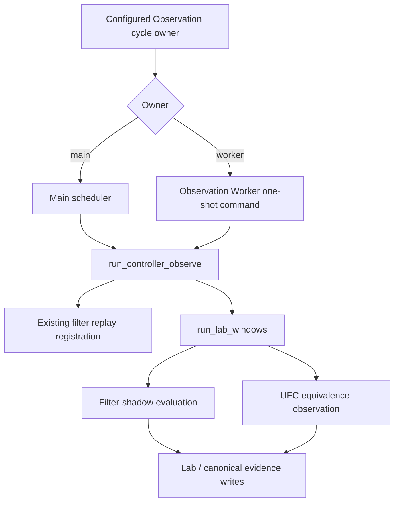

# Observation Lab v1 — Current Design

## Purpose

This document describes the current Observation Lab implementation shape and operating boundaries. It complements [observation_lab_contract.md](observation_lab_contract.md) and [observation_lab_backup_contract.md](observation_lab_backup_contract.md).

The historical ownership audit at [../../research/audits/UFC_OWNERSHIP_MAP_2026-08-18.md](../../research/audits/UFC_OWNERSHIP_MAP_2026-08-18.md) is frozen evidence only. It is not a current delivery plan.

This document must describe implemented/current behavior. Future capabilities belong in focused Issues/Proposals and are not arranged here as a roadmap.

## Runtime shape

Exactly one owner executes the cycle. `main` uses the Main Runtime scheduler; `worker` uses the dedicated Observation Worker boundary. There is no supported dual-owner mode.

Lab failures are isolated from ordinary Paper operation.

## Storage model

| Path | Owner | Lab access | Purpose |
|---|---|---|---|
| `app.db` | production domains | canonical reads plus only existing explicitly allowed observation writes | market/trading/Learning facts owned outside Lab |
| `observation-lab/lab.db` | Observation Lab | read/write | frozen units, equivalence evidence, execution manifests, Lab exposures, joint checkpoint facts |
| `config.yaml` | operator/config authority | read | Observation ownership/cadence settings |

The data root is resolved through the normal Aletheia data-dir contract. Lab must not hard-code a separate home-directory authority.

## Lab-owned data

`lab.db` contains bounded Lab-specific facts such as:

- `filter_shadow_frozen_units` — immutable first-exposure snapshots;
- `ufc_shadow_equivalence` — equivalence observations for the UFC evaluator path;
- `execution_manifests` — immutable/versioned treatment manifests;
- `lab_exposures` — append-only Lab exposure facts where used;
- `joint_checkpoints` — cross-store continuity/diagnostic fingerprints.

Current app-db observation surfaces remain owned by their existing canonical modules. Observation Lab must not duplicate market, Candidate, Position, Risk, execution or cost truth.

## Physical read-only boundary

`aletheia.storage.sqlite.open_readonly_snapshot(path=None)` opens SQLite using `mode=ro` with `PRAGMA query_only=ON`.

Use this primitive where the process boundary requires physical write prevention. A normal shared-process connection does not by itself prove read-only ownership.

## Cycle ownership

`config.observation.execution_owner` selects `main` or `worker`.

When `main` owns the cycle:

- the Main scheduler may register and execute the observation job;
- the Worker entry point must reject ownership.

When `worker` owns the cycle:

- Main must not register/recreate the observation job;
- the worker command acquires the cross-process lock before running;
- the Worker invokes the same canonical observation runner rather than a separate implementation;
- Worker service configuration must not grant exchange credentials or start Gateway/Risk/Execution services.

Ownership reconciliation must converge to one executor after restart/config changes.

## Runner

`run_lab_windows()` is the generic bounded runner for registered Lab windows.

Required properties:

- deterministic/fair window enumeration;
- per-window exception isolation;
- bounded result summaries;
- one failing window cannot suppress unrelated windows;
- Lab runner failure cannot stop ordinary Paper trading;
- registered windows share the same evidence/authority boundaries.

Current registered work includes filter-shadow evaluation and UFC equivalence observation. Adding another window requires its own independently justified contract; listing it in a design document is not activation.

## Adapter causal identity

Each adapter that can survive unrelated Main Runtime changes declares the semantic inputs that define comparability.

For a declared adapter:

- identity includes its relevant adapter/cohort/evaluator/outcome/input semantics;
- code commit may remain provenance without automatically invalidating the cohort;
- a material identity change terminates the incompatible collecting cohort fail-closed;
- historical evaluations remain immutable.

Paths without this explicit identity declaration keep their existing stricter compatibility behavior until separately changed.

## Frozen first-exposure units

Frozen units preserve the exact treatment-relevant input/parameter state available at first exposure.

Rules:

- one exact candidate/unit identity per observation contract;
- idempotent capture;
- no later schema/runtime state rewrites the frozen input;
- exact source/runtime provenance retained;
- missing facts remain unavailable;
- outcome join is by canonical unit identity, not symbol/time inference.

## Execution manifests

Execution manifests are immutable treatment contracts consumed only by explicitly compatible Main Runtime adapters.

Required invariants:

- stable manifest hash;
- generation/observation identity conflict checks;
- append-only exposure/provenance facts where applicable;
- undeclared manifest conflicts fail closed;
- manifest publication does not itself grant Paper, Risk, Gateway or Live authority.

## Joint checkpoint facts

Joint checkpoint evidence captures a bounded fingerprint across relevant app/Lab/manifest state.

Its exact authority on mismatch is governed by the current checkpoint/backup contract and executable tests. If those authorities disagree, resolve the contradiction in the focused Issue that owns it (for example #1193) rather than encoding a speculative future behavior here.

## CLI / operator surface

`aletheia observe` provides bounded Lab inspection/control commands. Commands may inspect/register/evaluate/close observations and run the supported one-shot cycle as defined by current code.

No Observation command may bypass Risk, Execution, credentials, config-mutation authority or owner-gated behavior promotion.

Operator status should report current Lab owner, window results/errors, relevant manifest/checkpoint state and unavailable/degraded conditions honestly.

## Failure semantics

- missing Lab directory/database may be initialized idempotently;
- corrupt/unopenable Lab state produces typed/degraded window results rather than silently claiming success;
- one evaluator/window failure remains isolated;
- concurrent worker ownership is rejected by the cross-process lock;
- a real schema/manifest/causal-identity mismatch remains visible and cannot be repaired by guessing compatibility;
- Lab unavailability does not stop unrelated Paper operation.

## Hard authority boundaries

- `production_mutation_allowed=0` for filter-shadow experiments remains storage-enforced;
- Lab modules do not own Risk / Execution / Gateway / credentials;
- treatment authority remains with the existing domain/Learning authority resolver;
- historical evidence is append-only/immutable where declared;
- Main/Worker execution ownership is singular;
- Lab state follows the configured data root;
- current code/tests/Runtime determine whether the design remains true.

## Unsupported or deferred capabilities

The current design does not imply:

- migration of every Learning/filter path to Lab;
- deletion of existing Learning storage;
- a generic behavior-comparability platform;
- a second Observation runtime;
- automatic backup/restore orchestration;
- Web dashboard as a prerequisite;
- automatic treatment promotion;
- new Risk/Execution/Live authority.

Any such capability needs an independently actionable Issue/Change Contract. No ordering among these possibilities is defined here.

## Verification

Current implementation should keep focused evidence for:

- one-cycle-owner enforcement and restart convergence;
- cross-process lock behavior;
- Lab failure isolation;
- causal adapter identity and invalidation;
- frozen-unit replay/equivalence;
- manifest immutability/conflict handling;
- append-only Lab exposure facts;
- app.db / lab.db separation;
- physical read-only helper behavior;
- CLI truthfulness and authority boundaries;
- joint checkpoint semantics as currently decided by its canonical authority.

Repository tests prove code semantics only. They do not prove a treatment is economically beneficial or eligible for production behavior.