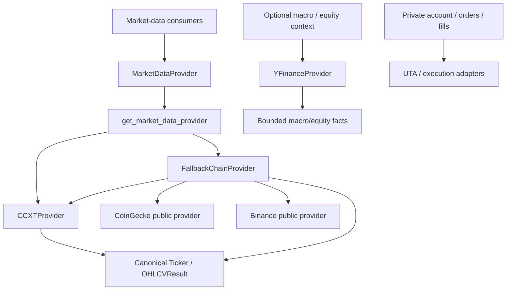

# Data Layer — Current Market-Data Boundary

## Purpose

This document describes Aletheia's **current market-data boundary**. It replaces the old staged refactoring plan.

The core rule is:

> **Public market facts go through the market-data abstraction. Private account/order/execution facts stay behind the account/execution boundary.**

A change in provider or fallback implementation must not silently change instrument identity, causal time, availability semantics, Risk authority or execution ownership.

## Current architecture

`MarketDataProvider` is defined in `aletheia/data/providers.py` and currently exposes bounded async ticker/OHLCV reads plus close semantics.

Consumers using the normalized Core boundary enter through `get_market_data_provider()` in `aletheia/data/providers.py`. Composition binds the concrete implementation from `extensions/data/ccxt_provider.py`; an absent binding reports market data unavailable. The adapter returns a **fresh provider per caller/event loop** because async CCXT sessions are loop-bound.

When crypto fallback is enabled, the adapter factory returns a `FallbackChainProvider` over the configured CCXT provider plus bounded public fallbacks in `extensions/data/sources/`. The Core provider contract exposes normalized capabilities, not native CCXT metadata. Primary-only observation capabilities do not use cross-source fallback. Ordinary ticker/OHLCV methods retain their configured fallback policy: selecting `exact_venue=True` does not disable that fallback when a distinct `fallback_venue` is explicitly supplied.

The native CCXT consumers `volume_scanner.py`, `microstructure.py` and `derivatives.py` belong to `extensions/data/collectors`; the existing scheduler composes them and retains cadence, health and live-snapshot persistence. Derivatives history backfill still delegates to the same Core repository APIs. Entry Planner uses the normalized exact-venue orderbook capability and retains freshness admission, diagnostics and persistence. This describes those consumers, not a complete inventory or proof that every Core/optional Data boundary is closed.

## Public market-data contract

Macro/FRED and Coinalyze acquisition lives in `extensions/data/collectors`.
These concrete adapters retain the owner-approved exception to resolve only
their own credential reference; Core consumers receive facts, not raw keys.
Scheduler composition owns cadence and snapshot persistence. Doctor calls the
optional Coinalyze presence probe and reports unavailable if the adapter is absent.
Existing FRED attempt provenance and Coinalyze Learning policy-epoch behavior
remain unchanged; neither adapter is claimed to be entirely side-effect-free.

Deribit options acquisition/GEX parsing lives in
`extensions/data/collectors/options_structure.py`; observation-only IV derivation
lives in `extensions/data/options_volatility.py`. Core keeps the persisted
`OptionsVolatilitySnapshot` contract in `aletheia/data/options_volatility.py`,
so repository validation and historical export do not require acquisition code.
Scheduler cadence, source clocks, GEX/IV formulas and repository writers are unchanged.

### Canonical values

Current canonical market-data models include:

- `Ticker`;
- `Candle`;
- `OHLCVResult` plus per-attempt quality/fallback evidence;
- `InstrumentId` / canonical symbol and physical market identity.

Market facts must be finite and semantically valid. Malformed, non-finite or physically impossible values are rejected rather than propagated as usable evidence.

### Exact instrument identity

Public data reads preserve the exact instrument dimensions required by the consumer, including where applicable:

- venue/exchange;
- canonical symbol;
- physical market type (`spot`, `perp`, etc.);
- provider/source identity;
- timeframe and bar timestamp.

A same-symbol Spot and Perp are not interchangeable. A fallback may not silently relabel one physical market as another.

### OHLCV semantics

`OHLCVResult` distinguishes complete/partial/empty/failed/unsupported attempts and retains request-scoped fallback/quality evidence.

Rules:

- candles are oldest → newest;
- the currently forming trailing bar is marked unclosed and must not be treated as confirmed history by causal consumers;
- malformed/non-finite/impossible rows are rejected explicitly;
- missing rows or provider failure do not become fabricated candles;
- confirmed bars may be persisted best-effort to the existing OHLCV store;
- persistence failure must not fabricate fetch success or change the fetched market fact.

### Cache

The market-data cache is an optimization only. Cache identity includes the material instrument/timeframe dimensions needed to avoid cross-market contamination.

Cached data does not become a second authority and cannot relax freshness/causal-time requirements of the caller.

## Provider lifecycle

Async CCXT instances are created on the active event loop and closed by the caller.

Do not introduce a process-global cached CCXT provider whose aiohttp session can leak across scheduler event loops.

New direct `CCXTProvider(...)` construction sites require a concrete reason. Normal consumers should enter through `get_market_data_provider()` so configuration, session ownership, fallback and malformed-market protections remain consistent.

## Provider/fallback boundary

Fallback is allowed only where the requested semantic identity remains compatible.

Examples:

- a generic public crypto read may try the configured fallback chain;
- a venue-pinned listing/exact-venue check must stay pinned and cannot substitute another venue merely to return a value;
- different physical market types must never be compared or substituted implicitly.

Fallback availability and source identity remain visible to downstream consumers.

## Symbol / identity boundary

Internal consumers should use canonical symbols / `InstrumentId` rather than provider-specific string conventions.

Provider-specific symbol conversion belongs at the provider/adapter boundary. Bitget/CCXT/yFinance display or API formats must not leak upward as competing domain identities.

Legacy persisted representations remain readable only through explicit compatibility code; new code should not create another symbol-normalization convention.

## Market data vs execution/account data

The separation is deliberate:

### Market-data layer owns

- public ticker / OHLCV / bounded market metadata;
- provider fallback and quality evidence;
- canonical public-market normalization;
- optional macro/equity observation facts where implemented.

### UTA / execution/account layers own

- credentials and private account reads;
- balances/equity;
- positions;
- open orders / order state;
- fills;
- funding/account economics where private evidence is required;
- submit/modify/cancel and execution reconciliation.

Do not route private account/order semantics through `MarketDataProvider`, and do not use a private execution client as the general public-market-data abstraction.

## Current consumers

Current production consumers may include Universe/feature collection, market context, charts/data routes and other bounded public-market readers.

Each consumer remains responsible for its own stricter requirements such as:

- exact venue pinning;
- physical market type;
- causal cutoff / closed-bar requirement;
- maximum staleness;
- complete versus partial admissibility.

A generic provider success is not automatically sufficient evidence for every Consumer.

## Optional yFinance context

`YFinanceProvider` is a separate bounded source used for supported equity/macro contexts. It does not make yFinance a universal fallback for crypto execution facts and does not grant trading authority.

Any derived comparison such as stock-token deviation must preserve the exact reference price/source/time used in the calculation.

## Failure semantics

- malformed provider payload → unavailable/rejected fact, not default zero;
- one provider unavailable → fallback only when semantic compatibility permits it;
- all compatible providers unavailable → explicit failure/unavailable result;
- cache/persistence failure → must not be confused with provider fact success/failure;
- forming/future bar → not confirmed evidence;
- wrong venue/market identity → reject rather than coerce;
- session close failure → bounded cleanup error; never reason to keep a loop-bound provider globally alive.

## Verification

Current market-data changes should preserve focused proof for:

- `MarketDataProvider` structural compatibility;
- exact Spot/Perp/venue identity;
- canonical symbol conversion;
- finite/valid ticker and OHLCV admission;
- forming-bar handling;
- fallback source/attempt evidence;
- venue-pinned no-substitution behavior;
- cache-key identity and no cross-market contamination;
- loop-scoped CCXT lifecycle / idempotent close;
- best-effort OHLCV persistence without changing fetch truth;
- public-market consumers not constructing private execution/account authority.

## Non-goals

This document does not authorize:

- a new market-data platform or generic provider registry beyond current need;
- automatic provider switching across incompatible venue/market identities;
- moving private account/order/fill authority into the public data layer;
- a second cache/persistence truth system;
- new data sources merely because an adapter can be written;
- Risk, execution, credential or Live changes.

## Issue discipline

This file describes the **current data-layer contract**. It contains no implementation phases or prescribed migration order. A new provider, cache behavior or consumer migration requires a focused current Change Contract only when independently justified.
