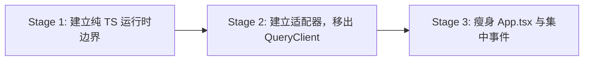

# 框架解耦与中立运行时演进契约 (#3069 对齐与落地规范)

> **契约目标**：本文件严格对齐并落地 GitHub Issue #3069（*[frontend][architecture] Reduce React/TanStack depth with a framework-neutral runtime boundary*），确立**切断 TanStack Query / React 对系统底层深度侵入的具体实施边界、七大解耦改造规范、三阶段演进路线与止损红线**。

---

## 一、 对 #3069 核心宗旨的定调

根据 Issue #3069 的定义，必须明确以下两个战略认知：

1. **解耦并不是要“杀死 React”或“移除 TanStack Query”**：
   - React 依然是非常优秀的通用 UI 视图层；
   - TanStack Query 依然是极佳的“请求/响应型服务端状态缓存器（Request/Response Server Cache）”。
2. **真正的罪魁祸首是“框架越界（Framework-Crossing Boundary）”**：
   - 错误在于把 `QueryClient` 实例和 React 组件生命周期当成了**全站运行时的万能胶水、实时通信总线、休眠唤醒恢复器和应用状态快照器**。
   - 这不仅给平时的维护带来了多重时钟冲突（Multiple Competing Freshness Clocks）和请求风暴，更成为了未来任何前端局部热点重构或框架升级（如 #3030）的巨大绊脚石。

---

## 二、 七大具体越界问题的解耦规范（The 7 Concrete Depth Remediations）

```
┌────────────────────────────────────────────────────────────────────────┐
│                        现存越界代码 (现状)                             │
├────────────────────────────────┬───────────────────────────────────────┤
│ 1. SettingsProps 暴露 qc: QC    │ 2. useRealtimeUpdates 强绑 QC.invalidate│
│ 3. initWakeupGate 强接 QC      │ 4. incidentDump 把 QC 缓存当应用状态快照│
│ 5. FetchProgress 靠 QC 轮询猜意图│ 6. App.tsx 身兼视图根与运行时协调器    │
│ 7. 业务组件手动发散 invalidateKeys(...)                                │
└────────────────────────────────┴───────────────────────────────────────┘
                                   │
                                   ▼ [下沉解耦]
┌────────────────────────────────────────────────────────────────────────┐
│             Layer 1 & 2: 框架中立的纯 TypeScript 运行时                │
│    (API Client + WebSocket Transport + Wakeup Gate + Snapshot Bus)     │
└────────────────────────────────────────────────────────────────────────┘
                                   │
                                   ▼ [单向适配]
┌────────────────────────────────────────────────────────────────────────┐
│                       Layer 3: React / 视图适配器                      │
│             (React 19 Shell + TanStack Query 纯数据缓存)               │
└────────────────────────────────────────────────────────────────────────┘
```

### 1. 消除特性组件接口中的 `QueryClient` 泄漏
- **现状**：`frontend/src/features/settings/types.ts` 中的 `SettingsProps` 包含 `qc: QueryClient`，导致子 Tab 强依赖缓存库实例。
- **重构契约**：
  - 彻底从 Props 中删除 `qc`。
  - 改为狭窄、显式的领域回调：`onSaveSettings: (patch) => Promise<void>`，`onRefresh: () => Promise<void>`，或通过 Context 提供领域级 Service。

### 2. 剥离 WebSocket 传输层对 React / React Query 的依赖
- **现状**：`frontend/src/lib/useRealtimeUpdates.ts` 揉合了 WebSocket 鉴权、心跳、退避重连、页面可见性处理、变更分类映射和 `qc.invalidateQueries()`。
- **重构契约**：
  - 下沉为纯 TS 模块 `src/core/realtime/transport.ts`，仅负责传输协议、重连与原生事件分发（`emit('category_changed', cat)`）。
  - React Query 仅作为**其中一个订阅适配器（Adapter）**，在 React 上层监听事件并决定失效哪些 Query Key。

### 3. 系统休眠/唤醒恢复服务（Wakeup Gate）框架中立化
- **现状**：`frontend/src/lib/wakeupGate.ts` 的签名是 `initWakeupGate(qc: QueryClient)`。
- **重构契约**：
  - 改造为纯 TS 事件源：`initWakeupGate(listener: (event: WakeupEvent) => void)`。
  - 核心仅负责探测操作系统时钟跳变（Clock Jump）与网络连通性恢复，派发 `SYSTEM_RESUMED` 事件；上层适配器决定重刷哪些数据。

### 4. 事故快照导出（Incident Dump）解耦
- **现状**：`frontend/src/lib/incidentDump.ts` 直接序列化 `qc.getQueryCache().getAll()`，把 UI 缓存当成前端全部记忆。
- **重构契约**：
  - 建立中立的诊断快照收集契约：`registerSnapshotContributor(name, providerFn)`。
  - 运行时状态（WebSocket 连接状态、内存队列、休眠时间戳）作为核心中立快照；Query Cache 仅作为其中一个可选的 HTTP 缓存贡献者。

### 5. 显式前后台操作意图契约（替代从 Query 轮询机制瞎猜）
- **现状**：`FetchProgress.tsx` 依赖 `useIsFetching()`，并通过检查 `refetchInterval` 勉强猜测当前请求是“用户前台操作”还是“后台静默轮询”。
- **重构契约**：
  - 建立显式的工作状态契约（Activity Contract）：前台关键异步动作（如保存配置、手动下单、触发归因）主动设置 `activity.start('saving_settings')`，避免通过底层网络抓包隐晦推导用户意图。

### 6. 精简 `App.tsx`，将运行时机制移出根组件树
- **现状**：`App.tsx` 是 UI 根，同时也是 WebSocket、休眠唤醒、键盘监听、本地持久化的“巨无霸协调器”。
- **重构契约**：
  - 将运行时服务（Realtime、WakeupGate）的初始化移至 `index.tsx` 或独立的 `bootstrapRuntime()` 纯函数中，在 React 树挂载前或并行启动。
  - `App.tsx` 严格回归到单纯的“顶层布局、导航、全局抽屉与路由容器”。

### 7. 集中化领域级变更失效策略（Domain-Driven Invalidation）
- **现状**：各个页面组件在 Mutation 成功后，手动分散调用 `qc.invalidateQueries(['settings'])`、`qc.invalidateQueries(['positions'])`，易漏防且难以维护。
- **重构契约**：
  - 在适配层建立集中的领域事件监听器：
    ```typescript
    domainEvents.on('POSITION_CHANGED', () => {
      qc.invalidateQueries({ queryKey: positionKeys.all });
    });
    ```
  - 页面和业务组件只负责调用 API，不再手写分散的 Cache Invalidation 拓扑网络。

---

## 三、 三阶段平滑演进路线图（Three-Stage Roadmap）



1. **Stage 1 —— 纯 TypeScript 核心运行时下沉**：
   - 提取纯 TS 的 `RealtimeTransport`、`WakeupGate`、`StorageService` 和 `IncidentSnapshotRegistry`，不引入重型状态库，仅使用极简的 `subscribe() / emit()`。
2. **Stage 2 —— 移除公共契约中的 `QueryClient`，建立单向适配器**：
   - 清理 `SettingsProps` 中的 `qc`；
   - 让 `useRealtimeUpdates` 变为薄包装的 Hook；
   - 统一由领域事件中心接管 Mutation 后的 Cache Invalidation。
3. **Stage 3 —— 瘦身 `App.tsx`**：
   - 将应用级运行时逻辑移至外壳初始化，彻底恢复 Presentation Layer 的纯粹性。

---

## 四、 验收标准与止损红线（Verification & Stop Rules）

### 验收标准（Checklist）
- [ ] `grep -r "qc: QueryClient" frontend/src/features` 返回 0 条结果；
- [ ] `frontend/src/core/realtime/` 和 `runtime/` 没有任何对 `react`、`@tanstack/react-query` 的导入；
- [ ] 系统休眠恢复测试通过，且 `wakeupGate.ts` 的函数签名中无 `QueryClient`；
- [ ] 现有的 455 个 Vitest 测试和 Vite 构建全部保持 PASS。

### 止损红线（Stop Rule）
- 如果在抽象中立运行时时，代码量失控膨胀，或者演变成了引入一套像 Redux / MobX 那样沉重繁琐的全局状态机，**必须立刻叫停并回退**。
- **中立核心的唯一目的就是“解开深层耦合，划清职责边界”**，代码量应当极简轻量（单文件百行以内），坚决拒绝为了抽象而抽象。
