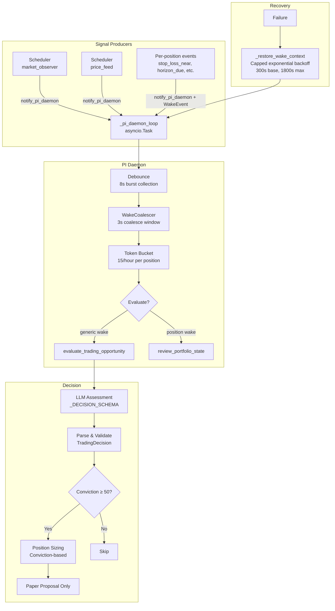

> Archived OpenWiki snapshot from `b7ec0d670`. This page is historical context,
> not current code, configuration, execution authority or acceptance criteria.

---
type: architecture
title: Agent Decision Loop
description: Event-driven System Operator daemon that evaluates trading opportunities via LLM, with wake-event coalescing and per-position rate limiting.
tags: [architecture, decision, pi-daemon, trading-decision]
openwiki:
  roles: [architecture, workflow]
  change_kinds: [lifecycle, public-api]
  source_paths:
    - aletheia/agent_runtime/pi_daemon.py
    - aletheia/agent_runtime/wake_events.py
    - aletheia/agent_shell/trading_decision.py
  symbols:
    - notify_pi_daemon
    - start_pi_daemon
    - _pi_daemon_loop
    - _run_evaluation
    - WakeCoalescer
    - evaluate_trading_opportunity
  test_paths:
    - tests/test_agent_runtime.py
    - tests/test_pi_daemon.py
  invariants:
    - The System Operator is the sole entry-decision authority for trades.
    - Live trading is never reachable from the evaluate_trading_opportunity path.
  validation_commands:
    - uv run pytest tests/test_agent_runtime.py
---

# Agent Decision Loop

The **Agent Decision Loop** is the System Operator's event-driven pipeline for evaluating trading opportunities. It replaces the old 15-minute APScheduler poll with immediate, coalesced, rate-limited evaluation triggered by market events.

## Architecture



## PI Daemon (`agent_runtime/pi_daemon.py`)

The PI Daemon runs as a long-lived `asyncio.Task` inside the uvicorn event loop. It is the central nervous system of the System Operator.

### Public API

| Function | Signature | Description |
|---|---|---|
| `notify_pi_daemon` | `(source: str = "unknown", event: WakeEvent \| None = None) -> bool` | Thread-safe signal to wake the daemon. Fire-and-forget. Safe from APScheduler threads. |
| `start_pi_daemon` | `(loop, debounce_sec=8.0, cooldown_sec=60.0, heartbeat_sec=300.0, coalesce_window_sec=3.0, wake_capacity=15, wake_refill_per_hour=15.0) -> asyncio.Task \| None` | Creates the daemon task named `"pi_daemon"`. |
| `stop_pi_daemon` | `() -> None` | Cancels the task, clears module-level state. |
| `reconfigure_pi_daemon` | `(enabled, debounce_sec, cooldown_sec, heartbeat_sec, loop) -> dict` | Hot-reconfigures without gateway restart. |
| `daemon_status` | `() -> dict` | Rich status: running, heartbeat_age, consecutive_failures, signal_pending_queue_depth. |

### Internal Loop (`_pi_daemon_loop`)

1. **Wait phase** — Awaits `_signal_event` with dynamic timeout (min of: next retry delay, next defer deadline, heartbeat backstop).
2. **Debounce** — Sleeps `debounce_sec` (8s) to collect burst signals.
3. **Runtime guards** — Checks `cfg.runtime.paused` and `cfg.agent.permission_mode` (must be `"Paper"` or `"Full"`).
4. **Coalescer drain** — Drains `_pending_events` into the `WakeCoalescer`, pulls rate-limited coalesced batches.
5. **Evaluation gate** — Evaluates on generic wake, heartbeat, or rate-passing position events.
6. **Evaluation** — Acquires `_eval_lock`, calls `_run_evaluation`.
7. **Cooldown** — Bounded sleep before next cycle.

### `_run_evaluation`

- Selects evaluator: `review_portfolio_state` if per-position batches exist, else `evaluate_trading_opportunity`.
- Wraps in `bind_economic_attribution` for R0 attribution.
- 300s timeout.
- On failure: applies capped exponential backoff via `_restore_wake_context`.

### Sentinel Return Codes

```python
_EVALUATION_RETRY_PENDING = -1    # Transient failure → retry after cooldown
_EVALUATION_NO_MODEL_PENDING = -2 # No-model defer → short bounded delay
```

## Wake Events (`agent_runtime/wake_events.py`)

The exit-intent plan (M1.5, decision D6) adds event sources that can wake the LLM-backed System Operator. Waking the LLM is expensive, so this module bounds and shapes those wakes.

### Three Mechanisms

1. **Coalescing** — Events for the same position within a fixed 3s window collapse into ONE batch.
2. **Rate limiting** — Per-position token bucket (default 15 per hour).
3. **Priority** — P0 catastrophic bypasses limit; P1 urgent never drops (requeues); P3 low drops under pressure.

### Event Kinds & Priorities

| Kind | Priority | Description |
|---|---|---|
| `catastrophic` | P0 | Bypasses rate limit, pre-empts |
| `stop_loss_near` | P1 | Must-answer: never dropped |
| `thesis_invalidated` | P1 | Must-answer: never dropped |
| `horizon_due` | P1 | Must-answer: never dropped |
| `adverse_signal` | P2 (default) | May be overridden by score |
| `take_profit_near` | P3 | Dropped under pressure |

### `adverse_signal_priority(score)`

Maps counter-signal confidence score to priority: ≥80 → P1, ≥60 → P2, else P3.

### `WakeCoalescer.ready_batches(now)` — Core Algorithm

For each pending position:
- Eligible when: coalesce window elapsed OR a P0 event is present.
- P0 batches emit immediately (bypass token bucket).
- Other eligible batches consume one token. If none:
  - Priority ≤ P1 → requeue (kept, retried when token refills)
  - Priority ≥ P2 → dropped (heartbeat re-scans)

## Trading Decision (`agent_shell/trading_decision.py`)

`evaluate_trading_opportunity()` is the System Operator's ability to act as Trading Decision Authority.

### `TradingDecision` Dataclass

Rich decision object with:
- `action` ("trade" | "skip"), `symbol`, `direction`, `conviction` (0–100), `reasoning`
- `position_size_usdt`, `stop_price`, `take_profit`, `expected_horizon_hours`
- `order_type` ("market" | "limit"), `market_type`, `venue`, `leverage`
- Debate fields: `debate_ran`, `debate_initial_conviction`, `debate_bull_confidence`, `debate_bear_confidence`
- R0 attribution: `opportunity_id`, `strategy_id`, `scanner_family`, `signal_source`
- S4/P2: `bear_case`, `key_assumptions`, `observed_facts`, `interpretations`, `invalidation_conditions`

### Decision Flow

1. `_assess_opportunity(ctx)` — LLM structured call with `_DECISION_SCHEMA`.
2. `_parse_decision(raw)` — Validates and parses raw LLM output into `TradingDecision`.
3. On malformed → `_reassess_direct_skip` (one bounded correction pass).
4. `_attach_opportunity_context` — R0 attribution: matches pick back to source opportunity.
5. Entry plan preflight — Validates entry mark.
6. If conviction in uncertain range (40–80) → Bull/Bear debate.
7. Conviction-based position sizing.

### Safety

The System Operator can only submit **paper** proposals (PaperAuto permission gate). Live trading is never reachable from this path.

### Thresholds

```python
_MIN_CONVICTION_TO_TRADE = 50
_DEBATE_RANGE = (40, 80)
_MAX_CONVICTION_MULTIPLIER = 2.0
_MIN_CONVICTION_MULTIPLIER = 0.5
```

## End-to-End Flow

```
1. MARKET DATA COLLECTION
   scheduler:market_data (5 min) → DB snapshots
   scheduler:price_feed (30 s)   → real-time prices
   scheduler:data_collectors (2 min) → orderbook/funding/OI

2. OPPORTUNITY SCANNING
   scheduler:market_observer (10 min) → opportunities table
     → calls notify_pi_daemon("market_observer")
     → or notify_pi_daemon(source, WakeEvent) for per-position wakes

3. PI DAEMON WAKE
   notify_pi_daemon() → loop.call_soon_threadsafe(_apply)
     → sets _generic_wake_pending or appends to _pending_events
     → _signal_event.set()

4. COALESCING + RATE LIMITING
   _pi_daemon_loop drains _pending_events into WakeCoalescer
     → per-position coalescing (3s fixed window)
     → per-position token bucket (15/hour)
     → P0 bypasses, P1 requeues, P2/P3 may drop

5. EVALUATION
   _run_evaluation():
     - If wake_batches → review_portfolio_state(ctx)
     - Else → evaluate_trading_opportunity(ctx)

6. PROPOSAL SUBMISSION (if action="trade")
   → create_paper_proposal (goes through Risk Engine)
   → Only PaperAuto permission; live trading never reachable

7. COOLDOWN + RETRY
   On failure → _restore_wake_context (capped exponential backoff 300s→1800s)
```

## Relationship to Other Components

- [Scheduler](../architecture/scheduler.md) — Signal producers that wake the daemon
- [Trading Loop](../architecture/trading-loop.md) — The full evidence pipeline
- [Execution Risk Flow](../architecture/execution-risk-flow.md) — What happens after a decision
- [System Operator Service](../services/pi-daemon.md) — Runtime deployment view
- [Risk Engine](../components/risk-engine.md) — Pre-trade approval gate
