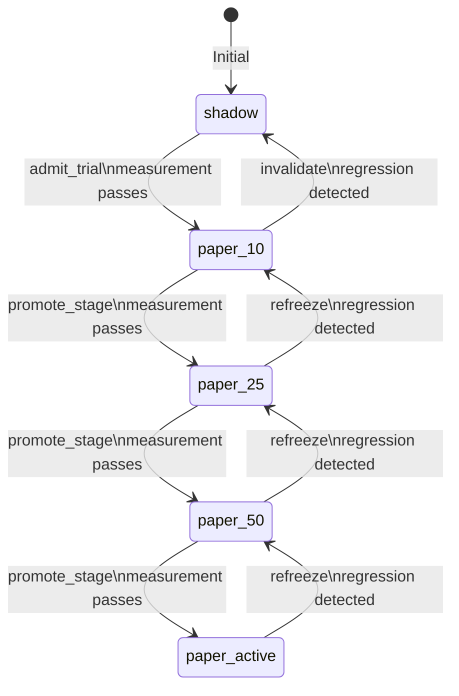

> Archived OpenWiki snapshot from `b7ec0d670`. This page is historical context,
> not current code, configuration, execution authority or acceptance criteria.

---
type: concept
title: Learning Stages (AT-01)
description: The 5 learning stages from shadow to paper_active that govern AT-01 system behavior.
tags: [learning, at-01, stages, autonomy, shadow, paper]
openwiki:
  roles: [domain]
  change_kinds: [lifecycle]
  source_paths:
    - aletheia/learning/lifecycle.py
    - aletheia/learning/authority.py
  symbols:
    - STAGE_SUCCESSOR
    - STAGE_ALLOCATION
    - LifecycleResult
    - LIFECYCLE_ACTIONS
  test_paths:
    - tests/test_learning_lifecycle.py
  invariants:
    - Shadow is always the baseline — it can never be turned off.
    - Transitions are durable and idempotent.
    - The authority system is read-only and fail-closed.
  validation_commands:
    - uv run pytest tests/test_learning_lifecycle.py
---

# Learning Stages (AT-01)

AT-01 progresses through 5 stages, each granting increasing trading authority and capital allocation.

## Stage Definitions

**Source:** `learning/lifecycle.py`

| Stage | Code | Trading Authority | Allocation | Description |
|---|---|---|---|---|
| shadow | `shadow` | None | 0% | Always-on baseline. No trading influence. |
| paper_10 | `paper_10` | Paper only | 10% | Paper trading with 10% of capital. |
| paper_25 | `paper_25` | Paper only | 25% | Paper trading with 25% of capital. |
| paper_50 | `paper_50` | Paper only | 50% | Paper trading with 50% of capital. |
| paper_active | `paper_active` | Active (configurable) | max 90% | Active trading with configurable allocation. |

## Stage Successor Map

```python
STAGE_SUCCESSOR = {
    "shadow": "paper_10",
    "paper_10": "paper_25",
    "paper_25": "paper_50",
    "paper_50": "paper_active",
}
```

## Stage Allocation Map

```python
STAGE_ALLOCATION = {
    "paper_10": 0.10,
    "paper_25": 0.25,
    "paper_50": 0.50,
}
```

## Stage Behaviors

### shadow — Always-On Baseline

- No trading influence.
- Experiments run in shadow with no capital allocation.
- Serves as the baseline for all comparisons.
- **Can never be turned off.**

### paper_10 — 10% Paper

- Paper trading with 10% of capital.
- Real market data, simulated execution.
- Measurement verdicts determine promotion.

### paper_25 — 25% Paper

- Paper trading with 25% of capital.
- Increased allocation based on positive measurement.

### paper_50 — 50% Paper

- Paper trading with 50% of capital.
- Significant allocation based on consistent positive measurement.

### paper_active — Active Trading

- Active trading with configurable allocation (max 90%).
- Requires consistent positive measurement across all paper stages.

## Stage Transitions



## Lifecycle Actions

```python
LIFECYCLE_ACTIONS = frozenset({
    "admit_trial", "promote_stage", "hold", "refreeze", "invalidate",
})
```

| Action | Description |
|---|---|
| `admit_trial` | Admit a new experiment from shadow to paper_10. |
| `promote_stage` | Advance to the next stage. |
| `hold` | Keep the experiment at the current stage. |
| `refreeze` | Freeze the experiment and revert to the previous stage. |
| `invalidate` | Invalidate the experiment and return to shadow. |

## Lifecycle Result

```python
@dataclass(frozen=True)
class LifecycleResult:
    action: str
    recommended_action: str
    reason: str
    experiment_id: str
    successor_experiment_id: str | None = None
    verdict_id: str | None = None
```

## Promotion Criteria

Promotion is determined by the Learning Authority (`learning/authority.py`) through a sequence of gate checks:

1. **Global refreeze** — If global learning is refrozen, no transitions allowed.
2. **Behavior contract** — Current behavior contract hash must match.
3. **Policy epoch** — Current policy epoch must be valid.
4. **Trial admission** — Trial admission measurement block checks.
5. **Measurement harm** — Harm gate checks.
6. **Measurement identity** — Identity verification.
7. **Measurement intervention** — Intervention block checks.
8. **Authority resolution** — Final authority level determination.

## Measurement Verdicts

| Verdict | Description |
|---|---|
| `positive` | Measurement supports promotion. |
| `neutral` | Measurement is inconclusive. |
| `insufficient_data` | Not enough data for a decision. |
| `negative` | Measurement supports refreeze/invalidation. |
| `invalid` | Measurement is invalid. |

## Fixed-Look Inference

**Source:** `learning/fixed_look.py`

Prospective, once-consumed contract (`ufc-fixed-look/v2`) — freezes outcome-blind cutoff, consumes exactly one confirmatory verdict.

## Key Invariants

1. **Shadow baseline** — Shadow is always the baseline; it can never be turned off.
2. **Durable transitions** — Lifecycle transitions are durable and idempotent.
3. **Read-only authority** — The authority system is read-only and fail-closed.
4. **Harm gate** — The harm gate cannot block safety actions.
5. **Global refreeze** — Global refreeze survives restart.

## Relationship to Other Components

- [Learning System](learning-system.md) — Full AT-01 reference
- [Agent Decision Loop](../architecture/agent-decision-loop.md) — Learning gates trading decisions
- [Trading Loop](../architecture/trading-loop.md) — Full evidence pipeline
