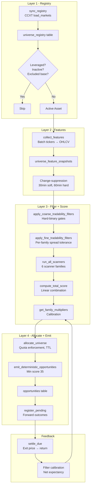

> Archived OpenWiki snapshot from `b7ec0d670`. This page is historical context,
> not current code, configuration, execution authority or acceptance criteria.

---
type: component
title: Universe Pipeline
description: 4-layer market scanning pipeline that converts raw market data into deterministic trading opportunities via scanners, features, filters, and allocation.
tags: [universe, scanners, features, allocation, signals]
openwiki:
  roles: [domain, architecture]
  change_kinds: [public-api]
  source_paths:
    - aletheia/universe/service.py
    - aletheia/universe/scanners.py
    - aletheia/universe/features.py
    - aletheia/universe/filters.py
    - aletheia/universe/allocator.py
    - aletheia/universe/signal_emitter.py
    - aletheia/universe/registry.py
    - aletheia/universe/outcome_recorder.py
  symbols:
    - UniverseService
    - sync_registry
    - collect_features
    - apply_coarse_tradability_filters
    - apply_fine_tradability_filters
    - run_all_scanners
    - compute_total_score
    - get_family_multipliers
    - emit_deterministic_opportunities
    - register_pending
    - settle_due
  test_paths:
    - tests/test_universe.py
    - tests/test_scanners.py
  invariants:
    - Signal emission is fully deterministic — no LLM calls, no DB writes in the emission path itself.
    - Scanner families are calibrated on cost-aware net expectancy, not win rate.
  validation_commands:
    - uv run pytest tests/test_universe.py
---

# Universe Pipeline

The **Universe Pipeline** is Aletheia's 4-layer market scanning system that converts raw market data into deterministic trading opportunities. It runs every ~10 minutes via the scheduler's `universe_refresh` job.

## Architecture



## Layer 1: Registry (`universe/registry.py`)

### `sync_registry(cfg) -> int`

Fetches tradable USDT-quoted pairs from the active exchange via CCXT `load_markets()`. Filters out:
- Inactive markets, non-USDT quotes
- Leveraged tokens (`_LEVERAGED_SUFFIXES`: 3L/3S/5L/5S/2L/2S/UP/DOWN/BULL/BEAR)
- Excluded bases (`_EXCLUDED_BASES`: BTTC, LUNC, LUNA, UST, FTT)
- Tokenized stocks (OKX category "3"), symbols with `_` or `TEST`

Demo mode narrows the universe to empirically-verified executable symbols:
- `BITGET_DEMO_WHITELIST`: curated frozensets for spot/perp
- OKX demo uses `OKXClient.load_demo_markets()`

## Layer 2: Feature Collection (`universe/features.py`)

### `collect_features(assets, cfg, scanner_run_id)`

Performs batch tickers → volume pre-filter → concurrent OHLCV collection.

**Key constants:**
- `_OHLCV_CONCURRENCY = 10`, `_OHLCV_TIMEOUT = 12.0`
- `_OHLCV_1H_LIMIT = 168` (7 days of 1h candles)
- `_TAKER_FETCH_THRESHOLD = 3.0` (lazy taker fetch for movers only)

**Change-suppression (Phase 3 retention):**
- Skips writes when age < 30 min
- Forces write at ≥60 min
- Uses exact/soft-delta equivalence in between (`_FEATURE_SOFT_DELTA_FIELDS` with 0.5% tolerance for noisy percentage fields)

## Layer 3: Filters + Scanners

### Two-Pass Tradability Filters (`universe/filters.py`)

**Pass 1 — Coarse (`apply_coarse_tradability_filters`):** Hard-binary gates:
- Stablecoin exclusion (`_STABLECOIN_BASES`: USDC, USDT, DAI, etc.)
- Blacklist, volume (`min_volume_24h_usdt`), freshness (`_MAX_FRESHNESS_SEC = 7200`)
- Extreme spread rejection at `3× max_spread_bps`

**Pass 2 — Fine (`apply_fine_tradability_filters`):** Per-family spread tolerance multipliers from `filter_advisor`. Records rejections via `record_filter_decision` with `scanner_family` attribution.

**`_compute_tradability_score(feat, cfg) -> float`:** 0-100 score from volume (40%), spread (35%), freshness (25%), depth (bonus/penalty).

### Scanner Families (`universe/scanners.py`)

`run_all_scanners(feat: dict) -> dict` runs all families and picks the best-scoring one that produces a direction.

| Family | Function | Core Logic |
|--------|----------|------------|
| **momentum** | `score_momentum()` | Relative strength vs BTC (24h/4h), RSI directional confirmation, volume spikes, taker flow, OI delta, funding conflict penalty, overextension guard |
| **mean_reversion** | `score_mean_reversion()` | RSI extremes (adaptive thresholds for low-vol regimes), overextended returns, volume exhaustion, funding crowding |
| **volatility** | `score_volatility()` | ATR expansion, BB squeeze/narrow, 4h confirmation, direction from 4h trend, taker confirmation |
| **derivatives** | `score_derivatives()` | Extreme/elevated/mild funding rates, OI surge, OI/price divergence; only fires on perp/swap/futures |
| **event** | `score_event()` | Sharp 1h price jumps (±4%/±8%) + volume spike + taker confirmation + OI surge |
| **short_bias** | `score_short_bias()` | Dedicated bearish setups: 4h+24h downward momentum, non-crowded shorts (funding gate), RSI room-to-fall |

**No-chase gate:** If the 15m candle already traveled >1.5 ATR in the proposed direction, the candidate is zeroed.

**`ScannerResult`** dataclass: structured output with `factor_attributions` dict for explainability (`top_factors(n=3)`).

## Layer 4: Allocation + Signal Emission

### Allocator (`universe/allocator.py`)

**`compute_total_score(feat, scanner_result, cfg, calibration, ...) -> float`:** Linear combination:
```
total_score = opportunity + tradability + liquidity - costs - penalties
```
- `opportunity_score` scaled by calibration multiplier and operator multiplier
- Calibration uses cost-aware **net expectancy** (not win rate), shrunk toward neutral for small samples (`_CALIBRATION_SHRINKAGE = 50`), with downside harm floor at -15%

**`get_family_multipliers(max_step=0.10, evidence_out) -> dict[str, float]`:** Computes stratified opportunity-score multipliers from net outcomes per `family:direction:market_type` key.

**`compute_late_entry_penalty(feat) -> float`:** 0-30 penalty for chasing extended moves (1h/4h returns, extreme RSI).

**`allocate_universe(scored, cfg, regime_state)`:** Quota enforcement, TTL assignment (`_FAMILY_TTL`: momentum 30min → core 24h), explore/exploit split.

### Signal Emitter (`universe/signal_emitter.py`)

**`emit_deterministic_opportunities(members, snapshot_id, scored_features, linked_strategy_id, regime, short_enabled) -> int`:** Converts high-scoring members into `Opportunity` rows without LLM.

**Gates:**
- `_MIN_SCORE = 35.0`
- `_HIGH_CONF_THRESHOLD = 60.0`
- `_REGIME_BIAS_THRESHOLD = 0.30`
- Factor feedback gate (`lookup_factor_signal`)
- Regime bias gate (`_passes_regime_gate`)
- Live signal suppression (`_find_live_universe_signal`) — prevents cross-snapshot flooding within TTL

**`_record_emission_decision()`:** Persists terminal facts via `record_filter_decision` with `raise_on_error=True`; raises `EmissionEvidenceError` on failure.

## Outcome Recorder (`universe/outcome_recorder.py`)

### `register_pending(members, entry_ts) -> int`

Creates `UniverseForwardOutcome` rows for each member × horizon (`_HORIZONS`: 15m/1h/4h/24h).

### `settle_due()`

Finds overdue pending rows, fetches exit price, computes return.

**Key constants:**
- `_FETCH_PLAN = 300` bars per request
- `_CANONICAL_FETCH_CEILING = 400` hard cap on exchange work per cycle
- `_MAX_CONCURRENT_FETCHES = 8`, `_FETCH_TIMEOUT_SEC = 20.0`

### `deferred_observation(reason) -> dict`

Third answer (measured nothing, decide nothing) — distinguishes "venue answered, no usable price" from "venue unreachable" to avoid condemning measurable rows during outages.

## Continuous Scoring (`universe/continuous_scoring.py`)

**Pure, non-authoritative shadow module** (`CONTINUOUS_SCORER_BEHAVIOR_VERSION = "universe-continuous-shadow-v1"`).

- `ContinuousScoringPolicy` dataclass
- `shape_preserving_curve()`: clamped cubic Hermite (PCHIP-style) for factor curves
- `CandidateScore` dataclass with point/pessimistic scores, evidence, sensitivities

Does NOT import allocator/filters/signal_emitter — used only by twin adapters for diagnostics.

## Key Invariants

1. **Deterministic emission** — No LLM calls, no DB writes in the emission path itself.
2. **Calibration feedback** — Scanner families are calibrated on cost-aware net expectancy, with empirical Bayes shrinkage and downside harm floor.
3. **Change-suppression** — Feature snapshots use fingerprint-based suppression to reduce near-duplicate writes.
4. **No-chase gate** — Candidates that have already moved >1.5 ATR in the proposed direction are zeroed.

## Relationship to Other Components

- [Agent Decision Loop](../architecture/agent-decision-loop.md) — Consumes opportunities
- [Trading Loop](../architecture/trading-loop.md) — Full evidence pipeline
- [Scheduler](../architecture/scheduler.md) — Orchestrates the pipeline
