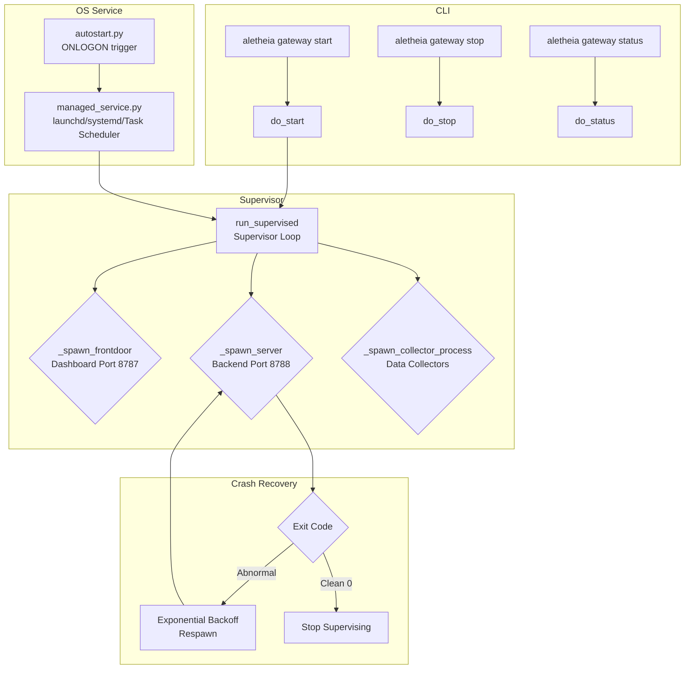

> Archived OpenWiki snapshot from `b7ec0d670`. This page is historical context,
> not current code, configuration, execution authority or acceptance criteria.

---
type: service
title: Gateway Service
description: Background process supervisor that manages the FastAPI server, front-door proxy, and data collector subprocess with crash recovery.
tags: [gateway, supervisor, lifecycle, service]
openwiki:
  roles: [operations, architecture]
  change_kinds: [lifecycle]
  source_paths:
    - aletheia/gateway/lifecycle.py
    - aletheia/_gateway_runner.py
    - aletheia/gateway/managed_service.py
    - aletheia/gateway/autostart.py
    - aletheia/gateway/pidfile.py
    - aletheia/gateway/frontdoor.py
  symbols:
    - do_start
    - do_stop
    - do_status
    - run_supervised
    - _spawn_server
    - _spawn_frontdoor
    - _spawn_collector_process
    - backend_port_for
    - _start_macos
    - _build_task_xml
    - _build_launchd_plist
  test_paths:
    - tests/test_gateway.py
    - tests/test_autostart.py
  invariants:
    - The gateway supervisor owns the PID file and respawns the inner server on abnormal exit.
    - The frontdoor owns the dashboard port; backend restarts don't change the port.
    - Autostart is human-triggered only, never agent-callable.
  validation_commands:
    - uv run aletheia gateway status
    - uv run pytest tests/test_gateway.py
---

# Gateway Service

The **Gateway Service** is Aletheia's background process supervisor. It manages the FastAPI server, the front-door reverse proxy, and the data collector subprocess — with crash recovery, PID management, and OS-level autostart.

## Architecture



## Lifecycle (`gateway/lifecycle.py`)

### `do_start(*, no_browser=False, foreground=False) -> bool | None`

Start the gateway (foreground or background).

**Flow:**
1. If machine service selected → `service_control.start()`.
2. `_check_circuit_break_auto_reset()` — auto-clear breaker after 30 min stability.
3. `run_preflight_checks()` + `assert_preflight_or_exit()`.
4. Stale PID detection → abnormal termination audit.
5. Port guard: `wait_port_free` → kill orphans → refuse if foreign holder.
6. `_apply_gateway_migrations()` — single migration owner.
7. Foreground: `write_pid()` → `_run_server(cfg)` (uvicorn in-process).
8. Background: `service_control.start()` → `_verify_started(cfg)` → `_auto_start_tunnel`.

### `do_stop()`

Tree-kill the supervisor + inner uvicorn, clean orphans, wait for port to free.

### `do_status()`

Show gateway status.

### `_verify_started(cfg, *, timeout, poll_interval) -> bool`

Block until the managed gateway is confirmed up.

### Circuit Breaker

- `_check_circuit_break_auto_reset`: If stable for 30 min with no new failures, reset.
- `_check_spawn_circuit_breaker`: If 3+ spawn failures within 30 min, disable watchdog + alert.

## Supervisor (`_gateway_runner.py`)

### `run_supervised(spawn_fn=None) -> dict`

Supervise the inner server. Respawns on abnormal exit with backoff.

**Flow:**
1. `bootstrap()` + `write_pid()` — supervisor owns the PID file.
2. Create 1-element mutable holders: `frontdoor_holder`, `collector_holder`, `backend_holder`.
3. `OperatorShellMonitor(cfg).start()`.
4. Install SIGTERM/SIGINT handlers via `_install_shutdown_handlers`.
5. Spawn frontdoor if enabled.
6. **Supervisor loop:**
   - `spawn_fn()` → inner server lifetime.
   - On abnormal exit → exponential backoff respawn, up to `supervisor_max_restarts` within `supervisor_restart_window_sec`.
   - On clean exit (0) → stop supervising.
7. **Finally block:** Tear down every owned subprocess (frontdoor, backend, collector), remove PID file.

### Process Architecture

```
_supervisor (run_supervised)
  ├── _frontdoor (frontdoor_runner) — owns dashboard port
  ├── _backend (uvicorn aletheia.server.app) — internal port
  └── _collector (aletheia.data.collector_runner) — independent
```

### Frontdoor Pattern

A stable local reverse proxy that owns the dashboard port. The backend can restart without the port changing. If the frontdoor dies, only the frontdoor is restarted — the backend is NEVER killed for a frontdoor fault.

### `backend_port_for(cfg) -> int`

Returns the internal backend worker port (dashboard_port + 1).

## Managed Service (`gateway/managed_service.py`)

On-demand, user-level ownership of the gateway supervisor. Created by `gateway start`, removed by `gateway stop`. No login trigger, interval, or restart policy.

**Platform support:** macOS (launchd), Linux (systemd), Windows (Task Scheduler).

**Design:** Deliberately separate from `autostart.py`. An on-demand service has no KeepAlive/Restart policy — the OS owns the foreground supervisor while it is running.

## Autostart (`gateway/autostart.py`)

OS-level autostart + supervisor watchdog for Windows and macOS.

**Mechanism:**
- **ONLOGON trigger** → starts the gateway when the user logs on.
- **Repeat every 1m** → because `do_start` is idempotent, each tick resurrects a dead supervisor. This is the OS-level watchdog over the supervisor.

**Governance:**
- Human-triggered only, never agent-callable.
- Runs `gateway start --no-browser` with `RunLevel=LeastPrivilege`.
- UI honesty: `status()` always shells a live `schtasks /Query`.

**Watchdog interval:** `WATCHDOG_INTERVAL = "PT1M"` (1 minute, the Windows minimum).

## PID Management (`gateway/pidfile.py`)

PID file creation, process-tree kill, stale PID detection.

## Key Invariants

1. **Supervisor owns PID** — The supervisor process writes and owns the PID file.
2. **Frontdoor owns port** — The dashboard port is stable across backend restarts.
3. **Crash recovery** — Abnormal exits trigger exponential backoff respawn.
4. **Clean teardown** — Finally block tears down all owned subprocesses.
5. **Autostart governance** — Human-triggered only, never agent-callable.

## Relationship to Other Components

- [API Server](api-server.md) — The FastAPI server managed by the gateway
- [PI Daemon](pi-daemon.md) — The System Operator daemon running inside the server
- [Data Collectors](data-collectors.md) — The collector subprocess managed by the gateway
