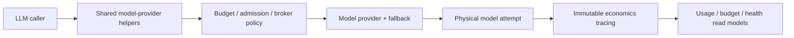

# Tokenomics / LLM Economics Harness

## Status

**Implemented proposal history.**

This proposal records the cross-domain decision to extend Aletheia's existing LLM provider/economics layers with one in-process governance surface for usage visibility, budget policy, provider/caller admission signals and bounded environment context.

Current normative behavior is owned by current code, configuration/economics contracts, Usage v2 and focused Issues. This file is not a delivery plan.

## Problem the proposal addressed

Aletheia already routed most model calls through shared provider helpers and already persisted immutable runtime-cost/pricing evidence, but operators lacked a coherent control plane for:

- live/historical LLM spend and pricing coverage;
- declared budget scope and headroom;
- explicit observe-only versus enforced budget behavior;
- provider/caller rate/concurrency visibility;
- honest model/broker health;
- a bounded common environment context for model calls where enabled;
- future prompt/response guardrails when independently justified.

## Architectural decision

Reuse the existing in-process provider and economics layers. Do not introduce an external LLM gateway or a second cost ledger.

Budget policy is a signal/control surface, not a replacement for trading safety. Risk/Execution/Live authority remains elsewhere.

## Current semantic contracts

### Usage and pricing truth

Usage surfaces must distinguish known, estimated and unknown cost. Unknown is never silently zero.

Read models may expose provider/model/agent/run/session scopes only when exact provenance supports them. A bounded query window must not be presented as a complete aggregate when older eligible rows exist.

### Budget declarations

Budgets are explicit scoped configuration/evidence. Supported scopes/windows are determined by current schema/code.

Observe-only evidence and actual denial are distinct facts:

- observe-only / warn behavior may record that a call would have crossed a budget while allowing the call;
- stricter enforcement is explicit, operator-visible and must evaluate the applicable budget independently of optional observation logging;
- “budget not evaluated/unavailable” is not equivalent to “within budget”.

Safety-relevant callers preserve their separately declared fail-safe semantics and cannot be silently converted into hard budget blocks by an ordinary setting.

### Enforcement modes

Current enforcement-mode semantics are owned by `EconomicsConfig` and the shared inference path. The UI/API must show the exact effective mode and provide a valid control for any operator-editable authority.

Enforcement may not silently rewrite prompts, model routing or provider selection merely to fit a cap.

### Rate/concurrency limits

Provider-tier and any supported caller-scope limits are load/admission controls, distinct from budget accounting. Rejections remain typed/observable rather than collapsing into generic provider failure.

### Common environment context

A bounded shared model-call context may include facts such as runtime/session identity, time, trading mode and economics state only where the current feature is enabled and verified not to degrade the owning model task.

This context is additive. Individual callers remain responsible for their task-specific prompt/evidence contract.

### Guardrails

Secret/prompt/response guardrails are not activated merely because this proposal mentions them. Any blocking guardrail requires its own current evidence about false positives, exact scope and failure behavior.

Repository secret-handling rules remain mandatory regardless of model guardrail support.

## Operator surfaces

Economics/Usage Settings and APIs should answer:

- is tracing/economic accounting active?
- what spend is known/estimated/unknown?
- what provider/model/logical-agent/session contributed?
- what budgets are configured and what current headroom is supported by exact evidence?
- which enforcement mode is effective?
- what model/broker reliability/admission facts are current?

A UI statement such as “observe only” must never be shown while a hidden persisted mode can actively deny calls.

## Failure semantics

- missing pricing → explicit unknown/estimated state according to current pricing contract;
- missing budget evidence under strict enforcement → explicit unavailable/fail-closed behavior defined by the current enforcement contract;
- provider or model health failure remains distinct from budget denial;
- session-scoped budget read models must use exact Runtime Session identity rather than mixing sessions by timestamp;
- ledger/read-model failure must not be projected as zero spend or healthy budget headroom.

## Non-goals

- no external inference gateway service;
- no second economics ledger;
- no Live unlock or hard Risk-limit change;
- no budget-driven hidden prompt/routing rewrite;
- no new provider/model catalogue simply because economics controls exist;
- no response cache/secret scanner/task router without an independently justified current problem;
- no development-stage sequence encoded in this proposal.

## Evidence history

Historical dated research under `docs/research/tokenomics/` preserves the original investigation, implementation decisions and measurements. Those files may retain their historical naming because they are evidence snapshots, not current implementation authority.

Issue #475 and its focused follow-up Issues preserve the implementation/bug history. Current behavior should be read from current code/contracts rather than replaying the historical rollout plan.
