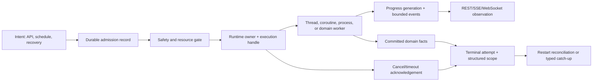

# Aletheia Comparison

## Executive Comparison

Aletheia has stronger runtime ownership, durable Agent lifecycle, timeout
containment, startup reconciliation, scheduler lane separation, and safety-aware
pause semantics. TickFlow has stronger generic long-job progress UX, visible
stage history, and interactive analytical worker isolation.

The correct synthesis is not to replace Aletheia's scheduler with TickFlow's
JobStore. It is to put TickFlow-quality progress and reconnect semantics on top
of Aletheia's stronger durable ownership and fail-closed execution model.

## Side-by-Side Matrix

| Concern | TickFlow | Aletheia | Better current basis |
|---|---|---|---|
| Current runtime owner | Implicit app process | Explicit current/shadow runtime mode | Aletheia |
| Scheduler uniqueness | Process-local, deployment invariant not shown | Only current runtime starts services | Aletheia |
| Scheduler lanes | Mainly default APScheduler behavior | Explicit small class-specific pools | Aletheia |
| Coalescing/overlap | Not explicit globally | Global coalesce and max_instances=1 | Aletheia |
| Pipeline progress | Stage, overall/stage %, bounded logs | Mostly domain-specific run rows/logs | TickFlow |
| Manual queue | One reused active pipeline id | Durable bounded serial Agent queue | Aletheia |
| Interactive compute isolation | Spawn process, IPC, RSS, terminate/join | Varies by workload; scheduler mostly threads | TickFlow |
| Sync timeout honesty | Reclaims lock while thread may live | Fixed occupied lane stays bounded | Aletheia |
| Active restart reconciliation | No generic reconciliation | Agent runs marked stale at startup | Aletheia |
| Browser reconnect | Strong for backtest SSE, moderate for pipeline | Durable run APIs, less unified progress protocol | Mixed |
| Pause semantics | Service-specific | Persisted blanket/layered pause | Aletheia |
| Consecutive failure surfacing | Mostly logs/job result | Infra event after threshold | Aletheia |
| Next-run visibility | Selected data schedules | Top-level count/state; few per-job times | TickFlow |
| Partial outcome representation | Good intent, failed result details lost | Domain-dependent; strong in selected workflows | Mixed |

## Runtime Owner Boundary

Aletheia's `runtime_process_context()` and
`should_start_background_services()` establish a critical invariant: only the
current runtime owns scheduled and background behavior. Shadow processes can be
validated without duplicating market collection, decisions, settlement, or
execution-adjacent work.

TickFlow constructs its services directly in every application lifespan. That
is simpler, but safety depends on an external single-process deployment rule
that is not visible in the studied source.

For Aletheia, this boundary must remain unchanged. No borrowed job framework
should start writers merely because a FastAPI app instance exists.

## Scheduler Architecture

### Aletheia strengths

Aletheia explicitly partitions scheduler capacity:

- single-writer-biased `io` lane;
- isolated `fast_io` lane;
- isolated boot observer;
- serial LLM/Agent lane;
- small general lane.

Global `coalesce=True` and `max_instances=1` prevent self-overlap and replay
storms. Jobs specify misfire windows and important cron timezones. First-run
offsets smooth startup load.

TickFlow has appropriate cron times and misfire windows, but relies more on
process-wide JobStore locks and framework defaults. Aletheia's declared lane
model is easier to reason about under SQLite single-writer constraints.

### Aletheia gap

`status_snapshot()` exposes only running/state/job count. The dashboard does not
receive a normalized inventory of:

- job id and class;
- executor lane;
- next run;
- previous attempt and outcome;
- consecutive failures;
- current execution age;
- timeout budget;
- paused reason;
- catch-up window.

TickFlow exposes selected next/last data schedule times close to dataset health.
Aletheia can learn from that presentation without exposing secrets or allowing
arbitrary scheduler mutation.

## Timeout and Capacity

### Aletheia's fixed-lane model

For synchronous external work, Aletheia uses one persistent worker with bounded
pending admission. When a call exceeds the observer timeout, the system cancels
only if it has not started; a running call remains in the single occupied lane.
New work cannot create an unlimited series of abandoned threads.

For async work, Aletheia uses persistent event-loop threads with a bounded
pending count and cooperative `asyncio.wait_for`. One separate loop isolates
news analysis. Timeout metrics expose real queue pressure.

This directly avoids TickFlow's pipeline reaper bug. It acknowledges that
Python threads cannot be safely killed and refuses to turn a UI timeout into
fictional capacity.

### Remaining Aletheia concerns

- `_sync_timeout_worker` has no visible close in `stop_scheduler()`, while the
  two async timeout workers are closed. It is a daemon process-owned lane, so
  process exit ends it, but graceful lifecycle symmetry is weaker.
- `BackgroundScheduler.shutdown(wait=False)` can return while executor work is
  still unwinding. The surrounding cleanup closes worker resources, so ordering
  deserves careful fault-oriented validation.
- `_ensure_agent_run_ended()` updates every running row for an `agent_name`, not
  a specific run id. Per-agent scheduler `max_instances=1` reduces risk, but a
  manual run of the same agent could overlap and be affected.
- not every scheduled function uses `_run_async_with_timeout()` or
  `_run_sync_with_timeout()`; the wrapper itself does not impose a universal
  duration bound.

These are static observations, not proof of runtime failure.

## Durable Lifecycle

### Aletheia strengths

Agent runs are inserted before or at execution start and completed with status,
outputs, errors, tool calls, model/provider, and cost. Startup reconciliation
marks orphaned queued/running rows stale and writes an audit record. The API
exposes runs, steps, and tool calls.

The manual Agent queue persists `queued` before putting work into its bounded
memory queue. If the queue is full, it records a terminal rejection. On
shutdown it durably cancels queued items. If the active worker does not join,
the manager keeps its reference and will not start a second concurrent worker.

TickFlow's generic pipeline record has richer live progress but weaker durable
active ownership. Aletheia has the better lifecycle foundation.

### Aletheia gap

Generic scheduler jobs do not all create a durable `job_attempt` record.
Consecutive failures are process-memory counters until they cross an infra-event
threshold. A restart clears the counter and APScheduler's in-memory history.

AgentRun is also not a natural record for every deterministic infrastructure
job. Forcing price feed, reconciliation, cleanup, and settlement into an Agent
schema would be semantically wrong.

A possible future abstraction is a small durable `runtime_job_attempt` envelope
for scheduler attempts, while AgentRun and domain-specific run records retain
their richer meanings. This is a research recommendation, not an implementation
decision.

## Manual Queue and Idempotency

Aletheia's manual Agent queue is stronger than TickFlow's pipeline admission in
several ways:

- capacity is explicit;
- queued state is durable;
- per-agent/caller key deduplication is explicit;
- overflow is a durable result;
- queue metrics are available;
- one serial worker aligns with SQLite safety;
- behavior-producing agents recheck pause and kill switch.

TickFlow's server-generated hash key is better for reconnectable analytical
tasks because it derives identity from a complete immutable input signature and
returns that identity in the stream before progress. Aletheia can combine these:
durable admission plus server-owned canonical job identity.

## Progress and Operator UX

### TickFlow advantage

The pipeline Data page shows:

- overall and stage-local percent;
- named stage;
- compact stage logs;
- affected dataset card;
- active job restored after navigation;
- result and partial skip summary;
- clickable recent history;
- last and next schedule around coverage.

This is substantially better for understanding a long maintenance operation
than Aletheia's general scheduler count and recent Agent run list.

### Aletheia advantage

Aletheia exposes deeper causal records after Agent work:

- ordered reasoning/action steps;
- tool calls and permission decisions;
- outputs and errors;
- provider/model and cost evidence;
- infrastructure events;
- runtime session and boot commit.

TickFlow explains “where the pipeline is now.” Aletheia often explains “what
the Agent did and why.” A unified operator experience needs both temporal
progress and causal evidence.

## Cancellation

### TickFlow lessons

The backtest protocol is worth copying conceptually:

1. server accepts and returns canonical job identity;
2. execution owns a cancel signal;
3. progress remains available independent of one connection;
4. reconnect replays progress;
5. cancel races before identity arrival are handled;
6. a process boundary exists for eventual hard cleanup.

The pipeline cancel path is not worth copying because it cancels metadata only.

### Aletheia current state

The manual Agent manager can cancel queued work during shutdown but does not
expose per-run cancellation for an active Agent through the generic run API.
Serenity research has richer explicit cancel semantics. Scheduler pause affects
future fires, not necessarily a running body.

The lesson is to describe cancellation by phase:

- admission revoked;
- queued item removed;
- cooperative stop requested;
- stop acknowledged;
- process/task terminated;
- side effects reconciled.

A single `cancelled` label is insufficient for trading-adjacent work.

## Restart and Catch-Up

Aletheia does several things TickFlow does not:

- records clean versus unclean runtime sessions;
- reconciles orphaned Agent runs at startup;
- uses database-backed window keys for selected daily catch-up jobs;
- separates current and shadow runtime ownership;
- defers slow startup work until after HTTP readiness;
- names and later cancels lifespan-owned tasks;
- starts essential data jobs under layered pause.

The remaining gap is that catch-up is domain-specific rather than universal.
This is appropriate: a missed price refresh, settlement, daily learning pass,
and cleanup window have different replay safety. A universal “run every missed
fire” policy would be dangerous.

TickFlow's selected schedule visibility can still improve Aletheia: for each
important job, expose whether restart catch-up is supported and the latest
successful domain window, rather than only APScheduler's next timestamp.

## Failure Semantics

Aletheia's consecutive-failure escalation is valuable: the first transient can
remain a log, while repeated failure becomes a deduplicated operator event. The
failure counter is reset on success.

The static gap is durability. A restart can erase two consecutive failures and
delay escalation. Learning jobs have richer durable health, but general jobs do
not share it.

TickFlow's pipeline preserves a terminal failed record immediately and shows it
in history, but the generic JobStore stores only a final error string on failure
and discards structured partial results.

The ideal combined attempt record contains:

- immutable job id and normalized window/input hash;
- runtime/session owner;
- admitted, started, heartbeat, and ended timestamps;
- terminal status and reason code;
- progress generation and stage;
- structured committed/failed/skipped scope;
- timeout/cancel phase;
- retry/catch-up relationship;
- sanitized error summary and link to deeper logs.

## What Aletheia Should Preserve

- only current runtime owns background services;
- migration verification precedes writers;
- SQLite-aware small executor lanes;
- global coalescing and single-instance defaults;
- fixed bounded timeout workers;
- no fictional reclamation of uninterruptible sync work;
- durable queued/running/terminal Agent rows;
- startup stale reconciliation and runtime sessions;
- behavior gates, kill switch, and layered pause;
- producer-before-consumer shutdown ordering;
- domain-specific catch-up and exact persisted authority.

## What Aletheia Can Borrow

### High-value, low-semantic-risk

- named stage plus overall/stage-local progress;
- bounded progress log with transient-entry compaction;
- server-provided canonical job key;
- active-job restore after navigation;
- replayable progress on reconnect;
- last/next schedule beside affected data coverage;
- child-process isolation and RSS/result-size metrics for memory-heavy research
  or analytical tasks;
- live schedule/config refresh on the owner loop;
- explicit partial result summaries.

### Requires a stronger backend contract first

- generic cancel button;
- stale timeout that frees capacity;
- unified job history for all scheduler work;
- automatic replay of missed scheduler fires;
- process termination for work that can touch trading state.

## Recommended Combined Architecture

The execution handle is deliberately separate from the durable attempt record.
Metadata may say a deadline was exceeded, but capacity is reclaimed only when
the actual owner acknowledges completion or a killable process is terminated.

## Suggested Aletheia Priority

### P0: Preserve invariants

- Do not import TickFlow's reaper/lock-release behavior.
- Do not let job UX bypass Risk, Execution Gateway, pause, or runtime ownership.
- Do not equate APScheduler enabled configuration with actual running state.

### P1: Operator clarity

- Define a shared read-only job status envelope for important long work.
- Surface per-job next run, last attempt, current stage, age, and paused reason.
- Add explicit `Not available` for unsupported progress/cancel/recovery fields.

### P2: Durable attempt envelope

- Evaluate a generic attempt table for non-Agent scheduler work.
- Keep domain results in their existing authoritative tables.
- Reconcile incomplete attempts by runtime session at startup.

### P3: Analytical process isolation

- Evaluate spawn/subprocess isolation only for measured memory-heavy,
  reconstructible analytical work.
- Keep trading execution and causal state inside existing safety boundaries.

These are research priorities, not authorization to implement.

## Final Comparison

TickFlow gives a better picture of long work while it is happening. Aletheia
gives a better proof of who owns work, how bounded execution behaves under
timeout, and what remains true after restart. The best system keeps Aletheia's
runtime foundation and adds TickFlow's progress grammar, reconnect protocol,
and analytical process isolation where the workload warrants it.
