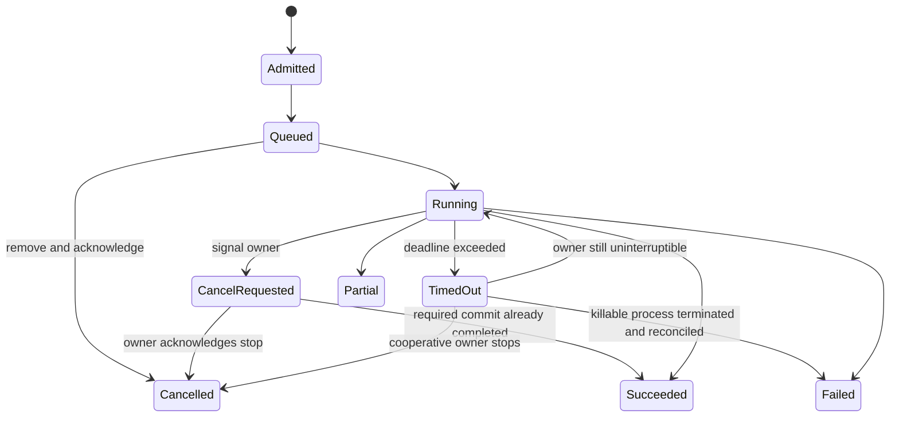

# Lessons and Extraction Notes

## Central Lesson

A background job is not a status row. It is a relationship among durable
intent, admitted capacity, an owned execution object, committed effects, and an
observable lifecycle. If any one of those is missing, labels such as running,
cancelled, timed out, or recovered can become misleading.

## Practices Worth Extracting from TickFlow

### 1. Pending is already active

Single-flight must begin at admission, not after a worker starts. TickFlow's
`pending ∨ running` deduplication closes a real duplicate-click race.

### 2. Progress has two scales

An overall percentage answers “how much of the workflow remains.” A stage-local
percentage answers “is this expensive stage moving.” Showing both avoids a
pipeline that appears stuck at the same overall number during a large batch.

### 3. Progress should name the affected domain

Mapping `sync_daily`, `compute_enriched`, and `sync_minute` to visible data cards
connects runtime work to user-visible consequences.

### 4. High-frequency progress needs compaction

Replacing the latest transient same-stage entry preserves current movement
without allowing logs to grow with every batch. A fixed tail limit adds a
second bound.

### 5. Server identity should be authoritative

The backtest stream emits the job key before progress, and cancel returns that
exact key. This eliminates duplicated identity normalization in the browser.

### 6. Reconnect is part of the job protocol

Detached execution, replayable progress, local reconnect hints, terminal
retention, and bounded reconnect attempts are designed together. Reconnecting
only the transport is insufficient.

### 7. Memory-heavy analysis benefits from a process boundary

Spawn isolation gives the parent a killable execution object and lets it
measure worker RSS, serialization cost, and exit status. It also releases
process memory more deterministically than a long-lived Python worker.

### 8. Workload-specific pools prevent starvation

TickFlow separates long blocking pipelines from the default request executor.
Aletheia extends the same idea with explicit IO, fast IO, observer, and Agent
lanes.

### 9. Schedule time belongs near data health

Operators care about when a dataset was last refreshed and when the next
attempt will happen, not merely that “the scheduler is enabled.”

### 10. Runtime configuration can update without restart

TickFlow rereads pull configuration each cycle and live capabilities before the
daily pipeline. Aletheia should retain the same property wherever safe.

## Practices to Avoid

### 1. Releasing capacity when only observation timed out

An uninterruptible thread remains an execution owner. Releasing its mutex
creates overlap; it does not cancel the thread.

### 2. Calling metadata failure “cancellation”

If no signal reaches the execution body, the honest status is detached,
abandoned, or deadline-exceeded-observer. “Cancelled” implies a stronger fact.

### 3. Keeping only terminal active state

When active jobs exist only in memory, restart erases the explanation for an
incomplete dataset. Persisting only successes and failures omits interruptions.

### 4. Using one last-sync timestamp as job history

A timestamp cannot express zero rows, partial batches, unchanged complete data,
provider denial, interruption, or failed publication.

### 5. Starting daemon work without retaining its handle

Unretained asyncio tasks and daemon threads cannot be awaited, joined, or
reconciled during shutdown.

### 6. Assuming a process-local mutex is a deployment lock

Multi-worker or shadow processes each own separate locks. Runtime ownership
must be explicit at deployment/process level.

### 7. Treating all missed schedules the same

Some work is safe to catch up, some is stale and should skip, and some requires
human or safety-gate review. Catch-up must be domain-keyed.

### 8. Showing progress without committed scope

A stage reaching 100 does not prove its data was committed completely. Progress
and outcome must remain separate.

### 9. Discarding structured partial results on failure

When a pipeline continues after soft errors, its failed terminal record should
retain which stages committed, failed, skipped, and remain stale.

### 10. Letting polished UI overstate backend truth

A beautiful progress card raises the trust cost of inaccurate lifecycle labels.

## Reusable Vocabulary

### Attempt status

- `admitted`: durable intent exists and capacity was granted;
- `queued`: owned queue contains the attempt;
- `running`: an execution handle acknowledges start;
- `succeeded`: required committed scope is complete;
- `partial`: declared subset committed, declared subset failed/unavailable;
- `failed`: required outcome not achieved;
- `cancel_requested`: cooperative request issued;
- `cancelled`: execution acknowledged stop before required completion;
- `timed_out`: configured deadline exceeded;
- `stale`: prior runtime no longer owns the attempt;
- `rejected`: admission was not granted;
- `skipped`: schedule evaluated but domain gate said no run was needed.

Not every subsystem needs every status, but it should not overload one label
with a weaker fact.

### Ownership fields

- attempt id;
- canonical input/window key;
- runtime session id;
- scheduler/job definition id;
- executor lane;
- execution kind;
- execution handle class, not raw unsafe handle value;
- admitted/started/heartbeat/ended timestamps;
- retry-of or catch-up-of relationship.

### Outcome fields

- required scope;
- committed scope;
- failed scope;
- skipped scope and reason;
- data generation/version after commit;
- sanitized error code and summary;
- artifacts/results references;
- source and as-of coverage.

## Cancellation State Machine



The unusual `TimedOut --> Running` edge is intentional. It represents the
observer's deadline expiring while an uninterruptible call still owns the real
execution lane. Hiding this state is how zombie overlap bugs appear.

## Progress Contract

A useful read model can contain:

```text
attempt_id
status
stage_code
stage_label
overall_pct
stage_pct
message
progress_generation
event_seq
started_at
last_progress_at
deadline_at
committed_scope
failed_scope
cancel_phase
next_run_at
```

Fields unsupported by a workload should be `Not available`, not guessed.

## Schedule Contract

Each important scheduled domain should declare:

- timezone and wall-clock or interval meaning;
- misfire grace;
- coalescing policy;
- maximum concurrent instances;
- executor lane;
- pause class: essential or non-essential;
- catch-up policy;
- idempotency/window key;
- expected duration and timeout;
- next run and last attempt;
- runtime owner requirement.

TickFlow exposes some of these in code and selected UI. Aletheia has more of
them in scheduler code but less in its operator read model.

## Shutdown Contract

An orderly shutdown should proceed by ownership dependency:

1. stop schedule admission and event producers;
2. stop accepting manual queue work;
3. durably cancel queued attempts;
4. request cooperative stop for active work;
5. await owned asyncio tasks within a grace period;
6. join threads or retain their ownership record;
7. terminate killable analytical child processes if policy permits;
8. reconcile unfinished attempt state;
9. close DB/provider resources;
10. record runtime session as clean only after these steps.

Aletheia already follows much of this ordering. TickFlow's lifecycle is uneven
across mechanisms.

## Restart Contract

At startup:

- identify the new runtime session;
- find attempts owned by prior sessions;
- mark them stale/interrupted without claiming their effects rolled back;
- verify domain commit markers/generations;
- decide per domain whether to skip, retry, resume, repair, or require review;
- never automatically release a resource still owned by a live process;
- expose the reconciliation result to operators.

TickFlow's terminal JSON history is insufficient for this because active rows
were never durable. Aletheia's AgentRun reconciliation is a strong partial
model.

## What “Single-Flight” Must Specify

Single-flight is incomplete unless it names its scope:

- per identical request key;
- per agent;
- per dataset or partition set;
- per writer lane;
- per process;
- per runtime owner;
- per deployment;
- per external provider quota.

TickFlow's pipeline is per process and per broad data-job family. Its backtest
key is per identical inputs, while its semaphore is per process and only
clearly applied to one backtest mode. Aletheia's runtime-mode gate extends
ownership beyond a single object instance.

## Analytical Work Versus Trading Work

Spawned workers are attractive for backtests because their inputs are immutable
or reconstructible and their output can be discarded on failure. The same
pattern must not be copied blindly into live execution:

- trading facts require exact causal commits;
- Risk approval must precede execution;
- orders must flow only through the Execution Gateway;
- duplicate or orphaned processes cannot gain exchange authority;
- kill/timeout cannot substitute for reconciliation.

Process isolation is best considered first for research matrices, report
generation, or other reconstructible workloads.

## Aletheia-Specific Reflections

### Stronger than TickFlow today

- current/shadow runtime ownership;
- durable runtime sessions;
- startup stale AgentRun reconciliation;
- persisted pause and safety gating;
- bounded fixed timeout lanes;
- SQLite cleanup around scheduled work;
- serial durable manual Agent queue;
- domain-specific catch-up keys;
- repeated-failure escalation.

### Worth improving from TickFlow's example

- generic long-work stage model;
- current-stage log and two-scale progress;
- per-job schedule read model;
- canonical server job key in interactive streams;
- page-reload progress recovery;
- explicit structured partial outcome;
- memory/serialization/exit telemetry for isolated analytical workers.

### Facts that should stay separate

- scheduler enabled versus actual scheduler running;
- socket connected versus data fresh;
- progress complete versus outcome successful;
- timeout observed versus execution stopped;
- Agent run stale versus side effects rolled back;
- job terminal versus domain facts committed;
- process exited versus runtime session clean.

## Adoption Heuristics

Borrow a practice when it improves one of these without weakening another:

- state consistency;
- safety;
- auditability;
- semantic honesty;
- bounded resource behavior;
- operator comprehension.

Reject or redesign it when it depends on:

- a hidden single-process assumption;
- direct file overwrite from overlapping workers;
- unretained daemon work;
- status-only cancellation;
- non-durable active state for important mutations;
- an automatic catch-up policy without domain idempotency.

## Closing Reflection

TickFlow shows that a local application can make long-running work feel calm,
legible, and recoverable in the browser. Aletheia shows that local-first runtime
ownership, SQLite discipline, durable audit, and safety-aware pausing can make
that work more truthful under failure.

The goal is to combine the two kinds of maturity: user-facing temporal clarity
and backend causal ownership. Neither one can substitute for the other.
