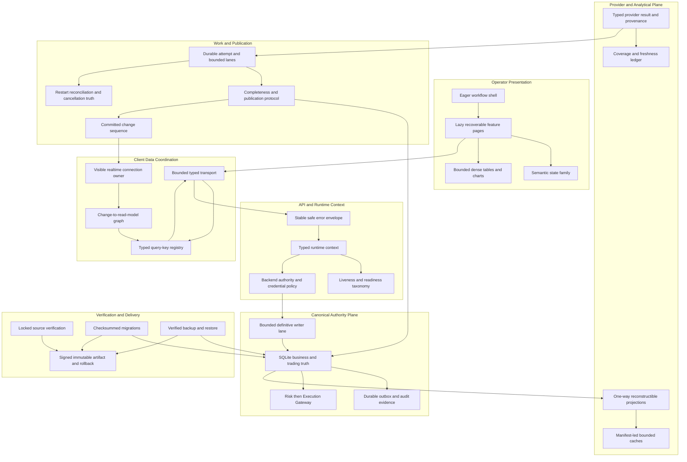
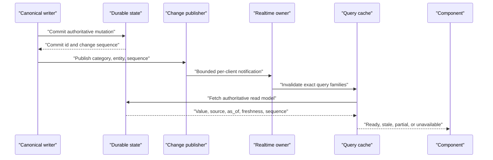
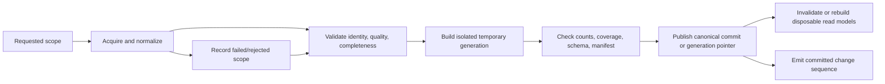

# Combined Architecture

## Objective

The combined architecture keeps Aletheia's authority boundaries intact while
adding the parts TickFlow handles especially well: analytical representations,
visible data coverage, bounded interactive work, and clear operator feedback.

It is a conceptual target, not approval for a broad refactor or new
infrastructure.

## System Shape



The arrows are deliberately directional. Analytical projections do not write
back into canonical authority. Realtime notification follows publication.
Frontend state does not authorize backend action. Release activation depends on
verification and recovery evidence.

## Contract 1: Presentation Truth

Every operator-facing component should render one of a finite set of backend-
grounded states:

| State | Meaning |
|---|---|
| loading | no prior value and an authoritative request is pending |
| refreshing | prior value remains visible while a refresh is pending |
| ready | response is valid under the consumer's freshness/completeness policy |
| empty | request succeeded and the valid scope legitimately contains no rows |
| partial | some requested scope is absent or rejected and is identified |
| stale | prior valid value remains but exceeded the decision/display threshold |
| unavailable | required source or computation failed; no acceptable value exists |
| not configured | capability could exist but owner configuration is absent |
| permission limited | system is capable/configured but actor lacks authority |
| degraded | feature remains usable with named limitation/fallback |
| failed | operation ended unsuccessfully with stable reason and recovery action |

These are not interchangeable copy variants. They control what conclusions the
operator may draw.

### Presentation invariants

- market direction and application status use separate semantic color planes;
- empty, partial, stale, and unavailable never share an unlabeled blank state;
- hidden columns or unmounted rows may remove optional I/O, never safety logic;
- chart refresh preserves viewport when identity is compatible;
- raw timestamps include source/as-of/freshness context where decision-relevant;
- every irreversible or authority-changing result comes from server-confirmed
  state;
- route chunk failure retains shell/navigation and offers recovery.

## Contract 2: Client Query and Change Identity

A typed query key is the client-side read-model identity. It includes every
parameter that can change the answer:

```text
domain + representation + exact instrument/scope + time range/as-of
+ source/provider policy + resolution + filters + computation version
```

The change graph maps committed backend categories to query families. It does
not use string prefixes as the sole cost or safety model.

### Realtime sequence



### Realtime invariants

- connection state and data freshness are separate;
- every connect performs initial catch-up or sequence reconciliation;
- missed/coalesced events are measurable;
- transient frames are not durable audit evidence;
- safety-relevant append events use durable ids/cursors when replay matters;
- one slow client cannot block all clients;
- rate-sensitive external queries are not invalidated by unrelated high-
  frequency events;
- REST/read-model response remains authoritative for derived state.

## Contract 3: Stable API Semantics

### Error envelope

```text
status
code
message
details
field_errors
retry_after
correlation_id
```

The backend decides status/code and sanitizes rejected input. The client keeps
machine identity in a typed `ApiError`; localization/presentation does not
flatten it into unstructured prose.

### Capability envelope

```text
capability: what provider/system can support
configuration: whether owner enabled and supplied required references
permission: whether this actor may invoke it
health: whether it works now
limits: batch, rate, history, subscription, resource constraints
observed_at and snapshot age
```

These axes must not collapse into `enabled`.

### Confirmation envelope

Authority-changing actions bind:

- named request type;
- explicit acknowledgement/confirm field;
- current expected state/version where relevant;
- server-derived actor/source;
- backend permission/risk gate;
- durable audit event;
- returned transition/result identity;
- inline safe failure and recovery.

The frontend can explain and construct confirmation. It cannot grant authority.

## Contract 4: Runtime Ownership and Readiness

A process runtime context owns stable services and task handles. Each lifecycle
component declares:

```text
name and owner runtime role
required dependencies
startup phase and budget
failure policy: fail | pause | degrade | retry
readiness facts produced
task/thread/process handle
shutdown order, cancellation, and timeout
```

### Readiness vocabulary

| Layer | Proof |
|---|---|
| alive | process and event loop respond |
| interface ready | API and dashboard assets available |
| canonical data ready | required migrations and authoritative store available |
| analytical data ready | named optional projection/cache generation ready |
| operation ready | startup behavior, permissions, risk, connectivity gates permit work |
| healthy/degraded | current incidents and limitations are classified |

One layer must not be inferred from another. Aletheia may expose the UI while
external systems are degraded only because authority-first pause/gates prevent
unsafe work.

### Shutdown order

```text
reject new work
  -> stop triggers/schedulers/producers
  -> request cancellation and await owned tasks within budget
  -> terminate isolated workers when required
  -> flush/close publishers, caches, providers, DB resources
  -> mark runtime session clean only after successful boundary completion
```

Every component gets a stop attempt even if another stop fails.

## Contract 5: Provider Semantics

A provider result is rows plus an outcome envelope:

```text
provider_id and physical venue
requested and actual instrument/market/timeframe
requested and obtained scope
source_as_of and observed_at
complete | partial | empty | failed | timed_out | unavailable
accepted and rejected rows with bounded reason counts
fallback reason and compatibility decision
rate/budget facts and retry guidance
```

### Provider invariants

- exact execution/protective consumers never accept silent venue, market-type,
  or timeframe substitution;
- observational UI/research fallbacks are explicitly labeled and consumer-
  authorized;
- malformed required identity/time/price is rejected or quarantined, not turned
  into silent null;
- provider reachability and data usability are separate;
- persistence success gates collector success when memory-only data is useless;
- capability snapshots retain last-known facts only with visible uncertainty;
- provenance survives cache and response identity;
- outbound destinations, credentials, redirects, response bytes, and parse work
  are policy-bound.

## Contract 6: Publication and Consistency

### Authority classes

| Class | Examples | Publication rule |
|---|---|---|
| canonical transactional | orders, approvals, fills, positions, outcomes | SQLite transaction and exact identity |
| canonical append evidence | hash-chained audit | stable id, process/OS lock, chain verification |
| reconstructible analytical | OHLCV mirror, feature partitions, matrices | staged generation, manifest/pointer last |
| convenience | UI preferences, display history | typed locked atomic file, bounded retention |

### Dataset publication protocol



### Publication invariants

- a non-empty frame does not authorize full replacement;
- previous known-good missing scope is retained on acquisition failure;
- unexplained coverage shrinkage is rejected;
- multi-file generation becomes visible through one final pointer/manifest;
- attempt, source, publication, and completion times are separate;
- progress traversal and terminal completeness are separate;
- cache failure after canonical commit degrades the read model, not business
  truth;
- secondary mirrors use durable outbox when completeness is promised;
- fsync strength follows authority and acknowledgement requirements.

## Contract 7: Analytical Representations

The analytical plane is introduced only for a measured consumer workload.

### Named representations

| Representation | Typical question | Shape |
|---|---|---|
| latest cross section | what is true across instruments now/as-of? | one row per exact instrument |
| live aggregate | what rolling values support interactive screening? | latest plus bounded history |
| session history | what happened over N actual closed sessions? | one instrument/time series |
| sparse event slice | what occurred on exact trigger dates? | selected partitions |
| broad panel | what are universe-wide features over time? | columnar partitions |
| dense matrix | what repeated vectorized backtest uses fixed axes? | read-only arrays/memmap |

### Analytical artifact manifest

```text
artifact and schema/computation/loader versions
source authority and committed watermark/generation
exact instruments, fields, resolution, provider/venue policy
coverage start/end and actual session axis
accepted/rejected counts and completeness
array/file layout, size, and checksum
build duration and producer runtime/commit
```

Missing or incompatible evidence makes the artifact a cache miss. Analytical
artifacts are discardable and never written back into trading authority.

## Contract 8: Background Work

### Work taxonomy

| Type | Ownership |
|---|---|
| finite durable mutation | durable attempt, writer permit, restart reconciliation |
| finite analytical process | server task id, bounded queue/process, resource metrics |
| periodic scheduler job | stable job definition plus durable attempt when consequential |
| continuous service | service health, lease/owner, heartbeat, stop/join |
| transient UI convenience | client state only; never authoritative completion |

### Attempt state

```text
accepted -> queued -> running -> terminal

terminal:
  succeeded
  partial
  failed
  cancelled_clean
  terminated
  interrupted_on_restart
  rejected_capacity
```

Timeout is a reason/state transition, not proof the execution body stopped.
Cancellation records request, acknowledgement, cooperative stop, forced
termination, writer release, and cleanup separately.

### Progress contract

- stage code and localized label;
- overall units only when total is meaningful;
- stage-local units;
- current scope/entity;
- bounded compacted log;
- rows/bytes/calls and publication id;
- partial/failed scope;
- terminal result independent of last progress value.

## Contract 9: Security and Extensions

### Credential contract

- one schema-level registry classifies every credential-bearing field;
- raw credential accepted only on write and never returned;
- reads expose configured/reference/last-four/rotation status;
- previews and agents cannot access production secrets unless explicitly
  authorized by a narrow capability;
- logs, errors, exports, support bundles, and URLs are redacted;
- destination origin is bound to credential use;
- file/keyring storage and deletion are atomic, permissioned, and observable.

### Extension contract

Declarative mappings remain observational. Executable extensions are immutable,
signed, isolated, versioned artifacts. AI/custom code receives:

- admission lint and interface validation;
- owner/agent authority check;
- source hash and immutable identity;
- credential-free environment;
- no network by default;
- restricted read-only inputs and output protocol;
- CPU, wall-time, memory, process, filesystem, and output limits;
- worker replacement after timeout/policy violation.

The core runtime never runs pip/npm install as an ordinary settings mutation.

## Contract 10: Engineering Assurance

### Source verification

- locked dependencies;
- pinned action/tool identities;
- lint/type/architecture/contract checks;
- critical backend/frontend tests;
- optimized-versus-authoritative equivalence;
- secret scan and targeted security checks;
- documentation governance.

### Release verification

```text
verified source SHA
  -> immutable dependency/toolchain identity
  -> final platform artifact and manifest
  -> hash, SBOM, provenance, platform signature
  -> isolated install/start/readiness
  -> supported-schema upgrade preflight
  -> backup/restore and failed-activation rollback proof
  -> publish exact tested digest
```

### Update and recovery

Aletheia's existing stronger chain remains the model:

- signed feed;
- download hash/size and safe extraction;
- immutable release manifest;
- consistent pre-update backup;
- candidate migration against a restored copy;
- config, SQLite, and audit validation;
- stable native-host activation;
- atomic release pointer;
- readiness/business health soak;
- automatic verified-backup rollback.

## Cross-Layer Identity Set

The architecture becomes traceable when each layer carries a small shared set
of non-secret identities:

```text
request_id
causation_id
run_id
publication_id or committed_change_sequence
runtime_session_id
producer_commit
schema/computation version
source/provider/instrument identity
artifact/release digest
```

Not every field belongs in every payload. The rule is that a support or recovery
path can follow a user-visible result back to its run, commit, source, runtime,
and release without using raw user content or credentials.

## Minimalism Boundary

This architecture does not require:

- replacing SQLite;
- adding Postgres, Redis, a vector database, or a data lake;
- moving all routes to dependency injection;
- generating types for every dynamic analytical endpoint;
- virtualizing every table;
- adopting every TickFlow library;
- implementing a generic plugin marketplace;
- running full regression suites during exploratory analysis.

Each mechanism enters only when it removes a proven semantic, operational, or
Alpha bottleneck while preserving the authority chain.
