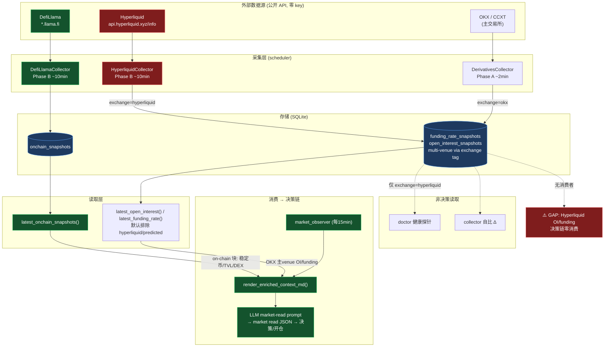

# 新数据源使用追溯 + 流程图 (2026-06-28)

> 目的：上线 Hyperliquid + DefiLlama 后，核实新数据是否**真被消化使用**（而非只躺在表里 collected-but-unused），逐源追溯实际消费路径，留档备查。
> 方法：grep 全仓消费者 + 查 SQLite agent 运行记录 + 直接跑消费代码路径用**当前真实数据**验证渲染输出。

---

## 0. 结论（一句话）

| 源 | 采集 | 存储 | **决策链消费** | 判定 |
|---|---|---|---|---|
| **DefiLlama on-chain** | ✅ | ✅ onchain_snapshots | ✅ **进 LLM market-read 上下文** | **真消化** |
| **Hyperliquid OI/funding** | ✅ | ✅ funding/OI 表(tag hyperliquid) | ❌ **决策链零消费**(仅 doctor 探活 + collector 自比) | **只存不用(gap)** |

---

## 1. DefiLlama on-chain —— 真被消化 ✅

**完整链路（代码 + 生产双证）**：
1. 采集：`scheduler.py:1572` Phase B(~10min) → `DefiLlamaCollector.collect()` 三路(stablecoin/TVL/DEX)。
2. 存储：写 `onchain_snapshots` 表（三类各等量、全活）。
3. 读取：`market_observer.py:181` `repo.latest_onchain_snapshots(limit=2)`。
4. 渲染：`market_observer.py:184` 传 `onchain=` → `context_builder.render_enriched_context_md()` 渲染 `### On-chain (DefiLlama)` 段。
5. 喂 LLM：`market_observer.py` 把 enriched 拼进 `context` → LLM market-read prompt（`user=...Market data...`）→ 输出 market read JSON → 进决策链。

**生产证据**：
- `market_observer` 每 15min 运行；上线后 12:34、12:49 两次 `completed`（onchain 已就绪），on-chain 块进了真实 LLM 读。
- 直接跑消费路径，用当前真实数据渲染出 LLM 实际会看到的内容：
  ```
  ### On-chain (DefiLlama)
  Stablecoin cap: $312.4B (+0.22% 24h)
  DeFi TVL: $70.6B
  DEX vol 24h: $4.34B (-47.0% 1d)
  ```

## 2. Hyperliquid OI/funding —— 只存不用 (gap) ⚠️

**链路在"存储"后断开**：
1. 采集：`scheduler.py:1572` Phase B → `HyperliquidCollector.collect()` OI/funding/预测funding。
2. 存储：写 `funding_rate_snapshots`/`open_interest_snapshots`，tag `exchange="hyperliquid"`/`"hyperliquid_predicted"`。
3. **读取层故意排除**：`latest_open_interest()`/`latest_funding_rate()` 默认 `_CROSS_VENUE_TAGS` 排除 hyperliquid（防止跨venue污染主信号——这是**正确的隔离**）。
4. **缺消费者**：全仓 grep 确认，除 ①collector 自比 delta(`hyperliquid.py:173` 显式 `exchange="hyperliquid"`) ②doctor 健康探针(`doctor.py:442`) 外，**决策链/LLM 无任何消费者读 hyperliquid 行**。

**根因**：集成时优先保证"不污染主交易所 per-symbol 信号"（已做对），但**跨venue 数据的专用消费端被推迟**，至今未建 → 数据采了、存了、却没进决策。

**闭环建议（任选其一，低风险增量）**：
- **A（推荐）**：在 `render_enriched_context_md` 加"跨venue资金费率对比"行——读 `latest_funding_rate(sym, exchange="hyperliquid")` 与主venue对比，揭示基差/情绪背离（Hyperliquid 永续 funding vs OKX）。
- **B**：把 Hyperliquid 聚合 OI 作为"全市场杠杆景气"宏观信号，折进 macro 块（类比 DefiLlama 做法）。
- **C**：暂不消费，但在 doctor 明确标注"采集中、未接入决策"，避免误以为已用。

---

## 3. 数据流流程图



**图例**：绿=真消化进决策；红=采集了但决策链未消费(gap)；蓝=存储。
实线=数据真流向决策；虚线=非决策读取(探活/自比)。

---

## 4. 备查要点

- DefiLlama 三路任一失败不影响其他两路（DL-C01 隔离），doctor `data.onchain` 探针报新鲜度。
- Hyperliquid 写入**故意被主 per-symbol 读排除**（venue 隔离，防污染）——这是 feature 不是 bug；缺的是专用跨venue消费端。
- 主交易所(OKX) OI/funding 经同样的 `latest_*` 默认读 → 正常进 LLM（与 Hyperliquid 形成对照：同表不同 tag，一个被消费一个被排除）。
- 复核命令：`grep -rn 'exchange="hyperliquid"' aletheia/`（确认消费者）；直接跑 `render_enriched_context_md(..., onchain=repo.latest_onchain_snapshots())` 验 on-chain 块。
