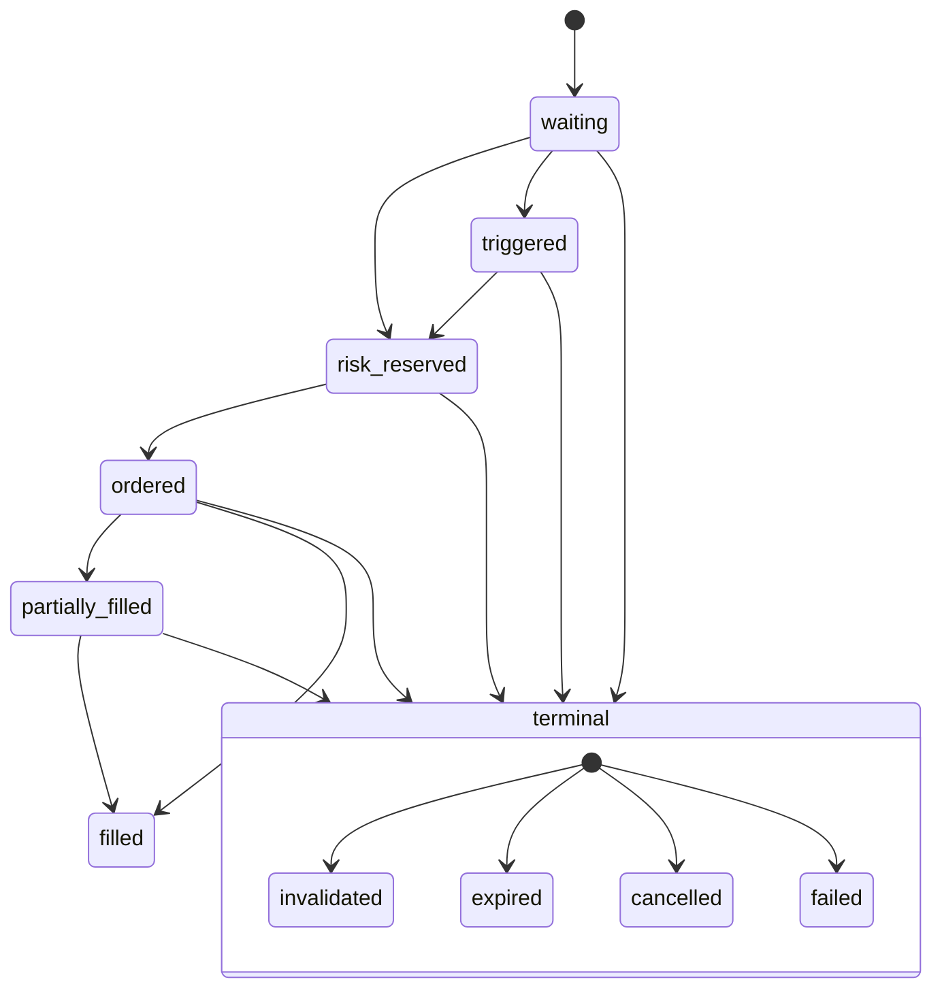
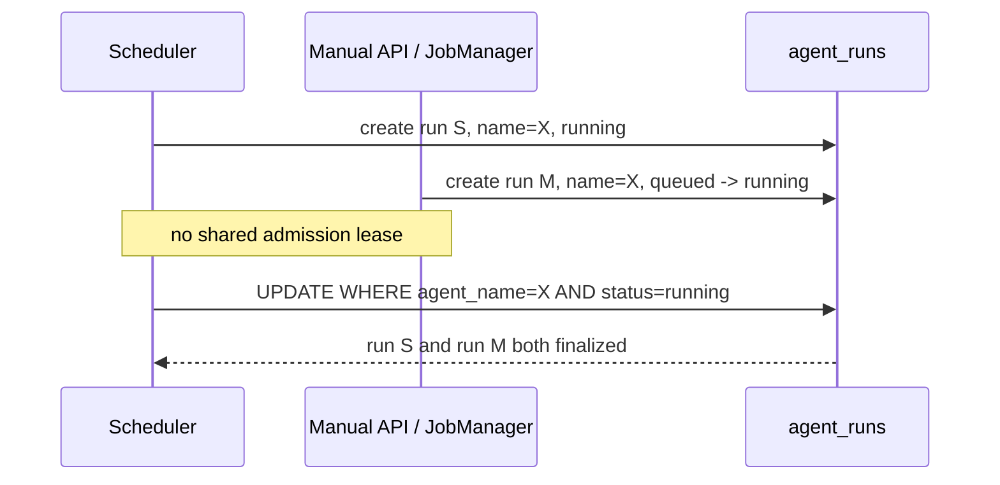
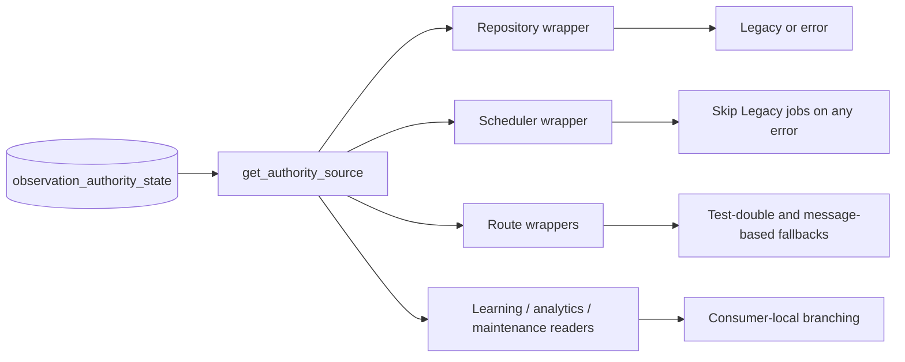
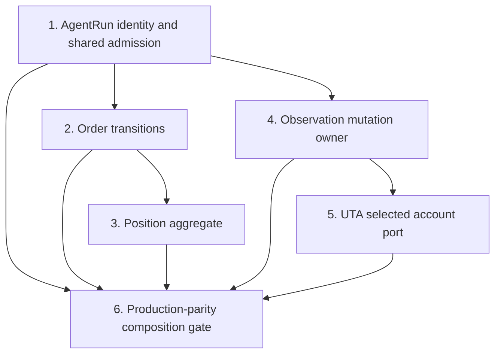

# Backend State, Authority, and Production-Parity Audit

**Audit date:** 2026-09-06

**Repository:** `iridyne/aletheia`

**Audited revision:** `4b821b258dcc26a3e5abe5e02bbeac53432c1969` (`origin/master`)

**Role:** evidence and repair contracts; not a mutable roadmap, progress tracker, or Runtime-health claim

**Scope:** backend state ownership, authority enforcement, and test/production semantic parity

**Mutation boundary:** documentation only; no application code, database, configuration, provider, or Runtime was changed

## Conclusion

The three reported concerns are different manifestations of one ownership defect:

> Aletheia persists lifecycle and authority facts, but several critical write paths do
> not have one code owner that is impossible to bypass.

The repository already contains the right local patterns: `EntryPlan` has a finite
status vocabulary, a legal-transition table, a database `CHECK`, and compare-and-set
(CAS); exchange acknowledgement has an aggregate transactional write; Observation Lab
has a canonical authority row; and selected behavior authority has an executable
consumer inventory. The problem is incomplete adoption, not the absence of a better
framework.

The highest-severity proven defect is the `AgentRun` lifecycle. The scheduler safety
net completes **every running row with the same `agent_name`**, while manual and
scheduled admission are independent and the manual de-duplication map is not
synchronized. A concurrent run can therefore be assigned another run's terminal
result. `Order` and `Position` have a wider structural exposure: their statuses are
free strings, their tables have no status `CHECK`, and generic `**kwargs` updaters are
called from many production modules. This is production-reachable, although this audit
did not execute a Runtime reproduction proving that an invalid Order or Position state
currently exists in a deployed database.

Authority has a canonical **fact source**, but not yet a singular **behavior owner**.
Observation authority is called from 25 production files, with wrappers that apply
different failure behavior. UTA selection is re-decided in Gateway, Risk, and account
projection code. Manual and scheduled Agent execution attach different `trigger_type`
metadata but do not share one admission lease. Those readers are not all wrong; the
defect is that mutation eligibility and fallback behavior are repeatedly decided at
consumer sites.

Testing is substantial but biased toward isolated semantic units. The default pytest
database uses an injected in-memory connection, a blueprint migration path, and a
different write route from production. The existing Golden Path proves an older
Opportunity-to-Position causal chain, while its Observer admission starts at a fixture
boundary and it does not exercise the current positive Candidate-to-EntryPlan chain.
There are targeted `real_db` and production-migration tests, but no small parity suite
that proves the critical differences together.

## Audit method and confidence

This audit used CodeGraph first for symbol/caller discovery, then verified every
reported claim against the fixed `origin/master` source. The dedicated audit worktree
does not carry the repository's local `.codegraph` index, so CodeGraph relationships
were read from the indexed main checkout and line evidence was re-read from the pinned
worktree. Repository searches were then used to count production writer and authority
surfaces.

No test, service, migration, provider call, or live-trading action was run. Therefore:

- **Proven defect** means deterministic code behavior establishes the failure without
  needing environment-dependent evidence.
- **Production-reachable structural risk** means an active production caller can reach
  a weak boundary, but this audit did not prove a deployed bad row or incident.
- **Test gap** means the claimed production composition is not directly exercised; it
  does not mean the underlying behavior is necessarily broken.

> 🧠 **From Hindsight memory (Component map)** — Earlier repository mapping identified the same concentration points in `storage/repositories.py` and `agent_runtime/scheduler.py`, plus the split between generic mutation helpers and newer lifecycle-specific APIs. This audit re-verified those observations against `4b821b258` rather than treating memory as current truth.

## Severity-ranked findings

| Severity | Finding | Classification | Real production path |
|---|---|---|---|
| **P1** | Scheduler completion is keyed by `agent_name`, not `run_id`, so one timed-out/completed job can terminate another overlapping run. | Proven defect | Yes: scheduled jobs call `_run_async_with_timeout`; `run_agent` persists AgentRun rows. |
| **P1** | Manual Agent admission uses an unsynchronized process-local map, and scheduled execution bypasses that admission owner entirely. | Proven race plus ownership gap | Yes: `/agent-runs/start`, prediction refresh, and Scheduler are active entry points. |
| **P1** | `Order` and `Position` lifecycle mutation remains available through untyped `**kwargs`; statuses are unconstrained strings without DB status checks. | Production-reachable structural risk | Yes: brokers, Gateway, reconciliation, materialization, PnL, protection, and maintenance call these functions. |
| **P2** | Observation authority is canonical in storage but enforcement/failure semantics are repeated across consumers. | Production-reachable ownership gap | Yes: scheduler, storage, learning, analytics, routes, maintenance, and Universe read it. |
| **P2** | UTA/legacy selection is a configuration value repeatedly interpreted by Gateway, Risk, and account-state projections instead of one selected port. | Production-reachable ownership gap | Yes: close mutation, balance/equity reads, qualification, and cache identity. |
| **P2** | Default pytest migration and SQLite write semantics differ from production, while positive Candidate-to-EntryPlan composition has no equivalent Golden Path. | Test evidence gap | Tests only; it weakens confidence in production claims. |
| **P3** | The primary CI command collects all tests but does not generate/enforce the existing trust-boundary coverage data. | CI policy gap | CI path, not Runtime. |

## 1. State is persisted, but lifecycle ownership is partial

### 1.1 What a real state boundary requires

A status column becomes a state machine only when all five conditions hold:

1. valid states are finite at the model and database boundary;
2. legal transitions are explicit;
3. every transition is scoped to immutable identity and expected current state;
4. coupled side effects are committed atomically;
5. generic update access cannot bypass the owner.

`EntryPlan` currently demonstrates all five most clearly. Its Pydantic model uses a
`Literal`, migration DDL has a `CHECK`, `ENTRY_PLAN_TRANSITIONS` declares the graph,
and `transition_entry_plan()` rejects illegal edges and updates with
`WHERE id=? AND status=?`. Terminal states have no successors.



Evidence: [`EntryPlanRecord.status`](../../../aletheia/storage/models.py#L1830),
[`ENTRY_PLAN_TRANSITIONS`](../../../aletheia/trading/entry_plan.py#L24),
[`transition_entry_plan`](../../../aletheia/storage/repositories.py#L11032), and
[`entry_plans_v66` DDL](../../../aletheia/storage/migrations.py#L3475).

### 1.2 Critical-entity ownership inventory

| Entity | Current lifecycle protection | Bypass / gap | Verdict |
|---|---|---|---|
| `AgentRun` | `run_logger` centralizes normal create/begin/end behavior. | `status: str`; no DB `CHECK`; `update_agent_run(run_id, **kwargs)` accepts any fields; scheduler performs a separate multi-row update by name; no expected-state CAS. | **P1: incomplete state machine with a proven identity bug.** |
| `EntryPlan` | `Literal`, DB `CHECK`, legal transition table, CAS, terminal monotonicity. | `update_order()` reads plan state and then attempts a second transition after the Order write; the two entity writes are not one aggregate transaction in this generic path. | **Reference pattern, with one remaining cross-aggregate atomicity seam.** |
| `Order` | Insert validates native authority; `finalize_exchange_acknowledgement()` uses an immediate transaction and expected status set. | `status: str`; no DB status `CHECK`; generic updater is used by Gateway, three brokers, materialization, reconciliation, paper broker, and outcome closure. It also owns an EntryPlan side effect. | **P1 structural risk: multiple lifecycle writers.** |
| `Position` | Verified close, administrative close, protection and exchange acknowledgement have specialized functions for some transitions. | `status: str`; no DB status `CHECK`; `update_position(pid, **kwargs)` validates neither keys nor transition; 53 production call sites span 20 files. | **P1 structural risk: aggregate ownership is fragmented.** |
| `TradeProposal` | Insert-time native authority and immutable hash/provenance checks protect creation. | `status: str`; historical compatibility fields remain; status lifecycle is not expressed as one CAS transition API. | **P2: narrower exposure, still not a closed lifecycle.** |
| `RiskDecision` | Mostly append-only evidence; authoritative/preflight role is explicit. | `decision_role` and related vocabularies are strings rather than closed DB values. | **P2: protect as immutable evidence, not by inventing a mutable state machine.** |
| `Fill` | Append-oriented execution evidence with hashes and provenance. | No status lifecycle exists and none is needed. | **No state-machine work required.** |

This classification prevents a blanket “turn every model into a state machine” rewrite.
`RiskDecision` and `Fill` should remain immutable facts; only entities with real
lifecycle transitions need transition owners.

### 1.3 Proven `AgentRun` corruption path

The normal lifecycle writes one run by `run.id`. The scheduler safety net instead runs:

```sql
UPDATE agent_runs
SET status = ?, ended_at = datetime('now')
WHERE agent_name = ? AND status = 'running'
```

`_run_async_with_timeout("prediction_observer", ...)`, for example, supplies an Agent
name as `job_id`. If a manual `prediction_observer` run overlaps the scheduled one,
both rows match. Completion or timeout of one invocation can finalize both rows with
the same outcome. The exception handler logs only at debug level, so a failure of this
safety write can also leave the intended ghost row unresolved.



Evidence: [`_ensure_agent_run_ended`](../../../aletheia/agent_runtime/scheduler.py#L705),
[`_run_async_with_timeout`](../../../aletheia/agent_runtime/scheduler.py#L728),
[`run_logger.end_run`](../../../aletheia/agent_runtime/run_logger.py#L101), and
[`update_agent_run`](../../../aletheia/storage/repositories.py#L709).

### 1.4 Manual de-duplication is not an authority boundary

`AgentJobManager.enqueue()` checks `_pending_agents`, durably creates a queued row,
enqueues it, and only then adds the map entry. These actions do not share a lock. The
worker and `stop()` rebuild the same map concurrently. Two request threads can both see
no entry and enqueue the same Agent; the later assignment can overwrite the first
run ID. Existing tests cover a normal queue, queue capacity, and route-level duplicate
behavior, but do not race simultaneous enqueue calls.

Even a lock around this dictionary would solve only same-process manual clicks.
Scheduler execution calls `run_agent()` directly and does not consult the manager, so
the minimal complete ownership boundary must be shared by both trigger types and, if
multiple gateway processes are possible, enforced by SQLite rather than only Python
memory.

Evidence: [`AgentJobManager.enqueue`](../../../aletheia/agent_runtime/job_queue.py#L87),
[`AgentJobManager._worker_main`](../../../aletheia/agent_runtime/job_queue.py#L132),
[`_async_run`](../../../aletheia/agent_runtime/scheduler.py#L4457),
[`/agent-runs/start`](../../../aletheia/server/routes/data.py#L432), and
[`test_agent_job_queue.py`](../../../tests/test_agent_job_queue.py#L1).

A related symptom confirms the cost of multiple manual entry points: the general route
maps `AgentJobAlreadyQueued` to HTTP 409, but the prediction-specific route does not
import or catch it. A duplicate refresh can therefore escape as an unhandled server
error instead of the declared “refresh in progress” response.

Evidence: [`data.start_agent_run`](../../../aletheia/server/routes/data.py#L432) versus
[`prediction.trigger_prediction_refresh`](../../../aletheia/server/routes/prediction.py#L225).

### 1.5 Generic update APIs convert schema flexibility into lifecycle authority

`_update()` builds column assignments directly from dictionary keys and updates by ID.
`update_order()` and `update_position()` expose it without a field allowlist, typed
command, expected status, or row-count contract. At the audited revision:

- `update_position()` has 51 production call expressions across 19 files;
- `update_order()` has 34 production call expressions across 9 files;
- `transition_entry_plan()` has 15 production call expressions across 6 files.

The counts are not themselves bugs. They prove that lifecycle ownership is distributed:
the blast radius cannot be fixed reliably by adding guards to whichever broker happens
to expose the next incident.

The strongest existing Order pattern is
`finalize_exchange_acknowledgement()`: it opens an immediate transaction, confirms
Order/Position identity, checks the expected current Order state, and updates the
coupled close claim atomically. The fix should expand this command style and shrink the
generic updater, not introduce a generic state-machine framework.

Evidence: [`_update`](../../../aletheia/storage/repositories.py#L339),
[`update_order`](../../../aletheia/storage/repositories.py#L3297),
[`finalize_exchange_acknowledgement`](../../../aletheia/storage/repositories.py#L3325),
and [`update_position`](../../../aletheia/storage/repositories.py#L3732).

## 2. Authority is a fact source, not yet code ownership

### 2.1 Three different concepts are currently mixed

| Concept | Required meaning | Current symptom |
|---|---|---|
| Authority fact | Which implementation owns a capability for this epoch/account/run? | Usually persisted correctly (`lab/legacy`, UTA boundary, trigger type). |
| Authority decision | May this exact command mutate now, and through which owner? | Recomputed in multiple consumers with different fallback behavior. |
| Read projection | Which historical/current rows should a UI, Risk check, or report read? | Often legitimately repeated, but sometimes also selects behavior or fallback. |

The goal is not to reduce every `get_authority_source()` call to one call. Read-only
projections may need the authority fact. The goal is to make it impossible for those
readers to become independent mutation selectors.

### 2.2 Observation Lab / Legacy

`get_authority_source()` is a canonical, validated read of one database row and epoch.
It has 32 production call expressions across 25 files. At least three local wrappers demonstrate semantic
drift:

- repository reads return Legacy for missing table/file but raise a specialized error
  for other invalid state;
- scheduler startup catches every exception and treats Lab as owner (fail closed
  against running the Legacy jobs);
- analytics/settings route wrappers return Legacy for selected test-double failures
  and infer Lab from exception message text for other failures.

Those behaviors may each have a local rationale, but they are not one enforceable
contract. A new consumer can choose a fourth interpretation. The scheduler also has a
second inline Lab check later in the module, separate from its startup wrapper.



The safe target is one **mutation port** for the experiment cycle. Scheduler and owner
actions call that port; it resolves the authority once and dispatches to Lab or an
explicitly retained Legacy owner. Read models may continue to read the canonical fact,
but they cannot directly run evaluation, lifecycle, promotion, or owner-action writes.
After cutover evidence shows no Legacy writer is needed, delete the Legacy mutation
port and retain only historical decoding where required.

Evidence: [`get_authority_source`](../../../aletheia/observation_lab/canonical.py#L919),
[`repositories._canonical_lab_authority`](../../../aletheia/storage/repositories.py#L80),
[`scheduler._observation_lab_owns_experiment_cycle`](../../../aletheia/agent_runtime/scheduler.py#L1202),
[`analytics._lab_experiment_authority`](../../../aletheia/server/routes/analytics.py#L33),
and [`settings._lab_experiment_authority`](../../../aletheia/server/routes/settings.py#L1309).

### 2.3 UTA / legacy broker

`ExchangeConfig.uta_read_boundary_for()` correctly defaults an unqualified account to
`legacy`. The ownership leak occurs after that fact is read:

- Gateway independently decides whether close mutation uses qualified UTA;
- Risk independently decides whether available balance/equity comes from the legacy
  Bitget cache or unified state;
- `exchange_sync` independently selects the default projection and validates cache
  boundary identity;
- qualification independently checks whether the exact mode is `uta_v1`.

This makes one account's behavior the product of several synchronized conditionals.
Changing the boundary value does not itself prove every consumer switched together.

The smallest durable replacement is an existing-codebase style selected account port:
one resolver returns the qualified read/mutation implementation for an exact
`execution_mode` and account generation. Gateway, Risk, and reconciliation consume that
selected port; they do not interpret `legacy/shadow_read/uta_v1` themselves. Read-only
shadow comparison remains separate and carries no mutation methods.

Evidence: [`uta_read_boundary_for`](../../../aletheia/config/schema.py#L339),
[`gateway._qualified_uta_mutation_selected`](../../../aletheia/execution/gateway.py#L900),
[`risk.engine`](../../../aletheia/risk/engine.py#L779),
[`exchange_sync.get_cached_state`](../../../aletheia/portfolio/exchange_sync.py#L159), and
[`require_uta_mutation_qualification`](../../../aletheia/trust/uta_qualification.py#L1).

### 2.4 Scheduled / manual is provenance, not admission authority

`trigger_type` records who initiated a run, but it does not grant a mutually exclusive
lease. Manual requests go through `AgentJobManager`; scheduled requests call
`run_agent()` through scheduler-owned timeout workers. This split causes both the
AgentRun corruption path and inconsistent route behavior.

The target is one durable `claim_agent_run(agent_name, trigger_type, ...)` command with
a database-enforced unique active claim and CAS completion by `run_id`. The manual queue
may remain a delivery mechanism and scheduler timeout workers may remain execution
mechanisms; neither is the lifecycle authority. This uses SQLite, already the durable
coordination owner, and avoids a new distributed job framework.

## 3. Tests prove components more often than production composition

### 3.1 Exact semantic differences

| Boundary | Default pytest path | Production path | What existing evidence proves | Missing proof |
|---|---|---|---|---|
| Fresh migration | Clones an in-memory blueprint; preserves Legacy experiment tables unless explicitly requested. | Detects a fresh Lab install, sets Lab authority, and retires Legacy experiment tables. | A dedicated `real_db` test explicitly clears `PYTEST_CURRENT_TEST` and proves fresh-production retirement. | Ordinary business tests do not run on the same resulting schema/authority topology. |
| SQLite writes | Autouse fixture injects one `:memory:` connection; `run_write()` bypasses the writer lane and executes under the process lock on that exact connection. | `run_write()` submits to the process-owned `_SQLiteWriterLane`, with thread-local connections and file locking. | Selected `real_db` tests cover WAL/lock cases. | Most state/route tests do not exercise queue admission, writer thread handoff, connection lifetime, or cross-process lock semantics. |
| Agent concurrency | Job queue tests drive orderly single-threaded enqueue/capacity behavior; route tests prove sequential duplicate 409. | Uvicorn request threads, manual worker, scheduler timeout workers, and shutdown cleanup can overlap. | Individual managers and scheduler workers have tests. | No simultaneous same-Agent manual/manual and manual/scheduled claim test against a real DB. |
| Current Candidate planning | Unit suites deeply exercise Candidate generations, claims, leases, planning, EntryPlan compilation, and transitions. | Universe publication, planner scheduling/wakeup, provider boundary, persistence, and EntryPlan activation compose dynamically. | `test_pipeline_universe_to_operator` proves the real producer can correctly stop before planning when monitoring is unavailable. | No positive real-producer Candidate -> claimed generation -> compiled EntryPlan -> active execution monitor chain. |
| Golden Path | Uses deterministic public/LLM boundaries, but starts Observer admission with `admit_observer_instrument()` and proves the older Opportunity -> PI decision -> Proposal -> Order/Position path. | Current architecture adds Universe Candidate planning and EntryPlan lifecycle before execution. | Strong causal integrity for the covered older chain. | It cannot prove Candidate generation or EntryPlan production scheduling merely because downstream execution passes. |
| Coverage gate | `.coveragerc` defines ten trust-boundary modules and `coverage_floors.py` can enforce them. | N/A | The primary CI runs all pytest files in batches. | The workflow invokes pytest without `--cov` and does not call `coverage_floors.py`; current floors are not enforced there. |

Evidence: [`_apply_production_migrations`](../../../aletheia/storage/migrations.py#L8220),
[`_apply_pytest_migrations`](../../../aletheia/storage/migrations.py#L8340),
[`run_write`](../../../aletheia/storage/sqlite.py#L549),
[`tests/conftest.py`](../../../tests/conftest.py#L523),
[`test_fresh_production_schema_retires_legacy_experiment_tables`](../../../tests/test_migration_fast_path.py#L78),
[`test_active_mainline_golden_path`](../../../tests/e2e/test_active_mainline_golden_path.py#L28),
[`test_pipeline_universe_to_operator`](../../../tests/e2e/test_pipeline_universe_to_operator.py#L1),
and [`.github/workflows/ci.yml`](../../../.github/workflows/ci.yml#L48).

### 3.2 Why test count did not prevent this

The tests are generally aligned with function ownership as implemented: repository
helpers, route branches, planner leases, migration fast paths, and individual execution
components. The production failure modes cross those seams:

- one scheduler invocation changes rows owned by another invocation;
- one authority value is interpreted independently by multiple consumers;
- one injected connection eliminates the writer topology being relied upon;
- one Golden Path begins after the producer boundary currently under development.

Adding more examples to the same unit suites will not close those gaps. The missing
tests are a small number of **composition contracts**, not a global coverage target or
real-provider test suite.

## 4. Root-cause analysis

### Verified historical facts

Git history shows that `update_agent_run()`, `update_order()`, and `update_position()`
were introduced together as generic one-line repository helpers on 2026-06-03. The
AgentRun scheduler safety net was added on 2026-06-17. EntryPlan's legal transition and
CAS owner arrived later, on 2026-08-27. Current repository history then shows frequent
September additions for Candidate, Entry, authority cutover, persistence, and recovery.

At the audited revision, the central files have grown to:

| Module | Lines | Why it matters |
|---|---:|---|
| `storage/repositories.py` | 14,605 | Generic CRUD, lifecycle commands, authority projections, and many aggregates coexist. |
| `storage/migrations.py` | 8,407 | Fresh install, historical upgrade, pytest blueprint, and compatibility retirement coexist. |
| `agent_runtime/scheduler.py` | 5,168 | Scheduling, timeout workers, lifecycle recovery, and authority gating coexist. |
| `execution/gateway.py` | 2,431 | Execution routing, UTA selection, plan transitions, and mutation coordination coexist. |

### Inference supported by those facts

The core cause is **additive hardening without subtractive cutover**:

1. Generic storage APIs optimized the first implementation for speed and flexibility.
2. Incidents and new safety requirements added local guards, aggregate commands, CAS,
   authority fields, and compatibility branches.
3. Old mutation APIs and old decision sites remained callable to protect tests and
   historical paths.
4. New features therefore added another correct route without making it the only route.
5. Tests followed the resulting component seams and used faster injected infrastructure,
   so they verified local rules more strongly than ownership exclusivity.

This is not primarily caused by Python, SQLite, insufficient typing, or insufficient
test quantity. Those are amplifiers. The causal policy failure is that a feature is
considered complete when its new path works, without also requiring an inventory and
retirement of every older writer/selector for the same semantic capability.

## 5. Repair contracts in minimum dependency order

These are evidence-derived contracts for future Issues. GitHub Issues/PRs must own
assignment and progress; this audit must not be edited into a checklist.

### Contract 1 — AgentRun identity and admission

**Problem:** completion is not scoped to run identity and all trigger types do not share
one active claim.

**Required invariant:** for a given active-claim key, at most one queued/running AgentRun
exists; only a command carrying that exact `run_id` and expected current status can
begin or finish it.

**Smallest repair:** add finite AgentRun statuses plus a database `CHECK`; replace
generic lifecycle writes with `queue`, `claim`, and `finish` commands using CAS; enforce
one active claim in SQLite; route both scheduler and manual admission through it; delete
the name-scoped scheduler update. Keep the existing manual queue and timeout workers as
delivery/execution mechanisms.

**Verification:** one real-file SQLite test races two manual claims; one races manual
against scheduled claim; exactly one wins, the loser receives the existing run ID, and
completion of either ID cannot change the other row. Add restart recovery for an
expired claim without allowing a terminal row to revive.

**Failure/rollback signal:** duplicate active rows, a completion rowcount other than
one, or a terminal-to-active transition fails closed and is surfaced; rollback retains
the old read schema but must not restore name-scoped writes.

### Contract 2 — Order transition ownership

**Problem:** multiple modules write arbitrary Order status and `update_order()` also
drives EntryPlan lifecycle outside one aggregate transaction.

**Required invariant:** every Order status transition is legal, expected-state CAS, and
atomically updates any coupled EntryPlan/Position claim.

**Smallest repair:** inventory current status values from production callers and stored
data; add the closed vocabulary and DB `CHECK`; move each real transition into the
smallest existing aggregate command (`finalize_exchange_acknowledgement`, fill
materialization, cancellation, recovery); restrict the remaining generic updater to
non-lifecycle metadata, then remove it when callers reach zero. Do not build a generic
state-machine library.

**Verification:** table-driven legal/illegal transitions plus real-DB races for fill vs
cancel and acknowledgement vs private materialization. Assert Order, EntryPlan, and
Position are all old or all new after injected failure.

**Failure/rollback signal:** any direct production `UPDATE orders SET status`, any
status-bearing call to generic `update_order`, or a partial aggregate write blocks
closure.

### Contract 3 — Position aggregate ownership

**Problem:** Position lifecycle and protection/accounting metadata are mutated through
one unrestricted dictionary API from many domains.

**Required invariant:** only explicit commands may open, claim close, verify close,
administratively close, reconcile, or update protection; status and coupled accounting
fields cannot be changed independently.

**Smallest repair:** preserve existing specialized functions
(`close_position_verified`, administrative close, protection functions, settlement,
exchange acknowledgement); migrate status-bearing and claim-bearing callers into those
owners; introduce only the missing named command; field-allowlist harmless mark/telemetry
updates; then remove generic `update_position` from production imports.

**Verification:** static caller inventory is empty for generic lifecycle fields; focused
real-DB tests race protection, manual close, reconciliation, and delayed exchange fill;
accounting/provenance invariants remain atomic.

**Failure/rollback signal:** a Position can become `closed` without verified or explicit
administrative evidence, or a pending-close claim can be overwritten by another owner.

### Contract 4 — Observation experiment mutation owner

**Problem:** one authority row is interpreted at many behavior-changing sites with
different failure semantics.

**Required invariant:** exactly one selected owner can mutate experiment lifecycle for
one authority epoch; unreadable/invalid authority permits no Legacy mutation.

**Smallest repair:** retain `get_authority_source()` as the fact reader; add one narrow
experiment-cycle command port that resolves authority and dispatches the mutation;
route scheduler and owner actions through it; convert other consumers to read-only
projections; remove route-local authority wrappers. Once no supported installation
needs Legacy writes, delete the Legacy mutation implementation and its tables through
the existing retirement migration.

**Verification:** reuse the `behavior_authority` spec pattern: an executable inventory
names every mutation consumer and asserts each calls the owner. Run the same contract
for Lab, Legacy, missing, invalid, and epoch-change states on the production migration
path.

**Failure/rollback signal:** any module outside the owner calls a Legacy/Lab lifecycle
writer directly, or two owners can mutate the same epoch.

### Contract 5 — UTA selected account port

**Problem:** consumers independently interpret the rollout boundary and can select
different account implementations.

**Required invariant:** an exact `(execution_mode, account_generation)` resolves to one
qualified read/mutation owner; shadow readers cannot mutate; unqualified mutation fails
closed.

**Smallest repair:** centralize the existing qualification and registry lookup into one
selected account port; pass that result to Gateway, Risk, reconciliation, and account
reads; remove consumer-local `uta_read_boundary_for()` behavior branches. Preserve the
Legacy adapter only for explicitly uncut-over modes.

**Verification:** a matrix over every execution mode/boundary/generation asserts that
balance, equity, positions, and close dispatch select the same owner. A stale generation
must fail before any mutation.

**Failure/rollback signal:** different consumers select different owners for the same
identity, or a shadow/legacy fallback performs an unqualified UTA mutation.

### Contract 6 — Production-parity composition gate

**Problem:** critical infrastructure differences and the current positive planning
chain are not proved together.

**Required invariant:** a small deterministic suite runs production migration and
writer semantics and proves the current active ownership seams, without real credentials
or nondeterministic model/network calls.

**Smallest repair:** add one parity marker/lane containing only:

1. fresh install and representative upgrade schema/authority assertions;
2. real-file writer-lane concurrency for AgentRun and lifecycle aggregates;
3. positive public-fixture Universe Candidate -> planning claim -> compiled EntryPlan
   -> active monitor handoff;
4. authority-owner matrices for Observation and UTA;
5. the existing downstream Golden Path, unchanged, for the older causal chain it
   honestly proves.

Do not convert the entire test suite to disk, call real exchanges/models, or add a
repo-wide coverage percentage. Wire the already-defined trust-boundary coverage command
only if its ten-module scope still matches current authority owners; otherwise update
that explicit list first.

**Verification:** CI runs the parity lane on the same Linux runner and fails if any test
uses the pytest blueprint, injected `:memory:` writer bypass, or hand-inserts the
Candidate/EntryPlan under proof.

**Failure/rollback signal:** the parity lane becomes flaky, uses credentials, duplicates
the full suite, or proves only a seeded downstream object. Quarantine the flaky external
fixture, not the production semantic assertions.

## 6. Why this order is minimal



AgentRun goes first because it is a deterministic production-reachable corruption bug
and creates the smallest reusable CAS/admission proof. Order precedes Position because
Order/fill acknowledgement initiates or resolves many Position transitions. Authority
work follows after lifecycle commands exist; otherwise centralizing authority merely
centralizes access to unsafe generic writers. The parity lane lands with each repair's
tests but becomes a required combined gate only after the owners are explicit.

## 7. Completion criteria

The three audit concerns are removed only when all of the following are true:

- AgentRun, Order, EntryPlan, and Position lifecycle states have closed vocabularies at
  model and database boundaries.
- Every terminal transition is identity-scoped CAS; zero/multiple-row outcomes are
  visible failures, never silent success.
- No production caller can write lifecycle fields through generic `**kwargs` APIs.
- Coupled Order/EntryPlan/Position mutations are aggregate transactions.
- Scheduled/manual provenance does not create separate admission owners.
- Observation and UTA each have one mutation selector; all other authority consumers
  are read-only projections.
- Legacy writers have explicit supported-installation evidence or are deleted; comments
  such as “legacy compatibility” alone do not justify indefinite retention.
- A Linux CI parity lane proves fresh install, representative upgrade, real writer
  topology, concurrency, and the positive Candidate-to-EntryPlan chain.
- Ownership is guarded by executable consumer inventories, not by a global coverage
  target or a convention in prose.

## 8. Explicit non-goals

- No generic workflow/state-machine framework.
- No rewrite or mechanical split of the 14,605-line repository module before ownership
  edges are closed.
- No blanket replacement of every `str` or `Any`.
- No conversion of append-only facts such as Fill into mutable state machines.
- No all-tests-on-disk migration.
- No real LLM/exchange calls in CI.
- No simultaneous Candidate/Entry strategy redesign; this audit concerns ownership and
  proof, not trading Alpha.

## 9. Implementation disposition

Contracts 1–6 have now been implemented on the audit branch in the dependency order
above. The local evidence gate is the credential-free `production_parity` suite: it
uses production migrations, a real SQLite file and writer lock, owner-selection
matrices, and a public-fixture Candidate that reaches a compiled EntryPlan and active
monitor without direct Candidate/EntryPlan insertion. The same explicit suite and the
fourteen-module trust-boundary coverage floors are wired into the Linux full-CI job.

The older frozen Golden Path file remains byte-for-byte unchanged. It is not counted as
new proof because its Observer-output assertion already fails on the frozen base SHA;
silently marking a pre-existing red test as the new parity gate would make CI knowingly
red. The new positive chain covers the previously missing Candidate-to-monitor segment,
while the old failure remains separately attributable debt. Remote Linux CI is still
required before claiming merge or deployment qualification.
