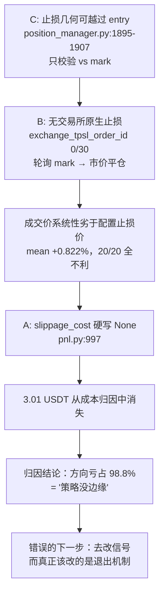

# 06 · 执行链缺口研究报告

> **历史结论更正提示（2026-09-28 后续复核）**：本文保留原始小样本研究。后续 [#3621 更正](https://github.com/iridyne/aletheia/issues/3621#issuecomment-5864551306) 证明扩展的 446 笔中 94% 是归档 paper_internal，不能代表当前 Demo；“去掉止损亏损即可盈利”已撤回。实际 Fill 已含滑点，新增诊断滑点不得重复从净 PnL 扣除。原生 TPSL 已有配置/capability gate，不能仅凭空挂单 ID 判为完全未实现。本文的损耗外推、优先级及自动启用建议不得直接执行；当前判断见 [全项目收敛与最小盈利循环](project_convergence_direction.md)。

> 研究日期：2026-09-28
> 运行态基线：Fedora gateway `http://10.2.2.66:8787`（只读 GET），`execution_mode = bitget_demo`
> 代码基线：`master@6525cee5a`（worktree 实测 HEAD `5426e5222`）
> 对照：R20/AstraQuant `642701c4`（v8.4.0）+ 其公开台账 `https://www.r20.cn/history`（浏览器渲染实测）
> **性质：分析与汇报，不含代码改动。** 修复设计写在本文第 6 节，供未来实施时直接取用。
> 关联 issue：#3618（滑点不记账）· #3619（无交易所原生止损）· #3620（止损几何越过 entry）· 汇总 issue 见文末

---

## 1. 一句话结论

**"我们的策略没有边缘"这个诊断，有 57% 是一个记账缺陷制造出来的假象。**

demo 盘 24 笔合格样本实亏 **−5.2666 USDT**。天真归因说成本只占 1.2%、方向占 98.8%。但把 20 笔止损平仓按"恰好在自己配置的止损价成交"重算：

| 口径 | 毛盈亏 |
|---|---:|
| 实际成交（20 笔止损） | **−7.9502** |
| 若各自在配置止损价成交 | **−4.9409** |
| **差额 = 纯止损滑价** | **3.0093 USDT** |

**3.01 USDT ≈ 合格样本总亏损的 57.1%，是执行损耗，不是方向判断错误。**

而这笔钱在 `/api/analytics/cost-summary` 里查不到，因为 `core/aletheia/portfolio/pnl.py:997` 每次平仓无条件写 `"slippage_cost": None`。**成本归因说"成本只占 1.2%"，是因为最大的那项成本被代码定义为不可观测。**

---

## 2. 执行链的三个缺陷（互相掩盖）

三者构成一个闭环：止损没有交易所挂单 → 成交价系统性劣于配置价 → 而这个差额永不记账 → 于是只剩"方向亏"这一个可见解释。

| # | 缺陷 | 类别 | 证据 | 对 −5.27 的影响 |
|---|---|---|---|---|
| A | 平仓 `slippage_cost` 硬写 `None` | 实现缺陷 | `portfolio/pnl.py:997` | 不直接亏钱，但使 **3.01 USDT 不可见** |
| B | 止损非交易所原生，靠本地轮询 mark 后市价平仓 | 设计选择（代价未计量） | `exchange_tpsl_order_id` **0/30** 为空；`price_feed.py` 容忍 90s 内存 / 120s DB 陈旧度 | **−3.01 USDT（57.1%）** |
| C | 止损几何可越过 entry（3 笔 LTC short 的 stop 在 entry 下方） | 实现缺陷 | `position_manager.py:1895-1907` 只校验 stop vs `mark`，不校验 vs `entry_price` | −0.42 USDT，且其中一笔在 entry 之上 3.1%（75.31）才"止损" |

### 2.1 缺陷 A：滑点被定义为不可观测

`core/aletheia/portfolio/pnl.py:985-1005` 的 `update_fields`：

```python
update_fields = {
    "status": "closed",
    "unrealized_pnl": 0.0,
    ...
    "slippage_cost": None,        # ← 无条件，从不计算
    ...
}
```

后果（`/api/analytics/cost-summary` 实测）：

```
missing_cost_counts.slippage_cost = 24      ← 24 笔全部缺失
total_slippage       = null
total_costs          = null
total_execution_drag = null
total_fees           = 0.58
total_funding_cost   = -0.517               ← 资金费是净收入
total_economic_costs = 0.063                ← 于是"成本"只剩 0.063
```

**这直接违反本仓自己的契约**，`core/aletheia/universe/outcome_economics.py:40-45`：

> "Net is deliberately unavailable when the direction is unknown ... **Unknown economic inputs must not become optimistic zeros.**"

而这里的输入**根本不是未知的**——`stop_price`、成交价、`exit_reasoning.trigger` 全部已落库，可直接算。

更讽刺的是：前瞻账本路径**做对了**。`outcome_economics.py:71` 会建模 `spread_slippage_pct = (spread_bps + 2.0 * slip_bps) / 100.0`。**即假设候选收滑点，真实成交不收。** 两个 cohort 因此不可比，任何"用实盘校准前瞻假设"的工作在当前代码下都无法进行。

### 2.2 缺陷 B：止损是"迟到的市价单"

实测 `/api/positions`（`execution_mode=bitget_demo`）：

```
总 30（closed 26 / open 4）
有 exchange_tpsl_order_id 的：0 / 30
26 笔 closed 的 close_reason：stop_loss 20、take_profit 4、max_hold 1、verified_external 1
26 笔 exit_price_source：全部 broker_fill
```

止损全部由本地轮询 mark 价触发后提交市价平仓。20 笔止损平仓的实际滑价（我独立用 `stop_price` vs 成交价重算）：

```
mean +0.822%   median +0.460%   max +5.772%   —— 20 笔全部不利，无一笔在止损价或更好
  LTC/USDT  short  stop=71.2                  exit=75.31      +5.772%
  LTC/USDT  short  stop=71.3717857142857      exit=73.56      +3.066%
  SHIB/USDT short  stop=5.963632142857143e-06 exit=6.118e-06  +2.588%
  AVAX/USDT short  stop=10.220864285714285    exit=10.342     +1.185%
```

**20 笔全部不利、零笔有利**，这不是随机滑点分布，是结构性的单边暴露：价格必须先穿过止损位，轮询才会发现，然后才下单。

规模对照（说明为何这是一阶项而非细节）：单笔名义值中位数约 20.88 USDT、2x 杠杆，`entry_fee` 中位数约 0.013 USDT。**0.822% 的滑价在 20 USDT 名义上是 0.164 USDT/笔，是单边手续费的 12 倍以上。**

方向暴露：`short 18 笔 −4.8765 / long 8 笔 −1.2592`。**空头承担 79% 的亏损**——而空头正是"轮询 + 市价平仓"最容易被向上插针刀掉的一侧。

R20 的对照做法（仅作设计参考，不作业绩背书）：`scripts/okx_rest.py:536` `place_algo_oco`，允许端点表含 `place_algo_oco`/`cancel_algo_orders`/`amend_algo_sl`/`pending_algo_orders`（`:45-48`）；其台账把 `触发云端止损` 与 `止损离场` 列为两种不同退出原因，即**交易所持有止损**。

### 2.3 缺陷 C：止损可以落在 entry 的错误一侧

3 笔 LTC short，全部 `stop_source=operator`：

| symbol | dir | entry | stop | status | close_reason | realized |
|---|---|---:|---:|---|---|---:|
| LTC/USDT | short | 72.38 | 71.4218 | open | — | 0.0 |
| LTC/USDT | short | 73.31 | 71.3718 | closed | stop_loss | −0.1014 |
| LTC/USDT | short | 73.05 | 71.2 | closed | stop_loss | −0.3228 |

空头的保护性止损必须在 entry **上方**。stop 在 entry 下方意味着它落在盈利区——**该仓位没有任何亏损下界**，而最终触发的所谓 "stop_loss" 是别的东西触发的（其中一笔在 75.31 成交，比 entry 高 3.1%）。

根因，`core/aletheia/portfolio/position_manager.py:1895-1907`：

```python
if new_stop is not None:
    if direction in ("long", "buy"):
        valid_stop_geometry = new_stop < mark
    elif direction in ("short", "sell"):
        valid_stop_geometry = mark < new_stop
    else:
        valid_stop_geometry = False
    if not valid_stop_geometry:
        return {"error": "stop_geometry_invalid", ...}
```

**唯一的几何判据是 stop vs `mark`，`entry_price` 从未被参与比较。** 一旦 mark 朝有利方向漂移（空头的 mark 跌到 entry 之下），一个位于 entry 下方的 operator 止损就能通过校验——因为它仍在 mark 之上。随后 `ExitPlan` 以 `provenance="operator"` 持久化（`:1921-1929`）。

准入层其实是对的：`trading/entry_plan.py:346` 要求 `target < entry < stop`（空头）。**缺口在改写路径，不在准入路径。**

---

## 3. 这三个缺陷如何互相掩盖（这是本报告最重要的一节）



**关键因果**：如果只修 A（记账），你会立刻看到 B 的代价；如果只修 B（原生止损）而不修 A，你无法证明回收了多少。**所以修复顺序是 A → B**，C 可独立并行（它是准入-改写不一致，与 A/B 无依赖）。

---

## 4. 这 24 笔能不能代表策略水平

**不能。** 诚实评估：

| 维度 | 实测 | 判断 |
|---|---|---|
| 样本量 | 24 笔合格（26 笔 closed） | 远低于任何统计判断门槛 |
| 时间跨度 | 集中在 2026-09-24 → 09-27 三天 | 单一市场状态 |
| 独立性 | 同 symbol 反复（BCH 5 笔、SHIB 5 笔、DOGE 4 笔、AVAX 3 笔） | 按本仓自己的 `INDEPENDENT_UNIT_VERSION = "scanner-t0-cross-section-nonoverlap-4h/v1"`（`universe/economic_utility.py:21`）口径，这构成的独立单元数远小于 24 |
| 归因能力 | `family` 全部 `unknown` | **无法按策略族拆分**（链断在 `trade_proposals.opportunity_id` 全空，`analytics/family_scorecard.py:70-81`） |
| 方向 | short 18 / long 8，空头亏 79% | 方向严重不平衡，无法区分"空头策略差"与"这三天是涨市" |

**所以 −5.27 USDT 既不能证明策略无效，也不能证明策略有效。** 它能证明的只有一件事：**执行链有 3.01 USDT 的可回收损耗**，这一点不依赖样本量——它是每笔都成立的机械损耗。

---

## 5. 与竞品的对照：R20 的 +200.90 同样不构成 alpha 证据

为避免"我们差、它们好"的错误参照，把 R20 公开台账逐 symbol 拉出（浏览器渲染 `r20.cn/history`，104 笔已平仓）：

| symbol | 笔数 | 胜率 | 净 PnL |
|---|---:|---:|---:|
| **SUI** | 24 | 70.8% | **+300.01** |
| XRP | 15 | 73.3% | +92.25 |
| ADA | 14 | 57.1% | +18.22 |
| DOGE | 5 | 40.0% | +15.24 |
| UNI | 8 | 37.5% | +12.33 |
| ARB | 9 | 33.3% | −55.83 |
| SOL | 10 | 50.0% | −49.49 |
| ETH | 11 | 36.4% | −56.92 |
| BTC | 8 | 25.0% | −74.91 |
| **合计** | **104** | **52.9%** | **+200.90** |

逐项加总 = 104 笔 / +200.90，与页面一致。

- **SUI 一个币 = 总利润的 149%**；剔除 SUI 后其余 80 笔净 **−99.11**
- SUI+XRP = 总利润的 195%；其余 65 笔 **−191.36**
- **它主打的 BTC+ETH+SOL：29 笔净 −181.32**
- 页面 `PROFIT FACTOR 4.71` 的口径是 **`bills basis · 10 trades`**（其 tooltip 自述"来源是交易所结算账单，不是本页台账行"）——**4.71 是 10 笔算出来的**
- `Account mode` 切 Live/Demo **三个值完全不变**（对照测试：切 Symbol 到 SUI 数字会变，证明筛选器工作正常）；其公开 API `/api/v1/public/plaza/profile` 返回 `{"is_live": false, "message": "当前为模拟盘模式，已被物理拒绝"}`

**结论：R20 的盈利是单一标的的一段行情，与我们 09-24 审计里 `short_bias` 的假象（12 笔来自 3 个币、PRL 一次上涨重复计入 4 次）是同一形状。** 不要把它当作"执行链修好就能到达"的目标。

**但这不削弱修 A/B/C 的价值**——那 3.01 USDT 是机械损耗，与对手表现无关。

---

## 6. 修复设计（供未来实施，本次不改代码）

### 6.1 优先级与依赖

| 序 | 动作 | 依赖 | 预期效果 | 如何验证 |
|---|---|---|---|---|
| 1 | **记录平仓滑点**（缺陷 A） | 无 | 不直接盈利，但让 B 的代价可见；使实盘与前瞻账本口径可比 | `cost-summary` 的 `total_slippage`/`total_execution_drag` 从 `null` 变为非空；`missing_cost_counts.slippage_cost` 归零 |
| 2 | **止损改交易所原生条件单**（缺陷 B） | 需要 1 先落地才能度量 | 回收 3.01 USDT 量级的滑价（按当前 cohort 口径） | 修复后新 cohort 的 mean adverse slip 显著低于 +0.822% |
| 3 | **止损几何补 entry 侧校验**（缺陷 C） | 独立 | 消除"无亏损下界"的仓位 | 3 笔 LTC 真实行做回归 fixture；故意提交越过 entry 的 stop 必须被拒 |

### 6.2 缺陷 A 的最小改法

位置：`core/aletheia/portfolio/pnl.py:985-1005` 的 `update_fields` 块。

- `exit_reasoning` 已在紧邻上方构建（`:975-984`）并携带 `trigger`，参考价现成
- 参考价按退出类型取：止损退出用 configured stop、止盈退出用 target、`max_hold` 用 mark
- **复用现有几何助手而非另写一套公式**（候选 `core/aletheia/analytics/entry_exit_geometry.py`），使入场侧与出场侧滑点共享同一定义
- 参考价确实无法解析时，持久化 `None` **并附原因**，与 `outcome_economics.py:42` 的"未知必须带原因"一致——不要留一个裸 `None`
- 不需要 schema 改动：`slippage_cost` 列已存在
- 历史 24 笔不会自动回填，需要时单独重算（本报告的 3.01 USDT 即是按此口径离线重算的）

### 6.3 缺陷 B 的最小改法

- 先确认 Bitget demo 适配器是否暴露条件单/algo 下单能力；若有，开仓时下保护性止损并把返回 id 落入**已存在的** `exchange_tpsl_order_id` 列（`stop_source` 列同样已存在，无需 schema 改动）
- **保持单一保护意图所有者**，不要在现有退出路径旁再加第二个止损状态机
- 原生下单失败必须走现有 infra-event 面显式报错，**不得静默降级为"仅本地止损"**——这与 `outcome_economics.py:42` 的 fail-closed 姿态一致，也是 #2518/#2516 在 OKX 侧已经提出的同类关切
- 无原生支持的场地保留本地轮询兜底，但该状态必须**显式标注**，不能与原生保护不可区分
- 注意前置债务：#2994（Bitget 是唯一仍手写 HTTP+auth 的场地）会影响这项的实施成本

### 6.4 缺陷 C 的最小改法

在 `position_manager.py:1895-1907` 同一个 `if new_stop is not None:` 块内，于现有 mark 侧判据**之外**增加 entry 侧判据：空头 stop 必须 > entry，多头 stop 必须 < entry。复用现有 `stop_geometry_invalid` 错误路径，不新增状态。用那 3 笔真实 LTC 行做回归 fixture。

### 6.5 顺带值得记录的两项（本次未开 issue）

| 观察 | 证据 | 为何未开 issue |
|---|---|---|
| 止损宽度不按标的波动率分层，全部贴 1.5% 全局地板 | `config/schema.py:1607` `vol_target_pct = 1.5`；实测 30 笔止损距离中位数 1.597%，**12 笔 < 1.55%** | 是设计选择而非缺陷。但它**放大缺陷 B**：止损越贴近价格，被 120s 轮询跳过的概率越高。R20 按 tier 分层（`instrument_pool.py:39-67`，tier_1 `sl_atr_mult=1.8` / tier_2 `=2.2`）是可参考的对照 |
| `family` 全 `unknown`，无法按策略族归因 | `trade_proposals.opportunity_id` 30 笔全空；`analytics/family_scorecard.py:70-81` 依赖它 | 不影响 PnL，但**使"哪个 mechanism 在亏"永远无法回答**。属归因链断裂，建议单独立项 |

---

## 7. 本次未验证 / 不可验证

- **R20 的真实业绩**。其公开节点自述模拟盘；profit factor 用 10 笔账单算；无第三方数据。本报告只用它的台账做**结构性对照**（利润集中度），不采信其收益水平。
- **修复 B 之后究竟能回收多少**。3.01 USDT 是"假设每笔恰好在配置止损价成交"的上界，真实回收会低于它（原生止损也有滑点，只是不再是"迟到的市价单"）。
- **Bitget demo 适配器是否真的支持条件单**。未读适配器代码确认，这是 6.3 的第一步。
- **`opportunity_id` 为何全空的写入侧位置**。只确认了读取侧依赖。
- **轮询 tick 的真实间隔**。只读到 `price_feed.py` 的陈旧度上限（90s 内存 / 120s DB），未确认调度周期。
- **3 笔 LTC 止损改写的 audit 记录**。未追溯是谁、何时、以什么理由改写了这些 stop。
- **前瞻账本 714 笔那一侧的结论未重跑**。第 4 节引用的 `t = −0.10` 来自 09-24 的 `ALPHA_MEASURABILITY_2026-09-24.md`，本次未重新查库。

---

## 8. 一句话给未来的实施者

**先修记账（A），再修机制（B），C 可并行。** 不要先去改信号——在 `slippage_cost` 恒为 `None` 的前提下，任何"方向 vs 成本"的归因都是不可信的，而当前数据显示 57% 的亏损其实住在执行侧。
