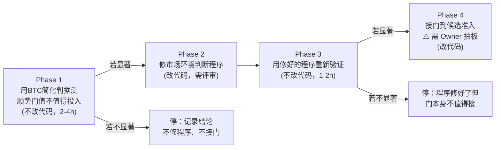

# 15 · Regime 门禁验证 — 可直接派发的执行计划

> 日期：2026-09-28
> 交付对象：其他 Agent 直接执行
> 前置阅读：`13_regime_gate_test.md`（问题背景）、`12_why_r20_turns.md`（R20 对照）
> 数据基线：Fedora `~/.aletheia/app.db`（只读直读）；代码基线 `origin/master`
> **性质：分析任务，前两个 Phase 不改任何交易代码。**

---

## 0. 名词速查（执行者必读）

| 名词 | 含义 |
|---|---|
**Regime（市场大环境）** | 当前市场是在涨（bull/牛市）、在跌（bear/熊市）、横盘（sideways）还是剧烈震荡（volatile）。 |
**Regime Tag** | 给每条候选交易机会盖的戳，记录"它是在什么市场环境下被发现的"。 |
**前瞻账本（forward ledger）** | 数据库表 `universe_forward_outcomes`，记录"如果当时按这个方向开仓，horizon 到期后结果如何"，不管实际有没有真开仓。 |
**dir%（方向毛收益）** | 扣除手续费/滑点前，只看方向判断对不对赚了多少（正=方向判断收钱，负=方向判断亏钱）。 |
**聚类 t 值** | 统计显著性指标。按"币"（symbol）分组算，而不是按"行"，因为同一个币会被反复评估很多次，不能当独立样本。`|t| ≥ 2` 才算有统计意义，否则可能是巧合。 |
**顺势门（R20 的 `01_macro_trend_filter`）** | 一条规则：大盘在涨时禁止做空，大盘在跌时禁止做多。 |

---

## 1. 已确认的事实（不要重复验证，直接用）

1. **我们已经有一套市场环境判断程序**：`extensions/regime/detector.py`，定义了 bull/bear/sideways/volatile 四态，还配了一张"该环境下偏多偏空多少"的表（`:36-41` 的 `_BIAS_TABLE`）。**这就是 R20 顺势门的等价物，还更细。**
2. **这套程序的输出从未被用来拦截交易**。全仓 grep `long_bias|short_bias`，只命中模型定义、数据库读写、命令行显示（`cli/inspect_cmd.py:1322,1331`）。没有任何准入或方向否决逻辑消费它。
3. **这套程序坏了**：数据库 `market_regimes` 表 5,013 次判断里，`bear` 和 `volatile` 各出现 **0 次**；`sideways` 只在 2026-08-07~08-20 出现过，之后连续 **39 天恒定输出 bull**。而前瞻账本恰好是从 2026-08-28 才开始记录的，**两者零重叠**——账本诞生那天起，判断程序就已经卡死了。
4. **所以前瞻账本里 96,992 条样本的 regime 标签清一色是 bull，没有对照组**，导致上一轮测试（bull 禁止做空）统计上不显著（t=+1.05）。这不是数据不够多，是缺少"非牛市"样本做比较。
5. **等判断程序修好、等市场真的转向再攒数据，等待时间不可控**（可能一周可能一个月，取决于市场，我们控制不了）。
6. **绕开等待的办法**：不用那个坏掉的判断程序，直接用 **BTC 自己当天涨跌** 当市场环境的简化判据——数据库 `market_snapshots` 表已有 BTC 24 小时涨跌幅，**100% 覆盖前瞻账本的整个时间段**（99,773 条样本全部落在覆盖期内），且已确认涨跌两侧都有充足样本（BTC 上涨的 6 天有 32,122 条、下跌的 13 天有 67,651 条）。**这个办法现在就能做，不需要先修判断程序。**

---

## 2. 三个阶段，只有第 3 阶段涉及产品决策

---

## Phase 1 · 用简化判据验证思路（现在就能做，不用等）

### 目标
回答一个问题：**"大盘涨的时候做空、大盘跌的时候做多，这些逆势单是不是真的明显更差？"** 如果连用这个粗糙判据都测不出效果，就不用再往下投入了。

### 具体步骤

1. 从 `market_snapshots` 表按天算出 BTC 当天的涨跌方向（`change_pct_24h` 字段，已确认可用，覆盖 2026-08-28 至今，共 19 天）。
2. 把这个"当天涨跌"接到前瞻账本的每一条记录上，按 `entry_ts` 的日期对齐（entry_ts 是候选被发现的时间点，即决策时刻）。
3. **重要约束**：只能用**候选被发现那一刻已经过去**的 BTC 数据，不能用候选发现之后才出现的数据。（这一点在上一轮已经踩过坑——第一次用"当天全天"数据算出来的效果显著，后来发现是因为"当天全天"包含了候选之后才发生的价格变化，属于用了未来数据，结果作废。这次必须避免同一个错误。）
4. 分别对 15m / 1h / 4h / 24h 四个持有时长计算：
   - 全部候选的 `dir%` 和聚类 t 值（作为基线）
   - 剔除"逆势"候选（大盘涨时的做空单、大盘跌时的做多单）之后的 `dir%` 和聚类 t 值
5. 输出对比表，格式参照 `13_regime_gate_test.md` 第 4 节的表格样式。

### 判断标准

| 结果 | 结论 | 下一步 |
|---|---|---|
剔除逆势单后，某个持有时长的聚类 **|t| ≥ 2**（达到统计显著） | 顺势门这个方向值得投入 | 进 Phase 2 |
全部 |t| < 2，但方向一致改善（负边缘变小或转正） | 有潜力但证据不够强，用简化判据测不出来是意料之中（因为判据本身粗糙） | 视情况可直接跳到 Phase 2（因为方向合理），或先做 Phase 1 的加强版（用更细的判据，比如换成 4 小时涨跌而不是 24 小时） |
剔除逆势单后没有改善甚至变差 | 顺势门这个思路本身可能不适用于我们的信号结构 | **停**，不进 Phase 2，把结论记录下来 |

### 交付物
一份分析文档，含：四个持有时长的对比表、统计显著性判断、结论建议（进 Phase 2 / 停）。**不改任何交易代码。**

### 预计工作量
2–4 小时（SQL 查询 + 统计计算 + 文档整理，无需等待新数据）。

---

## Phase 2 · 修市场环境判断程序（仅当 Phase 1 显示值得投入才做）

### 目标
让 `extensions/regime/detector.py` 恢复正常——它现在连续 39 天只会说"牛市"，需要它在真实下跌行情里能说出"熊市"。

### 具体步骤

1. 读 `extensions/regime/detector.py` 的判断逻辑，重点查 `_RegimeVote`（投票机制，`:59`）和状态切换的相关代码。
2. **优先排查一个具体嫌疑**：状态切换可能有一个"最小保持时长"的配置（`min_hold_periods`，从 `core/aletheia/universe/service.py:661` 传入），如果这个值设得太大，状态一旦定下来就很难再变，这很可能是卡死的原因。
3. 找到判断逻辑或阈值配置里的具体问题点。
4. 用历史行情**离线重新跑一遍**这个判断程序（不用连实盘、不用等新数据），验证修好之后它能不能在已知的下跌行情段（比如 2026-09-02、2026-08-31 那几天，账本数据显示这几天大盘明显在跌）正确识别出"熊市"或至少"非牛市"。
5. 若判断逻辑本身没问题、只是某个数值配置不合理，只改配置；若逻辑本身有缺陷，说明缺陷所在并提出修法。

### 验收标准
拿历史行情回放，能在已知的下跌段产出 `bear`（而不是继续说 `bull`）。

### 交付物
- 缺陷定位报告（具体是配置问题还是逻辑问题，`path:line`）
- 修复后的代码
- 历史回放验证结果（修复前 vs 修复后，在同一段已知下跌行情上的判断结果对比）

**这一步改代码，但改的是"判断程序"本身，不改任何交易/准入逻辑，不影响当前的交易行为。**

---

## Phase 3 · 用修好的程序重新验证（不用等新数据）

### 目标
Phase 2 修好后，**不需要等待新数据积累**——用 Phase 2 里"历史回放"产出的、带正确 regime 标签的历史数据，直接重新跑 Phase 1 的那套统计。

### 具体步骤
1. 用修复后的判断程序，对前瞻账本已有的全部历史候选（2026-08-28 至今）重新计算它们当时的真实 regime。
2. 重跑 Phase 1 的统计口径（全部候选 vs 剔除逆势单），但这次用真实的 regime 判断，不再用 BTC 简化代理。
3. 对比 Phase 1（简化判据）与 Phase 3（真实判断）的结果差异，评估简化判据在 Phase 1 里的可信度。

### 判断标准
与 Phase 1 相同——某个持有时长达到 |t| ≥ 2 才算显著。

### 交付物
最终验证报告，明确结论：**顺势门在真实 regime 判断下是否显著有效**，附完整数据支撑。

### 预计工作量
1–2 小时（复用 Phase 1 的统计代码，只是换数据源）。

---

## Phase 4 · 接入交易逻辑（仅当 Phase 3 显著有效，且需 Owner 拍板）

### 这一步不由执行 Agent 自行决定，只做准备

1. 在候选准入的地方（`core/aletheia/universe/scanners.py` 或对应的准入层）增加一道判断：读取当前 regime 的 `long_bias`/`short_bias`，如果某个方向的候选与当前环境明显相悖，则不予放行。
2. **规则形态建议参照 Phase 3 的实测结果**，而不是照抄 R20 的硬阈值（R20 是"牛市完全禁止做空"，我们的验证如果显示只在某个持有时长显著，规则应该只对那个持有时长生效，而不是全局硬禁）。
3. 提交前必须附上 Phase 3 的完整实测数据作为依据，供 Owner 评估是否批准这个改动。

**在 Phase 3 完成并证明显著之前，不要做这一步。**

---

## 给执行 Agent 的三条硬约束

1. **Phase 1 和 Phase 3 都不能改任何交易代码**，只能查数据库、跑统计、出报告。
2. **任何"市场环境"判据都必须是决策那一刻已经知道的信息**，不能用候选产生之后才出现的数据。上一轮已经在这个问题上犯过一次错（用"当天全天"数据造成未来数据泄漏），执行时务必用"决策时刻之前"的数据窗口。
3. **统计显著性用"按币聚类"的口径**，不要直接把每一行样本当独立样本算——同一个币会被反复评估，直接按行算会虚高显著性。参照 `13_regime_gate_test.md` 里已有的聚类计算方法。

---

## 已知风险与限制（供执行者提前了解）

- Phase 1 用 BTC 当天涨跌代表"整个市场环境"是一种简化，实际市场里不同币种可能各自有不同的小环境，这个简化可能低估或高估效果，Phase 3 用真实判断程序复核后才是可信结论。
- 判断程序卡死的具体原因目前只是初步怀疑（`min_hold_periods` 设置过大），Phase 2 需要先确认真实原因，不排除是其他逻辑问题。
- 若 Phase 2 发现判断程序需要较大改动，可能超出预计工作量，应及时反馈评估是否继续。
