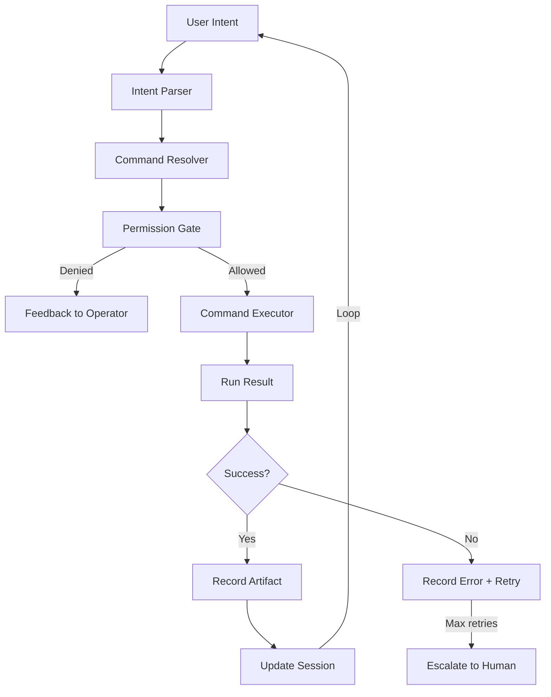

# Agent Shell Command Cycle

The System Operator's shell processes commands through a structured cycle: intent parsing → permission check → command execution → artifact recording. Lives in `aletheia/agent_shell/`.



## Stage 1: Intent Parsing

**Source:** `aletheia/agent_shell/intent.py`

- Parses natural-language or structured intent into a canonical action type
- Uses a lightweight local parser (not full LLM — performance)
- Produces an `Intent` object with: `action_type`, `parameters`, `confidence`

## Stage 2: Command Resolution

**Source:** `aletheia/agent_shell/registry.py`, `agent_shell/commands.py`

- Maps intent `action_type` to a registered `Command`
- Each command declares: `name`, `description`, `required_params`, `permissions`, `handler_fn`
- The registry is built at shell startup from decorated functions in `commands.py`

| Command | Permissions | Description |
|---|---|---|
| `evaluate_opportunity` | `trading_decision` | Evaluate a trading opportunity |
| `create_proposal` | `trading_decision` | Create a TradeProposal |
| `check_risk` | `risk` | Run risk checks on a proposal |
| `submit_order` | `execute_trade` | Submit order to broker |
| `close_position` | `manage_position` | Close an existing position |
| `query_knowledge` | `read_knowledge` | Query knowledge base |
| `add_lesson` | `write_knowledge` | Add a lesson to KB |
| `run_diagnostics` | `diagnostics` | Run system diagnostics |

## Stage 3: Permission Gate

**Source:** `aletheia/agent_shell/permissions.py`

Every command requires permissions. The permission system:

1. Checks the command's required permissions against the session's granted permissions
2. If the session lacks permission, escalates to the user (human-in-the-loop)
3. For **live trading** commands, requires explicit `live_trading` permission
4. For **risk override** commands, requires explicit `risk_override` permission
5. All permission decisions are logged to the audit trail

Permission hierarchy:
```
admin
└── trading
    ├── paper_trading
    ├── live_trading          [requires unlock]
    └── risk_override         [requires unlock]
└── operational
    ├── diagnostics
    ├── knowledge_write
    └── system_control
```

## Stage 4: Command Execution

**Source:** `aletheia/agent_shell/executor.py`

- Executes the command handler function
- Manages retry logic (max 3 retries with exponential backoff)
- On persistent failure, escalates to human via `system_operator` error handler
- Records execution metadata (start time, duration, result, error)

## Stage 5: Artifact Recording

**Source:** `aletheia/agent_shell/file_artifacts.py`

- Successful commands produce artifacts (decision records, proposal files, audit entries)
- Artifacts are stored in `~/.aletheia/artifacts/<session_id>/`
- Each artifact includes: content, hash, timestamp, command metadata
- Critical artifacts are also written to the JSONL audit trail (`files/jsonl.py`)

## Session Management

**Source:** `aletheia/agent_shell/sessions.py`

- Each operator cycle runs in a **session** with a unique `session_id`
- Sessions persist: conversation history, permissions granted, artifacts produced
- Session history is **compacted** after N turns (`agent_shell/compaction.py`) to manage context window size
- Sessions can be resumed, forked, or abandoned

## Key Symbols

| Symbol | Location | Description |
|---|---|---|
| `OperatorSession` | `agent_shell/sessions.py` | Session state (history, permissions, artifacts) |
| `parse_intent` | `agent_shell/intent.py` | Intent parser |
| `CommandRegistry` | `agent_shell/registry.py` | Command registry |
| `Command` | `agent_shell/commands.py` | Base command class |
| `check_permission` | `agent_shell/permissions.py` | Permission gate |
| `execute_command` | `agent_shell/executor.py` | Command executor |
| `record_artifact` | `agent_shell/file_artifacts.py` | Artifact recorder |

## Test Coverage

- `tests/test_agent_shell.py` — Tests for shell command processing, permissions, sessions
- `tests/test_trading_decision.py` — Tests for trading decision logic
- `tests/test_intent_parser.py` — Tests for intent parsing
- `tests/test_permissions.py` — Tests for permission gates
