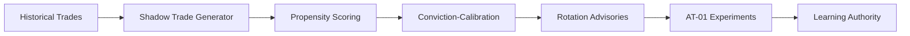

# Counterfactual Analysis Pipeline

The counterfactual pipeline estimates **what would have happened** if a different trading decision was made, without risking real capital. It runs primarily in `aletheia/counterfactual/` and feeds learning experiments and policy-epoch advisories.

## Stage 1: Shadow Trade Generation

**Source:** `aletheia/counterfactual/trades.py`

- Generates **shadow trades** for decisions that were actually made but with alternative parameters
- Runs daily in a batch job (`learning/maintenance.py`)
- Each shadow trade records: alternative entry, alternative exit, hypothetical PnL, counterfactual context
- Stored in the `shadow_trades` table

## Stage 2: Propensity Scoring

**Source:** `aletheia/counterfactual/propensity.py`

- Calculates the probability that a trade would have been taken under different conditions
- Uses logistic regression on historical features (momentum, volatility, regime)
- Stored in the `propensity_scores` table
- Feeds into the IPW (Inverse Propensity Weighting) estimator

## Stage 3: Causal Estimation

**Source:** `aletheia/counterfactual/estimators.py`

Two estimators:

1. **DR (Doubly Robust) Estimator** — combines outcome modeling and propensity weighting
2. **IPW (Inverse Propensity Weighting) Estimator** — pure propensity-based

Both produce **counterfactual PnL estimates** for policies that were not actually followed.

## Stage 4: Conviction-Calibration

**Source:** `aletheia/counterfactual/calibration.py`

- Compares actual conviction scores against counterfactual outcomes
- Detects **overconfidence** (high conviction, poor outcomes) and **underconfidence** (low conviction, good outcomes)
- Produces **calibration adjustments** that feed back into paper trader scoring
- Runs weekly, results stored in `calibration_adjustments`

## Stage 5: Rotation Advisories

**Source:** `aletheia/counterfactual/advisories.py`

- Generates **rotation advisories** per policy epoch
- Recommends shifting allocation between strategies based on counterfactual performance
- Feeds into `knowledge/guards.py` as advisory guardrails

## Stage 6: Filter Experiments

**Source:** `aletheia/counterfactual/filter_experiments.py`, `filter_replay.py`

- Runs offline simulations of universe filters against historical data
- Estimates filter accuracy, precision, recall for each policy epoch
- Stored in `filter_experiment_results`

## Key Symbols

| Symbol | Location | Description |
|---|---|---|
| `generate_shadow_trades` | `counterfactual/trades.py` | Generates shadow trade alternatives |
| `calculate_propensity` | `counterfactual/propensity.py` | Propensity scoring for IPW |
| `dr_estimator` | `counterfactual/estimators.py` | Doubly robust estimator |
| `ipw_estimator` | `counterfactual/estimators.py` | IPW estimator |
| `calibrate_conviction` | `counterfactual/calibration.py` | Conviction calibration |
| `generate_rotation_advisories` | `counterfactual/advisories.py` | Policy-epoch rotation recommendations |
| `run_filter_experiment` | `counterfactual/filter_experiments.py` | Offline filter simulation |

## Relationship to AT-01

<!-- openwiki: broken internal link [components/learning-system.md] file "components/learning-system.md" does not exist. Fix the href or restore the target, then delete this comment. -->
Counterfactual estimates feed directly into [AT-01 learning experiments](components/learning-system.md). The learning authority resolver checks whether counterfactual evidence is sufficient before promoting learned behavior to influence trading decisions.

## Test Coverage

- `tests/test_counterfactual.py` — Tests for shadow trade generation, propensity, DR/IPW estimators
- `tests/test_calibration.py` — Calibration accuracy tests
- `tests/test_filter_replay.py` — Filter replay accuracy
