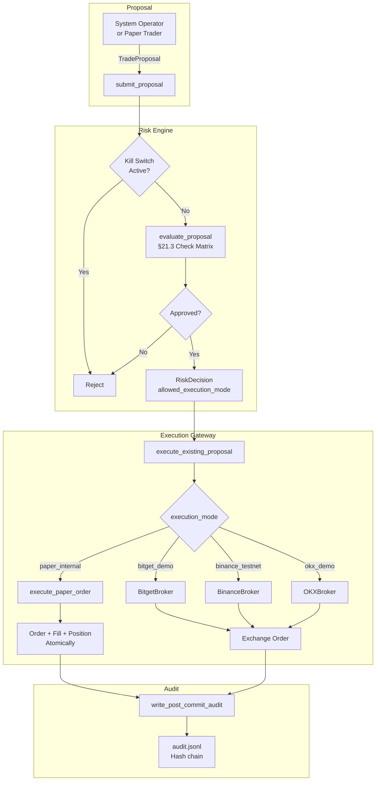

# Execution & Risk Flow

Every trade proposal in Aletheia flows through a strict pipeline: **Proposal → Risk Evaluation → Broker Routing → Execution → Fill → Audit**. The Risk Engine's §21.3 check matrix gates whether a proposal may proceed to execution.

## Architecture

## Submission (`execution/gateway.py`)

### `submit_proposal(...)`

The main entry point for creating and executing a trade proposal. Parameters include symbol, market_type, direction, order_type, quantity, price, leverage, stop_price, take_profit, execution_mode, strategy_id, opportunity_id.

**Flow:**
1. Creates `TradeProposal` via `insert_trade_proposal()`.
2. Calls `execute_existing_proposal(proposal.id, execution_mode)`.

### `execute_existing_proposal(proposal_id, execution_mode)`

- Atomically claims proposal via execution lease (`_EXECUTION_LEASE_SECONDS = 600`).
- Calls `_execute_proposal()` → routes to paper or exchange broker.
- Releases entry risk reservation on terminal states.

### `_reject_for_exchange_constraints(proposal, reason)`

Applies executable-venue minima before Risk Engine sees exchange orders.

## Risk Engine (`risk/engine.py`)

### `evaluate_proposal(proposal, decision_role="authoritative") -> RiskCheckResult`

Serialized via `_eval_lock` (closes daily-loss TOCTOU window). `preflight` always fresh; `authoritative` is idempotent for the proposal's original commit hash.

### `RiskCheckResult`

Dataclass with: `approved`, `risk_score`, `violations`, `allowed_execution_mode`, `message`, `decision_id`.

### §21.3 Check Matrix (`_evaluate_proposal_locked`)

| # | Check | Key Logic |
|---|-------|-----------|
| 0 | Kill switch | Global brake + mode-scoped brakes |
| 1 | Symbol filter | Whitelist or blacklist mode |
| 1b | Paper market authority | Memory ≤90s or typed SQLite fallback ≤120s |
| 2 | Market allowed | Spot/futures enabled gates |
| 2a | Local paper futures funding | Requires fresh `funding_rate_snapshots` anchor |
| 2b | Entry-plan completeness | Native entries commit entry/stop/TP/RR before order |
| 2c | Side-of-entry geometry | Long: stop < entry < TP; Short: TP < entry < stop |
| 3 | Live state | `live_state == "live_limited"` required |
| 4 | Permission mode | `Observe` mode blocks non-paper orders |
| 5 | Max position size | Configured cap tightened to cached available balance |
| 6 | Max open positions | Shared pool (serenity + main-track) |
| 6b | No duplicate symbol | Across open + unresolved + pre-order |
| 7 | Short allowed | `allow_short_live` / `allow_short_demo` |
| 7b | Spot short | `spot_short_not_allowed` |
| 8 | Max daily loss | Auto-trips kill switch |
| 9a | Exchange allowlist | `risk.allowed_exchange` check |
| 9 | Account mode match | Live order requires `exchange.mode == "live"` |
| 10 | Max leverage | Per-asset-tier + account-level flat cap |
| 11 | Data freshness (live) | `_MAX_DATA_AGE_SECONDS = 120` |
| 12 | Total live exposure | `max_total_live_exposure_pct * capital_base` |
| 13 | Single trade risk (live) | `(price - stop) * quantity ≤ max_single_trade_risk_pct * capital_base` |
| 14 | Scanner-family evidence (live) | Family must have proven clean-window edge |
| 15 | Lesson constraints | Accepted lessons impose symbol/direction blocks |
| 16 | Correlation guard | Sector concentration + portfolio BTC beta |
| 17 | Account leverage ratio | Futures-only, additive |
| 18 | Liquidation buffer | Futures-only, additive |
| 19 | Per-symbol cumulative notional (CUM-ADD) | Same-symbol adds average-merge |
| — | Causal check | `check_trade_causality()` — fail-closed for live |

### Native Input Validation

`_native_input_violations()` validates native intent before configurable checks: symbol format, market type, direction, order type, quantity, price, leverage, execution mode.

## Risk Policy (`risk/policy.py`)

### `resolve_risk_policy(cfg, execution_mode) -> ResolvedRiskPolicy`

Resolves mode-scoped policy (`cfg.risk.demo` or `cfg.risk.live`).

**Execution modes:**
- DEMO: `paper_internal`, `bitget_demo`, `binance_testnet`, `okx_demo`
- LIVE: `bitget_live_limited`, `binance_live_limited`, `okx_live_limited`

### `RiskPolicyView`

Compatibility view mapping legacy attribute names to nested mode policy fields (e.g., `max_live_limited_cap_usdt` → `policy.capital.base_usdt`).

## Kill Switch (`risk/kill_switch.py`)

### `is_active(scope="global") -> bool`

Checks `cfg.runtime.kill_switch_active` (or `demo_brake_active` / `live_brake_active`).

### `activate(reason, actor, scope)`

Engages brake. Idempotent. Persists to config so brake survives restart. On persist failure: pins config cache + emits infra event.

### `deactivate(actor, scope)`

Releases brake. Only updates in-memory config AFTER successful persistence. On failure: brake stays engaged.

## Paper Broker (`execution/paper_broker.py`)

### `execute_paper_order(...)`

Creates `Order` (status="filled"), `Fill`, and `Position` atomically.

- Applies adverse slippage: `price * (1 + slip)` for longs.
- `_materialize_paper_entry()`: weighted-average entry for averaging into same Proposal.
- `_paper_close_costs()`: resolves legacy config or frozen net-balance contract.

## Bitget Broker (`execution/bitget_broker.py`)

Routes approved exchange-bound proposals to Bitget for `bitget_live_limited` and `bitget_demo` modes.

- **API health circuit breaker**: `_API_FAILURE_THRESHOLD = 5`, `_API_COOLDOWN_SEC = 60.0`
- **`_guard_unresolved_submission()`**: blocks retry when exchange-side outcome is ambiguous.
- Symbol handling: local rows keep canonical format; exchange call normalizes to Bitget format (`BTCUSDT`).
- Fill price/quantity/fee/time come ONLY from private fill history.

## Entry Plan (`trading/entry_plan.py`)

### `calculate_entry_plan_risk_reward(entry_price, stop_price, take_profit) -> float | None`

`abs(target - entry) / abs(entry - stop)`

### `entry_plan_risk_reward_is_plausible(risk_reward) -> bool`

Envelope check: `ENTRY_PLAN_MIN_RISK_REWARD = 1.0` to `ENTRY_PLAN_MAX_RISK_REWARD = 10.0`

## Safety Mechanisms

1. **Execution lease** — Proposals are claimed via a time-limited lease to prevent double execution.
2. **Kill switch** — Global and mode-scoped brakes auto-trip on daily loss limits.
3. **Permission gates** — Observe mode blocks non-paper orders; PaperAuto only produces paper proposals.
4. **Evaluation serialization** — `_eval_lock` closes the daily-loss TOCTOU window.
5. **Config persistence** — Kill switch survives restart via config cache pin.
6. **Isolated execution modes** — Paper and live positions are never auto-closed by the manager.

## Relationship to Other Components

- [Agent Decision Loop](../architecture/agent-decision-loop.md) — Creates proposals that flow here
- [Trading Loop](../architecture/trading-loop.md) — Full evidence pipeline
- [Risk Engine](../components/risk-engine.md) — Component reference
- [Execution Gateway](../components/execution-gateway.md) — Component reference
