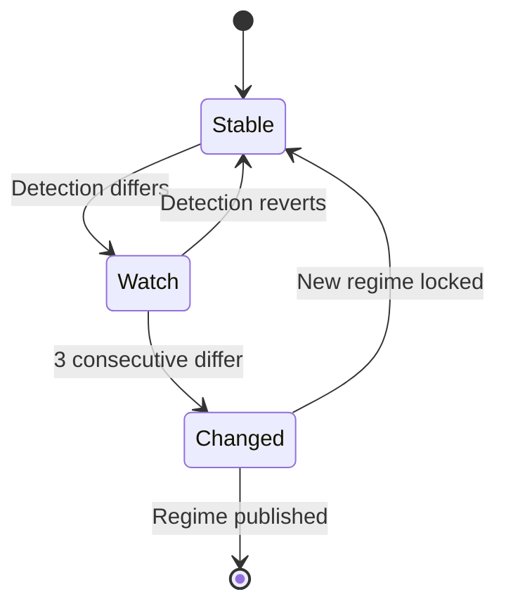

# Regime Detection Pipeline

Detects market regime (Bull / Bear / Sideways / Volatile) using deterministic multi-input analysis with debounce to prevent flip-flopping. Lives in `aletheia/regime/`.

```mermaid
flowchart LR
    A[VIX, DXY, Stablecoin\nTVL, DEX Volume] --> B[Input Collection]
    B --> C[Feature Extraction]
    C --> D[Regime Detection\nThresholds + Voting]
    D --> E[Debounce\n(3-period confirmation)]
    E --> F[Regime Published]
    F --> G[Knowledge Guards\nSerenity Lens]
```

## Stage 1: Input Collection

**Source:** `aletheia/regime/collector.py`

Collects regime inputs every 15 minutes:

| Input | Source | Table |
|---|---|---|
| VIX (volatility index) | `yfinance_provider.py` | `regime_inputs` |
| DXY (dollar index) | `yfinance_provider.py` | `regime_inputs` |
| Stablecoin TVL | `data/sources/chain.py` / DefiLlama | `regime_inputs` |
| DEX Volume | `data/sources/binance_public.py` | `regime_inputs` |

**Freshness:** If any input is stale (> 2h), the collector uses the last known value with a staleness flag.

## Stage 2: Feature Extraction

**Source:** `aletheia/regime/detector.py`

Transforms raw inputs into regime features:

- `vix_zscore` — Z-score of VIX over 30-day rolling window
- `dxy_trend` — DXY 5-period momentum
- `stablecoin_delta` — % change in stablecoin TVL over 24h
- `dex_volume_zscore` — DEX volume relative to 30-day average
- `volatility_regime` — Derived from VIX (low < 20, normal 20-30, high > 30)

## Stage 3: Regime Detection

**Source:** `aletheia/regime/detector.py::detect_regime`

Uses threshold-based voting across 4 axes:

| Axis | Bull | Bear | Sideways | Volatile |
|---|---|---|---|---|
| VIX z-score | < -0.5 | > 0.5 | -0.5..0.5 | > 1.5 |
| DXY trend | + | - | ≈ 0 | N/A |
| Stablecoin delta | + inflow | - outflow | ± small | N/A |
| DEX volume z-score | > +0.5 | < -0.5 | ± small | > 2.0 |

Each axis votes. The regime with the most votes wins. Ties go to Sideways.

## Stage 4: Debounce

**Source:** `aletheia/regime/detector.py::_debounce`

Regime changes require **3 consecutive matching detections** (45 minutes) to prevent flip-flopping from noise:



## Stage 5: Publication

The detected regime is stored in the `regime_state` table and surfaced:

- **Knowledge Guards** (`knowledge/guards.py`) — adjusts risk limits per regime
- **Serenity Lens** (`components/serenity-lens.md`) — research context weighting
- **Portfolio** (`portfolio/position_manager.py`) — adjusts trailing stop aggressiveness
- **Risk Engine** (`risk/engine.py`) — regime multiplier on position sizing

## Key Symbols

| Symbol | Location | Description |
|---|---|---|
| `collect_regime_inputs` | `regime/collector.py` | Collects VIX, DXY, stablecoin TVL, DEX volume |
| `detect_regime` | `regime/detector.py` | Main detection function with debounce |
| `RegimeState` | `regime/detector.py` | Enum: BULL, BEAR, SIDEWAYS, VOLATILE |
| `REGAUME_THRESHOLDS` | `regime/detector.py` | Detection thresholds per axis |
| `DEBOUNCE_PERIODS` | `regime/detector.py` | 3 consecutive detections required |

## Test Coverage

- `tests/test_regime_detector.py` — Tests for threshold voting, debounce logic, tie-breaking
- `tests/test_regime_collector.py` — Tests for input collection, staleness handling
