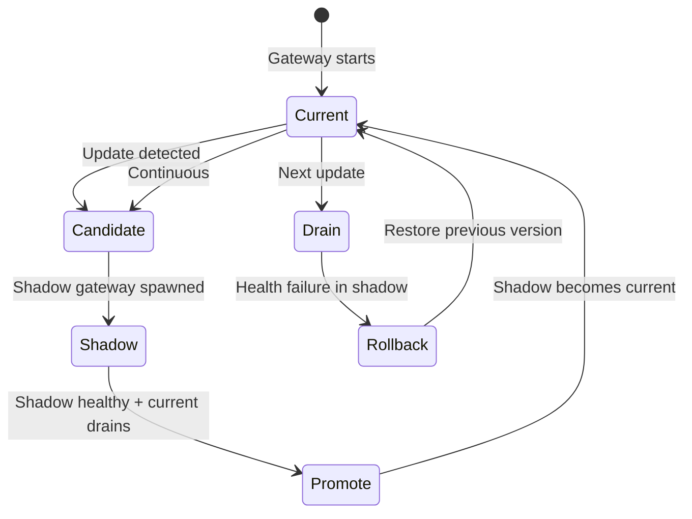

# Runtime Continuity Lifecycle

Runtime continuity enables **zero-downtime updates** of the Aletheia gateway while preserving trading state. It uses a state machine in `aletheia/runtime_continuity/service.py` with shadow gateways and git worktrees.

## States

| State | Description |
|---|---|
| **Current** | The active gateway serving traffic |
| **Candidate** | A new version bundle materialized from git |
| **Shadow** | A shadow gateway spawned from the candidate, running in parallel |
| **Promote** | Shadow passes health checks; current drains sessions |
| **Drain** | Current gateway finishes in-flight work, stops accepting new |
| **Rollback** | If shadow fails health checks, revert to current |

## Key Symbols

| Symbol | Location | Description |
|---|---|---|
| `RuntimeContinuityOrchestrator` | `runtime_continuity/service.py` | Main state machine controller |
| `detect_update_available` | `runtime_continuity/service.py` | Checks if a newer version is available |
| `spawn_shadow_gateway` | `runtime_continuity/processes.py` | Spawns a shadow gateway process |
| `materialize_bundle` | `runtime_continuity/bundles.py` | Creates git worktree from candidate |
| `health_check_shadow` | `runtime_continuity/service.py` | Validates shadow gateway health |
| `drain_current` | `runtime_continuity/service.py` | Drains current gateway sessions |
| `promote_shadow` | `runtime_continuity/service.py` | Promotes shadow to current |
| `rollback` | `runtime_continuity/service.py` | Reverts to previous version |

## Lifecycle Details

### 1. Update Detection

The `runtime_continuity` job (every 5 min on scheduler) calls `detect_update_available()`. It compares:
- Git remote HEAD commit
- Current running commit (`build_info.boot_commit`)
- Code drift (`build_info.code_drift`)

If an update is detected, transitions to **Candidate** state.

### 2. Bundle Materialization

`materialize_bundle()` in `runtime_continuity/bundles.py`:
- Creates a temporary git worktree at `~/.aletheia/runtime/worktrees/<commit>`
- Installs dependencies in the worktree
- Validates `package_integrity` for frozen bundles

### 3. Shadow Spawn

`spawn_shadow_gateway()` in `runtime_continuity/processes.py`:
- Spawns a new gateway process using the candidate bundle
- Configures it to listen on a shadow port
- Connects to the same `app.db` (shared state)
- Routes data through the same collectors

### 4. Health Verification

The shadow gateway must pass:
<!-- openwiki: broken internal link [services/diagnostics.md] file "services/diagnostics.md" does not exist. Fix the href or restore the target, then delete this comment. -->
- Doctor probes (see [Diagnostics](services/diagnostics.md))
- API health checks (`/api/health`, `/api/ready`)
- Scheduler connectivity
- Model provider availability

### 5. Graceful Drain

If the shadow is healthy:
- Current gateway stops accepting new trades (kill switch → paper-only)
- In-flight orders are allowed to complete (max 5 min)
- Sessions are gracefully handed off

### 6. Promotion

The shadow gateway is promoted to current:
- Shadow port becomes the primary port
- Current process is cleanly shut down
- PID files updated

### 7. Rollback

If the shadow fails health checks at any point:
- Shadow gateway is killed
- Current gateway continues serving
- Alert is logged to `infra/errors.py`

## Configuration

| Setting | Default | Description |
|---|---|---|
| `runtime_continuity.enabled` | `true` | Enable/disable runtime continuity |
| `runtime_continuity.health_timeout` | `300` | Seconds before shadow health check fails |
| `runtime_continuity.drain_timeout` | `300` | Seconds to wait for current gateway to drain |
| `runtime_continuity.rollback_on_failure` | `true` | Auto-rollback on shadow failure |

## Key Invariants

1. **Shared state** — shadow and current share the same `app.db`, so positions and orders survive the transition
2. **No double trading** — only the current gateway can place live trades; shadow is paper-only by default
3. **Atomic promotion** — port switch is atomic; no request is dropped
4. **Revertible** — every promotion creates a rollback point with the previous bundle
