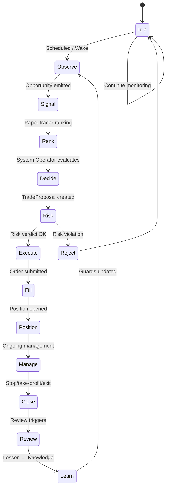
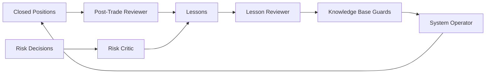

# The Aletheia Trading Cognition Loop

Aletheia operates on a **durable evidence loop** — market facts, decisions, risk verdicts, fills, outcomes, reviews, and learning evidence remain traceable in local state. The loop is **asynchronous and event-driven**, orchestrated by APScheduler jobs in `agent_runtime/scheduler.py`.

## Stage 1: Market Data Collection

**Source:** `aletheia/data/`

Nine collectors run in a standalone subprocess (`aletheia/data/collector_runner.py`) orchestrated by the scheduler's `collectors_pool` executor. Each collects into dedicated tables:

| Collector | Data | Storage |
|---|---|---|
| `ccxt_provider.py` | OHLCV, ticker, order book (primary + fallback CCXT) | `market_data` |
| `coinalyze.py` | Open interest, funding rates, long/short ratio | `market_data` |
| `derivatives.py` | Derivative metrics | `market_data` |
| `macro.py` | Macroeconomic data | `market_data` |
| `microstructure.py` | Orderbook microstructure | `market_data` |
| `volume_scanner.py` | Volume spikes | `market_data` |
| `volatility_scanner.py` | Volatility metrics | `market_data` |
| `hyperliquid.py` | Hyperliquid perp data | `market_data` |
| `verge_structure.py` | Verge structure observations | `market_data` |
| `news_collector.py` | RSS news feeds | `news` |
| `news_analyzer.py` | LLM sentiment + symbol extraction | `news` (enriched) |

**Freshness guarantee:** `aletheia/data/freshness.py` validates that snapshots are no older than 30s (configurable). Stale data triggers a venue cooldown in `venue_health.py`.

## Stage 2: Signal Generation

**Source:** `aletheia/universe/`

The Universe Service (`universe/service.py`) runs the core signal pipeline:

1. **Scanners** (`universe/scanners.py`) — 6 scanner families scan for patterns: momentum, mean_reversion, volatility, derivatives, event-driven, core
2. **Features** (`universe/features.py`) — Technical features per symbol (RSI, Bollinger Bands, vol_ratio, OI divergence, etc.)
3. **Allocator** (`universe/allocator.py`) — Scores candidates, enforces quotas (max symbols, per-strategy caps), TTL freshness
4. **Signal Emitter** (`universe/signal_emitter.py`) — Deterministically emits `Opportunity` rows that pass all checks

**Key invariant:** Signal emission is **fully deterministic** — no LLM calls, no DB writes in the emission path itself. LLM analysis happens downstream in the Market Observer.

## Stage 3: Ranking

**Source:** `aletheia/agents/paper_trader.py`, `aletheia/agents/paper_trader_ranker.py`

- **Ranker** (`paper_trader_ranker.py`) — Pure-deterministic ranking of candidate opportunities (no LLM, no DB writes). Produces a ranked list.
- **Paper Trader** (`paper_trader.py`) — Consumes the ranked list, applies paper-trade rules (capital limits, position limits), and produces `signal_pending` carriers that flow to the System Operator.

## Stage 4: Decision (System Operator)

**Source:** `aletheia/agent_runtime/pi_daemon.py`, `aletheia/agent_shell/trading_decision.py`

The System Operator is the **sole entry-decision authority**. It runs every 4 hours (`agent_shell/operator_loop.py`):

1. Collects candidates from paper trader
2. Assembles a trading context (`agent_shell/trading_context.py`)
3. Consults the Investment Committee (`agents/committee/`) for multi-agent evaluation
4. Checks knowledge-base guards (`knowledge/guards.py`)
5. Calls the Risk Engine (`risk/engine.py::evaluate_proposal`)
6. If approved, creates a `TradeProposal` → `pi_decision` record
7. Routes to the Execution Gateway

## Stage 5: Risk Evaluation

**Source:** `aletheia/risk/`

Every proposal passes through `risk/engine.py::evaluate_proposal` which applies the **§21.3 check matrix**:

| Check | What it guards |
|---|---|
| `max_position_size` | Per-symbol position cap |
| `max_order_value` | Per-order value cap |
| `max_leverage` | Leverage limit |
| `portfolio_exposure` | Total portfolio risk exposure |
| `daily_loss_limit` | Daily loss auto-trip |
| `concentration_limit` | Sector/instrument concentration |
| `liquidity_check` | Sufficient liquidity for exit |
| `kill_switch` | Global trading disable |
| `learning_authority` | Whether learned behavior can influence this decision |

**Kill switch:** Off by default for live trading (`risk/kill_switch.py`). Requires explicit `aletheia live unlock` with typed confirmation.

## Stage 6: Execution

**Source:** `aletheia/execution/`

1. `execution/gateway.py::submit_proposal` receives the approved proposal
2. Maps the proposal to the appropriate broker based on execution mode (paper/demo/live)
3. `execution/paper_broker.py` — paper fills with realistic slippage
4. `execution/bitget_broker.py` — Bitget exchange order routing (demo/live)
5. `execution/binance_broker.py` — Binance order routing
6. `execution/okx_broker.py` — OKX order routing

**Order constraints:** `execution/order_constraints.py` validates exchange-specific rules (min notional, tick size, step size) before submission.

## Stage 7: Position Management

**Source:** `aletheia/portfolio/`

The Position Manager (`portfolio/position_manager.py`) owns the position lifecycle:

- Enforces stop-loss, take-profit, trailing stop, and max-hold time
- Can **autonomously close positions** for risk management (but cannot open new ones)
- `portfolio/exit_plan.py` resolves the effective exit plan (user-set vs. protective closes)
- `portfolio/backtest_engine.py` simulates paper trading for learning

**PnL:** `portfolio/pnl.py` and `pnl_attribution.py` calculate realized/unrealized PnL and attribution.

## Stage 8: Review & Learning

**Source:** `aletheia/agents/`, `aletheia/learning/`

1. **Post-Trade Reviewer** (`agents/post_trade_reviewer.py`) — Reviews closed positions, extracts lessons
2. **Risk Critic** (`agents/risk_critic.py`) — Reviews risk decisions, extracts lessons
3. **Lesson Reviewer** (`agents/lesson_reviewer.py`) — Promotes lessons to knowledge base guardrails
4. **Learning System** (`aletheia/learning/`) — AT-01 measurement experiments gate whether learned behavior influences future decisions

**AT-01 lifecycle:** shadow → paper_10 → paper_25 → paper_50 → paper_active. Each stage requires passing measurement criteria before advancing.

## Stage 9: Feedback to Knowledge Base

Lessons promoted by the Lesson Reviewer become guardrails in `knowledge/guards.py`, which are evaluated by the System Operator in Stage 4. This closes the loop.

## Key Invariants

1. **Paper by default** — all trading starts in paper mode
2. **Risk in the middle** — every proposal passes `evaluate_proposal` before execution
3. **Deterministic signal emission** — no LLM/DB in the signal path
4. **Position manager can close but not open** — autonomous protection, not autonomous trading
5. **System Operator is sole decision authority** — no agent can directly place trades
6. **Durable evidence loop** — all decisions and outcomes are traceable
