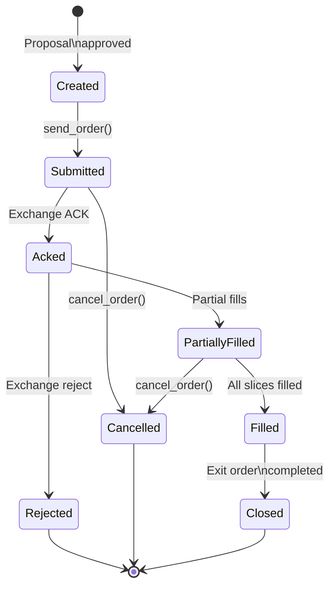

# Execution Gateway

The **Execution Gateway** (`aletheia/execution/`) is the bridge between Aletheia's internal proposal system and external broker/exchange APIs. It handles order lifecycle (creation, submission, cancellation, status updates) with safety mechanisms including a **Bitget monkeypatch** that prevents real orders during tests. The gateway supports multiple broker backends with a unified interface.

## Architecture

```mermaid
flowchart TD
    A[Position Manager] --> B[Execution Gateway]
    B --> C[Broker Router]
    C --> D1[CCXT Broker\n(Binance, Coinbase, etc.)]
    C --> D2[Bitget Broker\n(Bitget API)]
    D1 --> E[Order DB]
    D2 --> E
    B --> F[Safety Guard\n(Monkeypatch)]
    F -->|test mode| G[No real orders]
    F -->|live mode| C
    B --> H[Audit Trail\n(JSONL)]
    B --> I[Execution Metrics]
```

## Broker Backends

**Source:** `execution/ccxt_broker.py`, `execution/bitget_broker.py`

| Broker | Exchange | API | Status |
|---|---|---|---|
| CCXT Broker | Binance, Coinbase, KuCoin, OKX, Bybit | CCXT | Production |
| Bitget Broker | Bitget | Native REST + WS | Production |
| Simulated Broker | Internal | Simulated | Paper trading |

Brokers are registered in `execution/broker_registry.py` and selected by strategy preference or exchange availability.

## Order Lifecycle

**Source:** `execution/order_lifecycle.py`

```mermaid
stateDiagram-via
```



### Order States

| State | Description |
|---|---|
| `CREATED` | Order created locally, not yet sent |
| `SUBMITTED` | Order sent to exchange |
| `ACKED` | Exchange acknowledged order |
| `PARTIALLY_FILLED` | Some quantity filled |
| `FILLED` | Order fully filled |
| `REJECTED` | Exchange rejected order |
| `CANCELLED` | Order cancelled |
| `CLOSED` | Position fully exited |

## Safety Mechanisms

### Bitget Monkeypatch

**Source:** `tests/conftest.py` (monkeypatch guard), `execution/bitget_broker.py`

**Critical safety feature**: During tests, the Bitget broker is monkeypatched to prevent any real order submission. This is enforced in `conftest.py`:

```python
@pytest.fixture(autouse=True)
def bitget_safety_monkeypatch(monkeypatch):
    """Prevent real Bitget API order submission during tests."""
    def fake_submit(*args, **kwargs):
        raise RuntimeError(
            "Real Bitget order blocked in test environment. "
            "Use paper trading or simulation."
        )
    monkeypatch.setattr(BitgetBroker, "submit_order", fake_submit)
```

This fixture is `autouse=True` — it applies to **all tests** in the repository. There is no way to accidentally submit a real order through Bitget during testing.

### Paper Trading Mode

**Source:** `execution/paper_broker.py`

In paper trading mode:
- Orders are simulated against live market data
- No real funds are used
- Execution prices are based on current market prices (with slippage model)
- All order states are tracked but no real exchange interaction occurs

## Audit Trail

**Source:** `files/jsonl.py`, `execution/audit.py`

Every execution action is logged to the JSONL audit trail:

```python
{
    "event_type": "order_submitted",
    "order_id": "ord_abc123",
    "symbol": "BTCUSDT",
    "side": "buy",
    "quantity": 0.001,
    "price": 45000.0,
    "broker": "ccxt_binance",
    "timestamp": "2024-01-15T10:30:00Z",
    "session_id": "sess_xyz789"
}
```

Audit entries include: order submissions, cancellations, fills, rejections, and status updates.

## Execution Metrics

**Source:** `execution/metrics.py`

| Metric | Description |
|---|---|
| Slippage | Actual vs expected execution price |
| Fill rate | % of order quantity filled |
| Latency | Time from submission to first fill |
| Rejection rate | % of orders rejected by exchange |
| Cancel rate | % of orders cancelled before fill |

## Key Symbols

| Symbol | Location | Description |
|---|---|---|
| `ExecutionGateway` | `execution/gateway.py` | Main gateway class |
| `submit_order` | `execution/gateway.py` | Submit order to broker |
| `cancel_order` | `execution/gateway.py` | Cancel pending order |
| `CCXTBroker` | `execution/ccxt_broker.py` | CCXT broker backend |
| `BitgetBroker` | `execution/bitget_broker.py` | Bitget broker backend |
| `PaperBroker` | `execution/paper_broker.py` | Simulated broker |
| `BrokerRouter` | `execution/broker_router.py` | Broker selection |
| `OrderState` | `execution/order_lifecycle.py` | Order state enum |
| `log_audit_event` | `execution/audit.py` | Audit trail logging |
| `record_execution_metrics` | `execution/metrics.py` | Execution metrics |

## Test Coverage

- `tests/test_execution_gateway.py` — Tests for order lifecycle, broker routing
- `tests/test_ccxt_broker.py` — Tests for CCXT broker integration
- `tests/test_bitget_broker.py` — Tests for Bitget broker (with safety monkeypatch)
- `tests/test_paper_broker.py` — Tests for simulated execution
- `tests/test_broker_router.py` — Tests for broker selection
- `tests/test_audit_trail.py` — Tests for audit logging
- `tests/test_execution_metrics.py` — Tests for metrics computation

## Relationship to Other Components

- [Position Manager](position-manager.md) — Receives approved proposals, sends orders
- [Risk Engine](risk-engine.md) — Risk checks before order submission
<!-- openwiki: broken internal link [../architecture/audit-hash-chain.md] file "../architecture/audit-hash-chain.md" does not exist. Fix the href or restore the target, then delete this comment. -->
- [Audit Hash Chain](../architecture/audit-hash-chain.md) — Audit trail integration
