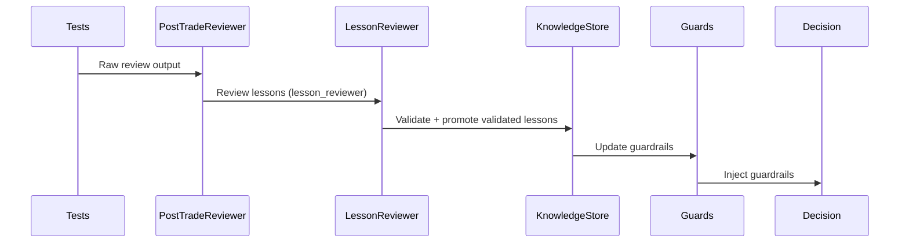

# Knowledge Base System

The Knowledge Base (`aletheia/knowledge/`) is Aletheia's **structured lesson storage system**. Unlike unstructured notes, lessons are stored with metadata (domain, confidence, last validated), guardrail type, and search indexes. The KB feeds guardrails into risk, learning, and decision-making.

## Architecture

```mermaid
flowchart TD
    A[Lessons\nSources] --> B[Lesson Store\n(inference_calls)]
    B --> C[Knowledge Base\n(SQLite)]
    C --> D1[Guardrails\n(risk, learning)]
    C --> D2[Search Index\n(TF-IDF + tags)]
    C --> D3[Maintenance\n(weekly pruning)]
    D2 --> E[Querying Agents]
    D1 --> F[Decision Pipeline]
```

## Lesson Storage

**Source:** `knowledge/store.py`

Lessons are stored in the `knowledge_base` table with:

| Field | Description |
|---|---|
| `id` | UUID |
| `content` | Lesson text |
| `domain` | Domain tag (operator, universe, serenity, risk, etc.) |
| `source` | Where it came from (test, post_trade_review, etc.) |
| `confidence` | 0-1 confidence score |
| `last_validated` | Timestamp of last validation |
| `tags` | List of tags for search |
| `valid` | Boolean — whether the lesson is still valid |
| `expires_at` | Optional expiration (stale lessons pruned) |

## Lesson Sources

Lessons come from multiple sources, each with different validation mechanisms:

| Source | Source Module | Validation |
|---|---|---|
| **Post-Trade Review** | `agents/post_trade_reviewer.py` | Validated against actual post-trade outcomes |
| **Risk Critic** | `agents/risk_critic.py` | Validated against risk model predictions |
| **Learning Experiments** | `learning/contribution.py` | Validated against contribution analysis |
| **Market Observer** | `agents/market_observer.py` | Validated against realized market movements |
| **System Operator** | `agent_runtime/pi_daemon.py` | Validated against operator decisions |
| **Tests** | `tests/` | Deterministic — high confidence |

Each source gets a **validation interval**. Lessons are automatically re-validated:
- Test-derived lessons: every run
- Operator-derived lessons: daily
- Market-derived lessons: weekly
- Trade-derived lessons: bi-weekly

## Guardrails

**Source:** `knowledge/guards.py`

Guardrails are **constraints** derived from lessons that are injected into decision-making systems:

| System | How guards are used |
|---|---|
| **Risk Engine** | Guards adjust risk multipliers, position limits, trailing stops |
| **Serenity Lens** | Guards adjust regime alignment weights |
| **Learning Authority** | Guards gate whether learned behaviors can influence live trading |
| **Counterfactual Advisories** | Guards recommend rotation away from underperforming strategies |

Guard types:
- `risk_guard` — adjusts risk parameters
- `entry_guard` — blocks entry to certain opportunities
- `exit_guard` — triggers early exits
- `regime_guard` — adjusts behavior per market regime
- `cost_guard` — blocks high-cost LLM calls in low-viability contexts

## Search

**Source:** `knowledge/search.py`

TF-IDF search with metadata filtering:

```python
results = search_knowledge(
    query="regime alignment",
    filters={"domain": "serenity", "confidence": ">0.8"},
    limit=10
)
```

Search features:
- Full-text TF-IDF on lesson content
- Tag-based filtering
- Confidence threshold filtering
- Domain-specific search
- Relevance ranking with recency boost

## Knowledge Maintenance

**Source:** `knowledge/maintenance.py`

Runs weekly via the `knowledge_maintenance` scheduler job:

1. **Pruning** — Removes lessons with expired `expires_at` or `valid=False` and low confidence
2. **Re-validation** — Re-runs validation for lessons due for re-validation
3. **Consolidation** — Merges similar lessons (cosine similarity > 0.85)
4. **Decay** — Reduces confidence of stale lessons (not accessed in 30+ days)
5. **Index rebuild** — Rebuilds the TF-IDF search index

## Lesson Promotion Flow



## Key Symbols

| Symbol | Location | Description |
|---|---|---|
| `KnowledgeStore` | `knowledge/store.py` | Lesson storage and retrieval |
| `search_knowledge` | `knowledge/search.py` | TF-IDF search with filters |
| `Guardrail` | `knowledge/guards.py` | Base guardrail type |
| `apply_guards` | `knowledge/guards.py` | Applies guards to a decision context |
| `run_maintenance` | `knowledge/maintenance.py` | Weekly pruning, revalidation, consolidation |
| `validate_lesson` | `knowledge/store.py` | Validates a lesson against source evidence |
| `consolidate_lessons` | `knowledge/maintenance.py` | Merges similar lessons |

## Test Coverage

- `tests/test_knowledge_store.py` — Tests for lesson storage, retrieval, validation
- `tests/test_knowledge_search.py` — Tests for TF-IDF search, filtering
- `tests/test_knowledge_guards.py` — Tests for guardrail application
- `tests/test_knowledge_maintenance.py` — Tests for pruning, consolidation
- `tests/test_lesson_reviewer.py` — Tests for lesson promotion flow
