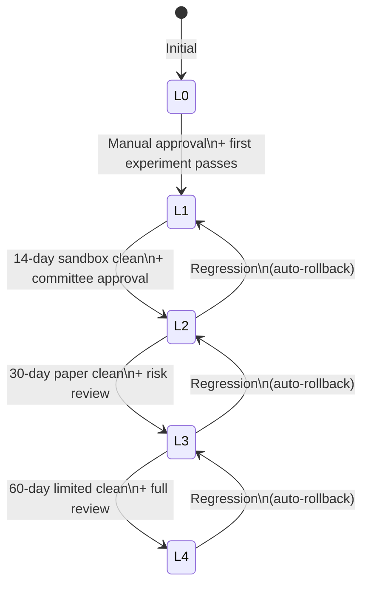

# Learning Stages (AT-01)

AT-01 progresses through 5 stages, each granting increasing autonomy and trading authority.

## Stage Definitions

**Source:** `learning/stages.py`

| Stage | Code | Name | Trading Authority | Human Oversight |
|---|---|---|---|---|
| L0 | `L0_FROZEN` | Frozen | None | Full |
| L1 | `L1_SANDBOX` | Sandbox | Paper only (mock) | Full |
| L2 | `L2_PAPER` | Paper Trading | Paper only (real data) | Periodic review |
| L3 | `L3_LIMITED` | Limited Live | Small trades (<1%) | Continuous monitoring |
| L4 | `L4_FULL` | Full Autonomy | Full portfolio | Exception-based |

## Stage Behaviors

### L0 — Frozen

- No autonomous actions
- All changes require operator approval
- Learning experiments run in mock only
- System generates recommendations, humans decide

### L1 — Sandbox

- Experiments run in mock environments
- No real or paper trades
- Confidence metrics collected
- Stage transition requires manual approval

### L2 — Paper Trading

- Experiments run with real market data, paper execution
- 30-day clean run required for L3 promotion
- Real-time monitoring of regressions
- Automatic rollback on regression detected

### L3 — Limited Live

- <1% of portfolio in live trades
- Continuous monitoring by Risk Engine
- Daily human review
- Automatic rollback on significant drawdown

### L4 — Full Autonomy

- Full portfolio authority
- Exception-based oversight
- Weekly human review
- Committee voting can override

## Stage Configuration

**Source:** `learning/stages.py::StageConfig`

```python
class StageConfig:
    """Configuration for each learning stage."""
    
    FROZEN = StageConfig(
        max_position_size=0,
        mock_environment=True,
        human_approval=True,
        max_daily_loss=0,
    )
    
    SANDBOX = StageConfig(
        max_position_size=0,
        mock_environment=True,
        human_approval=True,
        max_daily_loss=0,
    )
    
    PAPER = StageConfig(
        max_position_size=1.0,  # paper only
        mock_environment=False,
        human_approval=True,
        max_daily_loss=0.05,  # 5% stop-loss
    )
    
    LIMITED = StageConfig(
        max_position_size=0.01,  # 1% of portfolio
        mock_environment=False,
        human_approval=True,
        max_daily_loss=0.03,  # 3% stop-loss
    )
    
    FULL = StageConfig(
        max_position_size=1.0,  # full
        mock_environment=False,
        human_approval=False,
        max_daily_loss=0.10,  # 10% stop-loss
    )
```

## Stage Transitions



## Promotion Criteria

To advance from one stage to the next:

| Transition | Requirements |
|---|---|
| L0 → L1 | 3 experiments with >70% verdict pass rate |
| L1 → L2 | 14 days sandbox with no regressions |
| L2 → L3 | 30 days paper with <5% max drawdown |
| L3 → L4 | 60 days limited with <3% max drawdown + committee approval |

## Stage Control Commands

**Source:** `learning/control.py`

```python
# Pause learning (all stages)
learning.pause()

# Resume learning
learning.resume()

# Set current stage
learning.set_stage(LearningStage.L2_PAPER)

# Promote stage
learning.promote()

# Rollback stage
learning.rollback()

# Freeze specific behavior
learning.freeze_behavior("risk_multiplier")
```

## Test Coverage

- `tests/test_learning_stages.py` — Tests for stage transitions
- `tests/test_learning_control.py` — Tests for control commands
- `tests/test_learning_promotion.py` — Tests for promotion criteria
