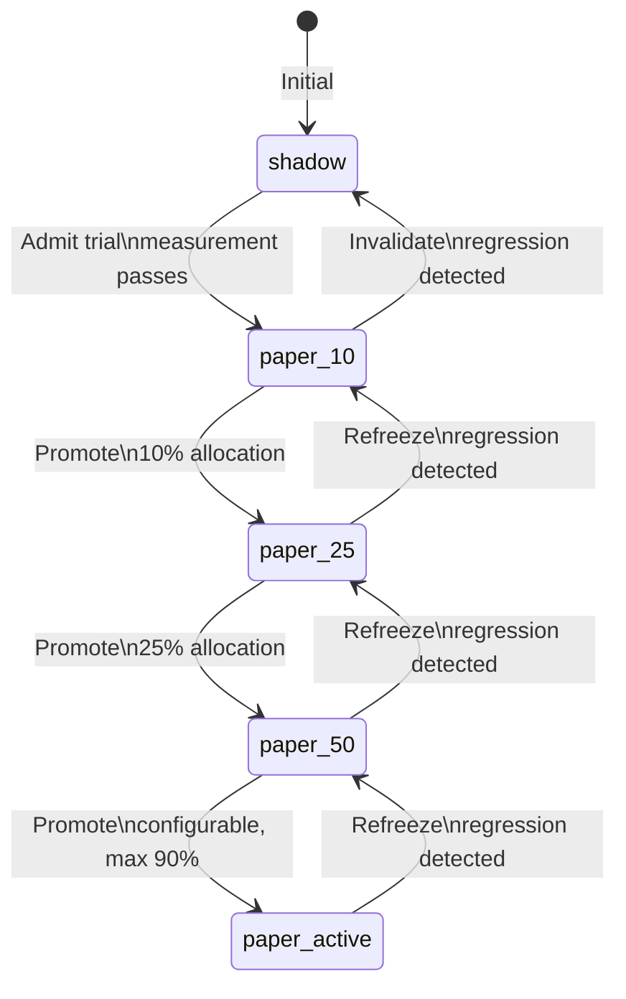

# Learning System (AT-01)

The **Learning System** (internally called **AT-01**) is Aletheia's framework for autonomous system improvement through **controlled experimentation and staged rollouts**. It enables the system to learn from past behavior, experiment with improvements, validate them through multiple analysis layers, and gradually promote learned changes from shadow to active trading.

## Learning Stages

AT-01 progresses through 5 stages:



| Stage | Allocation | Description |
|---|---|---|
| `shadow` | 0% | Always-on baseline. No trading influence. |
| `paper_10` | 10% | Paper trading with 10% of capital. |
| `paper_25` | 25% | Paper trading with 25% of capital. |
| `paper_50` | 50% | Paper trading with 50% of capital. |
| `paper_active` | configurable (max 90%) | Active trading with configurable allocation. |

### Stage Successor Map

```python
STAGE_SUCCESSOR = {
    "shadow": "paper_10",
    "paper_10": "paper_25",
    "paper_25": "paper_50",
    "paper_50": "paper_active",
}
```

### Stage Allocation Map

```python
STAGE_ALLOCATION = {
    "paper_10": 0.10,
    "paper_25": 0.25,
    "paper_50": 0.50,
}
```

## Lifecycle Actions

```python
LIFECYCLE_ACTIONS = frozenset({
    "admit_trial", "promote_stage", "hold", "refreeze", "invalidate",
})
```

| Action | Description |
|---|---|
| `admit_trial` | Admit a new experiment from shadow to paper_10. |
| `promote_stage` | Advance to the next stage (e.g., paper_10 → paper_25). |
| `hold` | Keep the experiment at the current stage. |
| `refreeze` | Freeze the experiment and revert to the previous stage. |
| `invalidate` | Invalidate the experiment and return to shadow. |

## Lifecycle Result

```python
@dataclass(frozen=True)
class LifecycleResult:
    action: str
    recommended_action: str
    reason: str
    experiment_id: str
    successor_experiment_id: str | None = None
    verdict_id: str | None = None
```

## Learning Authority

**Source:** `learning/authority.py`

The Learning Authority is the single decision point for lifecycle transitions. It is **read-only and fail-closed**, with 15+ sequential gate checks.

### `resolve_learning_authority() -> dict`

Resolves the current learning authority state. Returns the authority level and any blockers.

### Gate Hierarchy

1. **Global refreeze** — If global learning is refrozen, no transitions allowed.
2. **Behavior contract** — Current behavior contract hash must match.
3. **Policy epoch** — Current policy epoch must be valid.
4. **Trial admission** — Trial admission measurement block checks.
5. **Measurement harm** — Harm gate checks.
6. **Measurement identity** — Identity verification.
7. **Measurement intervention** — Intervention block checks.
8. **Authority resolution** — Final authority level determination.

### Measurement Verdicts

| Verdict | Description |
|---|---|
| `positive` | Measurement supports promotion. |
| `neutral` | Measurement is inconclusive. |
| `insufficient_data` | Not enough data for a decision. |
| `negative` | Measurement supports refreeze/invalidation. |
| `invalid` | Measurement is invalid. |

## Fixed-Look Inference

**Source:** `learning/fixed_look.py`

Prospective, once-consumed contract (`ufc-fixed-look/v2`) — freezes outcome-blind cutoff, consumes exactly one confirmatory verdict.

### `register_fixed_look_decision() -> dict`

Registers a fixed-look decision for an experiment.

### `get_consumed_fixed_look_verdict() -> dict`

Returns the consumed fixed-look verdict for an experiment.

## Experiment Management

**Source:** `learning/experiments.py`

### `apply_numeric_treatment() -> dict`

Records immutable exposures, applies only authorized paper treatments.

### `apply_boolean_treatment() -> dict`

Records immutable exposures, applies only authorized boolean treatments.

## Cohorts

**Source:** `learning/cohorts.py`

Exact, prospective contribution cohorts — `SUPPORTED_PATH_IDS` gates measurement to paths with explicit outcome contracts.

## Policy Epochs

**Source:** `learning/policy_epochs.py`

Deterministic, secret-free epoch hashing — code_commit excluded from hash to prevent epoch churn on rebuilds.

## Behavior Contracts

**Source:** `learning/behavior_contracts.py`

```python
def current_behavior_contract_hash() -> str:
    """Returns the hash of the current behavior contract."""
```

## Control

**Source:** `learning/control.py`

### `global_learning_refreeze_reason() -> str | None`

Returns the reason for global learning refreeze, or None if not refrozen.

## Models

**Source:** `learning/models.py`

### `LearningExperiment`

Dataclass representing a learning experiment with:
- `experiment_id`, `hypothesis_id`, `stage`, `status`
- `created_at`, `updated_at`, `completed_at`

### `LearningHypothesis`

Dataclass representing a learning hypothesis with:
- `hypothesis_id`, `behavior`, `domain`, `description`

### `LearningLifecycleEvent`

Dataclass representing a lifecycle event with:
- `event_id`, `experiment_id`, `action`, `reason`
- `audit_actor`, `audit_source`, `created_at`

## Ledger

**Source:** `learning/ledger.py`

### `insert_lifecycle_event(event: LearningLifecycleEvent) -> None`

Inserts a lifecycle event into the ledger.

### `get_latest_measurement_verdict(experiment_id: str) -> dict | None`

Returns the latest measurement verdict for an experiment.

### `list_lifecycle_events(experiment_id: str) -> list[LearningLifecycleEvent]`

Lists all lifecycle events for an experiment.

## Registry

**Source:** `learning/learning/registry.py`

Tracks the current state of all learning experiments and their associations.

## Key Invariants

1. **Durable and idempotent** — Lifecycle transitions are durable and idempotent.
2. **Read-only authority** — The authority system is read-only and fail-closed.
3. **Shadow baseline** — Shadow is always the baseline; it can never be turned off.
4. **Harm gate** — The harm gate cannot block safety actions.
5. **Global refreeze** — Global refreeze survives restart.

## Relationship to Other Components

- [Agent Decision Loop](../architecture/agent-decision-loop.md) — Learning gates trading decisions
- [Trading Loop](../architecture/trading-loop.md) — Full evidence pipeline
- [Risk Engine](../components/risk-engine.md) — Authority resolution for learned behavior
