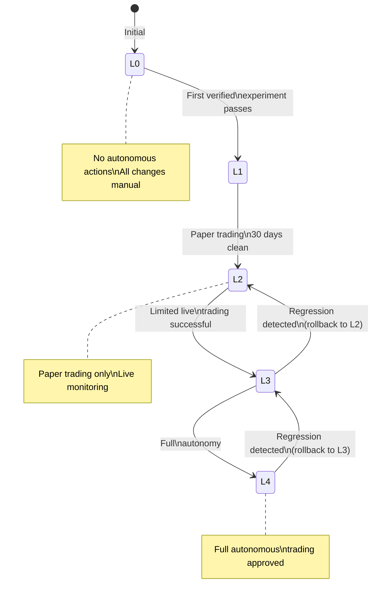
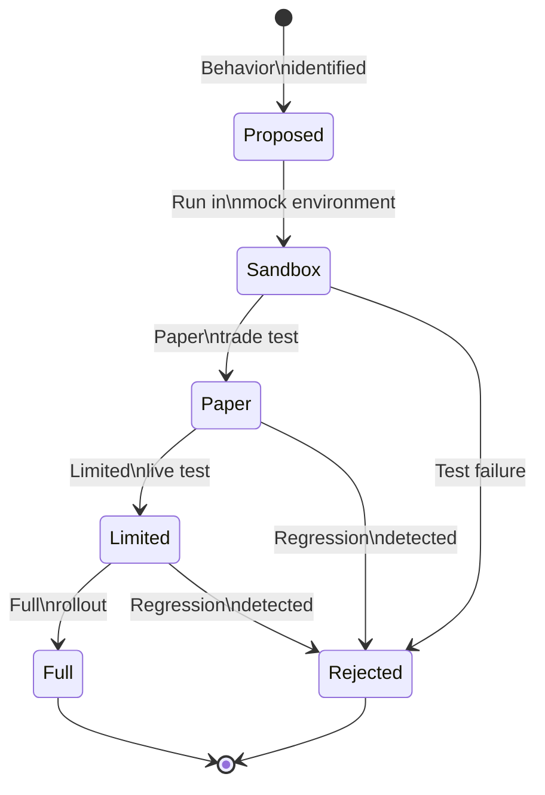

# Learning System (AT-01)

The **Learning System** (internally called **AT-01**) is Aletheia's framework for autonomous system improvement through **controlled experimentation and staged rollouts**. It enables the system to learn from past behavior, experiment with improvements, validate them through multiple analysis layers, and gradually promote learned changes from sandbox to full autonomy.

## Learning Stages

AT-01 progresses through 5 stages:



| Stage | Name | Autonomy Level | Description |
|---|---|---|---|
| `L0` | Frozen | None | No autonomous actions. All changes require operator approval. |
| `L1` | Sandbox | Minimal | Experiments run in sandbox with mock environments. |
| `L2` | Paper | Paper-only | Experiments run in paper trading with real data. |
| `L3` | Limited | Limited | Experiments run with small live trades (<1% portfolio). |
| `L4` | Full | Full | Experiments influence live trading at full scale. |

## Experiment Framework

**Source:** `learning/experiment.py`, `learning/control.py`

### Experiment Lifecycle

```mermaid
stateDiagram-via
```



### Experiment Creation

```python
from aletheia.learning.experiment import create_experiment

experiment = create_experiment(
    behavior="adjust_risk_for_volatility",
    hypothesis="Increasing risk multiplier in low-volatility regimes improves returns",
    domain="risk",
    stage=LearningStage.SANDBOX,
    test_config={
        "symbols": ["BTCUSDT", "ETHUSDT"],
        "duration_days": 7,
        "metrics": ["sharpe_ratio", "max_drawdown", "win_rate"]
    }
)
```

### Stages in Code

**Source:** `learning/stages.py`

Each stage has distinct characteristics:

```python
class LearningStage(Enum):
    L0_FROZEN = "l0_frozen"      # No autonomy
    L1_SANDBOX = "l1_sandbox"     # Mock environment
    L2_PAPER = "l2_paper"        # Paper trading
    L3_LIMITED = "l3_limited"    # Small live trades
    L4_FULL = "l4_full"          # Full autonomy

class StageConfig:
    """Configuration for each learning stage."""
    max_position_size: float  # % of portfolio
    mock_environment: bool    # Use mock data/execution
    human_approval: bool      # Require manual approval
    max_daily_loss: float     # Loss trigger for rollback
```

## Learning Authority

**Source:** `learning/authority.py`

The Learning Authority tracks which learned behaviors have influence:

```python
class LearningAuthority:
    """Tracks authority level for each learned behavior."""
    
    def get_authority(behavior: str) -> AuthorityLevel:
        """Get authority level for a behavior."""
        return self._authority_map.get(behavior, AuthorityLevel.L0)
    
    def can_influence_trading(behavior: str) -> bool:
        """Check if behavior has trading authority."""
        level = self.get_authority(behavior)
        return level.value >= AuthorityLevel.L2_PAPER.value
```

| Level | Name | Trading Authority |
|---|---|---|
| `L0` | Frozen | None |
| `L1` | Paper-only | Paper trading only |
| `L2` | Limited | Small live trades |
| `L3` | Full | Full trading influence |

## Verdict System

**Source:** `learning/verdicts.py`

After each experiment completes, a **verdict** is computed:

```python
@dataclass
class ExperimentVerdict:
    experiment_id: str
    stage_reached: LearningStage
    metrics: Dict[str, float]
    regression_detected: bool
    recommended_action: VerdictAction
    confidence: float
    evidence: List[str]

class VerdictAction(Enum):
    PROMOTE = "promote"      # Advance to next stage
    ROLLBACK = "rollback"    # Revert and freeze
    REJECT = "reject"        # Reject the behavior
    EXTEND = "extend"        # Extend experiment duration
```

### Verdict Criteria

| Metric | Promote Threshold | Rollback Threshold |
|---|---|---|
| Sharpe Ratio | > 1.5 | < 0.5 |
| Max Drawdown | < 20% | > 40% |
| Win Rate | > 50% | < 30% |
| Regression Flag | Not set | Set (from Fact Critic) |

## Rollback System

**Source:** `learning/rollback.py`

If a regression is detected, AT-01 performs an automated rollback:

1. **Detect regression** — Fact Critic or Risk Engine detects degradation
2. **Identify affected behaviors** — Which learned behaviors are active
3. **Rollback execution** — Revert behavior to previous known-good version
4. **Authority adjustment** — Reduce authority level for the behavior
5. **Notification** — System Operator alerted

```python
def perform_rollback(behavior: str, reason: str):
    """Rollback a learned behavior."""
    current_version = get_behavior_version(behavior)
    safe_version = find_safe_version(behavior)
    
    if safe_version:
        rollback_behavior(behavior, safe_version)
        reduce_authority(behavior, by_stages=1)
        logger.info(f"Rolled back {behavior} from {current_version} to {safe_version}")
        send_alert("LEARNING_ROLLBACK", f"Behavior {behavior} rolled back: {reason}")
```

## AT-01 Control Plane

**Source:** `learning/control.py`

The control plane manages learning state:

```python
class LearningControl:
    """AT-01 control plane."""
    
    def pause_learning(self):
        """Pause all learning experiments."""
        ...
    
    def resume_learning(self):
        """Resume learning experiments."""
        ...
    
    def enable_autonomous(self):
        """Enable autonomous learning (L4)."""
        ...
    
    def freeze_behavior(self, behavior: str):
        """Freeze a specific behavior at L0."""
        ...
    
    def promote_stage(self):
        """Advance entire system to next stage."""
        ...
```

## Learning Database

**Source:** `files/learning_schema.py`

Learning records are stored in SQLite:

| Table | Description |
|---|---|
| `learning_experiments` | Experiment definitions and configs |
| `learning_ledger` | Event ledger (all learning events) |
| `learning_verdicts` | Verdict results |
| `behavior_versions` | Version history of learned behaviors |
| `learning_rollbacks` | Rollback events |

## Key Symbols

| Symbol | Location | Description |
|---|---|---|
| `AT01System` | `learning/at01.py` | Main AT-01 system class |
| `LearningStage` | `learning/stages.py` | Stage enum |
| `StageConfig` | `learning/stages.py` | Stage configuration |
| `create_experiment` | `learning/experiment.py` | Create experiment |
| `ExperimentVerdict` | `learning/verdicts.py` | Verdict dataclass |
| `VerdictAction` | `learning/verdicts.py` | Verdict actions |
| `LearningAuthority` | `learning/authority.py` | Authority tracking |
| `perform_rollback` | `learning/rollback.py` | Rollback logic |
| `LearningControl` | `learning/control.py` | Control plane |

## Test Coverage

- `tests/test_learning_system.py` — Tests for AT-01 lifecycle
- `tests/test_learning_stages.py` — Tests for stage transitions
- `tests/test_experiments.py` — Tests for experiment creation
- `tests/test_verdicts.py` — Tests for verdict computation
- `tests/test_rollback.py` — Tests for rollback logic
- `tests/test_learning_authority.py` — Tests for authority tracking
- `tests/test_learning_control.py` — Tests for control plane

## Relationship to Other Components

- [Knowledge Base](knowledge-base.md) — Lessons and guardrails
- [Risk Engine](risk-engine.md) — Risk-based verdict criteria
- [Committee](committee.md) — Committee verdicts as verdict source
- [Runtime Engine](../runtime/engine.md) — Control commands
<!-- openwiki: broken internal link [../architecture/audit-ledger.md] file "../architecture/audit-ledger.md" does not exist. Fix the href or restore the target, then delete this comment. -->
- [Audit Ledger](../architecture/audit-ledger.md) — Learning event logging

## See Also

- [Learning Stages (AT-01)](learning-stages.md) — Stage definitions and transitions
