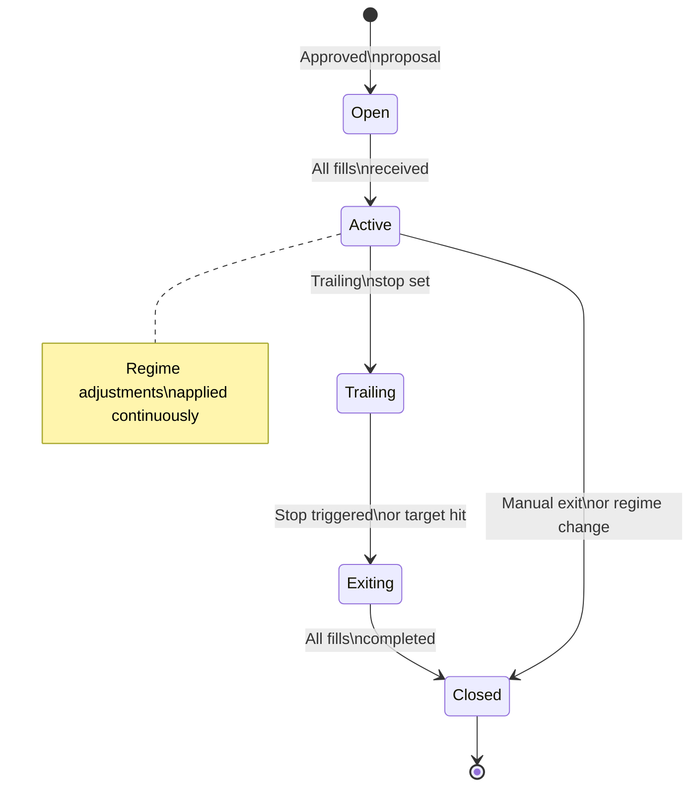

# Position Manager

The **Position Manager** (`aletheia/portfolio/position_manager.py`) manages the complete **position lifecycle**: opening, monitoring, and exiting positions. It receives risk-approved proposals from the Risk Engine and coordinates with the Execution Gateway for order submission. Position management is continuous — trailing stops, regime-based adjustments, and rebalancing are applied throughout a position's life.

## Position Lifecycle



## Opening Positions

**Source:** `portfolio/position_manager.py::open_position`

When a proposal is approved by the Risk Engine:

1. **Size calculation** — Position size determined by risk engine parameters (VaR, concentration limits)
2. **Slice calculation** — Large orders split into slices (TWAP execution over 30-60 min)
3. **Order generation** — Individual limit orders created per slice
4. **Gateway routing** — Orders sent to Execution Gateway
5. **Position entry** — Position record created in `portfolio_positions` table

## Monitoring & Trailing Stops

**Source:** `portfolio/position_manager.py::monitor_position`

Positions are monitored continuously:

| Check | Frequency | Action |
|---|---|---|
| Price vs trailing stop | Every 30s | Trigger exit if hit |
| Regime change | Every check | Adjust stop loss via Serenity Lens |
| Knowledge guard | On guard update | Trigger exit if guard activated |
| Time decay | Daily | Adjust exits for time-based strategies |
| Correlation risk | Hourly | Rebalance if correlation spikes |

### Trailing Stop Logic

```python
def update_trailing_stop(position, current_price, regime_state):
    base_distance = position.stop_loss_distance  # e.g., 8%
    regime_multiplier = REGIME_MULTIPLIERS[regime_state]  # 0.5-2.0x
    guard_adjustment = get_guard_adjustment(position.symbol)  # ±2%
    
    new_stop = current_price * (1 - base_distance * regime_multiplier + guard_adjustment)
    position.trailing_stop = max(position.trailing_stop, new_stop)
```

Trailing stops only move in the favorable direction (never lower for long positions, never higher for short positions).

## Exiting Positions

**Source:** `portfolio/position_manager.py::exit_position`

Exits are triggered by:

1. **Trailing stop hit** — Primary exit mechanism
2. **Profit target hit** — Pre-determined target price reached
3. **Regime change** — Serenity Lens detects regime shift
4. **Knowledge guard** — KB guard triggers exit (e.g., "exit ETH positions when Fed pivot narrative strengthens")
5. **Manual override** — System Operator command
6. **Learning rollback** — AT-01 rollback affects learned exit behavior

On exit:
1. Remaining slices are canceled
2. Exit order is sent to Execution Gateway
3. Position marked as closing
4. Post-trade review scheduled

## Portfolio Rebalancing

**Source:** `portfolio/rebalancer.py`

Weekly rebalancing to maintain target allocations:

1. **Target computation** — Based on current regime, knowledge guards, and portfolio objectives
2. **Deviation calculation** — Actual vs. target allocation
3. **Rebalance trades** — Generated for deviations > threshold (default 5%)
4. **Risk check** — All rebalance trades pass through Risk Engine
5. **Execution** — Sent through Position Manager → Execution Gateway

## Position Records

**Source:** `portfolio/models.py`

Each position is tracked in the `portfolio_positions` table:

| Field | Description |
|---|---|
| `id` | UUID |
| `symbol` | Trading symbol |
| `direction` | Long/Short |
| `entry_price` | Average entry price |
| `current_price` | Latest market price |
| `quantity` | Position size |
| `stop_loss` | Current stop loss price |
| `trailing_stop` | Trailing stop level |
| `take_profit` | Profit target |
| `unrealized_pnl` | Current P&L |
| `realized_pnl` | Realized P&L (post-exit) |
| `status` | open/active/closing/closed |
| `regime_at_entry` | Regime when opened |
| `created_at` | Entry timestamp |
| `closed_at` | Exit timestamp |
| `holding_period_hours` | Hours the position was held (tracked on close for quality-time correlation analysis by the AI Jury) |

## Key Symbols

| Symbol | Location | Description |
|---|---|---|
| `PositionManager` | `portfolio/position_manager.py` | Main position lifecycle manager |
| `open_position` | `portfolio/position_manager.py` | Open a new position |
| `monitor_position` | `portfolio/position_manager.py` | Monitor active position |
| `update_trailing_stop` | `portfolio/position_manager.py` | Trailing stop logic |
| `exit_position` | `portfolio/position_manager.py` | Exit a position |
| `Position` | `portfolio/models.py` | Position dataclass |
| `rebalance_portfolio` | `portfolio/rebalancer.py` | Weekly rebalancing |
| `generate_rebalance_trades` | `portfolio/rebalancer.py` | Trade generation for rebalancing |
| `REGIME_MULTIPLIERS` | `portfolio/position_manager.py` | Stop loss multipliers per regime |

## Test Coverage

- `tests/test_position_manager.py` — Tests for open, monitor, exit lifecycle
- `tests/test_trailing_stops.py` — Tests for trailing stop logic, regime adjustments
- `tests/test_position_exit.py` — Tests for exit triggers (stop, target, regime, guard)
- `tests/test_rebalancer.py` — Tests for rebalancing logic
- `tests/test_portfolio_models.py` — Tests for Position dataclass
- `tests/test_regime_adjustments_pm.py` — Tests for regime-based position adjustments

## Relationship to Other Components

- [Risk Engine](risk-engine.md) — Receives risk-approved proposals
- [Execution Gateway](execution-gateway.md) — Order execution
- [Serenity Lens](serenity-lens.md) — Regime state for stop adjustments
- [Knowledge Base](knowledge-base.md) — Guards for exit triggers
- [Learning System](learning-system.md) — AT-01 rollback affects learned exit behavior
