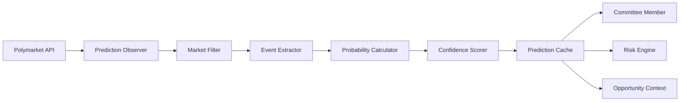

# Prediction Lens

The **Prediction Lens** (`agents/committee/prediction_lens.py`, `prediction/`) evaluates trading opportunities against **prediction market** data — primarily Polymarket — to identify opportunities where market prices diverge from event probabilities. It answers: *"What do prediction markets say about the events driving this opportunity?"*

## Role & Purpose

Prediction Lens provides a **probability-based reality check** on trading opportunities:

1. **Event probability extraction** — Pulls market-implied probabilities for relevant events
2. **Divergence identification** — Compares opportunity assumptions against market probabilities
3. **Confidence assessment** — Assigns confidence based on prediction market liquidity
4. **Committee voting** — Scores opportunities as an Investment Committee member

## Prediction Market Sources

| Source | Data | Update Frequency |
|---|---|---|
| **Polymarket** | Binary event markets, sentiment | 15 min |
| **Kalshi** | Event markets, FOMC outcomes | 30 min |
| **Manifold** | Community prediction markets | 60 min |

Polymarket is the primary source (~80% of probability signals come from Polymarket).

## The Prediction Pipeline

**Source:** `prediction/pipeline.py`



### Stage 1: Polymarket Data Collection

**Source:** `prediction/polymarket_collector.py`

- Polls Polymarket API every 15 minutes
- Filters markets by: liquidity (> $10k), volume (> $1k), resolution date (> 24h)
- Stores raw market data in the `prediction_markets` table

### Stage 2: Event Extraction

**Source:** `prediction/event_extractor.py`

- Extracts events from market titles using NLP entity extraction
- Maps events to canonical event types (economic, geopolitical, technical, sentiment)
- Stores in `prediction_events` table with event_id, type, description, resolution_date

### Stage 3: Probability Calculation

**Source:** `prediction/probability_calculator.py`

Converts market prices to probabilities:

```
P(event) = market_price * (1 - fee) - fee_buffer
```

Where:
- `market_price` — Polymarket binary market price (0-1)
- `fee` — Platform fee (default 2.5%)
- `fee_buffer` — Safety buffer (default 1%)
- `P(event)` — Adjusted event probability

### Stage 4: Confidence Scoring

**Source:** `prediction/confidence.py`

Confidence in a probability estimate based on:

| Factor | Weight | Description |
|---|---|---|
| Market liquidity | 0.40 | Higher liquidity = higher confidence |
| Market volume | 0.30 | Higher volume = higher confidence |
| Time to resolution | 0.15 | Closer to resolution = higher confidence |
| Historical accuracy | 0.15 | Past prediction accuracy |

```python
confidence = (
    min(liquidity / 100000, 1.0) * 0.40 +
    min(volume / 50000, 1.0) * 0.30 +
    (1 - days_to_resolution / 90) * 0.15 +
    historical_accuracy * 0.15
)
```

## Prediction Lens as Committee Member

**Source:** `agents/committee/prediction_lens.py`

In the Investment Committee, Prediction Lens votes with weight 0.20 by default:

```python
def score_opportunity(self, opportunity, prediction_context):
    # Find relevant prediction events for this opportunity
    events = self.find_relevant_events(opportunity, prediction_context)
    
    if not events:
        return 0.5  # Neutral if no prediction data
    
    # Calculate divergence score
    divergence = self.calculate_divergence(opportunity, events)
    
    # Weight by confidence
    weighted_score = divergence * events.confidence
    
    return weighted_score
```

### Divergence Scoring

The divergence score measures how far the opportunity's implied probability differs from the market-implied probability:

```
divergence = |implied_prob - market_prob| * confidence
```

High divergence = high information value (the opportunity may be under/overpriced relative to prediction markets).

## Integration Points

### Risk Engine

**Source:** `risk/engine.py`

Prediction probabilities are used as **external probability inputs** alongside internal model probabilities:

```python
external_prob = prediction_lens.get_event_probability(event_id)
combined_prob = combine_probabilities(internal_prob, external_prob, weight=0.3)
```

### Opportunity Context

**Source:** `opportunity/context.py`

When an opportunity is evaluated, Prediction Lens enriches it with relevant prediction event probabilities. This context flows to:
- Committee scoring
- Risk assessment
- Paper trader ranking

### Knowledge Base

Prediction Lens lessons feed into the Knowledge Base:
- **Fact Critic** validates prediction market interpretations
- **Market Observer** cross-references prediction events with news
- Guardrails are created for consistently inaccurate prediction sources

## Prediction Cache

**Source:** `prediction/cache.py`

- TTL-based cache (15 min) of prediction probabilities
- Avoids redundant API calls during committee sessions
- Cache stampede prevention with jittered refresh

## Key Symbols

| Symbol | Location | Description |
|---|---|---|
| `PredictionLens` | `agents/committee/prediction_lens.py` | Committee member |
| `run_prediction_pipeline` | `prediction/pipeline.py` | Main pipeline entry |
| `collect_polymarket` | `prediction/polymarket_collector.py` | Polymarket data collection |
| `extract_events` | `prediction/event_extractor.py` | Event extraction from markets |
| `calculate_probability` | `prediction/probability_calculator.py` | Price to probability conversion |
| `score_confidence` | `prediction/confidence.py` | Confidence scoring |
| `find_relevant_events` | `agents/committee/prediction_lens.py` | Event-opportunity matching |
| `calculate_divergence` | `agents/committee/prediction_lens.py` | Divergence scoring |

## Test Coverage

- `tests/test_prediction_lens.py` — Tests for committee scoring, divergence
- `tests/test_polymarket_collector.py` — Tests for market data collection and filtering
- `tests/test_probability_calculator.py` — Tests for probability conversion
- `tests/test_confidence.py` — Tests for confidence scoring
- `tests/test_event_extractor.py` — Tests for event NLP extraction

## Relationship to Other Components

- [Serenity Lens](serenity-lens.md) — Complementary macro-narrative analysis
- [Investment Committee](investment-committee.md) — Committee member (weight 0.20)
<!-- openwiki: broken internal link [fact-critic.md] file "fact-critic.md" does not exist. Fix the href or restore the target, then delete this comment. -->
- [Fact Critic](fact-critic.md) — Fact-checking prediction market interpretations
- [Risk Engine](risk-engine.md) — External probability integration
