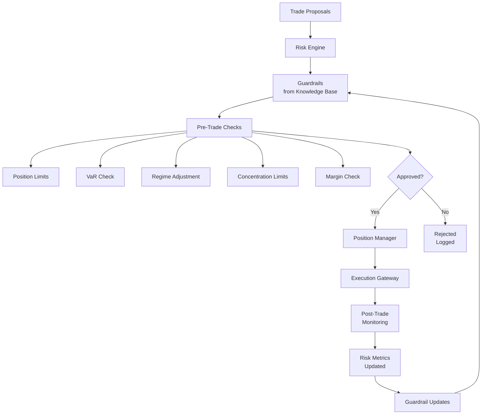

# Risk Engine

The **Risk Engine** (`aletheia/risk/`) is the centralized risk management system that enforces safety constraints across all trading activity. It operates at two levels: **pre-trade** (blocking/clearing proposals) and **post-trade** (monitoring and adjustment). The risk engine is consulted by the Investment Committee, Position Manager, and Execution Gateway.

## Architecture



## Risk Guardrails

**Source:** `risk/guards.py`, `knowledge/guards.py`

Guardrails are dynamic constraints stored in the Knowledge Base and applied by the risk engine:

| Guard Type | Source | Description |
|---|---|---|
| `risk_guard` | `knowledge/guards.py` | Adjusts risk multipliers per regime |
| `entry_guard` | `knowledge/guards.py` | Blocks entry to certain opportunities |
| `exit_guard` | `knowledge/guards.py` | Triggers early exits |
| `regime_guard` | `knowledge/guards.py` | Adjusts behavior per market regime |
| `cost_guard` | `knowledge/guards.py` | Blocks high-cost LLM calls |
| `learned_behavior_guard` | `learning/authority.py` | Gates learned behavior influence |

Guards are refreshed:
- On regime change (Serenity Lens)
- Weekly via Knowledge Maintenance
- On learning experiment verdict change (AT-01)

## Pre-Trade Checks

**Source:** `risk/pre_trade.py`

Every trade proposal passes through these checks before approval:

### 1. Position Limits

**Source:** `risk/limits.py`

| Limit Type | Default | Source |
|---|---|---|
| Per-symbol position | 15% of portfolio | `risk/limits.py::MAX_SYMBOL_EXPOSURE` |
| Per-sector position | 30% of portfolio | `risk/limits.py::MAX_SECTOR_EXPOSURE` |
| Total long exposure | 120% of portfolio | `risk/limits.py::MAX_LONG_EXPOSURE` |
| Total short exposure | 80% of portfolio | `risk/limits.py::MAX_SHORT_EXPOSURE` |
| Net exposure | ±20% | `risk/limits.py::MAX_NET_EXPOSURE` |

### 2. VaR (Value at Risk) Check

**Source:** `risk/var.py`

- Uses historical simulation VaR (95% confidence, 1-day horizon)
- Portfolio-level and position-level VaR computed
- If proposed trade increases VaR beyond threshold, requires approval escalation
- VaR computed using 252 days of historical returns

### 3. Regime Adjustment

**Source:** `risk/regime_adjustments.py`

Risk parameters are adjusted based on the current market regime (from Serenity Lens):

| Regime | Position Size Multiplier | Stop Loss Multiplier | Var Threshold Multiplier |
|---|---|---|---|
| Bull | 1.0x | 1.0x | 1.0x |
| Bear | 0.5x | 1.5x | 1.5x |
| Sideways | 0.8x | 1.2x | 1.2x |
| Volatile | 0.3x | 2.0x | 2.5x |

### 4. Concentration Limits

**Source:** `risk/concentration.py`

- Maximum 30% of portfolio in any single asset
- Maximum 50% in any single sector
- Maximum 20% in any single strategy type
- Concentration is measured as % of total portfolio NAV

### 5. Margin Check

**Source:** `risk/margin.py`

- For leveraged positions: margin requirement calculated
- Ensures sufficient collateral remains after the trade
- Uses maintenance margin (150% of initial margin)
- Liquidation risk assessed if margin would fall below 125%

## Post-Trade Monitoring

**Source:** `risk/monitoring.py`

After a trade is executed, the risk engine monitors:

1. **Realized P&L** — Updated in real-time
2. **Unrealized P&L** — Marked to market every 5 minutes
3. **Risk metrics** — VaR, beta, drawdown, correlation — updated hourly
4. **Margin levels** — Monitored every minute for leveraged positions
5. **Regime drift** — If regime changes while a position is open, trailing stops are adjusted

## Risk Metrics

**Source:** `risk/metrics.py`

| Metric | Calculation | Frequency |
|---|---|---|
| VaR (95%) | Historical simulation | Hourly |
| Expected Shortfall | Mean loss beyond VaR | Hourly |
| Beta | Regression vs benchmark | Daily |
| Portfolio volatility | 30-day rolling std | Daily |
| Max drawdown | Peak-to-trough | Daily |
| Correlation matrix | 30-day returns | Daily |
| Sharpe ratio | Return/volatility | Daily |

## Authority Resolution

**Source:** `risk/engine.py::resolve_authority`

The risk engine checks the **Learning Authority** before allowing learned behavior to influence risk decisions:

```python
def resolve_authority(self, behavior_id):
    authority = self.learning_authority.get_authority(behavior_id)
    if authority.level == AuthorityLevel.FROZEN:
        return False
    elif authority.level == AuthorityLevel.PAPER:
        return True  # Paper trades only
    elif authority.level == AuthorityLevel.AUTONOMOUS:
        return True  # Full authority
    return False
```

## Key Symbols

| Symbol | Location | Description |
|---|---|---|
| `RiskEngine` | `risk/engine.py` | Main risk engine class |
| `check_pre_trade` | `risk/pre_trade.py` | Pre-trade risk checks |
| `MAX_SYMBOL_EXPOSURE` | `risk/limits.py` | 15% per symbol limit |
| `compute_var` | `risk/var.py` | VaR calculation |
| `RegimeAdjustment` | `risk/regime_adjustments.py` | Regime-based multipliers |
| `check_concentration` | `risk/concentration.py` | Concentration limits |
| `update_monitoring` | `risk/monitoring.py` | Post-trade monitoring |
| `calculate_metrics` | `risk/metrics.py` | Risk metrics computation |
| `resolve_authority` | `risk/engine.py` | Learning authority check |

## Test Coverage

- `tests/test_risk_engine.py` — Tests for pre-trade checks, approval flow
- `tests/test_risk_limits.py` — Tests for position limit enforcement
- `tests/test_risk_var.py` — Tests for VaR calculation
- `tests/test_risk_regime.py` — Tests for regime-based adjustments
- `tests/test_risk_concentration.py` — Tests for concentration limits
- `tests/test_risk_monitoring.py` — Tests for post-trade monitoring
- `tests/test_risk_metrics.py` — Tests for risk metric computation
- `tests/test_risk_authority.py` — Tests for authority resolution

## Relationship to Other Components

- [Learning System](learning-system.md) — Authority resolution for learned behavior
- [Position Manager](position-manager.md) — Position management (receives risk approval)
- [Execution Gateway](execution-gateway.md) — Execution (receives risk approval)
- [Knowledge Base](knowledge-base.md) — Guardrails
- [Serenity Lens](serenity-lens.md) — Regime state input
