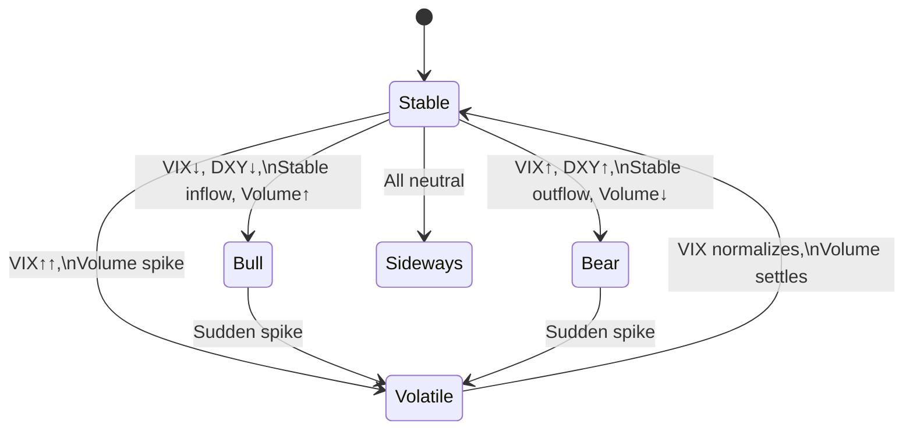

# Serenity Lens

The **Serenity Lens** (`aletheia/regime/serenity.py`, `agents/committee/serenity_lens.py`) provides macro-situational awareness by contextualizing portfolio decisions with **market regime** and **narrative signals**. It answers: *"Given the current macro environment, what should we pay attention to?"*

## Role & Purpose

Serenity Lens lives at the intersection of regime detection and narrative analysis. It produces three key outputs consumed by the broader system:

1. **Regime State** — The current market regime (Bull, Bear, Sideways, Volatile)
2. **Narrative Signals** — Top macroeconomic narratives driving market behavior
3. **Attention Weights** — Which factors should be prioritized in decision-making

## Inputs

| Input | Source | Frequency |
|---|---|---|
| VIX | `data/collectors/macro.py` | 15 min |
| DXY (Dollar Index) | `data/collectors/macro.py` | 15 min |
| Stablecoin TVL | `data/collectors/chain.py` | 30 min |
| DEX Volume | `data/collectors/binance_public.py` | 15 min |
| Economic Calendar | `data/collectors/macro.py` | Daily |
| News Sentiment | `data/news_analyzer.py` | 10 min |

## Regime Detection

**Source:** `aletheia/regime/serenity.py`, `aletheia/regime/detector.py`

Serenity Lens uses the regime detection pipeline (described in [Regime Detection Pipeline](../architecture/regime-detection-pipeline.md)). The detection algorithm:

1. **Z-score normalization** of VIX, DXY, and volume over 30-day rolling windows
2. **Regime voting** — 4 axes (volatility, dollar strength, liquidity, volume) each vote for a regime
3. **Debounce** — 3 consecutive matching detections required (45 minutes) to prevent flip-flopping
4. **Regime publication** — Published to the `regime_state` table

### Regime Definitions

| Regime | Characteristics | Risk Adjustment |
|---|---|---|
| **Bull** | Rising prices, low volatility, positive sentiment | Increase exposure, widen stops |
| **Bear** | Falling prices, high volatility, negative sentiment | Reduce exposure, tighten stops |
| **Sideways** | Flat prices, low volatility, mixed sentiment | Maintain neutral exposure |
| **Volatile** | High volatility, rapidly changing direction | Reduce exposure, widen stops, increase cash |

## Narrative Signals

**Source:** `aletheia/regime/narratives.py`

Beyond regime classification, Serenity Lens identifies the top 3 macroeconomic narratives:

1. **Central Bank Policy** — Fed funds, QE, rate cuts/hikes
2. **Geopolitical Risk** — Wars, sanctions, political instability
3. **Inflation/CPI** — Consumer price data, commodity prices
4. **Growth Sentiment** — GDP, earnings, employment
5. **Liquidity Conditions** — Stablecoin flows, DEX liquidity

Each narrative gets a **strength score** (0-1) and a **direction** (bullish/bearish/neutral) based on aggregated news sentiment and data flows.

## Attention Weights

**Source:** `aletheia/regime/serenity.py::compute_attention_weights`

Serenity Lens computes attention weights for each factor used in portfolio construction:

```python
weights = {
    "momentum": 0.25,
    "volatility": 0.15,
    "value": 0.10,
    "regime_alignment": 0.20,
    "narrative": 0.15,
    "liquidity": 0.15,
}
```

These weights are:
- Adjusted per regime (e.g., volatility gets higher weight in Volatile regime)
- Applied to portfolio construction in `portfolio/`
- Passed to committee member scoring in `agents/committee/`

## Serenity Lens as Committee Member

In the Investment Committee, Serenity Lens serves as a voting member (weight 0.30 by default):

**Source:** `agents/committee/serenity_lens.py`

The committee Serenity Lens:
1. Receives candidate opportunities from the opportunity set
2. Scores each opportunity against the current regime and narratives
3. Produces a **regime alignment score** (0-1) per opportunity
4. Votes on the collective assessment with its weighted score

## Knowledge Integration

Serenity Lens integrates with the Knowledge Base:

- **Guardrails:** `knowledge/guards.py` produces `regime_guard` entries that adjust attention weights per regime
- **Lessons:** Regime-specific lessons are surfaced via `search_knowledge(domain="serenity")`
- **Maintenance:** Weekly, the Knowledge Maintainer re-validates regime guardrails against recent outcomes

## Regime Transitions & Portfolio Impact

```mermaid
stateDiagram-via
```



When a regime transition occurs, Serenity Lens triggers:
1. **Portfolio rebalancing** — `portfolio/position_manager.py` adjusts positions per new regime
2. **Guardrail updates** — `knowledge/guards.py` regenerates regime guards
3. **Attention weight updates** — Recomputed immediately
4. **Committee recalibration** — Committee weights adjusted for regime-aware scoring

## Key Symbols

| Symbol | Location | Description |
|---|---|---|
| `SerenityLens` | `regime/serenity.py` | Main Serenity Lens class |
| `RegimeState` | `regime/serenity.py` | Enum: BULL, BEAR, SIDEWAYS, VOLATILE |
| `detect_regime` | `regime/detector.py` | Regime detection with debounce |
| `compute_attention_weights` | `regime/serenity.py` | Attention weight computation |
| `identify_narratives` | `regime/narratives.py` | Top 3 macro narratives |
| `score_opportunity` | `agents/committee/serenity_lens.py` | Committee scoring of opportunities |
| `apply_regime_adjustment` | `portfolio/position_manager.py` | Portfolio rebalancing per regime |

## Test Coverage

- `tests/test_serenity_lens.py` — Tests for regime scoring, attention weights
- `tests/test_regime_detector.py` — Tests for detection logic, debounce
- `tests/test_narratives.py` — Tests for narrative signal extraction
- `tests/test_regime_attention.py` — Tests for attention weight computation

## Relationship to Other Components

- [Regime Detection Pipeline](../architecture/regime-detection-pipeline.md) — Data collection and detection
- [Investment Committee](investment-committee.md) — Committee member voting
- [Knowledge Base](knowledge-base.md) — Guardrails and lessons
- [Risk Engine](../components/risk-engine.md) — Regime-based risk adjustments
