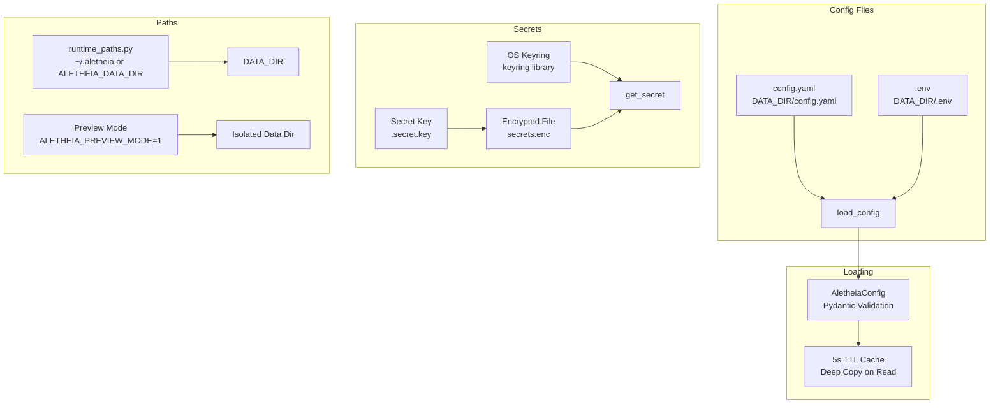

# Configuration System

The **Configuration System** manages Aletheia's runtime configuration, secrets, and file paths. It uses a Pydantic-validated YAML config with hot-reloading, OS keyring secrets, and preview mode isolation.

## Architecture



## Config Loading (`config/loader.py`)

### `load_config(*, persist_migrations=True, deep_copy=True) -> AletheiaConfig`

- **Hot path uses in-memory cache** with 5-second TTL (`_CONFIG_CACHE_TTL = 5.0`)
- **Deep copy on read** by default — prevents phantom mutations from corrupting the cache
- `deep_copy=False` returns the cached object directly for read-only callers (perf optimization)
- **Legacy mode migration** — maps old permission modes (`ReadOnly`→`Observe`, `PaperAuto`→`Paper`, etc.)
- **Runtime home migration** — calls `assert_runtime_home_ready()` before loading

### `save_config(cfg: AletheiaConfig) -> None`

- Atomic write via `tempfile.mkstemp` + `os.replace`
- Thread-safe via `_config_write_lock`
- Invalidates cache immediately
- Emits consistency events via `_emit_consistency_events(cfg)`

### `is_preview_mode() -> bool`

Whether this process is an explicitly isolated development API.

### `preview_data_dir() -> Path`

Returns the only data root an isolated preview process may use. Must be under `~/.aletheia/instances/dev-preview`.

### `runtime_data_dir() -> Path`

Returns the durable data root for the primary runtime. Honors `ALETHEIA_DATA_DIR` absolute override.

## Config Schema (`config/schema.py`)

`AletheiaConfig` is the top-level Pydantic model with these sections:

| Field | Model | Key Defaults |
|-------|-------|--------------|
| `app` | `AppConfig` | `dashboard_port=8787`, `bind_host="127.0.0.1"` |
| `runtime` | `RuntimeConfig` | `gateway_mode="background"`, `scheduler_enabled=True`, `kill_switch_active=False` |
| `exchange` | `ExchangeConfig` | `name="paper_internal"`, `mode="paper"` |
| `market_data` | `MarketDataConfig` | `provider="ccxt"`, `ccxt_exchange="binance"` |
| `live` | `LiveConfig` | `state="live_disabled"` |
| `agent` | `AgentConfig` | `permission_mode="Paper"` |
| `operator` | `OperatorConfig` | `enabled=True`, `port=8791` |
| `models` | `ModelsConfig` | `default_provider=""`, `providers={}` |
| `risk` | `RiskConfig` | `schema_version=3`, demo/live `ModeRiskPolicy` |
| `telegram` | `TelegramConfig` | `enabled=False` |
| `webhook` | `WebhookConfig` | `enabled=False` |
| `update` | `UpdateConfig` | `enabled=True`, `branch="master"` |
| `trading` | `TradingConfig` | `default_stop_loss_pct=2.0`, `default_take_profit_pct=4.0` |
| `retention` | `RetentionConfig` | `pruning_enabled=True`, `app_db_capacity_mb=2048` |
| `health` | `HealthConfig` | `enabled=True`, `self_heal_enabled=True` |
| `universe` | `UniverseConfig` | `enabled=True`, `refresh_interval_min=10` |
| `regime` | `RegimeConfig` | `enabled=True` |
| `guard` | `GuardConfig` | `enabled=True`, `auto_promote_enabled=False` |
| `tunnel` | `TunnelConfig` | `enabled=False` |
| `pi_daemon` | `PiDaemonConfig` | `enabled=True`, `decision_interval_minutes=30` |
| `news` | `NewsConfig` | `enabled=True`, `fetch_interval_minutes=15` |
| `serenity` | `SerenityConfig` | `enabled=False`, `auto_promote=False` |
| `controller` | `ControllerConfig` | `shadow_enabled=False` |
| `learning` | `LearningConfig` | `contribution_evaluation_enabled=True` |
| `economics` | `EconomicsConfig` | `enabled=False` |

## Secrets Management (`config/secrets.py`)

### Approach

- **OS keyring first** (via `keyring` library), **encrypted file fallback**
- **Never logs secrets**
- **Preview mode blocks all secret writes** (`PreviewSecretAccessError`)

### Storage

- **Keyring service name:** `"aletheia-trading-os"`
- **Encrypted file:** `get_data_dir() / "secrets.enc"`
- **Encryption:** Fernet (from `cryptography` library)
- **Key file:** `get_data_dir() / ".secret.key"` (generated if missing)

### API

```python
def set_secret(key: str, value: str) -> None:   # writes to file + best-effort keyring
def get_secret(key: str) -> str | None:          # keyring first, then file
def delete_secret(key: str) -> None:             # fails closed
def migrate_keyring_to_file() -> int:            # copies keyring secrets to file
```

### Known Keys

The system recognizes keys for:
- Bitget (demo/live): `bitget.api_key`, `bitget.api_secret`, `bitget.passphrase`
- Binance (testnet/live): `binance.api_key`, `binance.api_secret`
- OKX (demo/live): `okx.api_key`, `okx.api_secret`, `okx.passphrase`
- Model providers: `model.databricks.api_key`, `model.anthropic.api_key`, `model.openai.api_key`
- `coinalyze_api_key`

## Runtime Paths (`runtime_paths.py`)

### Path Resolution

| Path | Resolution |
|------|------------|
| Primary runtime root | `~/.aletheia/` (or `ALETHEIA_DATA_DIR`) |
| Preview root | `~/.aletheia/instances/dev-preview/` |
| Preview instance | `~/.aletheia/instances/dev-preview/<checkout_id>/<port>/` |
| Config file | `<DATA_DIR>/config.yaml` |
| Database | `<DATA_DIR>/app.db` |
| Logs | `<DATA_DIR>/logs/` |
| Events | `<DATA_DIR>/events/` |
| Artifacts | `<DATA_DIR>/artifacts/` |
| Secrets file | `<DATA_DIR>/secrets.enc` |
| Secret key | `<DATA_DIR>/.secret.key` |

## Data Directory Structure

`ensure_data_dirs()` creates:

```
DATA_DIR/
├── logs/
├── knowledge/
│   ├── evidence/
│   ├── research_notes/
│   ├── strategies/
│   ├── agent_memory/
│   ├── daily_reviews/
│   ├── dreaming_logs/
│   ├── post_trade_reviews/
│   └── deprecated/
├── playbooks/
├── reports/
│   ├── daily/
│   ├── post_trade/
│   ├── system_health/
│   ├── trade_review/
│   ├── risk/
│   └── agent_performance/
├── exports/
├── events/
├── backups/
└── artifacts/
    ├── evidence/
    ├── claims/
    ├── market_snapshots/
    ├── analyses/
    ├── opportunities/
    ├── strategy_specs/
    ├── validation_reports/
    ├── proposals/
    ├── paper_runs/
    ├── live_runs/
    ├── reconciliation_reports/
    ├── reviews/
    ├── lessons/
    └── skills/
```

## Key Invariants

1. **Secrets isolation** — Secrets are stored in the OS keyring or an encrypted file, never in config.yaml or logs.
2. **Preview isolation** — Preview mode uses an isolated data directory and blocks secret writes.
3. **Config caching** — Config is cached with a 5-second TTL and deep-copied on read.
4. **Atomic writes** — Config saves use atomic write (tempfile + rename).
5. **Thread safety** — Config writes are thread-safe via a lock.

## Relationship to Other Components

- [Gateway](services/gateway.md) — Uses config for all lifecycle decisions
- [Agent Decision Loop](../architecture/agent-decision-loop.md) — Consumes config for runtime guards
- [Trading Loop](../architecture/trading-loop.md) — Full evidence pipeline
