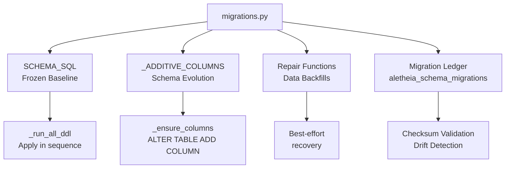

# Data Migrations & Schema

Aletheia's database uses a **versioned migration system** defined entirely in `aletheia/storage/migrations.py`. The schema is split into a frozen legacy baseline and additive migrations recorded in a ledger.

## Schema Version

- **Current schema version:** `aletheia-sqlite-v29` (`SCHEMA_VERSION`)
- **Legacy baseline version:** `aletheia-sqlite-v2` (`_LEGACY_BASELINE_SCHEMA_VERSION`)
- **Legacy baseline ID:** `20260806_0001_legacy_schema_v2`

## Migration Ledger

```sql
CREATE TABLE IF NOT EXISTS aletheia_schema_migrations (
    migration_id TEXT PRIMARY KEY,
    checksum TEXT NOT NULL,
    schema_version TEXT NOT NULL,
    applied_at TEXT NOT NULL,
    duration_ms REAL NOT NULL CHECK (duration_ms >= 0)
);
```

Each migration is recorded with a SHA-256 checksum so drift is detected if a migration is edited after being applied.

## Architecture



## The Baseline

The `SCHEMA_SQL` constant (lines 20–1348 of `migrations.py`) is the frozen legacy baseline. It creates all core tables:

- `settings`, `agent_runs`, `agent_run_steps`, `agent_tool_calls`
- `opportunities`, `trade_proposals`, `proposal_execution_claims`
- `entry_risk_reservations`, `risk_decisions`, `approvals`
- `orders`, `fills`, `positions`, `shadow_trades`
- `alpha_control_observations`, `filter_decisions`, `filter_decision_batches`
- `filter_candidate_outcomes`, `serenity_themes`, `serenity_evidence`
- `serenity_opportunities`, `serenity_risk_gates`, `portfolio_snapshots`
- `strategy_records`, `strategy_experiments`, `knowledge_items`
- `market_snapshots`, `audit_events`, `news_items`, `market_ohlcv`
- `runtime_registry`, `runtime_checkpoints`, `runtime_events`
- `agent_shell_sessions`, `agent_shell_commands`, `agent_shell_messages`
- `agent_shell_tasks`, `agent_shell_artifacts`, `agent_shell_heartbeats`
- `extension_registry`, `extension_runs`
- `serenity_research_runs`, `serenity_user_profiles`
- `ps_event_log`, `ps_gateway_sessions`, `ps_gateway_locks`
- `ps_reconciliation_reports`, `ps_execution_intents`, `ps_order_intents`
- `ps_orders`, `ps_fills`, `ps_positions`, `ps_checkpoints`
- `ps_lessons`, `ps_skills`, `ps_policy_versions`
- `ps_scheduled_jobs`, `ps_job_runs`
- `universe_registry`, `universe_feature_snapshots`, `universe_scanner_runs`
- `universe_snapshots`, `universe_members`, `universe_forward_outcomes`
- `universe_policies`, `runtime_sessions`

## Data Collector DDL

The `_DATA_COLLECTORS_DDL` block creates:

- `orderbook_snapshots`, `funding_rate_snapshots`, `open_interest_snapshots`
- `liquidation_events`, `perp_structure_snapshots`, `perp_structure_shadow_outcomes`
- `macro_snapshots`, `coingecko_top_snapshots`, `onchain_snapshots`

## Prediction Market DDL

The `_PREDICTION_NORMALIZED_DDL` block creates:

- `prediction_observer_runs`, `prediction_events`, `prediction_markets`
- `prediction_probability_snapshots`, `prediction_market_claims`

## Learning Ledger DDL

The `_LEARNING_LEDGER_DDL` block creates:

- `learning_hypotheses`, `learning_experiments`, `learning_exposures`
- `learning_contribution_verdicts`, `learning_lifecycle_events`
- `learning_job_health`, `learning_policy_epochs`

## Additive Columns Pattern

`_ADDITIVE_COLUMNS` is a list of `(col, table, coltype)` tuples. This is the primary mechanism for schema evolution — new columns are added via `ALTER TABLE ADD COLUMN` without recreating tables.

```python
_ADDITIVE_COLUMNS = [
    # (column_name, table_name, column_type),
    ...
]
```

### `_ensure_columns(db)`

Iterates `_ADDITIVE_COLUMNS` and runs `ALTER TABLE ADD COLUMN` for missing columns. Handles the TOCTOU race of concurrent startup.

## Migration Functions

| Function | Description |
|---|---|
| `_ensure_columns(db)` | Adds missing columns from `_ADDITIVE_COLUMNS` |
| `_ensure_outcome_integrity_schema(db)` | Atomically adds closure evidence fields under a SAVEPOINT |
| `_ensure_market_ohlcv_instrument_identity(db)` | Upgrades legacy symbol-only OHLCV to full instrument identity |
| `_ensure_orderbook_instrument_index(db)` | Creates orderbook index after additive columns |
| `_backfill_forward_outcome_instrument_identity(db)` | Recovers point-in-time instrument fields for legacy rows |
| `_ensure_filter_evidence_indexes(db)` | Creates indexes dependent on additive columns |
| `_ensure_runtime_baseline(db)` | Seeds the local current runtime and attaches legacy operator rows |
| `_ensure_knowledge_fts(db)` | Creates FTS5 full-text index (best-effort, optional) |
| `_backfill_entry_risk_reservations(db)` | Carries pre-Order authority across schema upgrades |
| `_repair_learning_experiment_activation(db)` | Aligns legacy open experiments |
| `_repair_terminal_serenity_skills(db)` | Aligns active Serenity sources |
| `_run_all_ddl(db)` | Executes every DDL statement in sequence |

## Migration Ledger Checksums

Each post-baseline migration has a checksum computed from its DDL/SQL. This ensures migrations are immutable once applied:

```python
_EVENT_JSONL_OUTBOX_CHECKSUM = hashlib.sha256(
    (repr(_EVENT_JSONL_OUTBOX_COLUMNS) + _EVENT_JSONL_OUTBOX_INDEX_SQL + "\nadditive_event_jsonl_outbox_v1").encode("utf-8")
).hexdigest()
```

## Post-Baseline Tables

After the migration ledger, additional tables are created:

- `position_path_observations` — append-only 5m bar observations
- `position_path_observation_deferred_buckets`
- `position_path_observer_cursor`
- `universe_twin_shadow_batches`
- `universe_twin_shadow_records`
- `position_exit_plan_versions`
- `position_protection_state`
- `position_protection_triggers`
- `exit_breakeven_shadow_assignments`
- `exit_breakeven_shadow_outcomes`
- `historical_accounting_reconciliations`
- `outcome_hook_jobs`
- `agent_run_artifacts`
- `learning_lesson_reviewer_attempts`
- `knowledge_fts` — FTS5 full-text search index

## How Migrations Run

1. **Gateway startup** calls `apply_migrations()` in `migrations.py`.
2. `_run_all_ddl(db)` executes every DDL statement in sequence (idempotent via `CREATE TABLE IF NOT EXISTS`).
3. `_ensure_columns(db)` adds any missing columns from `_ADDITIVE_COLUMNS`.
4. Repair functions backfill data as needed.
5. Each post-baseline migration is recorded in the ledger with its checksum.
6. If a migration's checksum doesn't match the ledger, drift is detected.

## Key Invariants

1. **Frozen baseline** — `SCHEMA_SQL` is the immutable legacy baseline.
2. **Additive evolution** — New columns use `ALTER TABLE ADD COLUMN`.
3. **Ledger integrity** — Checksums detect post-application edits.
4. **Idempotent DDL** — All CREATE statements use `IF NOT EXISTS`.
5. **Best-effort repairs** — Repair functions are best-effort; a failure must not block startup.

## Relationship to Other Components

- [Data Layer Overview](overview.md) — Full data layer reference
- [Configuration System](../config/configuration.md) — Config and secrets
